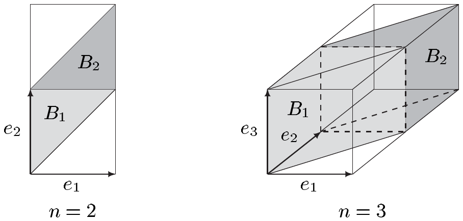

5.18 定理（斯坦豪斯） 对每个满足 $ \lambda_n(A) > 0 $ 的 $ A \in \mathcal{L}(n) $，集合 $ A - A $ 是 $ 0 $ 的邻域。

证明 设 $ A \in \mathcal{L}(n) $ 且 $ \lambda_n(A) > 0 $。通过取适当的 $ k \in \mathbb{N}^{\times} $ 并用 $ A \cap k\mathbb{B}^n $ 替换 $ A $，我们可以假定 $ \lambda_n(A) < \infty $。

$ \lambda_n $ 的正则性保证存在紧集 $ K $ 与开集 $ O $，使得 $ K \subset A \subset O $，并且

\[ 0 < \lambda_n(K) < \lambda_n(O) < 2\lambda_n(K) . \tag{5.10} \]

由于 $ K \subset O $ 且 $ K $ 是紧致的，我们有 $ \delta := d(K, O^{c}) > 0 $；见例 III.3.9(c)。

我们断言，任何 $ x \in \delta\mathbb{B}^n $ 都属于 $ K - K $（从而也属于 $ A - A $，而这正是我们所需要的）。因为，反设 $ K $ 与 $ x + K $ 不交，其中 $ x \in \delta\mathbb{B}^n $。由于 $ \lambda_n $ 是可加的且平移不变的，这给出

\[ \lambda_n(K \cup (x + K)) = \lambda_n(K) + \lambda_n(x + K) = 2\lambda_n(K) . \tag{5.11} \]

同时，由 $ \delta $ 的定义，$ x + K \subset O $，从而 $ K \cup (x + K) \subset O $。于是 (5.11) 蕴含 $ \lambda_n(O) \ge 2\lambda_n(K) $，这与 (5.10) 矛盾。■

##### 勒贝格测度的一个刻画

下一个定理特别表明，勒贝格测度在相差一个归一化常数的意义下由平移不变性确定。

5.19 定理 设 $ \mu $ 是 $ \mathcal{B}^n $ 或 $ \mathcal{L}(n) $ 上的平移不变的局部有限测度。则分别有 $ \mu = \alpha_n \beta_n $ 或 $ \mu = \alpha_n \lambda_n $，其中 $ \alpha_n := \mu([0, 1)^n) $。

证明 (i) 作为第一步，我们将证明

\[ \mu([a, b)) = \alpha_n \operatorname{vol}_n([a, b)) \quad \text{对 } a, b \in \mathbb{R}^n . \]

首先设 $ n = 1 $，并对 $ s > 0 $ 令 $ g(s) := \mu([0, s)) $。则 $ g: (0, \infty) \to (0, \infty) $ 是递增的，而 $ \mu $ 的平移不变性蕴含：对 $ s, t \in (0, \infty) $，

\[ \begin{aligned} g(s + t) &= \mu([0, s + t)) = \mu([0, s) \cup [s, s + t)) \\ &= \mu([0, s)) + \mu([s, s + t)) = \mu([0, s)) + \mu([0, t)) \\ &= g(s) + g(t) . \end{aligned} \]

习题 5 随后表明，对 $ s > 0 $ 有 $ g(s) = s g(1) $。由于 $ s = \operatorname{vol}_1([0, s)) $ 且 $ \alpha_1 = \mu([0, 1)) $，这蕴含

\[ \mu([0, s)) = g(s) = s g(1) = \operatorname{vol}_1([0, s)) \alpha_1 \quad \text{对 } s > 0 , \]

并且对 $ \alpha, \beta \in \mathbb{R} $，我们得到

\[ \mu([\alpha, \beta)) = \mu([0, \beta - \alpha)) = \alpha_1 \operatorname{vol}_1([0, \beta - \alpha)) = \alpha_1 \operatorname{vol}_1([\alpha, \beta)) \tag{5.12} \]

为处理 $ n \ge 2 $ 的情形，我们固定 $ a', b' \in \mathbb{R}^{n-1} $ 并令

\[ \mu_1([\alpha, \beta)) := \mu([\alpha, \beta) \times [a', b')) \quad \text{对 } \alpha, \beta \in \mathbb{R} . \]

习题 7 与 (5.12) 蕴含

\[ \mu_1([\alpha, \beta)) = \mu_1([0, 1)) \operatorname{vol}_1([\alpha, \beta)) \quad \text{对 } \alpha, \beta \in \mathbb{R} . \]

取 $ a = (a_1, \ldots, a_n) \in \mathbb{R}^n $、$ b = (b_1, \ldots, b_n) \in \mathbb{R}^n $，并令 $ a' = (a_2, \ldots, a_n) $、$ b' = (b_2, \ldots, b_n) $。则

\[ \begin{aligned} \mu([a, b)) &= \mu([a_1, b_1) \times [a', b')) = \mu_1([a_1, b_1)) \\ &= \operatorname{vol}_1([a_1, b_1)) \mu_1([0, 1)) \\ &= \operatorname{vol}_1([a_1, b_1)) \mu([0, 1) \times [a', b')) . \end{aligned} \]

一个简单的归纳论证现在给出

\[ \mu([a, b)) = \mu([0, 1)^n) \prod_{j=1}^{n} \operatorname{vol}_1([a_j, b_j)) = \alpha_n \operatorname{vol}_n([a, b)) . \]

(ii) 设 $ A \in \mathcal{B}^n $［或 $ A \in \mathcal{L}(n) $］，并设 $ (I_k) $ 是 $ \mathbb{J}_\ell(n) $ 中覆盖 $ A $ 的序列。由 (i) 推出

\[ \mu(A) \le \sum_k \mu(I_k) = \alpha_n \sum_k \lambda_n(I_k) . \]

因此，由命题 3.4 我们得到

\[ \mu(A) \le \alpha_n \lambda_n^{*}(A) = \alpha_n \lambda_n(A) . \]

(iii) 现在设 $ B \in \mathcal{B}^n $［或 $ B \in \mathcal{L}(n) $］有界。存在 $ I \in \mathbb{J}_\ell(n) $，使得 $ B \subset I \subset \overline{I} $。由于 $ I $ 是紧致的且 $ \mu $ 是局部有限的，注 5.3(a) 表明 $ \mu(B) < \infty $。此外由定理 5.1(iv) 有 $ \lambda_n(B) < \infty $，因此命题 2.3(ii) 给出

\[ \mu(I \setminus B) = \mu(I) - \mu(B) \quad \text{且} \quad \lambda_n(I \setminus B) = \lambda_n(I) - \lambda_n(B) , \]

并结合 (ii) 得到

\[ \mu(I) - \mu(B) = \mu(I \setminus B) \le \alpha_n \lambda_n(I \setminus B) = \alpha_n \lambda_n(I) - \alpha_n \lambda_n(B) . \]

由 (i) 有 $ \mu(I) = \alpha_n \lambda_n(I) $，从而推出不等式 $ \mu(B) \ge \alpha_n \lambda_n(B) $。结合 (ii)，我们便得到：对每个有界的 $ B \in \mathcal{B}^n $［或 $ B \in \mathcal{L}(n) $］，有 $ \mu(B) = \alpha_n \lambda_n(B) $。

(iv) 最后取任意的 $ A \in \mathcal{B}^n $［或 $ A \in \mathcal{L}(n) $］，并对 $ j \in \mathbb{N} $ 令 $ B_j := A \cap \mathbb{B}^n(0, j) $。序列 $ (B_j) $ 递增且覆盖 $ A $；此外每个 $ B_j $ 都是 $ \mathbb{R}^n $ 中的有界博雷尔［或勒贝格］集。应用 (iii) 与命题 2.3(iv)，我们看到

\[ \mu(A) = \lim_j \mu(B_j) = \alpha_n \lim_j \lambda_n(B_j) = \alpha_n \lambda_n(A) , \]

这就完成了证明。■

5.20 注 在刚刚证明的定理中，我们不能放宽 $ \mu $ 局部有限这一假设。

证明 显然，在博雷尔可测集或勒贝格可测集上的计数测度 $ \mathcal{H}^0 $ 是平移不变的。然而，它不是这两种测度中任何一个的倍数。■

##### 勒贝格测度在刚体运动下的不变性

定理 5.19 使得我们可以比较 $ n $ 维勒贝格测度与豪斯多夫测度。为此我们需要一个引理：

5.21 引理 $ \mathbb{R}^n $ 上的 $ n $ 维豪斯多夫测度 $ \mathcal{H}^n $ 是局部有限的，并且满足 $ \mathcal{H}^n([0, 1)^n) > 0 $。

证明 (i) 由定理 4.3 与例 4.4(c)，我们知道每个博雷尔集都是 $ \mathcal{H}^n $-可测的。设 $ K \subset \mathbb{R}^n $ 是紧致的，并取 $ \varepsilon > 0 $。选取 $ a > 0 $ 使得 $ K \subset [-a, a]^n $，并选取 $ m \in \mathbb{N} $ 使得 $ m \ge 2a\sqrt{n}/\varepsilon $。把 $ [-a, a]^n $ 细分为 $ m^n $ 个边长为 $ 2a/m $ 的小立方体 $ W_j $。则 $ \operatorname{diam}(W_j) = 2a\sqrt{n}/m \le \varepsilon $，因此

\[ \sum_{j=1}^{m^n} \left[ \operatorname{diam}(W_j) \right]^n = (2a)^n n^{n/2} . \]

习题 3.4 表明 $ \mathcal{H}^n_*(K) \le \mathcal{H}^n_*([-a, a]^n) \le (2a)^n n^{n/2} $。现在由注 5.3(b) 得到 $ \mathcal{H}^n $ 是局部有限的。

(ii) 仍需验证 $ \mathcal{H}^n([0, 1)^n) > 0 $。取 $ \varepsilon > 0 $，并设 $ (U_j) $ 是 $ \mathbb{R}^n $ 中覆盖 $ [0, 1)^n $ 的开集序列，且满足 $ \operatorname{diam}(U_j) < \varepsilon $。对每个 $ j \in \mathbb{N} $，存在 $ I_j \in \mathbb{J}(n) $，使得 $ I_j $ 的每条棱长都不超过 $ 2\operatorname{diam}(U_j) $，并且 $ U_j \subset I_j $。由此推出

\[ 1 = \lambda_n([0, 1)^n) \le \sum_j \operatorname{vol}_n(I_j) \le 2^n \sum_j \left[ \operatorname{diam}(U_j) \right]^n , \]

从而 $ 2^{-n} \le \mathcal{H}^n_\varepsilon([0, 1)^n) $。这意味着 $ \mathcal{H}^n([0, 1)^n) \ge 2^{-n} > 0 $。■

5.22 推论 $ \mathbb{R}^n $ 上的 $ n $ 维豪斯多夫测度 $ \mathcal{H}^n $ 是 $ \alpha_n \lambda_n $ 的延拓，其中 $ \alpha_n := \mathcal{H}^n([0, 1)^n) $；也就是说，每个 $ A \in \mathcal{L}(n) $ 都是 $ \mathcal{H}^n $-可测的，并且 $ \mathcal{H}^n(A) = \alpha_n \lambda_n(A) $。

证明 (i) 引理 5.21、习题 3.4 以及博雷尔集的 $ \mathcal{H}^n $-可测性表明，$ \mathcal{H}^n $ 是 $ \mathcal{B}^n $ 上的平移不变的局部有限测度。于是由定理 5.19，$ \mathcal{H}^n|\mathcal{B}^n = \alpha_n \beta_n $。

(ii) 设 $ N $ 是勒贝格测度为零的集合，并取 $ \varepsilon > 0 $。则存在 $ \mathbb{J}(n) $ 中的序列 $ (I_j) $，使得 $ \sum_j \operatorname{vol}_n(I_j) < \varepsilon $ 且 $ N \subset \bigcup_j I_j $。由 (i) 推出

\[ \mathcal{H}^n_*(I_j) = \mathcal{H}^n(I_j) = \alpha_n \lambda_n(I_j) , \]

并且我们得到

\[ \mathcal{H}^n_*(N) \le \mathcal{H}^n_* \left( \bigcup_j I_j \right) \le \sum_j \mathcal{H}^n_*(I_j) = \alpha_n \sum_j \operatorname{vol}_n(I_j) < \alpha_n \varepsilon . \]

因此 $ N $ 是 $ \mathcal{H}^n $-零集。

(iii) 设 $ A \in \mathcal{L}(n) $。根据定理 5.7，我们可以把 $ A $ 写成 $ A = S \cup N $，其中 $ S \in \mathcal{B}^n $ 且 $ N $ 的勒贝格测度为零。因此 $ A $ 是 $ \mathcal{H}^n $-可测的。并且由 (i) 与 (ii) 推出

\[ \begin{aligned} \mathcal{H}^n(A) &\le \mathcal{H}^n(S) + \mathcal{H}^n(N) = \mathcal{H}^n(S) = \alpha_n \lambda_n(S) \le \alpha_n \lambda_n(A) , \\ \alpha_n \lambda_n(A) &= \alpha_n \lambda_n(S) = \mathcal{H}^n(S) \le \mathcal{H}^n(A) , \end{aligned} \]

这两式共同表明 $ \mathcal{H}^n(A) = \alpha_n \lambda_n(A) $。■

5.23 推论 勒贝格测度与博雷尔–勒贝格测度是运动不变量，也就是说，它们在等距下保持不变。用符号表示，$ \mathbb{R}^n $ 的任何等距 $ \varphi $ 都满足 $ \lambda_n = \lambda_n \circ \varphi $ 与 $ \beta_n = \beta_n \circ \varphi $。

证明 设 $ \varphi $ 是 $ \mathbb{R}^n $ 的等距，并取 $ A \in \mathcal{L}(n) $［或 $ A \in \mathcal{B}^n $］。根据结论 VI.2.4(b)，$ \varphi $ 与 $ \varphi^{-1} $ 都是利普希茨连续的，因此我们从定理 5.12［或习题 1.6(b)］得到 $ \varphi(A) \in \mathcal{L}(n) $［或 $ \varphi(A) \in \mathcal{B}^n $］。其次，由习题 3.4(c)，$ \mathcal{H}^n_* $ 在等距下不变；因此引理 5.21 与推论 5.22 表明

\[ \alpha_n \lambda_n(\varphi(A)) = \mathcal{H}^n(\varphi(A)) = \mathcal{H}^n(A) = \alpha_n \lambda_n(A) . \quad \blacksquare \]

5.24 注 (a) 尽管推论 5.22 讲的是延拓，但实际上 $ \mathcal{H}^n $ 与 $ \lambda_n $ 的定义域是重合的。此外，比例常数 $ \alpha_n = \mathcal{H}^n([0, 1)^n) $ 等于 $ 2^n/\omega_n $，其中 $ \omega_n = \pi^{n/2}/\Gamma((n/2) + 1) $。这些断言的证明见 [Rog70, 定理 30 及随后的注]。

(b) $ \mathbb{R}^n $ 上的勒贝格测度存在真延拓，这些延拓在等距下不变；见 [Els99]。■

##### 线性映射的换元法则

设 $ \varphi $ 是 $ \mathbb{R}^n $ 的等距且 $ \varphi(0) = 0 $。习题 VII.9.1 与 VII.9.2 表明 $ \varphi $ 是自同构，并且 $ |\det \varphi| = 1 $。因此由推论 5.23 可得

\[ \lambda_n(\varphi(A)) = |\det \varphi| \lambda_n(A) \quad \text{对 } A \in \mathcal{L}(n) . \]

我们现在的目标是把这一公式从等距推广到任意的线性映射 $ T \in \mathcal{L}(\mathbb{R}^n) $。在下一章中，我们将得到一个更加深远的推广：其中 $ \varphi $ 被 $ C^1 $ 微分同胚替换，而 $ \lambda_n $ 被勒贝格积分替换。

5.25 定理 设 $ T \in \mathcal{L}(\mathbb{R}^n) $ 是线性映射。则

\[ \lambda_n(T(A)) = |\det T| \lambda_n(A) \quad \text{对 } A \in \mathcal{L}(n) . \tag{5.13} \]

证明 我们知道 $ T $ 是利普希茨连续的；见结论 VI.2.4(b)。因此由定理 5.12，对每个 $ A \in \mathcal{L}(n) $，$ T(A) $ 都是勒贝格可测的。

(i) 若 $ T $ 不是 $ \mathbb{R}^n $ 的自同构，则 $ \det T = 0 $，且 $ T(A) $ 落在 $ \mathbb{R}^n $ 的一个 $ (n-1) $ 维超平面中。由于 $ \lambda_n $ 是运动不变量，我们可以假定 $ T(A) $ 落在某个坐标超平面中。于是例 5.2 表明 $ T(A) $ 的勒贝格 $ n $-测度为零，从而在此情形下证明了 (5.13)。

(ii) 反之，设 $ T \in \mathcal{L}\mathrm{aut}(\mathbb{R}^n) $，并对 $ A \in \mathcal{L}(n) $ 定义 $ \mu(A) := \lambda_n(T(A)) $。不难验证 $ \mu $ 是 $ \mathcal{L}(n) $ 上的平移不变的局部有限测度。定理 5.19 于是表明 $ \mu = \mu([0, 1)^n) \lambda_n $；这就会蕴含 (5.13)，只要我们证明

\[ \lambda_n(T([0, 1)^n)) = |\det T| . \tag{5.14} \]

(iii) 设有序 $ n $ 元组 $ [Te_1, \ldots, Te_n] $ 是 $ \mathbb{R}^n $ 的标准基 $ [e_1, \ldots, e_n] $ 的一个排列。则 $ T([0, 1)^n) = [0, 1)^n $ 且 $ |\det T| = 1 $。因此 (5.14) 成立，从而 (5.13) 也成立。

(iv) 设 $ \alpha \in \mathbb{R}^{\times} $，并如下定义 $ T $：

\[ Te_j = \begin{cases} \alpha e_1 , & j = 1 , \\ e_j , & j \in \{2, \ldots, n\} . \end{cases} \]

则 $ |\det T| = |\alpha| $，并且

\[ T([0, 1)^n) = \begin{cases} [0, \alpha) \times [0, 1)^{n-1} , & \alpha > 0 , \\ (\alpha, 0] \times [0, 1)^{n-1} , & \alpha < 0 . \end{cases} \]

于是 (5.14) 再次成立，从而 (5.13) 也成立。

(v) 最后设 $ n \ge 2 $，并令

\[ Te_j = \begin{cases} e_1 + e_2 , & j = 1 , \\ e_j , & j \in \{2, \ldots, n\} . \end{cases} \]

则 $ \det T = 1 $，并且

\[ T([0, 1)^n) = \{ (y_1, \ldots, y_n) \in \mathbb{R}^n ;\ 0 \le y_1 \le y_2 < y_1 + 1, \ y_j \in [0, 1) \text{ 对 } j \ne 2 \} . \]

令 $ B_1 := \{ y \in T([0, 1)^n) ;\ y_2 < 1 \} $、$ B_2 := T([0, 1)^n) \setminus B_1 $，我们看到 $ B_1 \cup (B_2 - e_2) = [0, 1)^n $ 且 $ B_1 \cap (B_2 - e_2) = \varnothing $。

$ \lambda_n $ 的平移不变性于是给出

\[ \begin{aligned} \lambda_n(T([0, 1)^n)) &= \lambda_n(B_1 \cup B_2) = \lambda_n(B_1) + \lambda_n(B_2) \\ &= \lambda_n(B_1) + \lambda_n(B_2 - e_2) = \lambda_n(B_1 \cup (B_2 - e_2)) = \lambda_n([0, 1)^n) . \end{aligned} \]

于是 (5.14) 再次成立，从而 (5.13) 也成立。

(vi) 现在考虑 $ \mathbb{R}^n $ 的任意自同构 $ T $。线性代数的标准形定理（见 [Koe83] 中的 § 2.6）表明，$ T $ 可以写成映射 $ T_1, \ldots, T_k \in \mathcal{L}\mathrm{aut}(\mathbb{R}^n) $ 的复合 $ T = T_1 \circ \cdots \circ T_k $，其中每个映射都具有 (iii)–(v) 中所讨论的某个线性映射的形式。因此

\[ \begin{aligned} \lambda_n(T(A)) &= \lambda_n((T_1 \circ T_2 \circ \cdots \circ T_k)(A)) \\ &= |\det T_1| \lambda_n((T_2 \circ \cdots \circ T_k)(A)) = \cdots \\ &= |\det T_1| \cdot \cdots \cdot |\det T_k| \lambda_n(A) = |\det T| \lambda_n(A) \end{aligned} \]

对 $ A \in \mathcal{L}(n) $。■

5.26 注 (a) 设 $ [t_1, \ldots, t_n] \in \mathbb{R}^{n \times n} $ 是 $ T \in \mathcal{L}(\mathbb{R}^n) $ 关于典范基的矩阵表示 $ [T] $ 的各列。则

\[ T([0, 1)^n) = \{ x_1 t_1 + \cdots + x_n t_n ;\ 0 \le x_j < 1, \ 1 \le j \le n \} = P(t_1, \ldots, t_n) \]

是由向量 $ t_1, \ldots, t_n $ 生成的平行多面体。定理 5.25 表明，$ |\det T| $ 就是平行多面体 $ P(t_1, \ldots, t_n) $ 的体积，也就是它的勒贝格 $ n $-测度。

(b) 对 $ r \ge 0 $，有

\[ \lambda_n(r\mathbb{B}^n) = r^n \lambda_n(\mathbb{B}^n) . \]

证明 令 $ T := r\mathbf{1}_n $，则 $ \det T = r^n $ 且 $ T(\mathbb{B}^n) = r\mathbb{B}^n $。结论由定理 5.25 推出。■

##### 没有勒贝格测度的集合

我们现在转向这样一个问题：$ \sigma $-代数 $ \mathcal{L}(n) $ 是否与 $ \mathbb{R}^n $ 的幂集重合，或者说，是否存在不是勒贝格可测的集合。为了回答这个问题，我们必须诉诸选择公理（见注 I.6.10 与 5.31(d)）。在这方面，斯坦豪斯定理（定理 5.18）将非常有用。

我们首先考虑阿贝尔群 $ (\mathbb{R}^n, +) $ 模子群 $ (\mathbb{Q}^n, +) $ 的商群 $ \mathbb{R}^n/\mathbb{Q}^n $。由选择公理，我们可以从每个陪集 $ [x] $ 中选取一个代表元，这些代表元合起来构成 $ \mathbb{R}^n $ 的一个子集 $ R $。更确切地说，选择公理保证存在映射 $ \varphi: \mathbb{R}^n/\mathbb{Q}^n \to \mathbb{R}^n $，使得 $ \varphi([x]) \in [x] $。我们令

\[ R := \mathrm{im}(\varphi) = \{ x \in \mathbb{R}^n ;\ \exists\, [u] \in \mathbb{R}^n/\mathbb{Q}^n \text{ 使得 } x = \varphi([u]) \} . \tag{5.15} \]

5.27 注 (a) 设 $ x, y \in R $ 满足 $ x - y \in \mathbb{Q}^n $。则 $ x = y $。

证明 对 $ x \in R $ 以及如 (5.15) 中的 $ [u] $，我们有 $ x = \varphi([u]) \in [u] $，故 $ [u] = [x] $，从而 $ x = \varphi([x]) $。类似地，$ y = \varphi([y]) $。但 $ x - y \in \mathbb{Q}^n $ 蕴含 $ [x] = [y] $，因此 $ x = \varphi([x]) = \varphi([y]) = y $。■

(b) 对每个 $ B \subset R $，有 $ (B - B) \cap \mathbb{Q}^n = \{0\} $。

证明 这由 (a) 推出。■

5.28 定理 对每个满足 $ \lambda_n(A) > 0 $ 的 $ A \in \mathcal{L}(n) $，存在 $ B \subset A $，使得 $ B \notin \mathcal{L}(n) $。

证明 固定满足 $ \lambda_n(A) > 0 $ 的 $ A \in \mathcal{L}(n) $，并定义 $ B := \{ b \in R ;\ [b] \cap A \ne \varnothing \} $。在构造 $ R $ 时，只要 $ [b] \cap A \ne \varnothing $，我们就要求 $ b \in R $ 落在 $ A $ 中，从而保证 $ B $ 是 $ A $ 的子集。假设 $ B $ 是勒贝格可测的；则它的测度为零，否则定理 5.18 会蕴含 $ B - B $ 是 $ \mathbb{R}^n $ 中 $ 0 $ 的邻域，这与注 5.27(b) 矛盾。因为 $ \lambda_n $ 是平移不变的，所以每个形如 $ B + r $（其中 $ r \in \mathbb{Q}^n $）的集合的测度也为零。

现在考虑 $ a \in A $，并取 $ b := \varphi([a]) \in R $。则 $ b \in [a] $，从而 $ a \in [b] $。因此 $ a \in [b] \cap A $，也就是说 $ b \in B $，并且

\[ A \subset \bigcup_{b \in B} [b] = \bigcup_{r \in \mathbb{Q}^n} (B + r) . \]

$ \lambda_n $ 的完备性蕴含 $ A $ 的测度也为零，这与我们的假设矛盾。■

5.29 推论 博雷尔–勒贝格测度空间 $ (\mathbb{R}^n, \mathcal{B}^n, \beta_n) $ 不是完备的。

证明 (i) 我们首先考虑 $ n = 1 $ 的情形。设 $ C $ 为康托尔集，$ f: [0, 1] \to [0, 1] $ 为习题 III.3.8 中的康托尔函数。由于 $ C $ 是紧致的，它是博雷尔集；习题 4.7 告诉我们它的测度为零。下面的习题 17 表明，由 $ g(x) = x + f(x) $ 给出的映射 $ g: [0, 1] \to [0, 2] $ 是同胚，并且 $ g(C) $ 的测度为 1。由定理 5.28，$ g(C) $ 包含一个甚至不是勒贝格可测的集合 $ B $。我们断言 $ N_1 := g^{-1}(B) \subset C $ 不是博雷尔可测的。事实上，由于 $ g $ 是同胚，$ g^{-1} $ 是博雷尔可测映射，并且我们有

\[ B = g(N_1) = (g^{-1})^{-1}(N_1) . \]

若 $ N_1 $ 是博雷尔可测的，则 $ B $ 也会是博雷尔可测的，这与假设矛盾。

(ii) 当 $ n \ge 2 $ 时，令 $ A := C \times \mathbb{R}^{n-1} $、$ N_n := N_1 \times \mathbb{R}^{n-1} $。则推论 1.18 与习题 1 表明 $ A $ 的博雷尔 $ n $-测度为零。如果我们假设 $ N_n \in \mathcal{B}^n $，则由推论 1.18 与命题 1.19 可推出 $ N_1 $ 属于 $ \mathcal{B}^1 $，这与 (i) 矛盾。这就完成了证明。■

5.30 推论 博雷尔 $ \sigma $-代数是勒贝格 $ \sigma $-代数的真 $ \sigma $-子代数。

证明 设 $ A $ 与 $ N_n $ 如推论 5.29 的证明中那样。则 $ \lambda_n(A) = 0 $，而 $ \lambda_n $ 的完备性蕴含 $ N_n $ 属于 $ \mathcal{L}(n) $，即 $ N_n \in \mathcal{L}(n) \setminus \mathcal{B}^n $。■

5.31 注 (a) 设 $ (X, \le) $ 是有序集。若 $ Y $ 中任意两个元素都可比较，也就是说，若 $ (x, y) \in Y \times Y $ 总蕴含 $ (x \le y) \lor (y \le x) $，则称 $ X $ 的非空子集 $ Y $ 是**全序的**。若 $ x \ge m $ 蕴含 $ x \le m $，也就是说，若 $ X $ 中没有严格大于\footnote{注意，一个集合一般可以有多个极大元。} $ m $ 的元素，则称 $ X $ 的元素 $ m $ 为**极大元**。**佐恩引理**的表述是：**若 $ X $ 是有序集，且 $ X $ 的每个全序子集都有上界，则 $ X $ 有极大元。**可以证明（见 [Dug66] 中的定理 II.2.1），佐恩引理等价于选择公理。

(b) 设 $ \mathcal{V} $ 是域上的非平凡向量空间。则 $ \mathcal{V} $ 有基。

证明 其证明（用到佐恩引理）可参见 [Art93] 附录中的命题 (1.10)。■

(c) 设 $ B \subset \mathbb{R} $ 是 $ \mathbb{R} $ 作为 $ \mathbb{Q} $ 上向量空间的基。取 $ b_0 \in B $，并令 $ M := \mathrm{span}(B \setminus \{b_0\}) $。则 $ M $ 不是勒贝格可测的。

证明 假设 $ M $ 属于 $ \mathcal{L}(1) $。则 $ \lambda_1(M) > 0 $，因为否则由 $ \lambda_1 $ 的平移不变性可推出，对每个 $ r \in \mathbb{Q} $，$ M + r b_0 $ 都是 $ \lambda_1 $-零集。然而，由于

\[ \bigcup_{r \in \mathbb{Q}} (M + r b_0) = \mathrm{span}(B) = \mathbb{R} , \]

这是不可能的。因此定理 5.18 表明 $ M - M $ 是 $ \mathbb{R} $ 中 $ 0 $ 的邻域；特别地，存在 $ r_0 \in \mathbb{Q} $ 使得 $ r_0 \ne 0 $ 且 $ r_0 b_0 \in M - M $。由于 $ M = M - M $，存在 $ k \in \mathbb{N}^{\times} $、$ r_j \in \mathbb{Q} $ 以及 $ b_j \in B $（$ j = 1, \ldots, k $），使得 $ r_0 b_0 = \sum_{j=1}^{k} r_j b_j $，这与 $ B $ 在 $ \mathbb{Q} $ 上的线性无关性矛盾。■

(d) 在定理 5.28 的证明中，我们明确使用了选择公理。(c) 的证明同样依赖于选择公理；见 (a) 与 (b)。事实上，可以证明（见 [BS79]、[Sol70]）：如果在不包含选择公理的公理集合论中工作，原则上不可能具体指定一个不是勒贝格可测的集合。■
