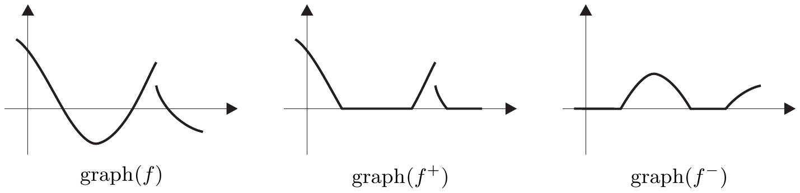
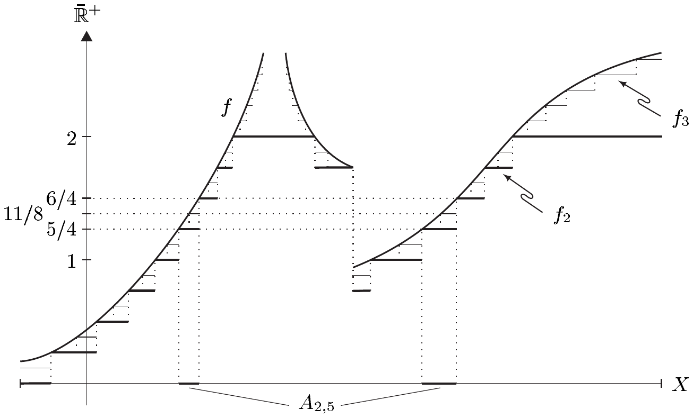

## 1 可测函数

设 $ (X,\mathcal{A},\mu) $ 是测度空间且 $ A \in \mathcal{A} $。与初等几何构造的类比使人把特征函数 $ \chi_A $ 关于测度 $ \mu $ 在 $ X $ 上的积分定义为 $ \int_X \chi_A \, d\mu := \mu(A) $。显然，这只有在 $ A $ 属于 $ \mathcal{A} $ 时才有意义。因此函数 $ f = \chi_A $ 必须在这个意义下与底层的测度空间 $ (\mathcal{A},\mu) $“相容”。对于更复杂的函数，适当的逼近论证使人们可以推广函数与测度之间的这种相容性概念，从而引出函数的可测性这一概念。

本节中总设

- $ (X,\mathcal{A},\mu) $ 是完备的 $ \sigma $-有限测度空间；$ E = (E,|\cdot|) $ 是 Banach 空间。

##### 简单函数与可测函数

设 $ \mathrm{E} $ 是 $ X $ 的每个点上或真或假的性质。若存在 $ \mu $-零集 $ N $ 使得 $ \mathrm{E}(x) $ 对每个 $ x \in N^c $ 为真，我们就说 $ \mathrm{E} $ **$ \mu $-几乎处处**成立，或者说**对 $ \mu $-几乎每个 $ x \in X $** 成立。“几乎每个”与“几乎处处”都缩写为“a.e.”。

1.1 例 (a) 对 $ f, g \in \mathbb{R}^X $，若存在 $ \mu $-零集 $ N $ 使得 $ f(x) \ge g(x) $ 对每个 $ x \in N^c $ 成立，我们就记“$ f \ge g $ $ \mu $-a.e.”。

(b) 设 $ f_j, f \in E^X $，$ j \in \mathbb{N} $。则 $ (f_j) $ $ \mu $-a.e. 收敛于 $ f $ 当且仅当存在 $ \mu $-零集 $ N $ 使得 $ f_j(x) \to f(x) $ 对 $ x \in N^c $ 成立。

(c) 函数 $ f \in E^X $ 是 $ \mu $-a.e. 有界的，当且仅当存在 $ \mu $-零集 $ N $ 与 $ M \ge 0 $ 使得 $ |f(x)| \le M $ 对每个 $ x \in N^c $ 成立。

(d) 若 $ \mathrm{E} $ 在 $ \mu $-a.e. 成立，则集合 $ \{ x \in X ;\ \mathrm{E}(x) \text{ 不成立} \} $ 是 $ \mu $-零集。

证明 这由 $ (X,\mathcal{A},\mu) $ 的完备性推出。■

(e) 设 $ (X,\mathcal{B},\nu) $ 是不完备的测度空间。则 $ X $ 上存在性质 $ \mathrm{E} $，它 $ \nu $-几乎处处成立，而集合 $ \{ x \in X ;\ \mathrm{E}(x) \text{ 不成立} \} $ 却不是 $ \nu $-零集。

证明 由于 $ (X,\mathcal{B},\nu) $ 不完备，存在 $ \nu $-零集 $ N $ 与 $ M \subset N $ 使得 $ M \notin \mathcal{B} $。若令 $ f := \chi_M $，则 $ f = 0 $ 在 $ \nu $-几乎处处成立，而 $ \{ x \in X ;\ f(x) \neq 0 \} = M $ 不是 $ \nu $-零集。■

我们称 $ f \in E^X $ 是 **$ \mu $-简单的**\footnote{若测度空间的标识是清楚的，我们就把函数称为\textbf{简单}的而不说 $ \mu $-简单的；对即将引入的 $ \mu $-可测函数也类似。}，若 $ f(X) $ 有限、$ f^{-1}(e) \in \mathcal{A} $ 对每个 $ e \in E $ 成立且 $ \mu\bigl(f^{-1}(E \setminus \{0\})\bigr) < \infty $。我们用 $ \mathcal{S}(X,\mu,E) $ 表示从 $ X $ 到 $ E $ 的所有 $ \mu $-简单函数之集\footnote{我们曾把跳跃连续函数空间记作 $ \mathcal{S}(I,E) $，但这不会引起混淆。}。

称函数 $ f \in E^X $ 为 **$ \mu $-可测的**，若存在 $ \mathcal{S}(X,\mu,E) $ 中的序列 $ (f_j) $ 使得 $ f_j \to f $ $ \mu $-几乎处处（$ j \to \infty $）。我们设\footnote{显然，函数的可测性定义即使在不完备的测度空间上也有意义。}

\[ \mathcal{L}_0(X,\mu,E) := \{ f \in E^X ;\ f \text{ 是 } \mu\text{-可测的} \} . \]

1.2 注 (a) 我们有向量子空间的包含关系

\[ \mathcal{S}(X,\mu,E) \subset \mathcal{L}_0(X,\mu,E) \subset E^X . \]

(b) 设 $ j = 0,\ldots,m $（其中 $ m \in \mathbb{N} $），考虑满足 $ \mu(A_j) < \infty $ 的 $ e_j \in E $ 与 $ A_j \in \mathcal{A} $。则 $ f := \sum_{j=0}^{m} e_j \chi_{A_j} $ 属于 $ \mathcal{S}(X,\mu,E) $。若

\[ e_j \neq 0 \quad \text{对 } j = 0,\ldots,m , \]

\[ e_j \neq e_k \quad \text{对 } j \neq k , \]

\[ A_j \cap A_k = \varnothing \quad \text{对 } j \neq k , \]

我们就称这是 $ f $ 的 **正规形**。

(c) 每个简单函数都有唯一的正规形，且\footnote{比较习题 VI.6.8 的脚注。}

\[ \mathcal{S}(X,\mu,E) = \left\{ \sum_{j=1}^{m} e_j \chi_{A_j} \ ;\ m \in \mathbb{N},\ e_j \in E \setminus \{0\},\ A_j \in \mathcal{A},\ \mu(A_j) < \infty,\ A_j \cap A_k = \varnothing \text{ 对 } j \neq k \right\} . \]

证明 设 $ f \in \mathcal{S}(X,\mu,E) $。则存在 $ m \in \mathbb{N} $ 与 $ E $ 中两两不同的元素 $ e_0,\ldots,e_m $ 使得 $ f(X) \setminus \{0\} = \{e_0,\ldots,e_m\} $。令 $ A_j := f^{-1}(e_j) $，则 $ A_j \in \mathcal{A} $、$ \mu(A_j) < \infty $ 且 $ A_j \cap A_k = \varnothing $（$ j \neq k $）。容易验证

\[ \sum_{j=0}^{m} e_j \chi_{A_j} \]

是 $ f $ 的唯一正规形。第二部分现在由 (b) 推出。■

(d) 设 $ f \in E^X $ 与 $ g \in \mathbb{K}^X $ 是 $ \mu $-简单的［或 $ \mu $-可测的］。则 $ |f| \in \mathbb{R}^X $ 与 $ gf \in E^X $ 也是 $ \mu $-简单的［或 $ \mu $-可测的］。特别地，$ \mathcal{S}(X,\mu,\mathbb{K}) $ 与 $ \mathcal{L}_0(X,\mu,\mathbb{K}) $ 是 $ \mathbb{K}^X $ 的子代数。

(e) 设 $ A \in \mathcal{A} $ 与 $ f \in E^X $，作限制 $ \nu := \mu \mid (\mathcal{A} \mid A) $（见习题 IX.1.7）。则

\[ f \mid A \in \mathcal{S}(A,\nu,E) \iff \chi_A f \in \mathcal{S}(X,\mu,E) , \]

\[ f \mid A \in \mathcal{L}_0(A,\nu,E) \iff \chi_A f \in \mathcal{L}_0(X,\mu,E) . \]

证明 验证很简单，留给读者。■

(f) 设 $ f \in \mathcal{L}_0(X,\mu,\mathbb{K}) $ 且 $ A := [f \neq 0] $。再通过

\[ g(x) := \begin{cases} 1/f(x) & \text{若 } x \in A , \\ 0 & \text{若 } x \notin A \end{cases} \]

定义 $ g \in \mathbb{K}^X $。

则 $ g $ 是 $ \mu $-可测的。

证明 $ f $ 的可测性蕴含存在 $ \mu $-零集 $ N $ 与 $ \mathcal{S}(X,\mu,\mathbb{K}) $ 中的序列 $ (\varphi_j) $ 使得 $ \varphi_j(x) \to f(x) $ 对 $ x \in N^c $ 成立。我们设

\[ \psi_j(x) := \begin{cases} 1/\varphi_j(x) & \text{若 } \varphi_j(x) \neq 0 , \\ 0 & \text{若 } \varphi_j(x) = 0 , \end{cases} \]

对 $ x \in X $、$ j \in \mathbb{N} $。由 (c) 与 (d)，$ (\chi_A \psi_j) $ 是 $ \mathcal{S}(X,\mu,\mathbb{K}) $ 中的序列，且容易验证 $ (\chi_A \psi_j)(x) \to g(x) $ 对每个 $ x \in N^c $ 成立（见命题 II.2.6）。■

(g) 设 $ e \in E \setminus \{0\} $，并设 $ \mu(X) = \infty $。则 $ e\chi_X $ 属于 $ \mathcal{L}_0(X,\mu,E) $ 但不属于 $ \mathcal{S}(X,\mu,E) $。

证明 显然 $ e\chi_X $ 不是 $ \mu $-简单的。由于 $ X $ 是 $ \sigma $-有限的，存在 $ \mathcal{A} $ 中的序列 $ (A_j) $ 使得 $ \bigcup_j A_j = X $ 且 $ \mu(A_j) < \infty $ 对 $ j \in \mathbb{N} $ 成立。对 $ j \in \mathbb{N} $，令 $ X_j := \bigcup_{k=0}^{j} A_k $ 与 $ \varphi_j := e\chi_{X_j} $。则 $ (\varphi_j) $ 是 $ \mathcal{S}(X,\mu,E) $ 中逐点收敛于 $ e\chi_X $ 的序列。■

##### 一个可测性判别法

称函数 $ f \in E^X $ 为 **$ \mathcal{A} $-可测的**，若 $ E $ 的开集在 $ f $ 下的原像可测，即若 $ f^{-1}(\mathcal{T}_E) \subset \mathcal{A} $，其中 $ \mathcal{T}_E $ 是 $ E $ 上的范数拓扑。若存在 $ \mu $-零集 $ N $ 使得 $ f(N^c) $ 可分，我们就说 $ f $ 是 **$ \mu $-几乎可分值的**。

1.3 注 (a) 习题 IX.1.6 表明 $ \mathcal{A} $-可测函数之集与 $ \mathcal{A} $-$ \mathcal{B}(E) $-可测函数之集一致。

(b) 可分度量空间的每个子空间都是可分的。

证明 由命题 IX.1.8，可分性等价于具有可数基。但对任意给定的子空间，拓扑空间的基经限制就给出该子空间的一个基（基数不更大）；见命题 III.2.26。■

(c) 设 $ E $ 可分且 $ f \in E^X $。则 $ f $ 是 $ \mu $-几乎可分值的。

证明 这由 (b) 推出。■

(d) 每个有限维赋范向量空间都是可分的。\footnote{比较例 V.4.3(e)。} ■

下一个结果给出 $ \mu $-可测函数的一个刻画，它除了具有理论意义之外，在判定可测性时也非常实用。

1.4 定理 $ E^X $ 中的函数是 $ \mu $-可测的当且仅当它是 $ \mathcal{A} $-可测的且 $ \mu $-几乎可分值的。

证明 “$ \Rightarrow $” 设 $ f \in \mathcal{L}_0(X,\mu,E) $。

(i) 存在 $ \mu $-零集 $ N $ 与 $ \mathcal{S}(X,\mu,E) $ 中的序列 $ (\varphi_j) $ 使得

\[ \varphi_j(x) \to f(x) \quad (j \to \infty) \quad \text{对 } x \in N^c . \tag{1.1} \]

由命题 I.6.8，$ F := \bigcup_{j=0}^{\infty} \varphi_j(X) $ 可数，因此其闭包 $ \overline{F} $ 可分。由 (1.1) 有 $ f(N^c) \subset \overline{F} $。注 1.3(b) 现在表明 $ f $ 是 $ \mu $-几乎可分值的。

(ii) 设 $ O $ 是 $ E $ 中的开集，并定义 $ O_n := \{ y \in O ;\ \operatorname{dist}(y,O^c) > 1/n \} $，$ n \in \mathbb{N}^\times $。则 $ O_n $ 开且 $ \overline{O}_n \subset O $。又设 $ x \in N^c $。由 (1.1)，$ f(x) $ 属于 $ O $ 当且仅当存在 $ n \in \mathbb{N}^\times $ 与 $ m = m(n) \in \mathbb{N}^\times $ 使得 $ \varphi_j(x) \in O_n $ 对 $ j \ge m $ 成立。因此

\[ f^{-1}(O) \cap N^c = \bigcup_{m,n \in \mathbb{N}^\times} \bigcap_{j \ge m} \varphi_j^{-1}(O_n) \cap N^c . \tag{1.2} \]

但 $ \varphi_j^{-1}(O_n) \in \mathcal{A} $（$ n \in \mathbb{N}^\times $，$ j \in \mathbb{N} $），因为 $ \varphi_j $ 是 $ \mu $-简单的。因此 (1.2) 说明 $ f^{-1}(O) \cap N^c \in \mathcal{A} $。

此外，$ \mu $ 的完备性表明 $ f^{-1}(O) \cap N $ 是 $ \mu $-零集，合起来我们得到

\[ f^{-1}(O) = (f^{-1}(O) \cap N) \cup (f^{-1}(O) \cap N^c) \in \mathcal{A} . \]

“$ \Leftarrow $” 设 $ f $ 是 $ \mu $-几乎可分值的且 $ \mathcal{A} $-可测的。

(iii) 先考虑 $ \mu(X) < \infty $ 的情形。取 $ n \in \mathbb{N} $。按假设，存在 $ \mu $-零集 $ N $ 使得 $ f(N^c) $ 可分。若 $ \{ e_j ;\ j \in \mathbb{N} \} $ 是 $ f(N^c) $ 的可数稠密子集，则族 $ \{ \mathbb{B}(e_j,1/(n+1)) ;\ j \in \mathbb{N} \} $ 覆盖集合 $ f(N^c) $，因此

\[ X = N \cup \bigcup_{j \in \mathbb{N}} f^{-1}\bigl(\mathbb{B}(e_j,1/(n+1))\bigr) . \]

由于 $ f $ 是 $ \mathcal{A} $-可测的，$ X_{j,n} := f^{-1}\bigl(\mathbb{B}(e_j,1/(n+1))\bigr) $ 对每个 $ (j,n) \in \mathbb{N}^2 $ 属于 $ \mathcal{A} $。$ \mu $ 的下连续性以及假设 $ \mu(X) < \infty $ 于是蕴含存在 $ m_n \in \mathbb{N}^\times $ 与 $ Y_n \in \mathcal{A} $ 使得

\[ \bigcup_{j=0}^{m_n} X_{j,n} = Y_n^c \quad \text{且} \quad \mu(Y_n) < \frac{1}{2^{n+1}} . \]

现在通过

\[ \varphi_n(x) := \begin{cases} e_0 & \text{若 } x \in X_{0,n} , \\ e_j & \text{若 } x \in X_{j,n} \setminus \bigcup_{k=0}^{j-1} X_{k,n} \text{ 且 } 1 \le j \le m_n , \\ 0 & \text{其他情形} \end{cases} \]

定义 $ \varphi_n \in E^X $。

显然 $ \varphi_n \in \mathcal{S}(X,\mu,E) $（$ n \in \mathbb{N} $），且

\[ |\varphi_n(x) - f(x)| < 1/(n+1) \quad \text{对 } x \in Y_n^c . \]

递减序列 $ Z_n := \bigcup_{k=0}^{\infty} Y_{n+k} $ 满足

\[ \mu(Z_n) \le \sum_{k=0}^{\infty} \mu(Y_{n+k}) \le \frac{1}{2^n} \quad \text{对 } n \in \mathbb{N} . \]

因此由 $ \mu $ 的上连续性推出 $ Z := \bigcap_{n \in \mathbb{N}} Z_n $ 是 $ \mu $-零集。现在我们设

\[ \psi_n(x) := \begin{cases} \varphi_n(x) & \text{若 } x \in Z_n^c , \\ 0 & \text{若 } x \in Z_n . \end{cases} \]

则 $ (\psi_n) $ 是 $ \mathcal{S}(X,\mu,E) $ 中的序列。又对每个 $ x \in Z^c = \bigcup_n Z_n^c $ 存在 $ m \in \mathbb{N} $ 使得 $ x \in Z_m^c $。由于 $ Z_m^c \subset Z_n^c $（$ n \ge m $）推出

\[ |\psi_n(x) - f(x)| = |\varphi_n(x) - f(x)| < 1/(n+1) . \]

总之，$ \lim \psi_n(x) = f(x) $ 对每个 $ x \in Z^c $ 成立。因此 $ f $ 是 $ \mu $-可测的。

(iv) 最后我们考虑 $ \mu(X) = \infty $ 的情形。注 IX.2.4(c) 表明存在 $ \mathcal{A} $ 中的不交序列 $ (X_j) $ 使得 $ \bigcup_j X_j = X $ 且 $ \mu(X_j) < \infty $。由 (iii)，对每个 $ j \in \mathbb{N} $ 存在 $ \mathcal{S}(X,\mu,E) $ 中的序列 $ (\varphi_{j,k})_{k \in \mathbb{N}} $ 与 $ \mu $-零集 $ N_j $ 使得 $ \lim_k \varphi_{j,k}(x) = f(x) $ 对每个 $ x \in X_j \cap N_j^c $ 成立。令 $ N := \bigcup_j N_j $ 及

\[ \varphi_k(x) := \begin{cases} \varphi_{j,k}(x) & \text{若 } x \in X_j ,\ j \in \{0,\ldots,k\} , \\ 0 & \text{若 } x \notin \bigcup_{j=0}^{k} X_j \end{cases} \]

对 $ k \in \mathbb{N} $，我们有 $ \varphi_k \in \mathcal{S}(X,\mu,E) $ 且 $ \lim_k \varphi_k(x) = f(x) $ 对 $ x \in N^c $ 成立。结果成立，因为 $ N $ 是 $ \mu $-零集。■

1.5 推论 设 $ E $ 可分且 $ f \in E^X $。则下列陈述等价：

(i) $ f $ 是 $ \mu $-可测的。

(ii) $ f $ 是 $ \mathcal{A} $-可测的。

(iii) $ f^{-1}(\mathcal{S}) \subset \mathcal{A} $ 对某个满足 $ \mathcal{A}_\sigma(\mathcal{S}) = \mathcal{B}(E) $ 的 $ \mathcal{S} \subset \mathfrak{P}(E) $ 成立。

(iv) $ f^{-1}(\mathcal{S}) \subset \mathcal{A} $ 对任何满足 $ \mathcal{A}_\sigma(\mathcal{S}) = \mathcal{B}(E) $ 的 $ \mathcal{S} \subset \mathfrak{P}(E) $ 成立。

证明 这由定理 1.4、注 1.3(c) 与习题 IX.1.6 推出。■

1.6 注 定理 1.4 与注 1.3(c) 的证明表明推论 1.5 对不完备的测度空间仍然成立。■

毫不费力地，我们从推论 1.5 得到 $ \mu $-可测函数的下列性质。

1.7 定理

(i) 若 $ E $ 与 $ F $ 是可分 Banach 空间，且有映射 $ f \in \mathcal{L}_0(X,\mu,E) $ 与 $ g \in C(f(X),F) $，则 $ g \circ f $ 属于 $ \mathcal{L}_0(X,\mu,F) $。特别地，$ |f| \in \mathcal{L}_0(X,\mu,\mathbb{R}) $。

(ii) 映射 $ f = (f_1,\ldots,f_n): X \to \mathbb{K}^n $ 是 $ \mu $-可测的当且仅当它的每个分量 $ f_j $ 都是。

(iii) 设 $ g, h \in \mathbb{R}^X $。则 $ f = g + ih $ 是 $ \mu $-可测的当且仅当 $ g $ 与 $ h $ 都是。

(iv) 若 $ f \in \mathcal{L}_0(X,\mu,E) $ 且 $ g \in \mathcal{L}_0(X,\mu,F) $，则 $ (f,g) \in \mathcal{L}_0(X,\mu,E \times F) $。

证明 (i) 设 $ O $ 是 $ F $ 中的开集。由于 $ g $ 连续，$ g^{-1}(O) $ 在 $ f(X) $ 中开。由命题 III.2.26，存在 $ E $ 的开子集 $ U $ 使得 $ g^{-1}(O) = f(X) \cap U $。由于 $ f $ 是 Lebesgue 可测的，由推论 1.5，$ f^{-1}(U) $ 属于 $ \mathcal{A} $。因为

\[ (g \circ f)^{-1}(O) = f^{-1}\bigl(g^{-1}(O)\bigr) = f^{-1}(f(X) \cap U) = f^{-1}(U) , \]

再次应用推论 1.5 即得结论。

(ii) 蕴含 “$ \Rightarrow $” 由 (i) 推出，因为 $ f_j = \mathrm{pr}_j \circ f $（$ 1 \le j \le n $）。

“$ \Leftarrow $” 先考虑 $ \mathbb{K} = \mathbb{R} $ 的情形。取 $ I \in \mathbb{J}(n) $，并把它写成 $ I = \prod_{j=1}^{n} I_j $，其中 $ I_j \in \mathbb{J}(1) $（$ 1 \le j \le n $）。因为每个 $ f_j^{-1}(I_j) $ 属于 $ \mathcal{A} $，所以 $ f^{-1}(I) = \bigcap_{j=1}^{n} f_j^{-1}(I_j) $ 也属于 $ \mathcal{A} $，即 $ f^{-1}(\mathbb{J}(n)) \subset \mathcal{A} $。又由定理 IX.1.11 知 $ \mathcal{A}_\sigma(\mathbb{J}(n)) = \mathcal{B}^n $。因此推论 1.5 蕴含 $ f $ 是 $ \mu $-可测的。

利用等同 $ \mathbb{C}^n = \mathbb{R}^{2n} $，$ \mathbb{K} = \mathbb{C} $ 的情形立即由刚刚证明的结果推出。

(iii) 是 (ii) 的特殊情形，而 (iv) 我们留作练习。■

##### 可测的扩充实值函数

在积分理论中，不仅考虑实值函数，而且考虑映入扩充实数轴 $ \overline{\mathbb{R}} $ 的映射是有用的。这样的映射称为 **$ \overline{\mathbb{R}} $ 值函数**。称 $ \overline{\mathbb{R}} $ 值函数 $ f: X \to \overline{\mathbb{R}} $ 为 **$ \mu $-可测的**，若 $ \mathcal{A} $ 包含 $ f^{-1}(-\infty) $、$ f^{-1}(\infty) $ 以及每个开子集 $ O \subset \overline{\mathbb{R}} $ 的 $ f^{-1}(O) $。我们用 $ \mathcal{L}_0(X,\mu,\overline{\mathbb{R}}) $ 表示 $ X $ 上所有 $ \mu $-可测 $ \overline{\mathbb{R}} $ 值函数之集。

1.8 注 (a) 任何实值函数 $ f: X \to \mathbb{R} $ 都可以看作 $ \overline{\mathbb{R}} $ 值函数。因此原则上适用于 $ f $ 的可测性概念有两个。但由于 $ f^{-1}(\{-\infty,\infty\}) = \varnothing $，推论 1.5 蕴含 $ f $ 作为实值函数是 $ \mu $-可测的当且仅当它作为 $ \overline{\mathbb{R}} $ 值函数是 $ \mu $-可测的。

(b) 注意 $ \mathcal{L}_0(X,\mu,\overline{\mathbb{R}}) $ 不是向量空间。■

在下一个结果中，我们列出 $ \overline{\mathbb{R}} $ 值函数的简单可测性判别法。

1.9 命题 对 $ \overline{\mathbb{R}} $ 值函数 $ f: X \to \overline{\mathbb{R}} $，下列陈述等价：

(i) $ f \in \mathcal{L}_0(X,\mu,\overline{\mathbb{R}}) $。

(ii) $ [f < \alpha] \in \mathcal{A} $ 对每个 $ \alpha \in \mathbb{Q} $［或 $ \alpha \in \mathbb{R} $］。

(iii) $ [f \le \alpha] \in \mathcal{A} $ 对每个 $ \alpha \in \mathbb{Q} $［或 $ \alpha \in \mathbb{R} $］。

(iv) $ [f > \alpha] \in \mathcal{A} $ 对每个 $ \alpha \in \mathbb{Q} $［或 $ \alpha \in \mathbb{R} $］。

(v) $ [f \ge \alpha] \in \mathcal{A} $ 对每个 $ \alpha \in \mathbb{Q} $［或 $ \alpha \in \mathbb{R} $］。

证明 “(i)$ \Rightarrow $(ii)” 集合 $ f^{-1}(-\infty) $ 与 $ f^{-1}\bigl((-\infty,\alpha)\bigr) $（$ \alpha \in \mathbb{Q} $［或 $ \alpha \in \mathbb{R} $］）属于 $ \mathcal{A} $。因为

\[ [f < \alpha] = f^{-1}\bigl([-\infty,\alpha)\bigr) = f^{-1}(-\infty) \cup f^{-1}\bigl((-\infty,\alpha)\bigr) , \]

所以 $ [f < \alpha] $ 也如此。

蕴涵 “(ii)$ \Rightarrow $(iii)$ \Rightarrow $(iv)$ \Rightarrow $(v)” 由下列恒等式推出

\[ [f \le \alpha] = \bigcap_{j=1}^{\infty} [f < \alpha + 1/j] , \quad [f > \alpha] = [f \le \alpha]^c , \quad [f \ge \alpha] = \bigcap_{j=1}^{\infty} [f > \alpha - 1/j] . \]

“(v)$ \Rightarrow $(i)” 设 $ O $ 在 $ \overline{\mathbb{R}} $ 中开。由命题 IX.5.6，存在 $ (\alpha_j), (\beta_j) \in \mathbb{Q}^{\mathbb{N}} $ 使得 $ O = \bigcup_j [\alpha_j,\beta_j) $。因此

\[ f^{-1}(O) = \bigcup_{j \in \mathbb{N}} f^{-1}\bigl([\alpha_j,\beta_j)\bigr) = \bigcup_{j \in \mathbb{N}} \bigl([f \ge \alpha_j] \cap [f < \beta_j]\bigr) , \]

又因为 $ [f < \alpha] = [f \ge \alpha]^c $，我们断定 $ f^{-1}(O) $ 属于 $ \mathcal{A} $。此外

\[ f^{-1}(-\infty) = \bigcap_{j \in \mathbb{N}} [f < -j] \quad \text{且} \quad f^{-1}(\infty) = \bigcap_{j \in \mathbb{N}} [f > j] . \]

于是 $ f^{-1}(\pm\infty) $ 也落在 $ \mathcal{A} $ 中。■

##### 可测扩充实值函数构成的格

称有序集 $ V = (V,\le) $ 为 **格**，若对每对 $ (a,b) \in V \times V $，下确界 $ a \wedge b $ 与上确界 $ a \vee b $ 都在 $ V $ 中存在。子集 $ U \subset V $ 称为 $ V $ 的 **子格**，若 $ U $ 赋以 $ V $ 诱导的序后是格。一个同时是格的有序向量空间称为 **向量格**。若向量格的向量子空间是子格，我们称它为 **向量子格**。

1.10 例 (a) 设 $ V $ 是格［或向量格］。则 $ V^X $ 关于逐点序是格［或向量格］。

(b) $ \overline{\mathbb{R}} $ 是格，而 $ \mathbb{R} $ 是向量格。

(c) 向量格 $ \mathbb{R}^X $ 满足

\[ f \vee g = (f + g + |f - g|)/2 , \quad f \wedge g = (f + g - |f - g|)/2 . \]

(d) $ B(X,\mathbb{R}) $ 是 $ \mathbb{R}^X $ 的向量子格。

(e) 设 $ X $ 是拓扑空间。则 $ C(X,\mathbb{R}) $ 是 $ \mathbb{R}^X $ 的向量子格。

证明 这由 (c) 以及“$ f $ 连续则 $ |f| $ 连续”这一事实推出。■

(f) $ \mathcal{S}(X,\mu,\mathbb{R}) $ 与 $ \mathcal{L}_0(X,\mu,\mathbb{R}) $ 是 $ \mathbb{R}^X $ 的向量子格。

证明 第一个陈述是显然的。第二个由 (c) 与定理 1.7 或注 1.2(d) 推出。■

(g) 设 $ V $ 是向量格，$ x, y, z \in V $。则

\[ (x \vee y) + z = (x + z) \vee (y + z) , \]

\[ (-x) \vee (-y) = -(x \wedge y) , \]

\[ x + y = (x \vee y) + (x \wedge y) . \]

证明 若 $ u \in V $ 满足 $ u \ge x $ 与 $ u \ge y $，则显然 $ u + z \ge (x + z) \vee (y + z) $。因此

\[ (x \vee y) + z \ge (x + z) \vee (y + z) . \]

设 $ v \ge (x + z) \vee (y + z) $。则 $ v - z \ge x $ 且 $ v - z \ge y $，从而 $ v \ge (x \vee y) + z $。由于这对 $ \{x + z, y + z\} $ 的每个上界 $ v $ 都成立，推出

\[ (x + z) \vee (y + z) \ge (x \vee y) + z . \]

这证明了第一个等式。第二个不过是平凡关系

\[ \sup\{-x,-y\} = \sup(-\{x,y\}) = -\inf\{x,y\} . \]

利用它，我们现在得到

\[ x \vee y = \bigl(-y + (x + y)\bigr) \vee \bigl(-x + (x + y)\bigr) = \bigl((-y) \vee (-x)\bigr) + (x + y) = -(x \wedge y) + (x + y) , \]

这证明了最后一个断言。■

(h) 设 $ V $ 是向量格。对 $ x \in V $，我们设

\[ x^{+} := x \vee 0 , \quad x^{-} := (-x) \vee 0 , \quad |x| := x \vee (-x) . \]

于是我们有\footnote{见 II.8 节脚注 8。}

\[ x = x^{+} - x^{-} , \quad |x| = x^{+} + x^{-} , \quad x^{+} \wedge x^{-} = 0 . \]

证明 第一个断言容易由 (g) 推出。由此及 (g)，我们得到

\[ x^{+} + x^{-} = x + 2x^{-} = x + \bigl((-2x) \vee 0\bigr) = (-x) \vee x = |x| . \]

类似地，我们有

\[ (x^{+} \wedge x^{-}) - x^{-} = (x^{+} - x^{-}) \wedge (x^{-} - x^{-}) = x \wedge 0 = -x^{-} , \]

因此 $ x^{+} \wedge x^{-} = 0 $。■

若 $ V $ 是向量格且 $ x \in V $，我们称 $ x^{+} $ 为 $ x $ 的 **正部**、$ x^{-} $ 为 $ x $ 的 **负部**，而 $ |x| $ 是 $ x $ 的 **模**\footnote{若 $ V $ 是赋范向量空间，这不要与向量 $ x $ 的范数相混淆。$ x \in V $ 的模总是 $ V $ 中的向量，而范数是一个非负数。}。显然 $ x^{+} \ge 0 $、$ x^{-} \ge 0 $、$ |x| \ge 0 $。

下图说明向量格 $ \mathbb{R}^X $ 的元素 $ f $ 的正部与负部。

设 $ f \in \overline{\mathbb{R}}^X $。则 $ f^{+} := f \vee 0 $ 称为 $ f $ 的 **正部**，而 $ f^{-} := 0 \vee (-f) $ 称为 $ f $ 的 **负部**。这些术语显然是比照向量格 $ \mathbb{R}^X $ 的情形选定的。\footnote{记住 $ \overline{\mathbb{R}}^X $ 是格但不是向量格。} 这里同样有

\[ f^{+} \ge 0 , \quad f^{-} \ge 0 , \quad f = f^{+} - f^{-} , \quad |f| = f^{+} + f^{-} . \]

下一个结果表明 $ \mathcal{L}_0(X,\mu,\overline{\mathbb{R}}) $ 是 $ \overline{\mathbb{R}}^X $ 的子格，并且对可数多个格运算封闭。

1.11 命题 设 $ f \in \mathcal{L}_0(X,\mu,\overline{\mathbb{R}}) $，$ (f_j) $ 是 $ \mathcal{L}_0(X,\mu,\overline{\mathbb{R}}) $ 中的序列，$ k \in \mathbb{N} $。则下列每个 $ \overline{\mathbb{R}} $ 值函数

\[ f^{+} , \quad f^{-} , \quad |f| , \quad \max_{0 \le j \le k} f_j , \quad \min_{0 \le j \le k} f_j , \quad \sup_j f_j , \quad \inf_j f_j , \quad \overline{\lim}_j f_j , \quad \underline{\lim}_j f_j \]

都属于 $ \mathcal{L}_0(X,\mu,\overline{\mathbb{R}}) $。

证明 (i) 设 $ \alpha \in \mathbb{R} $。由命题 1.9 知 $ [f_j > \alpha] $ 对 $ j \in \mathbb{N} $ 属于 $ \mathcal{A} $。因此

\[ [\sup_j f_j > \alpha] = \bigcup_j [f_j > \alpha] \]

也如此，而命题 1.9 蕴含 $ \sup_j f_j $ 是 $ \mu $-可测的。

(ii) 由于 $ f_j $ 属于 $ \mathcal{L}_0(X,\mu,\overline{\mathbb{R}}) $，$ -f_j $ 也属于。于是由 (i) 推出函数 $ \inf_j f_j = -\sup_j(-f_j) $ 是 $ \mu $-可测的。

(iii) 对 $ j \in \mathbb{N} $，设

\[ g_j := \begin{cases} f_j & \text{若 } 0 \le j \le k , \\ f_k & \text{若 } j > k . \end{cases} \]

由 (i)，$ \sup_j g_j = \max_{0 \le j \le k} f_j $ 属于 $ \mathcal{L}_0(X,\mu,\overline{\mathbb{R}}) $。类似地可以证明 $ \min_{0 \le j \le k} f_j $ 是 $ \mu $-可测的。

(iv) 由 (iii) 推出 $ f^{+} $、$ f^{-} $ 与 $ |f| $ 属于 $ \mathcal{L}_0(X,\mu,\overline{\mathbb{R}}) $。

(v) 我们有

\[ \overline{\lim}_j f_j = \inf_j \sup_{k \ge j} f_k \quad \text{且} \quad \underline{\lim}_j f_j = \sup_j \inf_{k \ge j} f_k . \]

因此由 (i) 与 (ii)，$ \overline{\lim}_j f_j $ 与 $ \underline{\lim}_j f_j $ 也属于 $ \mathcal{L}_0(X,\mu,\overline{\mathbb{R}}) $。■

$ \mathcal{S}(X,\mu,\mathbb{R}) $ 的正锥 $ \mathcal{S}(X,\mu,\mathbb{R}^{+}) $ 是所有满足 $ f(X) \subset \mathbb{R}^{+} $ 的 $ f \in \mathcal{S}(X,\mu,\mathbb{R}) $ 之集；见注 VI.4.7(b) 与 (d)。因此把它记作 $ \mathcal{S}(X,\mu,\mathbb{R}^{+}) $ 是自然的。类似地，若 $ \overline{\mathbb{R}}^{+} := [0,\infty] $ 是扩充实数轴的非负部分，我们用 $ \mathcal{L}_0(X,\mu,\overline{\mathbb{R}}^{+}) $ 表示 $ X $ 上所有处处非负的 $ \mu $-可测 $ \overline{\mathbb{R}} $ 值函数之集。

集合 $ \mathcal{L}_0(X,\mu,\overline{\mathbb{R}}^{+}) $ 有一个有趣的刻画：

1.12 定理 对 $ f: X \to \overline{\mathbb{R}}^{+} $，下列陈述等价：

(i) $ f \in \mathcal{L}_0(X,\mu,\overline{\mathbb{R}}^{+}) $。

(ii) 存在 $ \mathcal{S}(X,\mu,\overline{\mathbb{R}}^{+}) $ 中的递增序列 $ (f_j) $ 使得 $ f_j \to f $（$ j \to \infty $）。

证明 “(i)$ \Rightarrow $(ii)” 由 $ (\mathcal{A},\mu) $ 的 $ \sigma $-有限性，只需考虑 $ \mu(X) < \infty $ 的情形（比较定理 1.4 证明中的 (iv) 部分）。于是对 $ j, k \in \mathbb{N} $，设

\[ A_{j,k} := \begin{cases} [k2^{-j} \le f < (k+1)2^{-j}] & \text{若 } k = 0,\ldots,j2^{j} - 1 , \\ [f \ge j] & \text{若 } k = j2^{j} . \end{cases} \]

集合 $ A_{j,k} $ 对 $ k = 0,\ldots,j2^{j} $ 显然两两不交，且由命题 1.9 它们落在 $ \mathcal{A} $ 中。由于 $ \mu(X) < \infty $，每个 $ A_{j,k} $ 有有限测度。于是由注 1.2(b)，

\[ f_j := \sum_{k=0}^{j2^{j}} k2^{-j} \chi_{A_{j,k}} \quad \text{对 } j \in \mathbb{N} \]

属于 $ \mathcal{S}(X,\mu,\mathbb{R}) $。此外可以验证 $ 0 \le f_j \le f_{j+1} $（$ j \in \mathbb{N} $）。

现在设 $ x \in X $。若 $ f(x) = \infty $，我们有 $ f_j(x) = j $，故 $ \lim_j f_j(x) = f(x) $。另一方面，若 $ f(x) < \infty $，则当 $ j > f(x) $ 时 $ f_j(x) \le f(x) < f_j(x) + 2^{-j} $，故此时同样有 $ \lim_j f_j(x) = f(x) $。这表明 $ (f_j) $ 逐点收敛于 $ f $。

“(ii)$ \Rightarrow $(i)” 这由命题 1.11 推出。■

下面说明定理 1.12 的证明中 $ A_{j,k} $ 的构造：

1.13 推论

(i) 对每个 $ f \in \mathcal{L}_0(X,\mu,\overline{\mathbb{R}}) $，存在 $ \mathcal{S}(X,\mu,\mathbb{R}) $ 中的序列 $ (f_j) $ 使得 $ f_j \to f $。

(ii) 设 $ f \in \mathcal{L}_0(X,\mu,\overline{\mathbb{R}}^{+}) $ 有界。则存在 $ \mathcal{S}(X,\mu,\overline{\mathbb{R}}^{+}) $ 中的递增序列 $ (f_j) $ 一致收敛于 $ f $。

(iii) 设 $ (f_j) $ 是 $ \mathcal{L}_0(X,\mu,\overline{\mathbb{R}}^{+}) $ 中的序列。则 $ \sum_j f_j \in \mathcal{L}_0(X,\mu,\overline{\mathbb{R}}^{+}) $。

证明 (i) 鉴于分解 $ f = f^{+} - f^{-} $，这由定理 1.12 与注 1.2(a) 推出。

(ii) 设 $ f \in \mathcal{L}_0(X,\mu,\overline{\mathbb{R}}^{+}) $ 有界。对定理 1.12 的证明中构造的序列 $ (f_j) $，我们有

\[ f_j(x) \le f(x) < f_j(x) + 2^{-j} \quad \text{对 } j > \|f\|_\infty . \]

因此 $ (f_j) $ 一致收敛于 $ f $。

(iii) 由定理 1.12，对每个 $ j \in \mathbb{N} $ 存在 $ \mathcal{S}(X,\mu,\overline{\mathbb{R}}^{+}) $ 中的递增序列 $ (\varphi_{j,k})_{k \in \mathbb{N}} $ 使得 $ \varphi_{j,k} \uparrow f_j $（$ k \to \infty $）。对 $ k, n \in \mathbb{N} $ 令 $ s_{k,n} := \sum_{j=0}^{k} \varphi_{j,n} $。则 $ (s_{k,n})_{n \in \mathbb{N}} $ 是 $ \mathcal{S}(X,\mu,\overline{\mathbb{R}}^{+}) $ 中的递增序列，当 $ n \to \infty $ 时收敛于 $ s_k := \sum_{j=0}^{k} f_j $。于是由定理 1.12，$ (s_k) $ 是 $ \mathcal{L}_0(X,\mu,\overline{\mathbb{R}}^{+}) $ 中的序列且 $ \lim_k s_k = \sup_k s_k = \sum_{j=0}^{\infty} f_j $。结论现在由命题 1.11 推出。■
