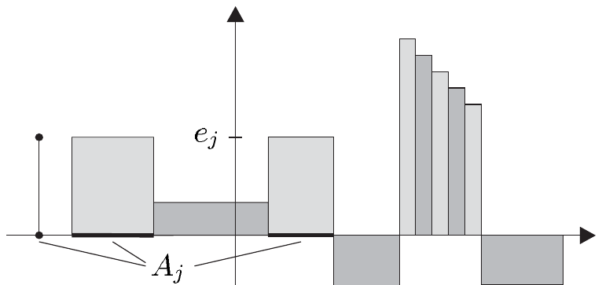

## 2 可积函数

本节我们定义一般的 Bochner–Lebesgue 积分，并叙述它的基本性质。我们还证明，可积函数构成的向量空间关于由该积分诱导的半范数是完备的。

与上一节一样，假设

- $ (X, \mathcal{A}, \mu) $ 是完备的 $ \sigma $-有限测度空间；$ E = (E, \left|\cdot\right|) $ 是巴拿赫空间。

##### 简单函数的积分

在注 1.2(c) 中我们已经知道，每个简单函数都有唯一的规范形式。这个形式在下文中很有用，我们优先使用它。

约定 我们总是用规范形式表示 $ \mu $-简单函数，除非另有说明。此外，我们令\footnote{约定 (2.1) 在积分论中很常见，它使例如在简单函数的整个定义域上对其积分成为可能。在 $ E = \mathbb{R} $ 的情形，这\textbf{不}应理解为 $ \overline{\mathbb{R}} $ 中的又一条计算规则，而应理解为 $ \infty, -\infty \in \overline{\mathbb{R}} $ 与 $ \mathbb{R} $ 的零向量的“外部”乘法。}

\[ \infty \cdot 0_E := -\infty \cdot 0_E := 0_E , \tag{2.1} \]

其中 $ 0_E $ 是 $ E $ 的零向量。

对 $ \varphi = \sum_{j=0}^{m} e_j \chi_{A_j} \in \mathcal{S}(X,\mu,E) $，我们把**$ \varphi $ 在 $ X $ 上关于测度 $ \mu $ 的积分**定义为和

\[ \int_X \varphi \, d\mu := \int \varphi \, d\mu := \sum_{j=0}^{m} e_j \mu(A_j) . \]

若 $ A $ 是 $ \mu $-可测集，我们把**$ \varphi $ 在 $ A $ 上关于测度 $ \mu $ 的积分**定义为

\[ \int_A \varphi \, d\mu := \int_X \chi_A \varphi \, d\mu . \]

2.1 注 (a) 对 $ \varphi \in \mathcal{S}(X,\mu,E) $ 和 $ A \in \mathcal{A} $，积分 $ \int_A \varphi \, d\mu $ 是良定义的。

证明 这由注 1.2(c) 与 (d) 推出。■

(b) 设 $ \varphi = \sum_{k=0}^{n} f_k \chi_{B_k} $，其中 $ f_0, \ldots, f_n \in E $ 非零，$ B_0, \ldots, B_n \in \mathcal{A} $ 两两不交，是一个不必处于规范形式的 $ \mu $-简单函数。则

\[ \int_X \varphi \, d\mu = \sum_{k=0}^{n} f_k \mu(B_k) . \]

证明 设 $ \sum_{j=0}^{m} e_j \chi_{A_j} $ 是 $ \varphi $ 的规范形式。令

\[ A_{m+1} := \bigcap_{j=0}^{m} A_j^{c} , \quad B_{n+1} := \bigcap_{k=0}^{n} B_k^{c} , \quad e_{m+1} := 0 , \quad f_{n+1} := 0 . \tag{2.2} \]

于是 $ X = \bigcup_{j=0}^{m+1} A_j = \bigcup_{k=0}^{n+1} B_k $，故

\[ A_j = \bigcup_{k=0}^{n+1} (A_j \cap B_k) \quad \text{且} \quad B_k = \bigcup_{j=0}^{m+1} (A_j \cap B_k) \quad \text{对 } j = 0, \ldots, m+1 \text{ 和 } k = 0, \ldots, n+1 . \]

因为集合 $ A_j \cap B_k $ 两两不交，我们有

\[ \mu(A_j) = \sum_{k=0}^{n+1} \mu(A_j \cap B_k) \quad \text{且} \quad \mu(B_k) = \sum_{j=0}^{m+1} \mu(A_j \cap B_k) . \]

若 $ A_j \cap B_k \ne \varnothing $，则 $ e_j = f_k $，并且我们得到

\[ \int_X \varphi \, d\mu = \sum_{j=0}^{m} e_j \mu(A_j) = \sum_{j=0}^{m+1} e_j \sum_{k=0}^{n+1} \mu(A_j \cap B_k) = \sum_{k=0}^{n+1} f_k \sum_{j=0}^{m+1} \mu(A_j \cap B_k) \]
\[ = \sum_{k=0}^{n} f_k \mu(B_k) . \quad \blacksquare \]

(c) 积分 $ \int_X \cdot \, d\mu : \mathcal{S}(X,\mu,E) \to E $ 是线性的。

证明 设 $ \varphi = \sum_{j=0}^{m} e_j \chi_{A_j} $ 与 $ \psi = \sum_{k=0}^{n} f_k \chi_{B_k} $ 是 $ \mu $-简单函数，$ \alpha \in \mathbb{K} $。容易验证 $ \int_X \alpha \varphi \, d\mu = \alpha \int_X \varphi \, d\mu $。利用关系式 (2.2)，像 (b) 中那样论证可得

\[ \chi_{A_j} = \sum_{k=0}^{n+1} \chi_{A_j \cap B_k} \quad \text{且} \quad \chi_{B_k} = \sum_{j=0}^{m+1} \chi_{A_j \cap B_k} , \]

于是我们有\footnote{一般而言，(2.3) \textbf{不}给出 $ \varphi + \psi $ 的规范形式。}

\[ \varphi + \psi = \sum_{j=0}^{m+1} \sum_{k=0}^{n+1} (e_j + f_k) \chi_{A_j \cap B_k} . \tag{2.3} \]

结论现在由 (b) 推出。■

(d) 对 $ A, B \in \mathcal{A} $ 且 $ A \cap B = \varnothing $，我们有

\[ \int_{A \cup B} \varphi \, d\mu = \int_A \varphi \, d\mu + \int_B \varphi \, d\mu \quad \text{对 } \varphi \in \mathcal{S}(X,\mu,E) . \]

证明 这由 (c) 以及等式 $ \chi_{A \cup B} \varphi = \chi_A \varphi + \chi_B \varphi $ 推出。■

(e) 对 $ \varphi \in \mathcal{S}(X,\mu,E) $ 和 $ A \in \mathcal{A} $，我们有

\[ \left| \int_A \varphi \, d\mu \right| \le \int_A |\varphi| \, d\mu \le \|\varphi\|_\infty \, \mu(A) . \]

证明 这由注 1.2(d) 与三角不等式推出。■

(f) 若 $ \varphi, \psi \in \mathcal{S}(X,\mu,\mathbb{R}) $ 满足 $ \varphi \le \psi $，则 $ \int_A \varphi \, d\mu \le \int_A \psi \, d\mu $。

证明 显然 $ \int_A \eta \, d\mu \ge 0 $ 对 $ \eta \in \mathcal{S}(X,\mu,\mathbb{R}^{+}) $。结论现在由 (c) 推出。■

##### $ \mathcal{L}_1 $-半范数

设 $ V $ 是 $ \mathbb{K} $ 上的向量空间。若映射 $ p : V \to \mathbb{R} $ 满足以下性质，则称它是 $ V $ 上的**半范数**：

(i) $ p(v) \ge 0 $ 对 $ v \in V $；

(ii) $ p(\lambda v) = |\lambda| \, p(v) $ 对 $ v \in V $ 和 $ \lambda \in \mathbb{K} $；

(iii) $ p(v + w) \le p(v) + p(w) $ 对 $ v, w \in V $。

对 $ v \in V $ 和 $ r > 0 $，我们用

\[ \mathbb{B}_p(v,r) := \{ w \in V ; \; p(v - w) < r \} \]

记 $ (V,p) $ 中以 $ v $ 为心、半径为 $ r $ 的**开球**。称 $ V $ 的子集 $ O $ 是 **p-开**的，若对每个 $ v \in O $ 都存在 $ r > 0 $ 使得 $ \mathbb{B}_p(v,r) \subset O $。

2.2 注 设 $ V $ 是向量空间，$ p $ 是 $ V $ 上的半范数。

(a) 半范数 $ p $ 是范数当且仅当 $ p^{-1}(0) = \{0\} $。

(b) 设 $ K \subset \mathbb{R}^n $ 紧，$ k \in \mathbb{N} \cup \{\infty\} $，且

\[ p_K(f) := \max_{x \in K} |f(x)| \quad \text{对 } f \in C^{k}(\mathbb{R}^n, E) . \]

则 $ p_K $ 是 $ C^{k}(\mathbb{R}^n, E) $ 上的半范数，但不是范数。

证明 容易验证 $ p_K $ 是 $ C^{k}(\mathbb{R}^n, E) $ 上的半范数。设 $ U $ 是 $ K $ 的开邻域。则习题 VII.6.7 表明存在 $ f \in C^{\infty}(\mathbb{R}^n, \mathbb{R}) $，使得 $ f(x) = 1 $ 对 $ x \in K $ 且 $ f(x) = 0 $ 对 $ x \in U^{c} $。对 $ e \in E \setminus \{0\} $，令 $ g := (\chi_{\mathbb{R}^n} - f)e $。则 $ g $ 属于 $ C^{\infty}(\mathbb{R}^n, E) $，并且 $ p_K(g) = 0 $，但 $ g \ne 0 $。因此 $ p_K $ 不是 $ C^{k}(\mathbb{R}^n, E) $ 上的范数。■

(c) 令

\[ \|\varphi\|_1 := \int_X |\varphi| \, d\mu \quad \text{对 } \varphi \in \mathcal{S}(X,\mu,E) . \]

则 $ \|\cdot\|_1 $ 是 $ \mathcal{S}(X,\mu,E) $ 上的半范数。若 $ \mathcal{A} $ 中存在非空的 $ \mu $-零集，则 $ \|\cdot\|_1 $ 不是 $ \mathcal{S}(X,\mu,E) $ 上的范数。

证明 显然 $ \|\cdot\|_1 $ 是 $ \mathcal{S}(X,\mu,E) $ 上的半范数。取非空 $ \mu $-零集 $ N $，我们有 $ \|\chi_N\|_1 = 0 $，但 $ \chi_N \ne 0 $。■

(d) $ \mathcal{T}_p := \{ O \subset V ; \; O \text{ 是 } p\text{-开} \} $ 是 $ V $ 上的拓扑，称为**由 $ p $ 生成的拓扑**。

证明 容易验证，命题 III.2.4 的证明中所用的论证可以移植到此情形。■

(e) 拓扑 $ \mathcal{T}_p $ 不必是豪斯多夫的。若不是，则 $ V $ 上不存在生成 $ \mathcal{T}_p $ 的度量。

证明 我们使用 (b) 的记号并令 $ K := \{0\} $。再设 $ f \in C^{k}(\mathbb{R}^n, E) $ 满足 $ f(0) = 0 $ 且 $ f \ne 0 $。则 $ \mathbb{B}_{p_K}(f,\varepsilon) = \mathbb{B}_{p_K}(0,\varepsilon) $ 对每个 $ \varepsilon > 0 $。因此 $ \mathcal{T}_{p_K} $ 不是豪斯多夫的。第二个结论由命题 III.2.17 推出。■

(f) 称线性映射 $ A : V \to E $ 是 **(p)-有界**的，若存在 $ M \ge 0 $ 使得 $ |Av| \le M p(v) $ 对 $ v \in V $。对线性映射 $ A : V \to E $，以下结论等价：

(i) $ A $ 连续。

(ii) $ A $ 在 0 处连续。

(iii) $ A $ 有界。

证明 这由定理 VI.2.5 的证明推出，那里只用到半范数的性质。■

(g) $ \int \cdot \, d\mu : \mathcal{S}(X,\mu,E) \to E $ 连续。

证明 这由 (c)、(f) 以及注 2.1(c) 推出。■

设 $ p $ 是 $ V $ 上的半范数。由注 2.2(e) 可知，$ (V,p) $ 的拓扑未必由 $ V $ 上的度量生成，此时柯西序列与完备性这些度量概念都不可用。因此我们需要新的定义：若对每个 $ \varepsilon > 0 $ 都存在 $ N \in \mathbb{N} $ 使得 $ p(v_j - v_k) < \varepsilon $ 对 $ j, k \ge N $，则称序列 $ (v_j) \in V^{\mathbb{N}} $ 是 $ (V,p) $ 中的**柯西序列**。若 $ (V,p) $ 中每个柯西序列都收敛，则称 $ (V,p) $ **完备**。

2.3 注 (a) 若 $ (V,p) $ 是赋范向量空间，这些概念与第 II.6 节的一致。

(b) 设 $ (v_j) \in V^{\mathbb{N}} $ 且 $ v \in V $。则 $ v_j \to v $ 当且仅当 $ p(v - v_j) \to 0 $。然而收敛序列的极限一般并不唯一确定：若 $ p $ 不是范数，则 $ v_j \to v $ 蕴含 $ v_j \to w $ 对每个满足 $ p(v - w) = 0 $ 的 $ w \in V $。

(c) $ (V,p) $ 中所有柯西序列的集合构成 $ V^{\mathbb{N}} $ 的向量子空间。■

下文我们总给空间 $ \mathcal{S}(X,\mu,E) $ 装配由 $ \|\cdot\|_1 $ 诱导的拓扑。这时我们也可以把 $ \mathcal{S}(X,\mu,E) $ 中的柯西序列称为 **$ \mathcal{L}_1 $-柯西序列**。

称函数 $ f \in E^{X} $ 是 **μ-可积**的，若 $ f $ 是 $ \mathcal{S}(X,\mu,E) $ 中某个 $ \mathcal{L}_1 $-柯西序列 $ (\varphi_j) $ 的 $ \mu $-几乎处处极限。我们把 $ X $ 的 $ E $ 值 $ \mu $-可积函数之集记作 $ \mathcal{L}_1(X,\mu,E) $。

2.4 命题 作为向量子空间，我们有包含关系

\[ \mathcal{S}(X,\mu,E) \subset \mathcal{L}_1(X,\mu,E) \subset \mathcal{L}_0(X,\mu,E) . \]

证明 显然每个 $ \mu $-简单函数都是 $ \mu $-可积的。每个 $ \mu $-可积函数都是 $ \mu $-可测的，这由注 1.2(a) 与定理 1.14 推出。还需证明 $ \mathcal{L}_1(X,\mu,E) $ 是 $ \mathcal{L}_0(X,\mu,E) $ 的向量子空间。取 $ f, g \in \mathcal{L}_1(X,\mu,E) $ 与 $ \alpha \in \mathbb{K} $。存在 $ \mathcal{S}(X,\mu,E) $ 中的 $ \mathcal{L}_1 $-柯西序列 $ (\varphi_j) $ 与 $ (\psi_j) $，使得当 $ j \to \infty $ 时 $ \varphi_j \to f $ 且 $ \psi_j \to g $ 都是 $ \mu $-几乎处处的。由三角不等式可知 $ (\alpha \varphi_j + \psi_j)_{j \in \mathbb{N}} $ 是 $ \mathcal{S}(X,\mu,E) $ 中的 $ \mathcal{L}_1 $-柯西序列，且 $ \mu $-几乎处处收敛到 $ \alpha f + g $。因此 $ \alpha f + g $ 是 $ \mu $-可积的，如所要求。■

##### Bochner–Lebesgue 积分

设 $ f \in \mathcal{L}_1(X,\mu,E) $。则存在 $ \mathcal{S}(X,\mu,E) $ 中的 $ \mathcal{L}_1 $-柯西序列 $ (\varphi_j) $ 使得 $ \varphi_j \to f $ 是 $ \mu $-几乎处处的。我们将看到序列 $ \left( \int_X \varphi_j \, d\mu \right)_{j \in \mathbb{N}} $ 在 $ E $ 中收敛。于是自然地，把 $ f $ 关于 $ \mu $ 的积分定义为这个积分序列的极限。当然我们必须验证该极限与逼近的简单函数序列无关；也就是说，必须证明：若 $ (\psi_j) $ 是 $ \mathcal{S}(X,\mu,E) $ 中另一个满足 $ \psi_j \to f $（$ \mu $-几乎处处）的柯西序列，则 $ \lim_j \int \varphi_j \, d\mu = \lim_j \int \psi_j \, d\mu $。

2.5 引理 设 $ (\varphi_j) $ 是 $ \mathcal{S}(X,\mu,E) $ 中的柯西序列。则存在 $ (\varphi_j) $ 的子列 $ (\varphi_{j_k})_{k \in \mathbb{N}} $ 与 $ f \in \mathcal{L}_1(X,\mu,E) $，使得

(i) 当 $ k \to \infty $ 时 $ \varphi_{j_k} \to f $ 是 $ \mu $-几乎处处的；

(ii) 对每个 $ \varepsilon > 0 $ 都存在 $ A_\varepsilon \in \mathcal{A} $，使得 $ \mu(A_\varepsilon) < \varepsilon $ 且 $ (\varphi_{j_k})_{k \in \mathbb{N}} $ 在 $ A_\varepsilon^{c} $ 上一致收敛到 $ f $。

证明 （α）按假设，对任意 $ k \in \mathbb{N} $ 都存在 $ j_k \in \mathbb{N} $，使得界 $ \|\varphi_\ell - \varphi_m\|_1 < 2^{-2k} $ 对 $ \ell, m \ge j_k $ 成立。不妨设序列 $ (j_k)_{k \in \mathbb{N}} $ 递增。令 $ \psi_k := \varphi_{j_k} $，我们便得到

\[ \|\psi_\ell - \psi_m\|_1 < 2^{-2\ell} \quad \text{对 } m \ge \ell \ge 0 . \]

（β）令 $ B_\ell := \left[ |\psi_{\ell+1} - \psi_\ell| \ge 2^{-\ell} \right] $ 对 $ \ell \in \mathbb{N} $。则 $ B_\ell $ 属于 $ \mathcal{A} $，并且 $ \mu(B_\ell) < \infty $ 对 $ \ell \in \mathbb{N} $，因为每个 $ \psi_m $ 都是 $ \mu $-简单的。因此 $ \chi_{B_\ell} $ 也是 $ \mu $-简单的，且注 2.1(f) 蕴含

\[ 2^{-\ell} \mu(B_\ell) = 2^{-\ell} \int_X \chi_{B_\ell} \, d\mu \le \int_X |\psi_{\ell+1} - \psi_\ell| \, d\mu = \|\psi_{\ell+1} - \psi_\ell\|_1 < 2^{-2\ell} . \]

这导致 $ \mu(B_\ell) < 2^{-\ell} $ 对 $ \ell \in \mathbb{N} $。

令 $ A_n := \bigcup_{k=0}^{\infty} B_{n+k} $，我们有 $ \mu(A_n) \le 2^{-n+1} $ 对 $ n \in \mathbb{N} $，并且我们看到 $ A := \bigcap_{n=0}^{\infty} A_n $ 是 $ \mu $-零集。

（γ）若 $ x $ 位于 $ A_n^{c} = \bigcap_{k=0}^{\infty} B_{n+k}^{c} $ 中，则

\[ |\psi_{\ell+1}(x) - \psi_\ell(x)| < 2^{-\ell} \quad \text{对 } \ell \ge n . \]

由魏尔斯特拉斯优级数判别法（定理 V.1.6），级数

\[ \psi_0 + \sum (\psi_{\ell+1} - \psi_\ell) \]

在 $ A_n^{c} $ 上一致收敛于 $ E $ 中。现在我们令

\[ f(x) := \begin{cases} \lim_k \psi_k(x) & \text{若 } x \in A^{c} , \\ 0 & \text{若 } x \in A . \end{cases} \]

则当 $ k \to \infty $ 时 $ \varphi_{j_k} \to f $ 是 $ \mu $-几乎处处的。此外，对每个 $ \varepsilon > 0 $ 都存在 $ n \in \mathbb{N} $ 使得 $ \mu(A_n) \le 2^{-n+1} < \varepsilon $，且当 $ k \to \infty $ 时 $ (\varphi_{j_k})_{k \in \mathbb{N}} $ 在 $ A_n^{c} $ 上一致收敛到 $ f $。■

2.6 引理 设 $ (\varphi_j) $ 与 $ (\psi_j) $ 是 $ \mathcal{S}(X,\mu,E) $ 中 $ \mu $-几乎处处收敛到同一函数的 $ \mathcal{L}_1 $-柯西序列。则 $ \lim \|\varphi_j - \psi_j\|_1 = 0 $。

证明 (i) 取 $ \varepsilon > 0 $ 并令 $ \eta_j := \varphi_j - \psi_j $ 对 $ j \in \mathbb{N} $。由注 2.3(c)，$ (\eta_j) $ 是 $ \mathcal{S}(X,\mu,E) $ 中的 $ \mathcal{L}_1 $-柯西序列。因此存在自然数 $ N $，使得 $ \|\eta_j - \eta_k\| < \varepsilon/8 $ 对 $ j, k \ge N $。

(ii) 因为 $ \eta_N $ 是 $ \mu $-简单的，$ A := [\eta_N \ne 0] $ 属于 $ \mathcal{A} $ 且 $ \mu(A) < \infty $。此外 $ (\eta_j) $ 是 $ \mu $-几乎处处收敛到零的。于是引理 2.5 说明存在 $ B \in \mathcal{A} $ 使得 $ \mu(B) < \varepsilon/8(1 + \|\eta_N\|_\infty) $，并且存在 $ (\eta_j) $ 的子列 $ (\eta_{j_k})_{k \in \mathbb{N}} $，它在 $ B^{c} $ 上一致收敛到 0。因此存在 $ K \ge N $ 使得

\[ |\eta_{j_K}(x)| \le \varepsilon/8(1 + \mu(A)) \quad \text{对 } x \in A \setminus B . \]

这表明 $ \int_{A \setminus B} |\eta_{j_K}| \, d\mu \le \varepsilon/8 $。

(iii) $ B $ 与 $ K $ 的性质蕴含

\[ \int_B |\eta_{j_K}| \, d\mu \le \int_B |\eta_{j_K} - \eta_N| \, d\mu + \int_B |\eta_N| \, d\mu \]
\[ \le \|\eta_{j_K} - \eta_N\|_1 + \|\eta_N\|_\infty \, \mu(B) < \varepsilon/4 . \]

由 $ A $ 的定义，我们有

\[ \int_{A^{c}} |\eta_{j_K}| \, d\mu = \int_{A^{c}} |\eta_{j_K} - \eta_N| \, d\mu \le \|\eta_{j_K} - \eta_N\|_1 < \varepsilon/8 . \]

综合起来，利用注 2.1(d) 得到

\[ \|\eta_{j_K}\|_1 \le \int_{A^{c} \cup (A \setminus B) \cup B} |\eta_{j_K}| \, d\mu < \varepsilon/2 , \]

因此 $ \|\eta_j\|_1 \le \|\eta_{j_K}\|_1 + \|\eta_j - \eta_{j_K}\|_1 < \varepsilon $ 对 $ j \ge N $。由于 $ \varepsilon > 0 $ 任意，一切得证。■

2.7 推论 设 $ (\varphi_j) $ 与 $ (\psi_j) $ 是 $ \mathcal{S}(X,\mu,E) $ 中 $ \mu $-几乎处处收敛到同一函数的柯西序列。则序列 $ \left( \int_X \varphi_j \, d\mu \right) $ 与 $ \left( \int_X \psi_j \, d\mu \right) $ 在 $ E $ 中收敛，且

\[ \lim_j \int_X \varphi_j \, d\mu = \lim_j \int_X \psi_j \, d\mu . \]

证明 因为

\[ \left| \int_X \varphi_j \, d\mu - \int_X \varphi_k \, d\mu \right| \le \|\varphi_j - \varphi_k\|_1 \quad \text{对 } j, k \in \mathbb{N} , \]

$ \left( \int \varphi_j \, d\mu \right)_{j \in \mathbb{N}} $ 是 $ E $ 中的柯西序列；因此当 $ j \to \infty $ 时 $ \int \varphi_j \, d\mu \to e $，其中 $ e \in E $。同样存在 $ e' \in E $ 使得当 $ j \to \infty $ 时 $ \int \psi_j \, d\mu \to e' $。应用引理 2.6 与 $ E $ 的范数的连续性，我们看到

\[ |e - e'| = \lim_j \left| \int_X \varphi_j \, d\mu - \int_X \psi_j \, d\mu \right| \le \lim_j \int_X |\varphi_j - \psi_j| \, d\mu = \lim_j \|\varphi_j - \psi_j\|_1 = 0 , \]

于是证毕。■

在这些准备之后，我们以自然的方式定义可积函数的积分，它是简单函数积分的推广。设 $ f \in \mathcal{L}_1(X,\mu,E) $。则存在 $ \mathcal{S}(X,\mu,E) $ 中的 $ \mathcal{L}_1 $-柯西序列 $ (\varphi_j) $ 使得 $ \varphi_j \to f $ 是 $ \mu $-几乎处处的。根据推论 2.7，量

\[ \int_X f \, d\mu := \lim_j \int_X \varphi_j \, d\mu \]

在 $ E $ 中存在，且与序列 $ (\varphi_j) $ 无关。这称为 $ f $ 在 $ X $ 上关于测度 $ \mu $ 的 **Bochner–Lebesgue 积分**。除 $ \int_X f \, d\mu $ 外还常用其他记号，即

\[ \int f \, d\mu , \quad \int_X f(x) \, d\mu(x) , \quad \int_X f(x) \, \mu(dx) . \]

显然，对简单函数而言，Bochner–Lebesgue 积分与本节开头（第 80 页）定义的积分一致。

##### $ \mathcal{L}_1 $ 的完备性

借助积分，我们现在在 $ \mathcal{L}_1(X,\mu,E) $ 上定义一个半范数，并证明 $ \mathcal{L}_1(X,\mu,E) $ 关于此半范数是完备的。

2.8 引理 若 $ f \in \mathcal{L}_1(X,\mu,E) $，则 $ |f| $ 属于 $ \mathcal{L}_1(X,\mu,\mathbb{R}) $。若 $ (\varphi_j) $ 是 $ \mathcal{S}(X,\mu,E) $ 中的 $ \mathcal{L}_1 $-柯西序列且 $ \varphi_j \to f $ 是 $ \mu $-几乎处处的，则 $ \int |f| \, d\mu = \lim_j \int |\varphi_j| \, d\mu $。

证明 反向三角不等式（它显然对半范数也成立）给出

\[ \left\| |\varphi_j| - |\varphi_k| \right\|_1 \le \|\varphi_j - \varphi_k\|_1 \quad \text{且} \quad |\,|\varphi_j| - |\varphi_k|\,| \le |\varphi_j - \varphi_k| \quad \text{对 } j, k \in \mathbb{N} . \]

因此 $ (|\varphi_j|)_{j \in \mathbb{N}} $ 是 $ \mathcal{S}(X,\mu,\mathbb{R}) $ 中的 $ \mathcal{L}_1 $-柯西序列，且 $ \mu $-几乎处处收敛到 $ |f| $。所以 $ |f| $ 属于 $ \mathcal{L}_1(X,\mu,\mathbb{R}) $，并且 $ \int |f| \, d\mu = \lim_j \int |\varphi_j| \, d\mu $。■

2.9 推论 对 $ f \in \mathcal{L}_1(X,\mu,E) $，令 $ \|f\|_1 := \int_X |f| \, d\mu $。则 $ \|\cdot\|_1 $ 是 $ \mathcal{L}_1(X,\mu,E) $ 上的半范数，称为 **$ \mathcal{L}_1 $-半范数**。

证明 取 $ f, g \in \mathcal{L}_1(X,\mu,E) $，并设 $ (\varphi_j) $ 与 $ (\psi_j) $ 是 $ \mathcal{S}(X,\mu,E) $ 中的 $ \mathcal{L}_1 $-柯西序列，使得 $ \varphi_j \to f $ 且 $ \psi_j \to g $ 都是 $ \mu $-几乎处处的。由引理 2.8 与注 2.2(c)，我们有

\[ \|f\|_1 = \int_X |f| \, d\mu = \lim_j \int_X |\varphi_j| \, d\mu = \lim_j \|\varphi_j\|_1 \ge 0 , \]

以及

\[ \|f + g\|_1 = \lim_j \|\varphi_j + \psi_j\|_1 \le \lim_j (\|\varphi_j\|_1 + \|\psi_j\|_1) = \|f\|_1 + \|g\|_1 , \]

和

\[ \|\alpha f\|_1 = \lim_j \|\alpha \varphi_j\| = |\alpha| \lim_j \|\varphi_j\| = |\alpha| \, \|f\|_1 \]

对任意 $ \alpha \in \mathbb{K} $。■

我们将总给 $ \mathcal{L}_1(X,\mu,E) $ 装配由半范数 $ \|\cdot\|_1 $ 诱导的拓扑。

2.10 定理

(i) $ \mathcal{S}(X,\mu,E) $ 在 $ \mathcal{L}_1(X,\mu,E) $ 中稠密。

(ii) 空间 $ \mathcal{L}_1(X,\mu,E) $ 是完备的。

证明 (i) 设 $ f \in \mathcal{L}_1(X,\mu,E) $，并令 $ (\varphi_j) $ 表示简单函数构成的 $ \mathcal{L}_1 $-柯西序列，使得当 $ j \to \infty $ 时 $ \varphi_j \to f $ 是 $ \mu $-几乎处处的。再设 $ k \in \mathbb{N} $。则 $ (\varphi_j - \varphi_k)_{j \in \mathbb{N}} $ 是 $ \mathcal{S}(X,\mu,E) $ 中的 $ \mathcal{L}_1 $-柯西序列，使得 $ (\varphi_j - \varphi_k) \to (f - \varphi_k) $
