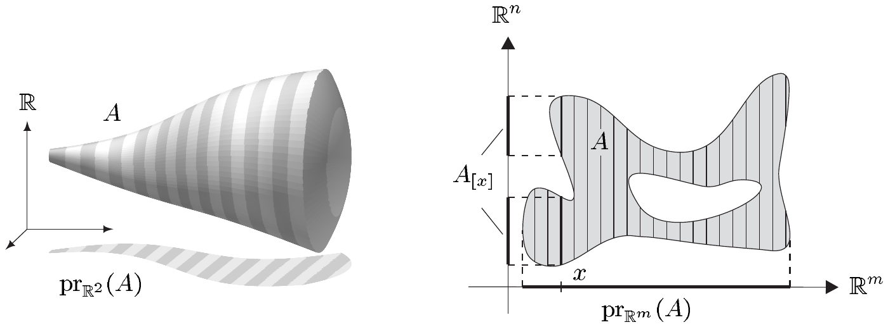
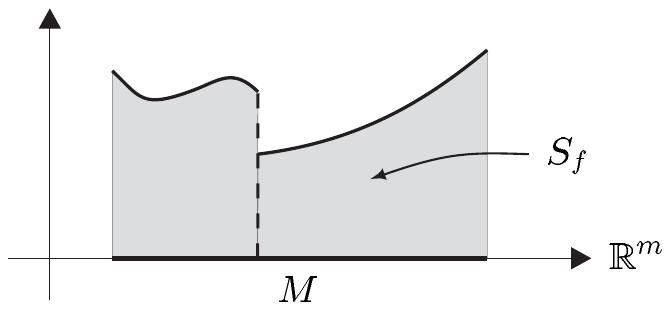
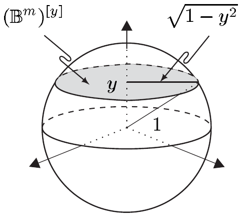

## 6 富比尼定理

本节的核心是证明：多变量函数的勒贝格积分可以迭代地计算，并且这一系列一元积分可以按任意顺序进行。因此多变量积分归结为对一元函数的积分。借助上一节的结果与第 II 卷中发展的方法，多维积分在许多情形下可以显式计算。

积分迭代求值的方法有广泛的理论应用，我们将介绍其中少数几个。

本节自始至终假设 $ m, n $ 是正整数，且 $ E $ 是 Banach 空间。

此外，我们一般把 $ \mathbb{R}^{m+n} $ 与 $ \mathbb{R}^m \times \mathbb{R}^n $ 等同起来。

##### 几乎处处有定义的映射

设 $ (X, \mathcal{A}, \mu) $ 是测度空间。我们常常考虑仅在 $ \mu $-几乎处处有定义的非负 $ \overline{\mathbb{R}} $ 值函数。对于这些函数，我们简单地写作 $ x \mapsto f(x) $，而不具体指明其定义域。我们说这样的函数 $ x \mapsto f(x) $ 是**可测**的，如果存在 $ \mu $-零集 $ N $，使得 $ f \mid N^{c} : N^{c} \to \overline{\mathbb{R}}^{+} $ 有定义且 $ \mu $-可测。因此 $ \int_{N^{c}} f \, d\mu $ 有定义。若 $ M $ 是另一个 $ \mu $-零集，使得 $ f \mid M^{c} : M^{c} \to \overline{\mathbb{R}}^{+} $ 有定义且 $ \mu $-可测，则等式 $ \mu(N) = \mu(M) = \mu(M \cup N) = 0 $ 以及注 3.3(a) 与 (b) 蕴含

\[ \int_{N^{c}} f \, d\mu = \int_{M^{c} \cap N^{c}} f \, d\mu = \int_{M^{c}} f \, d\mu . \]

因此

\[ \int_{X} f \, d\mu := \int_{N^{c}} f \, d\mu \tag{6.1} \]

是有良好定义的，并且与所选零集 $ N $ 无关。

对于 $ \mu $-几乎处处有定义的 $ E $ 值函数 $ x \mapsto f(x) $，我们完全像上面那样定义可测性。我们说这样的 $ f $ 是**可积**的，如果 $ f \mid N^{c} $ 属于 $ \mathcal{L}_{1}(N^{c}, \mu, E) $。此时 $ \int_{X} f \, d\mu $ 也通过 (6.1) 定义，并且引理 2.15 表明这个定义是有意义的。

例如考虑 $ A \in \mathcal{L}(m+n) $，并假设截面 $ A_{[x]} $ 对 $ \lambda_m $-几乎每个 $ x \in \mathbb{R}^m $ 是 $ \lambda_n $-可测的。则 $ x \mapsto \lambda_n(A_{[x]}) $ 是 $ \lambda_m $-几乎处处有定义的非负 $ \overline{\mathbb{R}} $ 值函数。若 $ x \mapsto \lambda_n(A_{[x]}) $ 可测，则积分 $ \int_{\mathbb{R}^m} \lambda_n(A_{[x]}) \, dx $ 有良好定义。

##### 卡瓦列里原理

我们用 $ \mathcal{C}(m, n) $ 表示满足以下条件的全体 $ A \in \mathcal{L}(m+n) $ 构成的集合：

(i) $ A_{[x]} \in \mathcal{L}(n) $ 对 $ \lambda_m $-几乎每个 $ x \in \mathbb{R}^m $ 成立；

(ii) $ x \mapsto \lambda_n(A_{[x]}) $ 是 $ \lambda_m $-可测的；

(iii) $ \lambda_{m+n}(A) = \int_{\mathbb{R}^m} \lambda_n(A_{[x]}) \, dx $。

我们想证明 $ \mathcal{C}(m, n) $ 与 $ \mathcal{L}(m+n) $ 一致，但这需要一些准备工作。

6.1 注 (a) 设 $ A \in \mathcal{C}(1, n) $ 有界，且 $ \mathrm{pr}_1(A) $ 是以 $ a $ 与 $ b $ 为端点的区间。则

\[ \lambda_{n+1}(A) = \int_{a}^{b} \lambda_n(A_{[x]}) \, dx . \]

这一结论称为**卡瓦列里原理**，它精确表达了如下几何思想：$ A $ 的测度（体积）可以通过把 $ A $ 分割成薄的平行切片、并连续地对这些切片的体积求和（积分）来确定。

(b) $ \mathcal{L}(m) \boxtimes \mathcal{L}(n) \subset \mathcal{C}(m, n) $。

(c) 对 $ \mathcal{C}(m, n) $ 中的每个递增序列 $ (A_j) $，并集 $ \bigcup_j A_j $ 属于 $ \mathcal{C}(m, n) $。

证明 (i) 对 $ j \in \mathbb{N} $，设 $ M_j $ 是 $ \lambda_m $-零集，使得对 $ x \in M_j^{c} $ 有 $ A_{j,[x]} := (A_j)_{[x]} \in \mathcal{L}(n) $。令 $ A := \bigcup_j A_j $ 且 $ M := \bigcup_j M_j $，则对 $ x \in M^{c} $ 有 $ A_{[x]} = \bigcup_j A_{j,[x]} \in \mathcal{L}(n) $。$ \lambda_n $ 的下连续性蕴含，对 $ x \in M^{c} $ 有 $ \lambda_n(A_{[x]}) = \lim_j \lambda_n(A_{j,[x]}) $；借助命题 1.11 我们得出 $ x \mapsto \lambda_n(A_{[x]}) $ 是 $ \lambda_m $-可测的。

(ii) 由于 $ A_j \in \mathcal{C}(m, n) $，我们有

\[ \int_{\mathbb{R}^m} \lambda_n(A_{j,[x]}) \, dx = \lambda_{m+n}(A_j) \quad \text{对 } j \in \mathbb{N} , \]

由单调收敛定理推出

\[ \lim_j \int_{\mathbb{R}^m} \lambda_n(A_{j,[x]}) \, dx = \int_{\mathbb{R}^m} \lambda_n(A_{[x]}) \, dx . \tag{6.2} \]

$ \lambda_{m+n} $ 的下连续性于是表明

\[ \lambda_{m+n}(A) = \lim_j \lambda_{m+n}(A_j) = \lim_j \int_{\mathbb{R}^m} \lambda_n(A_{j,[x]}) \, dx = \int_{\mathbb{R}^m} \lambda_n(A_{[x]}) \, dx . \]

因此 $ A $ 属于 $ \mathcal{C}(m, n) $。■

(d) 设 $ (A_j) $ 是 $ \mathcal{C}(m, n) $ 中的递减序列，且存在 $ k \in \mathbb{N} $ 使 $ \lambda_{m+n}(A_k) < \infty $。则 $ \bigcap_j A_j $ 属于 $ \mathcal{C}(m, n) $。

证明 我们令 $ A := \bigcap_j A_j $。对 $ \lambda_m $-几乎所有截面 $ A_{[x]} $ 的可测性以及 $ x \mapsto \lambda_n(A_{[x]}) $ 的可测性，都如同 (c) 中那样得到。其次，勒贝格控制收敛定理表明 (6.2) 在此情形下成立。结论现在如同 (c) 中那样推出。■

(e) 设 $ (A_j) $ 是 $ \mathcal{C}(m, n) $ 中的不交序列。则 $ \bigcup_j A_j $ 也属于 $ \mathcal{C}(m, n) $。

证明 由于 (c)，只需对有限不交序列证明该结论。我们把这个练习留给读者。■

(f) $ \mathbb{R}^{m+n} $ 中的每个开集都属于 $ \mathcal{C}(m, n) $。

证明 这由命题 IX.5.6、(e) 与 (b) 推出。■

(g) $ \mathbb{R}^{m+n} $ 中的每个有界 $ G_\delta $ 集都属于 $ \mathcal{C}(m, n) $。

证明 这由 (f) 与 (d) 推出。■

(h) 设 $ A $ 是 $ \lambda_{m+n} $-零集。则 $ A $ 属于 $ \mathcal{C}(m, n) $，且存在 $ \lambda_m $-零集 $ M $，使得对每个 $ x \in M^{c} $，$ A_{[x]} $ 是 $ \lambda_n $-零集。

证明 只需验证存在 $ \lambda_m $-零集 $ M $，使得对 $ x \in M^{c} $ 有 $ \lambda_n(A_{[x]}) = 0 $。于是令 $ A_j := A \cap (j \mathbb{B}^{m+n}) $ 对 $ j \in \mathbb{N} $。则 $ (A_j) $ 是有界 $ \lambda_{m+n} $-零集的递增序列，且 $ \bigcup_j A_j = A $。由推论 IX.5.5，存在有界 $ G_\delta $ 集序列 $ (G_j) $，使得 $ G_j \supset A_j $ 且 $ \lambda_{m+n}(G_j) = 0 $ 对 $ j \in \mathbb{N} $。由 (g) 因此推出

\[ 0 = \lambda_{m+n}(G_j) = \int_{\mathbb{R}^m} \lambda_n(G_{j,[x]}) \, dx . \]

于是，对每个 $ j \in \mathbb{N} $ 存在 $ \lambda_m $-零集 $ M_j $，使得对 $ x \in M_j^{c} $ 有 $ \lambda_n(G_{j,[x]}) = 0 $（见注 3.3(c)）。因为

\[ \bigcup_j G_{j,[x]} \supset \bigcup_j A_{j,[x]} = \left( \bigcup_j A_j \right)_{[x]} = A_{[x]} \quad \text{对 } x \in \mathbb{R}^m , \]

故 $ M := \bigcup_j M_j $ 具有所需的性质。■

在这些注之后，我们现在可以证明 $ \mathcal{C}(m, n) $ 与 $ \mathcal{L}(m+n) $ 相等。

6.2 命题 $ \mathcal{C}(m, n) = \mathcal{L}(m+n) $。

证明 我们只需验证包含关系 $ \mathcal{L}(m+n) \subset \mathcal{C}(m, n) $。

(i) 设 $ A \in \mathcal{L}(m+n) $ 有界。由推论 IX.5.5，存在有界 $ G_\delta $ 集 $ G $，使得 $ G \supset A $ 且 $ \lambda_{m+n}(G) = \lambda_{m+n}(A) $。由于 $ A $ 的测度有限，$ G \backslash A $ 是有界 $ \lambda_{m+n} $-零集（命题 IX.2.3(ii)），并且利用注 6.1(h) 得出 $ (G \backslash A)_{[x]} = G_{[x]} \backslash A_{[x]} $ 对 $ \lambda_m $-几乎每个 $ x \in \mathbb{R}^m $ 是 $ \lambda_n $-零集。由注 6.1(g)，$ G_{[x]} $ 对 $ \lambda_m $-几乎每个 $ x \in \mathbb{R}^m $ 属于 $ \mathcal{L}(n) $。因为

\[ A_{[x]} = G_{[x]} \cap (G_{[x]} \backslash A_{[x]})^{c} \quad \text{对 } x \in \mathbb{R}^m , \]

这对 $ \lambda_m $-几乎每个交集 $ A_{[x]} $ 也成立。此外，$ \lambda_n(A_{[x]}) = \lambda_n(G_{[x]}) $ 对 $ \lambda_m $-几乎每个 $ x \in \mathbb{R}^m $ 成立。由注 6.1(g) 我们知道 $ G $ 属于 $ \mathcal{C}(m, n) $。因此 $ x \mapsto \lambda_n(A_{[x]}) $ 可测，且

\[ \lambda_{m+n}(G) = \int_{\mathbb{R}^m} \lambda_n(G_{[x]}) \, dx = \int_{\mathbb{R}^m} \lambda_n(A_{[x]}) \, dx . \]

因此 $ A $ 属于 $ \mathcal{C}(m, n) $。

(ii) 若 $ A $ 无界，我们令 $ A_j := A \cap (j \mathbb{B}^{m+n}) $ 对 $ j \in \mathbb{N} $。则 $ (A_j) $ 是 $ \mathcal{L}(m+n) $ 中的递增序列，且 $ \bigcup_j A_j = A $。结论现在由 (i) 与注 6.1(c) 推出。■

6.3 推论 若 $ A \in \mathcal{L}(m+n) $ 的测度有限，则 $ \lambda_n(A_{[x]}) < \infty $ 对 $ \lambda_m $-几乎每个 $ x \in \mathbb{R}^m $ 成立。

证明 由于命题 6.2 蕴含

\[ \int_{\mathbb{R}^m} \lambda_n(A_{[x]}) \, dx = \lambda_{m+n}(A) < \infty , \]

结论由注 3.11(c) 推出。■

对 $ A \in \mathcal{L}(m+n) $ 与 $ x \in \mathbb{R}^m $，我们有 $ \chi_A(x, \cdot) = \chi_{A_{[x]}} $，因此命题 6.2 也可以用特征函数来表述。于是很容易把该结论应用到特征函数的线性组合上，从而应用到简单函数上。

6.4 引理 设 $ f \in \mathcal{S}(\mathbb{R}^{m+n}, E) $。

(i) $ f(x, \cdot) \in \mathcal{S}(\mathbb{R}^n, E) $ 对 $ \lambda_m $-几乎每个 $ x \in \mathbb{R}^m $ 成立。

(ii) $ E $ 值函数 $ x \mapsto \int_{\mathbb{R}^n} f(x, y) \, dy $ 是 $ \lambda_m $-可积的。

(iii) $ \int_{\mathbb{R}^{m+n}} f \, d(x, y) = \int_{\mathbb{R}^m} \left[ \int_{\mathbb{R}^n} f(x, y) \, dy \right] dx $。

证明 (i) 取 $ f = \sum_{j=0}^{k} e_j \chi_{A_j} $，则对 $ x \in \mathbb{R}^m $ 有 $ f(x, \cdot) = \sum_{j=0}^{k} e_j \chi_{A_{j,[x]}} $。于是由命题 6.2 与推论 6.3 容易得出：存在 $ \lambda_m $-零集 $ M $，使得对每个 $ x \in M^{c} $，$ f(x, \cdot) $ 属于 $ \mathcal{S}(\mathbb{R}^n, E) $。

(ii) 我们令

\[ g(x) := \int_{\mathbb{R}^n} f(x, y) \, dy = \sum_{j=0}^{k} e_j \lambda_n(A_{j,[x]}) \quad \text{对 } x \in M^{c} . \tag{6.3} \]

则命题 6.2 与注 1.2(d) 表明 $ x \mapsto g(x) $ 是 $ \lambda_m $-可测的。此外，我们有

\[ \int_{\mathbb{R}^m} |g| \, dx \le \sum_{j=0}^{k} |e_j| \int_{\mathbb{R}^m} \lambda_n(A_{j,[x]}) \, dx = \sum_{j=0}^{k} |e_j| \lambda_{m+n}(A_j) < \infty . \]

因此 $ x \mapsto g(x) $ 是 $ \lambda_m $-可积的。

(iii) 最后，由命题 6.2 与 (6.3) 推出

\[ \begin{aligned} \int_{\mathbb{R}^{m+n}} f \, d(x, y) &= \sum_{j=0}^{k} e_j \lambda_{m+n}(A_j) = \sum_{j=0}^{k} e_j \int_{\mathbb{R}^m} \lambda_n(A_{j,[x]}) \, dx = \int_{\mathbb{R}^m} g \, dx \\ &= \int_{\mathbb{R}^m} \left[ \int_{\mathbb{R}^n} f(x, y) \, dy \right] dx , \end{aligned} \]

这就完成了证明。■

6.5 注 在集合 $ \mathcal{C}(m, n) $ 的定义中，我们选择标出 $ \mathbb{R}^{m+n} $ 的前 $ m $ 个坐标。我们本来也完全可以选取后 $ n $ 个坐标，并用 $ \lambda_m(A^{[y]}) $ 而不是 $ \lambda_n(A_{[x]}) $ 对 $ \lambda_n $-几乎每个 $ y \in \mathbb{R}^n $ 作同样的论证。按这种 $ \mathcal{C}(m, n) $ 的定义，我们显然同样会得到 $ \mathcal{C}(m, n) = \mathcal{L}(m+n) $。因此引理 6.4 中 $ x $ 与 $ y $ 的地位可以互换，于是我们得出：对 $ f \in \mathcal{S}(\mathbb{R}^{m+n}, E) $，

(i) $ f(\cdot, y) \in \mathcal{S}(\mathbb{R}^m, E) $ 对 $ \lambda_n $-几乎每个 $ y \in \mathbb{R}^n $ 成立；

(ii) $ E $ 值函数 $ y \mapsto \int_{\mathbb{R}^m} f(x, y) \, dx $ 是 $ \lambda_n $-可积的；

(iii) $ \int_{\mathbb{R}^{m+n}} f \, d(x, y) = \int_{\mathbb{R}^n} \left[ \int_{\mathbb{R}^m} f(x, y) \, dx \right] dy $。

特别地，我们得到

\[ \int_{\mathbb{R}^m} \left[ \int_{\mathbb{R}^n} f(x, y) \, dy \right] dx = \int_{\mathbb{R}^n} \left[ \int_{\mathbb{R}^m} f(x, y) \, dx \right] dy \]

对 $ f \in \mathcal{S}(\mathbb{R}^{m+n}, E) $ 成立。换句话说，对简单函数而言，积分 $ \int_{\mathbb{R}^{m+n}} f \, d(x, y) $ 可以迭代计算，而且积分进行的顺序无关紧要。■

##### 卡瓦列里原理的应用

本节的主要结果是：注 6.5 关于积分迭代计算的结论对任意可积函数 $ f $ 仍然成立。在证明这个定理之前，我们先给出卡瓦列里原理的几个应用，也就是说我们在 $ f = \chi_A $ 的情形下工作。

6.6 例 (a)（积分的几何解释）对 $ M \in \mathcal{L}(m) $ 与 $ f \in \mathcal{L}_{0}(M, \mathbb{R}^{+}) $，集合

\[ S_f := S_{f,M} := \{ (x, y) \in \mathbb{R}^m \times \mathbb{R} ; 0 \le y \le f(x), x \in M \} \]

属于 $ \mathcal{L}(m+1) $，且

\[ \int_{M} f \, dx = \lambda_{m+1}(S_f) , \]

也就是说，积分 $ \int_{M} f \, dx $ 等于 $ f $ 的图像下方的点集的 $ (m+1) $ 维勒贝格测度。\footnote{比较第 VI.3 节的引言性评注。}

证明 令 $ f_1 := \mathrm{pr}_{\mathbb{R}} $ 与 $ f_2 := f \circ \mathrm{pr}_{\mathbb{R}^m} $。则 $ f_1 $ 与 $ f_2 $ 属于 $ \mathcal{L}_{0}(M \times \mathbb{R}, \overline{\mathbb{R}}^{+}) $，且 $ S_f = [0 \le f_1 \le f_2] $。因此命题 1.9 蕴含 $ S_f $ 的 $ \lambda_{m+1} $-可测性。因为 $ (S_f)_{[x]} = [0, f(x)] $ 对 $ x \in M $ 成立，所以 $ \lambda_1((S_f)_{[x]}) = f(x) $，从而

\[ \lambda_{m+1}(S_f) = \int_{\mathbb{R}^m} \lambda_1((S_f)_{[x]}) \, dx = \int_{M} f \, dx , \]

由命题 6.2 即得。■

(b)（线性映射的换元法则）设 $ T \in \mathcal{L}(\mathbb{R}^m) $、$ a \in \mathbb{R}^m $ 与 $ M \in \mathcal{L}(m) $。又设 $ \varphi(x) := a + Tx $ 对 $ x \in \mathbb{R}^m $，且 $ f \in \mathcal{L}_{1}(\varphi(M)) $。则 $ f \circ \varphi $ 属于 $ \mathcal{L}_{1}(M) $，且

\[ \int_{\varphi(M)} f \, dy = |\det T| \int_{M} (f \circ \varphi) \, dx . \tag{6.4} \]

特别地，勒贝格积分是**仿射等距不变**的，即对 $ \mathbb{R}^m $ 的每个仿射等距 $ \varphi $，我们有

\[ \int_{\mathbb{R}^m} f = \int_{\mathbb{R}^m} f \circ \varphi \quad \text{对 } f \in \mathcal{L}_{1}(\mathbb{R}^m) . \]

证明 (i) 由定理 IX.5.12，$ \varphi $ 把 $ \sigma $-代数 $ \mathcal{L}(m) $ 映入自身。因此 $ \varphi(M) $ 属于 $ \mathcal{L}(m) $，且定理 1.4 蕴含 $ f \circ \varphi $ 位于 $ \mathcal{L}_{0}(M) $ 中。分解 $ f = f_1 - f_2 + i(f_3 - f_4) $，其中 $ f_j \in \mathcal{L}_{1}(\varphi(M), \mathbb{R}^{+}) $，表明我们可以限于 $ f \in \mathcal{L}_{1}(\varphi(M), \mathbb{R}^{+}) $ 的情形。此时 (a) 说明

\[ \int_{\varphi(M)} f = \lambda_{m+1}(S_{f,\varphi(M)}) , \quad \int_{M} f \circ \varphi = \lambda_{m+1}(S_{f \circ \varphi, M}) . \tag{6.5} \]

(ii) 我们令 $ \hat{a} := (a, 0) \in \mathbb{R}^m \times \mathbb{R} $ 以及 $ \hat{T}(x, t) := (Tx, t) $ 对 $ (x, t) \in \mathbb{R}^m \times \mathbb{R} $。则 $ \hat{a} + \hat{T}(S_{f \circ \varphi}) = S_f $ 且 $ \det T = \det \hat{T} $，因为表示矩阵 $ \hat{T} $ 具有分块结构

\[ [\hat{T}] = \begin{bmatrix} [T] & 0 \\ 0 & 1 \end{bmatrix} . \]

由推论 IX.5.23 与定理 IX.5.25 因此推出

\[ \lambda_{m+1}(S_f) = \lambda_{m+1}(\hat{T}(S_{f \circ \varphi})) = |\det T| \lambda_{m+1}(S_{f \circ \varphi}) , \]

结合 (6.5) 即证得 (6.4)。$ f \circ \varphi $ 的可积性由注 3.11(a) 推出。■

(c)（$ \mathbb{R}^m $ 中单位球的体积）对 $ m \in \mathbb{N}^{\times} $，我们有

\[ \lambda_m(\mathbb{B}^m) = \frac{\pi^{m/2}}{\Gamma(1 + m/2)} ; \]

特别地，$ \lambda_1(\mathbb{B}^1) = 2 $、$ \lambda_2(\mathbb{B}^2) = \pi $，且 $ \lambda_3(\mathbb{B}^3) = 4\pi/3 $。

证明 令 $ \omega_m := \lambda_m(\mathbb{B}^m) $，由卡瓦列里原理以及注 IX.5.26(b) 与 6.5 得到

\[ \begin{aligned} \omega_m &= \int_{-1}^{1} \lambda_{m-1}((\mathbb{B}^m)^{[y]}) \, dy \\ &= \int_{-1}^{1} \lambda_{m-1}(\sqrt{1 - y^2} \mathbb{B}^{m-1}) \, dy \\ &= \omega_{m-1} \int_{-1}^{1} (\sqrt{1 - y^2})^{m-1} \, dy . \end{aligned} \]

为了计算积分

\[ B_m := \int_{-1}^{1} (1 - y^2)^{(m-1)/2} \, dy = 2 \int_{0}^{1} (1 - y^2)^{(m-1)/2} \, dy \quad \text{对 } m \in \mathbb{N}^{\times} , \]

我们令 $ y = -\cos x $，于是 $ dy = \sin x \, dx $。由此得到 $ B_m = 2 \int_{0}^{\pi/2} \sin^m x \, dx $。由例 VI.5.5(d) 的证明可得

\[ B_{2m} = \frac{(2m-1)(2m-3) \cdots 1}{2m(2m-2) \cdots 2} \cdot \pi , \quad B_{2m+1} = \frac{2m(2m-2) \cdots 2}{(2m+1)(2m-1) \cdots 1} \cdot 2 . \]

于是得到 $ B_m B_{m-1} = 2\pi/m $，并且

\[ \omega_m = B_m \omega_{m-1} = B_m B_{m-1} \omega_{m-2} = \frac{2\pi}{m} \omega_{m-2} . \tag{6.6} \]

由于 $ \omega_1 = 2 $，我们得到 $ \omega_2 = B_2 \omega_1 = 2B_2 = \pi $，于是由 (6.6) 得

\[ \omega_{2m} = \frac{\pi^m}{m!} , \quad \omega_{2m+1} = \frac{(2\pi)^m}{1 \cdot 3 \cdot 5 \cdots (2m+1)} \cdot 2 . \]

这两个表达式可以借助 Gamma 函数统一起来，因为

\[ \Gamma(m+1) = m! , \quad \Gamma\left(m + \frac{3}{2}\right) = \frac{\sqrt{\pi}}{2^{m+1}} \cdot 1 \cdot 3 \cdots (2m+1) \]

（见定理 VI.9.2 与习题 VI.9.1）。■

##### 托内利定理

我们现在证明前面预告的定理，它为非负 $ \overline{\mathbb{R}} $ 值函数积分的迭代计算提供了依据。这个版本，即托内利定理，将为我们提供关于 $ E $ 值函数的一个重要的可积性判别法。

6.7 定理（托内利）设 $ f \in \mathcal{L}_{0}(\mathbb{R}^{m+n}, \overline{\mathbb{R}}^{+}) $，

(i) $ f(x, \cdot) \in \mathcal{L}_{0}(\mathbb{R}^n, \overline{\mathbb{R}}^{+}) $ 对 $ \lambda_m $-几乎所有 $ x \in \mathbb{R}^m $ 成立，$ f(\cdot, y) \in \mathcal{L}_{0}(\mathbb{R}^m, \overline{\mathbb{R}}^{+}) $ 对 $ \lambda_n $-几乎所有 $ y \in \mathbb{R}^n $ 成立；

(ii) $ x \mapsto \int_{\mathbb{R}^n} f(x, y) \, dy $ 是 $ \lambda_m $-可测的，$ y \mapsto \int_{\mathbb{R}^m} f(x, y) \, dx $ 是 $ \lambda_n $-可测的；

(iii) $ \int_{\mathbb{R}^{m+n}} f \, d(x, y) = \int_{\mathbb{R}^m} \left[ \int_{\mathbb{R}^n} f(x, y) \, dy \right] dx = \int_{\mathbb{R}^n} \left[ \int_{\mathbb{R}^m} f(x, y) \, dx \right] dy $。

证明 (i) 由定理 1.12，存在 $ \mathcal{S}(\mathbb{R}^{m+n}, \mathbb{R}^{+}) $ 中的递增序列 $ (f_j) $ 收敛于 $ f $。单调收敛定理于是给出

\[ \lim_j \int_{\mathbb{R}^{m+n}} f_j \, d(x, y) = \int_{\mathbb{R}^{m+n}} f \, d(x, y) \quad \text{在 } \overline{\mathbb{R}}^{+} \text{ 中} . \tag{6.7} \]

其次，由引理 6.4，对每个 $ j \in \mathbb{N} $ 存在 $ \lambda_m $-零集 $ M_j $，使得对 $ x \in M_j^{c} $ 有 $ f_j(x, \cdot) \in \mathcal{S}(\mathbb{R}^n, \mathbb{R}^{+}) $。若令 $ M := \bigcup_j M_j $，则由单调收敛定理可见

\[ \int_{\mathbb{R}^n} f_j(x, y) \, dy \uparrow \int_{\mathbb{R}^n} f(x, y) \, dy \quad \text{对 } x \in M^{c} . \tag{6.8} \]

引理 6.4(ii)、命题 1.11、$ M $ 的测度为零这一事实以及 (6.8) 蕴含 $ \overline{\mathbb{R}} $ 值函数 $ x \mapsto \int_{\mathbb{R}^n} f(x, y) \, dy $ 是 $ \lambda_m $-可测的。其次，由 (6.7)、引理 6.4(iii)、(6.8) 以及单调收敛定理推出

\[ \begin{aligned} \int_{\mathbb{R}^{m+n}} f \, d(x, y) &= \lim_j \int_{\mathbb{R}^{m+n}} f_j \, d(x, y) = \lim_j \int_{\mathbb{R}^m} \left[ \int_{\mathbb{R}^n} f_j(x, y) \, dy \right] dx \\ &= \int_{\mathbb{R}^m} \left[ \int_{\mathbb{R}^n} f(x, y) \, dy \right] dx . \end{aligned} \]

其余结论可类似地证明（注意注 6.5）。■

6.8 推论 设 $ f \in \mathcal{L}_{0}(\mathbb{R}^{m+n}, E) $ 满足 $ f = 0 $ 关于 $ \lambda_{m+n} $ 几乎处处。则存在 $ \lambda_m $-零集 $ M $，使得对每个 $ x \in M^{c} $，$ f(x, \cdot) $ 关于 $ \lambda_n $ 几乎处处为零；并且存在 $ \lambda_n $-零集 $ N $，使得对每个 $ y \in N^{c} $，$ f(\cdot, y) = 0 $ 关于 $ \lambda_m $ 几乎处处成立。

证明 显然只需证明 $ M $ 的存在性（比较注 6.5）。托内利定理给出

\[ \int_{\mathbb{R}^m} \left[ \int_{\mathbb{R}^n} |f(x, y)| \, dy \right] dx = \int_{\mathbb{R}^{m+n}} |f| \, d(x, y) = 0 . \]

于是由注 3.3(c) 存在 $ \lambda_m $-零集 $ M $，使得

\[ \int_{\mathbb{R}^n} |f(x, y)| \, dy = 0 \quad \text{对 } x \in M^{c} , \]

再次由注 3.3(c) 即得结论。■

##### 标量函数的富比尼定理

现在很容易把托内利定理推广到可积的 $ \mathbb{K} $ 值函数的情形，这在应用上特别有意义。

6.9 定理（富比尼）设 $ f \in \mathcal{L}_{1}(\mathbb{R}^{m+n}) $，

(i) $ f(x, \cdot) \in \mathcal{L}_{1}(\mathbb{R}^n) $ 对 $ \lambda_m $-几乎所有 $ x \in \mathbb{R}^m $ 成立，$ f(\cdot, y) \in \mathcal{L}_{1}(\mathbb{R}^m) $ 对 $ \lambda_n $-几乎所有 $ y \in \mathbb{R}^n $ 成立；

(ii) $ x \mapsto \int_{\mathbb{R}^n} f(x, y) \, dy $ 是 $ \lambda_m $-可积的，$ y \mapsto \int_{\mathbb{R}^m} f(x, y) \, dx $ 是 $ \lambda_n $-可积的；

(iii) $ \int_{\mathbb{R}^{m+n}} f \, d(x, y) = \int_{\mathbb{R}^m} \left[ \int_{\mathbb{R}^n} f(x, y) \, dy \right] dx = \int_{\mathbb{R}^n} \left[ \int_{\mathbb{R}^m} f(x, y) \, dx \right] dy $。

证明 (a) 对 $ f \in \mathcal{L}_{1}(\mathbb{R}^{m+n}, \mathbb{R}^{+}) $，结论由托内利定理与注 3.3(e) 推出。

(b) 给定表示 $ f = f_1 - f_2 + i(f_3 - f_4) $，其中 $ f_j \in \mathcal{L}_{1}(\mathbb{R}^{m+n}, \mathbb{R}^{+}) $，一般情形现在由推论 2.12 与积分的线性性推出。■

6.10 推论 设 $ A \in \mathcal{L}(m) $ 且 $ f \in \mathcal{L}_{1}(A) $。设 $ (j_1, \ldots, j_m) $ 是 $ (1, \ldots, m) $ 的一个排列。则

\[ \int_{A} f \, dx = \int_{\mathbb{R}} \left( \int_{\mathbb{R}} \cdots \left( \int_{\mathbb{R}} \tilde{f}(x_1 \ldots, x_m) \, dx_{j_1} \right) \cdots dx_{j_{m-1}} \right) dx_{j_m} . \]

富比尼定理保证**可积**函数可以按任意顺序积分。与托内利定理相结合，我们得到多变量函数可积性的一个简单、通用且极其重要的判别法，以及一种显式计算积分的方法。

6.11 定理（富比尼–托内利）设 $ A \in \mathcal{L}(m+n) $ 且 $ f \in \mathcal{L}_{0}(A) $。

(i) 若下列积分之一

\[ \int_{\mathbb{R}^m} \left[ \int_{\mathbb{R}^n} |\tilde{f}(x, y)| \, dy \right] dx , \quad \int_{\mathbb{R}^n} \left[ \int_{\mathbb{R}^m} |\tilde{f}(x, y)| \, dx \right] dy , \quad \int_{A} |f| \, d(x, y) \]

为有限，则其余每个也为有限，且它们全都相等。此时 $ f $ 可积，并且定理 6.9 的结论对 $ \tilde{f} $ 成立。
