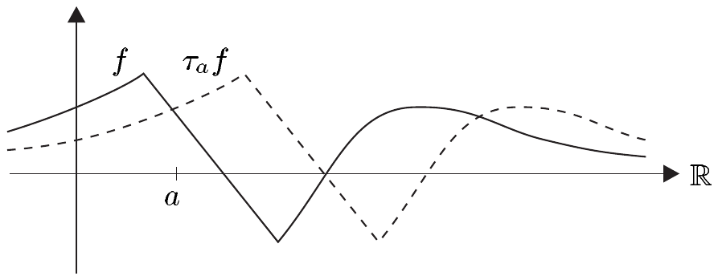

## 7 卷积

本节中，我们利用勒贝格测度的平移不变性在 $ L_{1}(\mathbb{R}^{n}) $ 上引进一个新的乘法——卷积，它依赖于勒贝格积分。我们将证明，这一运算不仅在 $ L_{1}(\mathbb{R}^{n}) $ 上有定义，而且在其他函数空间上也有定义，并且它具有重要的磨光性质。它的应用之一是某些逼近定理，我们在此证明它们，因为它们在后续的构造中极为有用。

我们将主要考虑定义在整个 $ \mathbb{R}^{n} $ 上的 $ \mathbb{K} $ 值函数空间。对于这类空间，我们在记号中省略定义域与陪域。换言之，若 $ \mathcal{F}(\mathbb{R}^{n}) = \mathcal{F}(\mathbb{R}^{n},\mathbb{K}) $ 是 $ \mathbb{R}^{n} $ 上 $ \mathbb{K} $ 值函数构成的向量空间，在没有混淆风险时我们就简写为 $ \mathcal{F} $。于是 $ L_{p} $ 表示 $ L_{p}(\mathbb{R}^{n}) = L_{p}(\mathbb{R}^{n},\mathbb{K}) $，依此类推。此外，$ \int f\,dx $ 将始终表示 $ \int_{\mathbb{R}^{n}} f\,dx $。

##### 卷积的定义

设 $ F $ 是 $ \mathbb{K} $-向量空间。对 $ f \in \mathcal{F}(\mathbb{R}^{n},F) $，我们定义另一个函数 $ \tilde{f} \in \mathcal{F}(\mathbb{R}^{n},F) $ 为 $ \tilde{f}(x) := f(-x) $，其中 $ x \in \mathbb{R}^{n} $。映射 $ f \mapsto \tilde{f} $ 称为（关于原点的）**反演**。

回忆 IX.5.15 中平移群 $ \mathcal{T} := \{\, \tau_{a} ; a \in \mathbb{R}^{n} \,\} $ 的定义。现在我们定义该群在 $ \mathcal{F}(\mathbb{R}^{n},F) $ 上的一个作用\footnote{见习题 I.7.6。}：

\[ \mathcal{T} \times \mathcal{F}(\mathbb{R}^{n},F) \to \mathcal{F}(\mathbb{R}^{n},F) , \quad (\tau_{a},f) \mapsto \tau_{a}f , \tag{7.1} \]

其中

\[ \tau_{a}f(x) := f(x-a) \quad \text{对 } a, x \in \mathbb{R}^{n} . \tag{7.2} \]

因此

\[ \tau_{a}f = f \circ \tau_{-a} = (\tau_{-a})^{\ast}f , \]

其中 $ (\tau_{-a})^{\ast} $ 是 VIII.3 节中定义的拉回。

7.1 注 (a) 对 $ f \in \mathcal{F} := \mathcal{F}(\mathbb{R}^{n},\mathbb{K}) $，我们有 $ \tilde{f} = (-\mathrm{id}_{\mathbb{R}^{n}})^{\ast}f $。

(b) 反演是 $ \mathcal{F} $ 上以及 $ p \in [1,\infty] \cup \{0\} $ 时的 $ \mathcal{L}_{p} $ 上的对合\footnote{映射 $ f \in X^{X} $ 称为\textbf{对合的}，若 $ f \circ f = \mathrm{id}_{X} $。}向量空间同构。

(c) 设 $ E \in \{ BC^{k}, BUC^{k}, C_{0} ; k \in \mathbb{N} \} $。则反演属于 $ \mathcal{L}\mathrm{aut}(E) $。

(d) 对 $ f \in \mathcal{F} $ 与 $ x \in \mathbb{R}^{n} $，我们有

\[ (\tau_{-x}f)^{\sim}(y) = \tau_{x}\tilde{f}(y) = f(x-y) \quad \text{对 } y \in \mathbb{R}^{n} . \]

(e) 设 $ n = 1 $ 且 $ a > 0 $。则 $ \tau_{a} : \mathbb{R} \to \mathbb{R} $，$ x \mapsto x+a $ 是 $ \mathbb{R} $ 上由 $ a $ 给出的**右平移**。定义 (7.2) 意味着 $ \tau_{a} $ 也把 $ f $ 的图像向右平移 $ a $。

因此 $ \mathcal{T} $ 在 $ \mathcal{F}(\mathbb{R},F) $ 上作为**右平移**起作用，这就澄清了把 $ \tau_{a}f $ 定义为 $ \mathbb{R} $ 的左平移 $ \tau_{-a} $ 的拉回这一做法。 ■

取 $ f, g \in \mathcal{L}_{1} $ 与 $ x \in \mathbb{R}^{n} $，并设 $ O $ 在 $ \mathbb{K} $ 中开。

\[ (\tau_{-x}f)^{-1}(O) = (f \circ \tau_{x})^{-1}(O) = \tau_{-x}(f^{-1}(O)) . \]

因此由推论 1.5 与引理 IX.5.16 可知 $ (\tau_{-x}f)^{-1}(O) $ 可测。于是再由推论 1.5，$ \tau_{-x}f $ 属于 $ \mathcal{L}_{0} $。现在由注 1.2(d) 以及注 7.1 的 (b) 与 (d) 推得：对每个 $ x \in \mathbb{R}^{n} $，$ y \mapsto f(x-y)g(y) $ 属于 $ \mathcal{L}_{0} $。若此函数可积，我们定义 $ f $ 与 $ g $ 在 $ x $ 处的卷积为

\[ f * g(x) := \int f(x-y)g(y)\,dy . \]

若 $ f * g(x) $ 对几乎每个 $ x \in \mathbb{R}^{n} $ 有定义，我们就说 $ f $ 与 $ g $ 是**可卷积的**。此时几乎处处有定义的函数

\[ f * g := (x \mapsto f * g(x)) \]

称为 $ f $ 与 $ g $ 的**卷积**。若 $ f $ 与 $ g $ 可卷积，且 $ (f * g)^{p} $ 可积（或当 $ p = \infty $ 时 $ f * g $ 本质有界），我们就写 $ f * g \in \mathcal{L}_{p} $，这略有滥用记号之嫌。\footnote{我们的确切意思是 $ f * g $ 的平凡延拓属于 $ \mathcal{L}_{p} $。})

现在我们要证明：对 $ p \in [1,\infty] $，每一对 $ (f,g) \in \mathcal{L}_{p} \times \mathcal{L}_{1} $ 都是可卷积的。下面的观察将有用。

7.2 引理 设 $ f \in \mathcal{L}_{0} $，$ (x,y) \in \mathbb{R}^{n} \times \mathbb{R}^{n} = \mathbb{R}^{2n} $，令

\[ F_{1}(x,y) := f(x) \quad \text{与} \quad F_{2}(x,y) := f(x-y) . \]

则 $ F_{1} $ 与 $ F_{2} $ 属于 $ \mathcal{L}_{0}(\mathbb{R}^{2n}) $。

证明 (i) 设 $ O $ 在 $ \mathbb{K} $ 中开，$ A := f^{-1}(O) $。则 $ A $ 属于 $ \mathcal{L}(n) $。因此注 6.1(b) 与命题 6.2 表明 $ F_{1}^{-1}(O) = A \times \mathbb{R}^{n} $ 是 $ \lambda_{2n} $-可测的。现在关于 $ F_{1} $ 的断言由推论 1.5 推出。

(ii) 令 $ \varphi(x,y) := (x-y,y) $，$ (x,y) \in \mathbb{R}^{n} \times \mathbb{R}^{n} $。则 $ \varphi \in \mathcal{L}\mathrm{aut}(\mathbb{R}^{2n}) $ 且 $ F_{2} = F_{1} \circ \varphi $。断言于是由 (i) 与定理 IX.5.12 推出。 ■

7.3 定理 设 $ p \in [1,\infty] $ 且 $ (f,g) \in \mathcal{L}_{p} \times \mathcal{L}_{1} $。

(i) $ f $ 与 $ g $ 可卷积。

(ii)（杨不等式）$ f * g \in \mathcal{L}_{p} $，且 $ \|f * g\|_{p} \le \|f\|_{p}\|g\|_{1} $。

证明 (a) 先设 $ p \in [1,\infty) $。由引理 7.2 与注 1.2(d)，映射 $ (x,y) \mapsto f(x-y)g(y) $ 属于 $ \mathcal{L}_{0}(\mathbb{R}^{2n}) $。利用赫尔德不等式推得

\[ \begin{aligned} \int |f(x-y)g(y)|\,dy &= \int |f(x-y)|\,|g(y)|^{1/p}|g(y)|^{1/p'}\,dy \\ &\le \left(\int |f(x-y)|^{p}|g(y)|\,dy\right)^{1/p}\left(\int |g(y)|\,dy\right)^{1/p'} . \end{aligned} \]

由此与托内利定理，我们得到

\[ \begin{aligned} \int \left(\int |f(x-y)g(y)|\,dy\right)^{p} dx &\le \|g\|_{1}^{p/p'}\iint |f(x-y)|^{p}|g(y)|\,dy\,dx \\ &= \|g\|_{1}^{p/p'}\iint |f(x-y)|^{p}\,dx\,|g(y)|\,dy \\ &= \|g\|_{1}^{1+p/p'}\|f\|_{p}^{p} < \infty , \end{aligned} \]

其中最后一步我们再次用到了勒贝格积分的平移不变性。于是得到\footnote{通读上一节最后一部分的读者会看出，这个界也可以由积分的闵可夫斯基不等式容易地推出。}

\[ \left(\int \left[\int |f(x-y)g(y)|\,dy\right]^{p} dx\right)^{1/p} \le \|f\|_{p}\|g\|_{1} < \infty . \tag{7.3} \]

现在由注 3.11(c) 断定：对几乎每个 $ x \in \mathbb{R}^{n} $ 有 $ \int |f(x-y)g(y)|\,dy < \infty $；由注 3.11(a)，这已足以说明 $ f $ 与 $ g $ 可卷积。定理的 (ii) 部分于是由 (7.3) 推出。

(b) 在 $ p = \infty $ 的情形，我们有

\[ \int |f(x-y)g(y)|\,dy \le \|f\|_{\infty}\|g\|_{1} < \infty \quad \text{对几乎每个 } x \in \mathbb{R}^{n} , \]

这立即蕴含 (i) 与 (ii)。 ■

7.4 推论 设 $ ([f],[g]) \in L_{p} \times L_{1} $，$ p \in [1,\infty] $。则

\[ f * g = f^{*} * g^{*} \quad \text{几乎处处于 } \mathbb{R}^{n} \]

对 $ (f^{*},g^{*}) \in ([f],[g]) $ 成立。

证明 由定理 7.3，$ f * g $、$ f^{*} * g^{*} $ 与 $ f * g^{*} $ 均几乎处处有定义且属于 $ \mathcal{L}_{p} $。因为

\[ f * g - f^{*} * g^{*} = f * (g - g^{*}) + (f - f^{*}) * g^{*} , \]

由杨不等式得到

\[ \|f * g - f^{*} * g^{*}\|_{p} \le \|f\|_{p}\|g - g^{*}\|_{1} + \|f - f^{*}\|_{p}\|g^{*}\|_{1} = 0 , \]

由此即得断言。 ■

现在我们可以对 $ p \in [1,\infty) $ 的 $ L_{p} \times L_{1} $ 的元素定义卷积：事实上，推论 7.4 保证映射

\[ * : L_{p} \times L_{1} \to L_{p} , \quad ([f],[g]) \mapsto [f * g] \]

是良定义的。我们把这个 $ * $ 称为 $ L_{p} \times L_{1} $ 上的**卷积乘积**，并称 $ [f] * [g] := [f * g] $ 为 $ [f] $ 与 $ [g] $ 的**卷积**。显然卷积也可以定义在 $ L_{1} \times L_{p} $ 上，对此我们也使用符号 $ * $。

##### 平移群

为了能更好地探讨卷积的更多性质，我们先汇集关于平移群 $ (\mathbb{R}^{n},+) $ 在函数空间上的表示的一些重要定义与事实。

设 $ F $ 是 $ \mathbb{K} $-向量空间，$ V $ 是 $ \mathcal{F}(\mathbb{R}^{n},F) $ 的向量子空间，且它在 $ \mathbb{R}^{n} $ 的平移群 $ \mathcal{T} $ 的作用 (7.1) 下是**不变的**，即对一切 $ a \in \mathbb{R}^{n} $ 有 $ \tau_{a}(V) \subset V $。通过**限制**，(7.1) 诱导出平移群 $ \mathcal{T} $ 在 $ V $ 上的一个作用

\[ \mathcal{T} \times V \to V , \quad (\tau_{a},v) \mapsto \tau_{a}v \]

对每个 $ a \in \mathbb{R}^{n} $，映射 $ T_{a} := (v \mapsto \tau_{a}v) $ 是 $ V $ 到自身的线性映射。因为

\[ \tau_{a}\tau_{b}v = \tau_{a+b}v \quad \text{与} \quad \tau_{0}v = v , \]

$ T_{a} $ 是 $ V $ 的向量空间自同构，且 $ (T_{a})^{-1} = T_{-a} $。因此\footnote{见注 I.12.2(d) 与 I.7.6(e)。}

\[ (\mathbb{R}^{n},+) \to \mathrm{Aut}(V) , \quad a \mapsto T_{a} \]

是一个群同态，即群 $ (\mathbb{R}^{n},+) $ 在 $ V $ 上的一个**线性表示**。特别地，

\[ \mathcal{T}_{V} := \{\, T_{a} \in \mathrm{Aut}(V) ; a \in \mathbb{R}^{n} \,\} \]

是 $ \mathrm{Aut}(V) $ 的子群，称为 $ V $ 上的**平移群**。我们倾向于在不致误解时用同一个符号 $ \tau_{a} $ 代替 $ T_{a} $。$ V $ 在 (7.1) 下的不变性也说成 $ (\mathbb{R}^{n},+) $ 在 $ V $ 上**线性可表示**。

若 $ V $ 是（半）赋范向量空间，则称群 $ \mathcal{T}_{V} $ 是**强连续的**，若对每个 $ v \in V $ 有 $ \lim_{a \to 0}\tau_{a}v = v $。

7.5 注 (a) $ (\mathbb{R}^{n},+) $ 在 $ \mathcal{F} $ 上以及在 $ \mathcal{B} := B(\mathbb{R}^{n}) $ 上线性可表示。

(b) $ (\mathbb{R}^{n},+) $ 在 $ \mathcal{L}_{\infty} $ 上线性可表示，且对 $ f \in \mathcal{L}_{\infty} $ 有 $ \|\tau_{a}f\|_{\infty} = \|f\|_{\infty} $。

证明 取 $ f \in \mathcal{L}_{\infty} $。对每个 $ \alpha > \|f\|_{\infty} $，存在勒贝格测度为零的集合 $ N $，使得 $ |f(x)| \le \alpha $ 对 $ x \in N^{c} $ 成立。由平移不变性（定理 IX.5.17），$ N_{a} := \tau_{a}(N) $ 的测度也为零，且

\[ |\tau_{a}f(x)| = |f(x-a)| \le \alpha \quad \text{对 } x \in N_{a}^{c} . \]

因此 $ \tau_{a}f $ 本质有界，且 $ \|\tau_{a}f\|_{\infty} \le \|f\|_{\infty} $。断言成立，因为

\[ \|f\|_{\infty} = \|\tau_{-a}(\tau_{a}f)\|_{\infty} \le \|\tau_{a}f\|_{\infty} . \quad \blacksquare \]

(c) 平移群 $ \mathcal{T}_{\mathcal{B}} $ 与 $ \mathcal{T}_{\mathcal{L}_{\infty}} $ 不强连续。

证明 $ \|\tau_{a}\chi_{\mathbb{B}^{n}} - \chi_{\mathbb{B}^{n}}\|_{\infty} = 1 $，$ a \in \mathbb{R}^{n} \setminus \{0\} $。 ■

(d) 若 $ \mathcal{T}_{V} $ 强连续，则

\[ (a \mapsto \tau_{a}f) \in C(\mathbb{R}^{n},V) \quad \text{对 } f \in V . \]

证明 这由 $ \tau_{a}f - \tau_{b}f = \tau_{a-b}(\tau_{b}f) - \tau_{b}f $（$ f \in V $，$ a, b \in \mathbb{R}^{n} $）推出。 ■

7.6 定理 设 $ V = \mathcal{L}_{p} $，$ p \in [1,\infty) $，或 $ V = BUC^{k} $，$ k \in \mathbb{N} $。则 $ (\mathbb{R}^{n},+) $ 在 $ V $ 上线性可表示，且平移群 $ \mathcal{T}_{V} $ 强连续。此外对 $ a \in \mathbb{R}^{n} $ 与 $ f \in V $ 有 $ \|\tau_{a}f\|_{V} = \|f\|_{V} $。

证明 (i) 先考虑 $ V = BUC^{k} $ 的情形。取 $ f \in BUC^{k} $、$ a \in \mathbb{R}^{n} $ 与 $ \varepsilon > 0 $。则存在 $ \delta > 0 $，使得对所有满足 $ |x-y| < \delta $ 的 $ x, y \in \mathbb{R}^{n} $ 有 $ |f(x) - f(y)| < \varepsilon $。由此

\[ |\tau_{a}f(x) - \tau_{a}f(y)| = |f(x-a) - f(y-a)| < \varepsilon \tag{7.4} \]

对满足 $ |x-y| < \delta $ 的 $ x, y \in \mathbb{R}^{n} $ 成立。因此 $ \tau_{a}f $ 属于 $ BUC $；又因为

\[ \partial^{\alpha}\tau_{a}f = \tau_{a}\partial^{\alpha}f \quad \text{对 } \alpha \in \mathbb{N}^{n} \text{ 与 } |\alpha| \le k , \tag{7.5} \]

我们得到 $ \tau_{a}f \in BUC^{k} $。从而 $ (\mathbb{R}^{n},+) $ 在 $ BUC^{k} $ 上线性可表示。

由注 7.5(b) 与 (7.5)，我们得到 $ \|\tau_{a}f\|_{BC^{k}} = \|f\|_{BC^{k}} $。

现在取 $ x \in \mathbb{R}^{n} $。若 $ |a| < \delta $，可在 (7.4) 中令 $ y = x+a $，得到

\[ |\tau_{a}f(x) - f(x)| < \varepsilon \quad \text{对 } x \in \mathbb{R}^{n} , \]

即 $ \|\tau_{a}f - f\|_{\infty} < \varepsilon $ 对 $ a \in \delta\mathbb{B}^{n} $ 成立。类似地，用 (7.5) 可以证明存在 $ \delta_{1} > 0 $，使得 $ \|\tau_{a}f - f\|_{BC^{k}} < \varepsilon $ 对 $ a \in \delta_{1}\mathbb{B}^{n} $ 成立。因此 $ \mathcal{T}_{BUC^{k}} $ 强连续。

(ii) 设 $ p \in [1,\infty) $，$ f \in \mathcal{L}_{p} $。等式 $ \|\tau_{a}f\|_{p} = \|f\|_{p} $ 由勒贝格积分的平移不变性推出。

现在取 $ \varepsilon > 0 $。由定理 4.14，存在 $ g \in C_{c} $ 使得 $ \|f - g\|_{p} < \varepsilon/3 $。因为 $ g $ 有紧支集，存在 $ \mathbb{R}^{n} $ 的紧子集 $ K $，使得 $ \mathrm{supp}(\tau_{a}g) \subset K $ 对 $ |a| \le 1 $ 成立。又因 $ g $ 一致连续，存在 $ \delta \in (0,1] $ 使得

\[ \|\tau_{a}g - g\|_{\infty} < \varepsilon/3\lambda_{n}(K)^{1/p} \quad \text{对 } a \in \delta\mathbb{B}^{n} . \]

设 $ a \in \delta\mathbb{B}^{n} $。因为 $ \mathrm{supp}(\tau_{a}g - g) \subset K $，定理 5.1(iv) 表明

\[ \|\tau_{a}g - g\|_{p} < \varepsilon/3 \quad \text{对 } a \in \delta\mathbb{B}^{n} . \]

由于

\[ \|\tau_{a}f - f\|_{p} \le \|\tau_{a}f - \tau_{a}g\|_{p} + \|\tau_{a}g - g\|_{p} + \|g - f\|_{p} \]

且 $ \|\tau_{a}f - \tau_{a}g\|_{p} = \|\tau_{a}(f-g)\|_{p} = \|f-g\|_{p} $，我们得到 $ \|\tau_{a}f - f\|_{p} < \varepsilon $ 对 $ a \in \delta\mathbb{B}^{n} $，证毕。 ■

现在我们对 $ p \in [1,\infty] $ 定义 $ \mathcal{T} $ 在 $ L_{p} $ 上的一个作用。由注 7.5(b) 与定理 7.6，对每个 $ a \in \mathbb{R}^{n} $，$ \tau_{a} $ 是 $ \mathcal{L}_{p} $ 的等距。因此映射

\[ L_{p} \to L_{p} , \quad [f] \mapsto [\tau_{a}f] \]

对每个 $ a \in \mathbb{R}^{n} $ 都良定义。我们也用 $ \tau_{a} $ 表示它，即令

\[ \tau_{a}[f] := [\tau_{a}f] \quad \text{对 } f \in L_{p} \text{ 与 } a \in \mathbb{R}^{n} . \]

于是

\[ \|\tau_{a}[f]\|_{p} = \|[\tau_{a}f]\|_{p} = \|\tau_{a}f\|_{p} = \|f\|_{p} = \|[f]\|_{p} . \tag{7.6} \]

显然

\[ \mathcal{T} \times L_{p} \to L_{p} , \quad (\tau_{a},f) \mapsto \tau_{a}f \]

是 $ \mathbb{R}^{n} $ 的平移群 $ \mathcal{T} $ 在 $ L_{p} $ 上的作用。由注 7.5(b) 与定理 7.6，对每个 $ a \in \mathbb{R}^{n} $，$ T_{a} := (f \mapsto \tau_{a}f) $ 是 $ L_{p} $ 上的线性等距。再次把 $ T_{a} $ 写成 $ \tau_{a} $，我们断定

\[ (\mathbb{R}^{n},+) \to \mathcal{L}\mathrm{aut}(L_{p}) , \quad a \mapsto \tau_{a} \]

是 $ \mathbb{R}^{n} $ 的加法群通过 $ L_{p} $ 上的线性等距给出的一个表示。特别地，$ L_{p} $ 上的**平移群**，即

\[ \mathcal{T}_{L_{p}} := \{\, \tau_{a} \in \mathcal{L}\mathrm{aut}(L_{p}) ; a \in \mathbb{R}^{n} \,\} , \]

是 $ \mathcal{L}\mathrm{aut}(L_{p}) $ 的由等距组成的子群。

7.7 推论 对 $ 1 \le p < \infty $，$ L_{p} $ 上的平移群强连续。

证明 这是定理 7.6 与 (7.6) 的直接推论。 ■

##### 卷积的基本性质

在关于平移群的这段题外话之后，我们回到卷积并导出它的主要性质。

7.8 定理 考虑 $ (f,g) \in L_{p} \times L_{1} $，$ p \in [1,\infty] $。

(i) 卷积 $ f * g $ 属于 $ L_{p} $，且满足**杨不等式**

\[ \|f * g\|_{p} \le \|f\|_{p}\|g\|_{1} . \]

(ii) $ f * g = g * f $。

(iii) 若 $ p = \infty $，则卷积 $ f * g $ 属于\footnote{见定理 4.18。} $ BUC $。

(iv) 对 $ \varphi \in BC^{k} $，我们有 $ \varphi * g \in BUC^{k} $，

\[ \partial^{\alpha}(\varphi * g) = \partial^{\alpha}\varphi * g \quad \text{对 } \alpha \in \mathbb{N}^{n} , \ |\alpha| \le k , \]

且 $ \|\varphi * g\|_{BC^{k}} \le \|\varphi\|_{BC^{k}}\|g\|_{1} $。

证明 (i) 由定理 7.3(ii) 与推论 7.4 推出。

(ii) 取 $ x \in \mathbb{R} $，设 $ f^{*} $ 与 $ g^{*} $ 分别是 $ f $ 与 $ g $ 的代表。又令 $ \psi(y) := x-y $，$ y \in \mathbb{R}^{n} $。则 $ \psi $ 是 $ \mathbb{R}^{n} $ 的对合等距。由定理 7.3(i) 与例 6.6(b) 可得

\[ \begin{aligned} f^{*} * g^{*}(x) &= \int f^{*}(x-y)g^{*}(y)\,dy = \int (f^{*} \circ \psi)\left((g^{*} \circ \psi) \circ \psi\right) dy \\ &= \int (g^{*} \circ \psi)f^{*}\,dy = \int g^{*}(x-y)f^{*}(y)\,dy = g^{*} * f^{*}(x) . \end{aligned} \]

因此由推论 7.4 得 $ f * g = g * f $。

(iii) 勒贝格积分的平移不变性给出 $ \|\tilde{g}\|_{1} = \|g\|_{1} $。由 (ii)，并因为 $ \mathcal{T}_{L_{1}} $ 的元素是等距，我们于是得到

\[ \begin{aligned} |f^{*} * g^{*}(x) - f^{*} * g^{*}(y)| &\le \int |f^{*}(z)(g^{*}(x-z) - g^{*}(y-z))|\,dz \le \|f^{*}\|_{\infty}\|\tau_{x}\tilde{g} - \tau_{y}\tilde{g}\|_{1} \\ &= \|f\|_{\infty}\|\tau_{y}(\tau_{x-y}\tilde{g} - \tilde{g})\|_{1} = \|f\|_{\infty}\|\tau_{x-y}\tilde{g} - \tilde{g}\|_{1} \end{aligned} \]

对 $ x, y \in \mathbb{R}^{n} $ 成立。因为 $ \tilde{g} \in L_{1} $，$ \mathcal{T}_{L_{1}} $ 的强连续性连同 (i) 表明 $ f^{*} * g^{*} \in BUC $。断言得证。

(iv) 鉴于 (iii)，只需考虑 $ k \ge 1 $ 的情形。为此我们定义 $ h(x,y) := \varphi(x-y)g(y) $，$ (x,y) \in \mathbb{R}^{n} \times \mathbb{R}^{n} $。则 $ h $ 满足定理 3.18 的假设，且由此得 $ \partial_{j}(\varphi * g) = \partial_{j}\varphi * g $，$ j \in \{1,\ldots,n\} $。由 (iii) 与定理 VII.2.10，我们有 $ \varphi * g \in BUC^{1} $。现在用归纳法可知 $ \varphi * g $ 属于 $ BUC^{k} $，且对每个满足 $ |\alpha| \le k $ 的 $ \alpha \in \mathbb{N}^{n} $ 有 $ \partial^{\alpha}(\varphi * g) = \partial^{\alpha}\varphi * g $。最后，由 (i) 我们有

\[ \begin{aligned} \|\varphi * g\|_{BC^{k}} &= \max_{|\alpha| \le k}\|\partial^{\alpha}(\varphi * g)\|_{\infty} = \max_{|\alpha| \le k}\|(\partial^{\alpha}\varphi) * g\|_{\infty} \le \left(\max_{|\alpha| \le k}\|\partial^{\alpha}\varphi\|_{\infty}\right)\|g\|_{1} \\ &= \|\varphi\|_{BC^{k}}\|g\|_{1} . \quad \blacksquare \end{aligned} \]

7.9 推论

(i) 设 $ p \in (1,\infty) $ 且 $ k \in \mathbb{N} $。卷积满足

\[ * \in \begin{cases} \mathcal{L}_{\mathrm{sym}}^{2}(L_{1},L_{1}) , \\ \mathcal{L}(L_{p},L_{1};L_{p}) , \\ \mathcal{L}(L_{\infty},L_{1};BUC) , \\ \mathcal{L}(BC^{k},L_{1};BUC^{k}) , \end{cases} \]

且所有这些映射的范数至多为 1。

(ii) $ (L_{1},+,*) $ 是没有乘法单位元的交换巴拿赫代数。

证明 (i) 与 (ii) 的第一个断言由定理 7.8 直接推出。现在假设存在 $ e \in L_{1} $ 使得对每个 $ f \in L_{1} $ 有 $ e * f = f $。我们取 $ e $ 的一个代表 $ e^{*} $，然后由习题 2.15 找到 $ \delta > 0 $ 使得

\[ \left|\int_{\delta\mathbb{B}^{n}} e^{*}(x-y)\,dy\right| = \left|\int_{\mathbb{B}^{n}(x,\delta)} e^{*}(z)\,dz\right| < 1 \quad \text{对 } x \in \mathbb{R}^{n} . \]

此外，存在勒贝格测度为零的集合 $ N $，使得 $ \chi_{\delta\mathbb{B}^{n}}(x) = e^{*} * \chi_{\delta\mathbb{B}^{n}}(x) $ 对 $ x \in N^{c} $ 成立。然而，对 $ x \in \delta\mathbb{B}^{n} \cap N^{c} $，我们有

\[ 1 = \chi_{\delta\mathbb{B}^{n}}(x) = e^{*} * \chi_{\delta\mathbb{B}^{n}}(x) = \int_{\mathbb{R}^{n}} e^{*}(x-y)\chi_{\delta\mathbb{B}^{n}}(y)\,dy = \int_{\delta\mathbb{B}^{n}} e^{*}(x-y)\,dy < 1 , \]

这是不可能的。 ■

7.10 定理（支集的可加性） 设 $ f, g \in \mathcal{L}_{0} $ 可卷积且 $ f $ 有紧支集。则

\[ \mathrm{supp}(f * g) \subset \mathrm{supp}(f) + \mathrm{supp}(g) . \]

证明 (i) 我们可以假设 $ f * g \neq 0 $。对 $ x \in [f * g \neq 0] $，存在 $ y \in \mathbb{R}^{n} $ 使得 $ f(x-y)g(y) \neq 0 $。由此 $ y \in \mathrm{supp}(g) $ 且 $ x \in y + \mathrm{supp}(f) $，于是 $ x $ 属于 $ \mathrm{supp}(f) + \mathrm{supp}(g) $。因此 $ [f * g \neq 0] \subset \mathrm{supp}(f) + \mathrm{supp}(g) $。

(ii) 我们证明 $ \mathrm{supp}(f) + \mathrm{supp}(g) $ 是闭的。设 $ (x_{k}) $ 是 $ \mathrm{supp}(f) + \mathrm{supp}(g) $ 中的序列，使得 $ x_{k} \to x $ 对某个 $ x \in \mathbb{R}^{n} $ 成立。则存在 $ \mathrm{supp}(f) $ 中的序列 $ (a_{k}) $ 与 $ \mathrm{supp}(g) $ 中的序列 $ (b_{k}) $，使得 $ x_{k} = a_{k} + b_{k} $，$ k \in \mathbb{N} $。因为 $ \mathrm{supp}(f) $ 紧，存在 $ (a_{k}) $ 的子序列 $ (a_{k_{\ell}})_{\ell \in \mathbb{N}} $ 与 $ a \in \mathrm{supp}(f) $，使得 $ a_{k_{\ell}} \to a $（$ \ell \to \infty $）。于是 $ b_{k_{\ell}} = x_{k_{\ell}} - a_{k_{\ell}} \to x - a $（$ k \to \infty $）。因为 $ \mathrm{supp}(g) $ 闭，我们知道 $ x-a $ 属于 $ \mathrm{supp}(g) $。因此存在 $ b \in \mathrm{supp}(g) $ 使得 $ x = a+b $。这说明 $ \mathrm{supp}(f) + \mathrm{supp}(g) $ 是闭的。断言由推论 III.2.13 推出。 ■

##### 恒等逼近

由推论 7.9 我们看到卷积代数 $ L_{1} $ 没有乘法单位元。然而，下一定理保证了“恒等逼近”的存在性，即元素 $ \varphi \in L_{1} $ 满足对每个 $ f \in L_{1} $ 有 $ \|\varphi * f - f\|_{1} < \varepsilon $（对给定的 $ \varepsilon > 0 $）。

7.11 定理（逼近定理） 给定 $ E \in \{ L_{p} ; 1 \le p < \infty \} $ 或 $ E \in \{ BUC^{k} ; k \in \mathbb{N} \} $，设 $ \varphi \in \mathcal{L}_{1} $ 且

\[ a := \int \varphi\,dx , \quad \varphi_{\varepsilon}(x) := \varepsilon^{-n}\varphi(x/\varepsilon) \quad \text{对 } x \in \mathbb{R}^{n} , \ \varepsilon > 0 . \]

则 $ \lim_{\varepsilon \to 0}\varphi_{\varepsilon} * f = af $ 在 $ E $ 中对 $ f \in E $ 成立。

证明 (i) 固定 $ \varepsilon > 0 $。由换元法则——例 6.6(b)——我们知道 $ \varphi_{\varepsilon} \in L_{1} $ 且 $ \int \varphi_{\varepsilon}\,dx = a $。因此定理 7.8 表明 $ \varphi_{\varepsilon} * f \in E $ 对 $ f \in E $ 成立。

(ii) 为证明 $ \varepsilon \to 0 $ 时的极限，先考虑 $ E = L_{p} $ 的情形。取 $ f \in \mathcal{L}_{p} $ 与 $ \varepsilon > 0 $。由定理 7.3(i) 以及定理 7.8(ii) 的证明，并用例 6.6(b) 中的变换 $ y \mapsto y/\varepsilon $，我们得到

\[ \begin{aligned} \varphi_{\varepsilon} * f(x) - af(x) &= f * \varphi_{\varepsilon}(x) - af(x) = \int [f(x-y) - f(x)]\varphi_{\varepsilon}(y)\,dy \\ &= \int [f(x-\varepsilon z) - f(x)]\varphi(z)\,dz = \int [\tau_{\varepsilon z}f(x) - f(x)]\varphi(z)\,dz \end{aligned} \tag{7.7} \]

对几乎每个 $ x \in \mathbb{R}^{n} $ 成立。推论 7.7 与注 7.5(d) 表明

\[ (z \mapsto (\tau_{\varepsilon z}f - f)) \in C(\mathbb{R}^{n},E) \quad \text{对 } \varepsilon > 0 , \tag{7.8} \]

且

\[ \lim_{\varepsilon \to 0}\|\tau_{\varepsilon z}f - f\|_{E} = 0 \quad \text{对 } z \in \mathbb{R}^{n} . \tag{7.9} \]

现在令

\[ g^{\varepsilon}(z) := (\tau_{\varepsilon z}f - f)\varphi(z) \quad \text{对 } z \in \mathbb{R}^{n} \text{ 与 } \varepsilon > 0 . \]

则由 (7.8)、定理 1.17 与注 1.2(d) 可知，对每个 $ \varepsilon > 0 $，$ g^{\varepsilon} $ 属于 $ \mathcal{L}_{0}(\mathbb{R}^{n},E) $。因为 $ \|\tau_{\varepsilon z}f\|_{E} = \|f\|_{E} $，我们还可由
