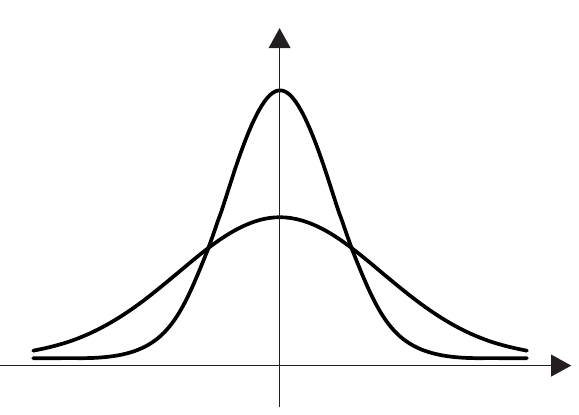
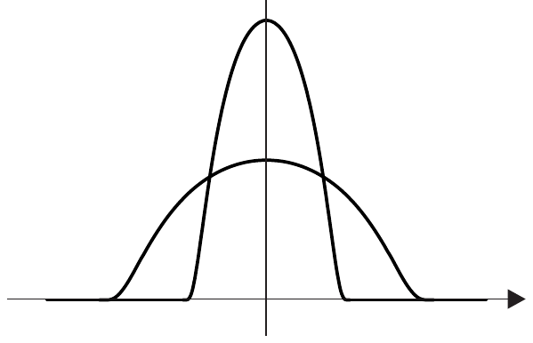
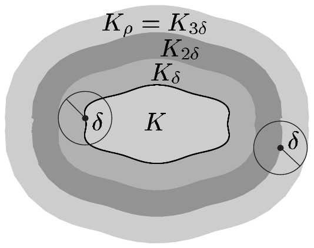

三角不等式

\[ \|g^{\varepsilon}(z)\|_{E} \le 2\|f\|_{E}|\varphi(z)| \quad \text{对 } z \in \mathbb{R}^{n} \text{ 与 } \varepsilon > 0 . \]

因为 $ \varphi \in \mathcal{L}_{1}(\mathbb{R}^{n}) $，我们由此断定 $ g^{\varepsilon} \in \mathcal{L}_{1}(\mathbb{R}^{n},E) $。于是 (7.7) 与定理 2.11(i) 给出界\footnote{这也可由积分的闵可夫斯基不等式推出。}

\[ \|\varphi_{\varepsilon} * f - af\|_{E} = \left\|\int g^{\varepsilon}(z)\,dz\right\|_{E} \le \int\|g^{\varepsilon}(z)\|_{E}\,dz . \]

现在控制收敛定理表明，当 $ \varepsilon \to 0 $ 时 $ \varphi_{\varepsilon} * f $ 在 $ E $ 中收敛到 $ af $，因为由 (7.9)，对几乎每个 $ z \in \mathbb{R}^{n} $ 都有 $ \lim_{\varepsilon \to 0}\|g^{\varepsilon}(z)\|_{E} = 0 $。

(iii) 现在设 $ f \in BUC^{k} $。若 $ \varphi = 0 $ 是 $ \lambda_{n} $-几乎处处成立的，则断言显然为真。于是设 $ m := \int|\varphi|\,dx > 0 $。由定理 7.8(ii) 与 (iv) 推出

\[ \partial^{\alpha}(\varphi_{\varepsilon} * f - af) = \varphi_{\varepsilon} * \partial^{\alpha}f - a\partial^{\alpha}f \quad \text{对 } \alpha \in \mathbb{N}^{n} \text{ 且 } |\alpha| \le k . \]

因此只需考虑 $ k = 0 $ 的情形。

设 $ \eta > 0 $。则存在 $ \delta > 0 $ 使得

\[ |f(x - y) - f(x)| \le \eta/2m \quad \text{对 } x, y \in \mathbb{R}^{n} ,\quad |y| < \delta , \]

并且我们得到

\[ \begin{aligned} |\varphi_{\varepsilon} * f(x) - af(x)| &\le \int|f(x - y) - f(x)|\,|\varphi_{\varepsilon}(y)|\,dy \\ &\le \frac{\eta}{2m}\int_{[|y|<\delta]}|\varphi_{\varepsilon}(y)|\,dy + 2\|f\|_{\infty}\int_{[|y|\ge\delta]}|\varphi_{\varepsilon}(y)|\,dy \\ &\le \frac{\eta}{2} + 2\|f\|_{\infty}\int_{[|y|\ge\delta]}|\varphi_{\varepsilon}(y)|\,dy \end{aligned} \tag{7.10} \]

对 $ x \in \mathbb{R}^{n} $。换元法则于是给出

\[ \int_{[|y|\ge\delta]}|\varphi_{\varepsilon}(y)|\,dy = \varepsilon^{-n}\int_{[|y|\ge\delta]}|\varphi(y/\varepsilon)|\,dy = \int_{[|z|\ge\delta/\varepsilon]}|\varphi(z)|\,dz . \]

由控制收敛定理，存在 $ \varepsilon_{0} > 0 $ 使得

\[ \int_{[|y|\ge\delta]}|\varphi_{\varepsilon}(y)|\,dy \le \frac{\eta}{4\|f\|_{\infty}} \quad \text{对 } \varepsilon \in (0,\varepsilon_{0}] . \]

现在由 (7.10) 推出断言。■

设 $ \varphi \in \mathcal{L}_{1} $ 满足 $ \int\varphi\,dx = 1 $，并置

\[ \varphi_{\varepsilon}(x) := \varepsilon^{-n}\varphi(x/\varepsilon) \quad \text{对 } x \in \mathbb{R}^{n} \text{ 与 } \varepsilon > 0 . \tag{7.11} \]

族 $ \{\varphi_{\varepsilon} ; \varepsilon > 0\} $ 称为**逼近核**或**恒等逼近**。若

\[ \varphi \in C^{\infty}(\mathbb{R}^{n},\mathbb{R}) , \quad \check{\varphi} = \varphi , \quad \varphi \ge 0 , \quad \operatorname{supp}(\varphi) \subset \overline{\mathbb{B}}^{n} , \quad \int\varphi\,dx = 1 , \]

则称 $ \{\varphi_{\varepsilon} ; \varepsilon > 0\} $ 为**磨光核**或**光滑核**。每个光滑核显然满足

\[ \operatorname{supp}(\varphi_{\varepsilon}) \subset \varepsilon\overline{\mathbb{B}}^{n} , \quad \|\varphi_{\varepsilon}\|_{1} = 1 \quad \text{对 } \varepsilon > 0 . \]

7.12 例\footnote{在两个例子中，图形下方的面积始终为 1，因此 $ \varepsilon $ 越小，最大值就相应地越高。} (a) **高斯核**是由

\[ k(x) := (4\pi)^{-n/2}e^{-|x|^{2}/4} \quad \text{对 } x \in \mathbb{R}^{n} \]

定义的族 $ \{k_{\varepsilon} ; \varepsilon > 0\} $。它是逼近核。

证明 由例 6.13(a)，我们知道

\[ \int g(x)\,dx = 1 \]

其中 $ g(x) := \pi^{-n/2}e^{-|x|^{2}} $。由于 $ k(x) = 2^{-n}g(x/2) $ 对 $ x \in \mathbb{R}^{n} $ 成立，由换元法则推出 $ \int k(x)\,dx = 1 $。■

(b) 设

\[ \varphi(x) := \begin{cases} c\,e^{1/(|x|^{2}-1)} & \text{若 } |x| < 1 , \\ 0 & \text{若 } |x| \ge 1 , \end{cases} \]

其中 $ c := \left(\int_{\mathbb{B}^{n}}e^{1/(|x|^{2}-1)}\,dx\right)^{-1} $ 的选取使 $ \varphi $ 的积分为 1。则族 $ \{\varphi_{\varepsilon} ; \varepsilon > 0\} $ 是光滑核。

证明 由于 $ x \mapsto |x|^{2} - 1 $ 在 $ \mathbb{R}^{n} $ 上光滑，例 IV.1.17 表明 $ \varphi $ 属于 $ C^{\infty}(\mathbb{R}^{n},\mathbb{R}) $（见习题 VII.5.16）。断言容易推出。■

##### 检验函数

设 $ X $ 是度量空间，$ A $ 与 $ B $ 是 $ X $ 的子集。若 $ \overline{A} $ 紧且含于 $ B $ 的内部，则称 $ A $ **紧包含于** $ B $（记作 $ A \subset\subset B $）。

若 $ X $ 在 $ \mathbb{R}^{n} $ 中开且 $ E $ 是赋范向量空间，则称

\[ \mathcal{D}(X,E) := \{\varphi \in C^{\infty}(X,E) ; \operatorname{supp}(\varphi) \subset\subset X\} \]

为 $ X $ 上的**（$ E $ 值）检验函数空间**。当 $ E = \mathbb{K} $ 时，按惯例记 $ \mathcal{D}(X) := \mathcal{D}(X,\mathbb{K}) $。显然 $ \mathcal{D}(X,E) $ 是 $ C^{\infty}(X,E) $ 与 $ C_{c}(X,E) $ 的向量子空间，且 $ \mathcal{D}(X,E) = C^{\infty}(X,E) \cap C_{c}(X,E) $。由于映射

\[ j : C_{c}(X,E) \to C_{c}(\mathbb{R}^{n},E) , \quad g \mapsto \tilde{g} , \]

是线性的且为单射，我们可以把 $ C_{c}(X,E) $ 与 $ C_{c}(\mathbb{R}^{n},E) $ 的一个向量子空间等同起来，并在需要时把前者的每个元素看作后者的元素。同样，我们把 $ \mathcal{D}(X,E) $ 与 $ \mathcal{D}(\mathbb{R}^{n},E) $ 的一个向量子空间等同起来。有了这些记号，对每个 $ p \in [1,\infty] $ 我们都有如下向量子空间的包含关系：

\[ \mathcal{D}(X,E) \subset \mathcal{D}(\mathbb{R}^{n},E) \subset C_{c}(\mathbb{R}^{n},E) \subset L_{p}(\mathbb{R}^{n},E) . \]

7.13 定理 设 $ X $ 在 $ \mathbb{R}^{n} $ 中开，$ p \in [1,\infty) $。则 $ \mathcal{D}(X) $ 是 $ L_{p}(X) $ 与 $ C_{0}(X) $ 的稠密向量子空间。

证明 (i) 取 $ g \in C_{c}(X) $ 与 $ \eta > 0 $。又设 $ \{\varphi_{\varepsilon} ; \varepsilon > 0\} $ 是光滑核。由定理 7.8，$ \varphi_{\varepsilon} * g $ 属于 $ BUC^{k} $，从而对每个 $ k \in \mathbb{N} $ 属于 $ BUC^{\infty} $。由于 $ g $ 具有紧支集，存在 $ \varepsilon_{0} > 0 $ 使得\footnote{这里约定 $ \operatorname{dist}(\operatorname{supp}(g),\varnothing) := \infty $。} $ \operatorname{dist}(\operatorname{supp}(g),X^{c}) \ge \varepsilon_{0} $。由定理 7.10 推出

\[ \operatorname{supp}(\varphi_{\varepsilon} * g) \subset \operatorname{supp}(\varphi_{\varepsilon}) + \operatorname{supp}(g) \subset \operatorname{supp}(g) + \varepsilon\overline{\mathbb{B}}^{n} \quad \text{对 } \varepsilon > 0 . \]

于是对 $ \varepsilon \in (0,\varepsilon_{0}) $，$ \varphi_{\varepsilon} * g $ 属于 $ \mathcal{D}(X) $。最后由定理 7.11，对每个 $ q \in [1,\infty] $ 都能找到某个 $ \varepsilon_{1} \in (0,\varepsilon_{0}) $ 使得 $ \|\varphi_{\varepsilon_{1}} * g - g\|_{q} < \eta/2 $。

(ii) 现在设 $ f \in L_{p}(X) $。由定理 5.1，可以找到 $ g \in C_{c}(X) $ 使得 $ \|f - g\|_{p} < \eta/2 $。由 (i)，存在 $ h \in \mathcal{D}(X) $ 使得 $ \|f - h\|_{p} < \eta $。

(iii) 对 $ f \in C_{0}(X) $，设 $ K $ 是 $ X $ 的紧子集，使得对 $ x \in X \setminus K $ 有 $ |f(x)| < \eta/2 $。由命题 4.13，可以选取 $ \varphi \in C_{c}(X) $ 使得 $ 0 \le \varphi \le 1 $ 且 $ \varphi|K = 1 $。置 $ g := \varphi f $。由于对 $ x \in K $ 有 $ f(x) = g(x) $，推出

\[ |f(x) - g(x)| = |f(x)|\,|1 - \varphi(x)| < \eta/2 \quad \text{对 } x \in X . \]

因此 $ \|f - g\|_{\infty} \le \eta/2 $。断言于是由 (i) 推出。■

##### 光滑单位分解

在第 4 节中，我们证明了一般度量空间中连续乌雷松函数的存在性。这一结果在 $ \mathbb{R}^{n} $ 的特殊情形下可以明显改进，此时我们可以用磨光核真正构造出光滑截断函数。

7.14 命题（光滑截断函数） 设 $ K \subset \mathbb{R}^{n} $ 紧，并置

\[ K_{\rho} := \{x \in \mathbb{R}^{n} ; \operatorname{dist}(x,K) < \rho\} \quad \text{对 } \rho > 0 . \]

则对每个 $ \alpha \in \mathbb{N}^{n} $ 与每个 $ \rho > 0 $，存在正常数 $ c(\alpha) $ 与映射 $ \varphi \in \mathcal{D}(K_{\rho}) $ 使得 $ 0 \le \varphi \le 1 $、$ \varphi|K = 1 $，且 $ \|\partial^{\alpha}\varphi\|_{\infty} \le c(\alpha)\rho^{-|\alpha|} $。

证明 设 $ \{\psi_{\varepsilon} ; \varepsilon > 0\} $ 是光滑核。置 $ \delta := \rho/3 $ 与 $ \varphi := \psi_{\delta} * \chi_{K_{\delta}} $。则 $ \varphi $ 属于 $ BUC^{\infty} $，且由定理 7.10 推出

\[ \operatorname{supp}(\varphi) \subset \operatorname{supp}(\psi_{\delta}) + \overline{K}_{\delta} \subset \delta\overline{\mathbb{B}}^{n} + \overline{K}_{\delta} \subset \overline{K}_{2\delta} \subset K_{3\delta} = K_{\rho} . \]

因此 $ \varphi $ 属于 $ \mathcal{D}(K_{\rho}) $。此外

\[ \varphi(x) = \int\psi_{\delta}(x - y)\chi_{K_{\delta}}(y)\,dy \le \int\psi_{\delta}(x - y)\,dy = 1 \]

对 $ x \in \mathbb{R}^{n} $ 成立，从而 $ 0 \le \varphi \le 1 $。若 $ x $ 位于 $ K $ 中，则

\[ \varphi(x) = \int\psi_{\delta}(y)\chi_{K_{\delta}}(x - y)\,dy = \int\psi_{\delta}(y)\,dy = 1 , \]

因此 $ \varphi|K = 1 $。最后，由于 $ \partial^{\alpha}\psi_{\delta} = \delta^{-|\alpha|}(\partial^{\alpha}\psi_{1})_{\delta} $ 对 $ \alpha \in \mathbb{N}^{n} $ 成立，由定理 7.8(iv) 得到

\[ \partial^{\alpha}\varphi = \partial^{\alpha}(\psi_{\delta} * \chi_{K_{\delta}}) = \partial^{\alpha}\psi_{\delta} * \chi_{K_{\delta}} = \delta^{-|\alpha|}(\partial^{\alpha}\psi_{1})_{\delta} * \chi_{K_{\delta}} . \]

现在 $ c(\alpha) := 3^{|\alpha|}\|\partial^{\alpha}\psi_{1}\|_{1} $ 与 $ \delta > 0 $ 无关，于是由杨不等式推出 $ \|\partial^{\alpha}\varphi\|_{\infty} \le c(\alpha)\rho^{-|\alpha|} $。■

设 $ K \subset \mathbb{R}^{n} $ 紧，并用 $ \{X_{j} ; 0 \le j \le m\} $ 表示 $ K $ 的一个有限开覆盖。若对每个 $ j \in \{0,\ldots,m\} $ 都存在 $ \varphi_{j} \in C^{\infty}(\mathbb{R}^{n}) $ 使得

(i) $ 0 \le \varphi_{j} \le 1 $，

(ii) $ \operatorname{supp}(\varphi_{j}) \subset X_{j} $，且

(iii) $ \sum_{j=0}^{m}\varphi_{j}(x) = 1 $ 对 $ x \in K $，

则称 $ \{\varphi_{j} ; 0 \le j \le m\} $ 为 $ K $ 上从属于覆盖 $ \{X_{j} ; 0 \le j \le m\} $ 的**光滑单位分解**。

若 $ X_{0} $ 在 $ \mathbb{R}^{n} $ 中开且 $ K \subset X_{0} $，则 $ \operatorname{dist}(K,X_{0}^{c}) > 0 $，而命题 7.14（取 $ \rho := \operatorname{dist}(K,X_{0}^{c}) $）保证了 $ K $ 上从属于单元素覆盖 $ \{X_{0}\} $ 的光滑单位分解的存在性。为处理有限覆盖的一般情形，我们需要一个技术性结果：

7.15 引理（收缩引理） 设 $ \{X_{j} ; 0 \le j \le m\} $ 是 $ \mathbb{R}^{n} $ 的紧子集 $ K $ 的有限开覆盖。则存在 $ K $ 的开覆盖 $ \{U_{j} ; 0 \le j \le m\} $ 使得 $ U_{j} \subset\subset X_{j} $ 对 $ j \in \{0,\ldots,m\} $ 成立。

证明 给定 $ x \in K $，选取 $ j \in \{0,\ldots,m\} $ 使得 $ x \in X_{j} $，并取 $ r_{x} > 0 $ 使得 $ V_{x} := \mathbb{B}^{n}(x,r_{x}) $ 紧且含于 $ X_{j} $。则 $ \{V_{x} ; x \in K\} $ 是 $ K $ 的开覆盖，于是存在 $ k \in \mathbb{N} $ 与 $ \{x_{0},\ldots,x_{k}\} \subset K $ 使得 $ K \subset \bigcup_{i=0}^{k}V_{x_{i}} $。取 $ U_{j} := \bigcup\{V_{x_{i}} ; V_{x_{i}} \subset X_{j}\} $（$ j \in \{0,\ldots,m\} $），我们便得到具有所需性质的族 $ \{U_{j} ; 0 \le j \le m\} $。■

7.16 定理（光滑单位分解） 若 $ K $ 是 $ \mathbb{R}^{n} $ 的紧子集，则 $ K $ 的每个有限开覆盖都有从属于它的光滑单位分解。

证明 设 $ \{X_{j} ; 0 \le j \le m\} $ 是 $ K $ 的有限开覆盖。由引理 7.15，存在开覆盖 $ \{U_{j} ; 0 \le j \le m\} $ 使得 $ U_{j} \subset\subset X_{j} $ 对 $ j \in \{0,\ldots,m\} $ 成立。我们定义 $ K_{j} := \overline{U}_{j} $。则 $ K_{j} $ 紧，且 $ \operatorname{dist}(K_{j},X_{j}^{c}) $ 对每个 $ j \in \{0,\ldots,m\} $ 都为正。命题 7.14 于是表明存在 $ \psi_{j} \in \mathcal{D}(X_{j}) $ 使得 $ 0 \le \psi_{j} \le 1 $ 且 $ \psi_{j}|K_{j} = 1 $。置

\[ \varphi_{0} := \psi_{0} \quad \text{与} \quad \varphi_{k} := \psi_{k}\prod_{j=0}^{k-1}(1 - \psi_{j}) \quad \text{对 } 1 \le k \le m , \]

容易用归纳法验证 $ \sum_{j=0}^{m}\varphi_{j} = 1 - \prod_{j=0}^{m}(1 - \psi_{j}) $。断言现在由 $ K \subset \bigcup_{j=0}^{m}K_{j} $ 推出。■

下面我们给出定理 7.16 的一些简单应用。更多更复杂的情形将在后续各章中描述。

7.17 应用 (a) 设 $ X $ 在 $ \mathbb{R}^{n} $ 中开。则对 $ f \in L_{0}(X) $，下列命题等价：

(i) $ f \in L_{1,loc}(X) $；

(ii) 对每个 $ \varphi \in \mathcal{D}(X) $ 有 $ \varphi f \in L_{1}(X) $；

(iii) 对每个 $ K = \overline{K} \subset\subset X $ 有 $ \widetilde{f|K} \in L_{1}(X) $。

证明 设 $ (U_{j})_{j\in\mathbb{N}} $ 是 $ X $ 的一列递增的相对紧开子集，且 $ X = \bigcup_{j}U_{j} $（见注 1.16(d) 与 (e)）。则（见习题 4.3）

\[ L_{1,loc}(X) = \{f \in L_{0}(X) ; \chi_{U_{j}}f \in L_{1}(X),\ j \in \mathbb{N}\} . \]

“(i)$ \Rightarrow $(ii)” 设 $ \varphi \in \mathcal{D}(X) $。由于 $ K := \operatorname{supp}(\varphi) $ 紧且 $ (U_{j})_{j\in\mathbb{N}} $ 递增，存在 $ k \in \mathbb{N} $ 使得 $ K \subset U_{k} $。借助命题 7.14，我们找到 $ \psi \in \mathcal{D}(U_{k}) $ 使得 $ 0 \le \psi \le 1 $ 且 $ \psi|K = 1 $。则

\[ \int_{X}|\varphi f|\,dx = \int_{X}|\varphi\psi f|\,dx \le \|\varphi\|_{\infty}\int_{X}|\psi f|\,dx \le \|\varphi\|_{\infty}\|\chi_{U_{k}}f\|_{1} < \infty . \]

因此 $ \varphi f $ 属于 $ L_{1}(X) $。

“(ii)$ \Rightarrow $(iii)” 取 $ K = \overline{K} \subset\subset X $ 与 $ \varphi \in \mathcal{D}(X) $ 使得 $ \varphi|K = 1 $。则

\[ \int_{K}|f| = \int_{K}|\varphi f| \le \|\varphi f\|_{1} < \infty , \]

因此 $ \widetilde{f|K} \in L_{1}(X) $。

“(iii)$ \Rightarrow $(i)” 这一蕴含是显然的，因为每个 $ \overline{U}_{j} $ 都紧。■

(b) 设 $ X $ 在 $ \mathbb{R}^{n} $ 中开。则 $ C(X) \subset L_{1,loc}(X) $。

证明 取 $ f \in C(X) $ 与 $ \varphi \in \mathcal{D}(X) $。则 $ \varphi f $ 属于 $ C_{c}(X) $。由定理 5.1 有 $ \varphi f \in L_{1}(X) $，断言由 (a) 推出。■

(c) 群 $ (\mathbb{R}^{n},+) $ 在 $ BUC^{k} $ 中的线性表示是单射，从而是到其像 $ \mathcal{T}_{BUC^{k}} $ 上的群同构。

证明 对 $ a \in \mathbb{R}^{n} $，设 $ \tau_{a} = \mathrm{id}_{BUC^{k}} $。取 $ r > |a| $ 以及关于 $ r\overline{\mathbb{B}}^{n} $ 的截断函数 $ \varphi \in \mathcal{D}(\mathbb{R}^{n}) $。则 $ f_{j} := \varphi\,\mathrm{pr}_{j} $ 属于 $ BUC^{k} $，并且我们得到

\[ -a_{j} = \tau_{a}f_{j}(0) = f_{j}(0) = 0 \quad \text{对 } j \in \{1,\ldots,n\} . \]

因此 $ a = 0 $。这意味着表示 $ a \mapsto \tau_{a} $ 是单射。■

(d) 设 $ X $ 在 $ \mathbb{R}^{n} $ 中开且有界。又设 $ \{X_{j} ; 0 \le j \le m\} $ 是 $ X $ 的有限开覆盖，$ \{\varphi_{j} ; 0 \le j \le m\} $ 是从属于它的光滑单位分解。最后设 $ k \in \mathbb{N} $ 且

\[ |||u|||_{BC^{k}} := \sum_{j=0}^{m}\|\varphi_{j}u\|_{BC^{k}} \quad \text{对 } u \in BC^{k}(X) . \]

则 $ |||\cdot|||_{BC^{k}} $ 是 $ BC^{k}(X) $ 上的等价范数。

证明 取 $ u \in BC^{k}(X) $。显然

\[ \|u\|_{BC^{k}} = \left\|\sum_{j=0}^{m}\varphi_{j}u\right\|_{BC^{k}} \le \sum_{j=0}^{m}\|\varphi_{j}u\|_{BC^{k}} = |||u|||_{BC^{k}} . \]

由莱布尼茨法则（见习题 VII.5.21），我们得到

\[ \begin{aligned} |||u|||_{BC^{k}} &= \sum_{j=0}^{m}\max_{|\alpha|\le k}\|\partial^{\alpha}(\varphi_{j}u)\|_{\infty} = \sum_{j=0}^{m}\max_{|\alpha|\le k}\left\|\sum_{\beta\le\alpha}\binom{\alpha}{\beta}\partial^{\beta}\varphi_{j}\,\partial^{\alpha-\beta}u\right\|_{\infty} \\ &\le \sum_{j=0}^{m}c_{k}\|\varphi_{j}\|_{BC^{k}}\|u\|_{BC^{k}} \le C\|u\|_{BC^{k}} , \end{aligned} \]

其中我们置 $ c_{k} := \max_{|\alpha|\le k}\sum_{\beta\le\alpha}\binom{\alpha}{\beta} $ 与 $ C := c_{k}\sum_{j=0}^{m}\|\varphi_{j}\|_{BC^{k}} $。■

##### E 值函数的卷积

回顾前面的证明可见，当两个函数之一取值于巴拿赫空间 $ F $ 而另一个为标量值时，卷积 $ f * g $ 同样可以定义。只要关于等距映射的换元法则对 $ F $ 值函数仍然成立，所有证明都可原样通过\footnote{当然，交换性公式 $ f * g = g * f $ 必须作正确的解释。}。情况确实如此，这一点我们将在下一节说明。特别地，定理 7.11 中的关键逼近结果对空间 $ L_{p}(\mathbb{R}^{n},F) $ 与 $ BUC^{k}(\mathbb{R}^{n},F) $ 仍然成立，其中 $ 1 \le p < \infty $、$ k \in \mathbb{N} $。由此得到的一个推论是定理 7.13 的类似结论：$ \mathcal{D}(X,F) $ 是 $ C_{0}(X,F) $ 与 $ L_{p}(X,F) $（$ 1 \le p < \infty $）的稠密向量子空间。

##### 分布

设 $ X $ 是 $ \mathbb{R}^{n} $ 的非空开子集\footnote{本节其余部分意在提供应用与更深入理论的概览；初读时可以跳过。}。众所周知，$ X $ 上的标量函数是把实数或复数指派给 $ X $ 中每一点的规则。但这个定义只是抽象的说法，因为 $ X $ 的各个点在实践中无法分辨。例如，若要确定占据集合 $ X $ 的某种介质的温度分布，我们就必须依靠实验探针。然而这样的探针有一定大小，只能确定 $ f $ 在一个扩展区域上的值；它赋给 $ f(x_{0}) $ 的值并不代表 $ x_{0} $ 处的真实值（如果这种说法在物理上确实有意义），而是代表 $ x_{0} $ 附近某种平均值：在数学上就是积分 $ \int_{X}\varphi f\,dx $，其中 $ \varphi $ 是依赖于探针的“检验函数”。当然，检验函数 $ \varphi $ 越是集中在 $ x_{0} $ 附近，测量就越好地逼近精确值 $ f(x_{0}) $，也就是说，探针把数据抹得越少。

若要声称完全了解 $ f(x_{0}) $，人们可以想象动用一切可能的探针，换言之，确定 $ \int_{X}\varphi f\,dx $ 对所有可能的检验函数 $ \varphi $ 的取值。用数学语言来说，我们就是用定义在所有检验函数构成的空间上的一个泛函来代替逐点函数 $ f : X \to \mathbb{K} $，即映射

\[ T_{f} : \mathcal{D}(X) \to \mathbb{K} , \quad \varphi \mapsto \int_{X}\varphi f\,dx . \tag{7.12} \]

我们选取 $ \mathcal{D}(X) $ 作为检验函数空间在很大程度上是任意的。为概念上的简单起见，我们也许想用 $ C_{c}(X) $ 代替 $ \mathcal{D}(X) $。同时，我们还想避免进行比必要的更多的“测量”；这就要求选一个在某种意义下小的检验空间。但这个空间必须足够大，使得平均值 $ \int_{X}\varphi f\,dx $ 确实能确定 $ f $。也就是说，我们希望：对所有检验函数 $ \varphi $，$ \int_{X}\varphi f\,dx $ 与 $ \int_{X}\varphi g\,dx $ 相等，就能推出 $ f = g $。

下一个定理表明，若我们选取 $ \mathcal{D}(X) $ 作为检验空间并在 $ L_{1,loc}(X) $ 中工作，情况确实如此。（由应用 7.17(a)，$ L_{1,loc}(X) $ 是 $ L_{0}(X) $ 的最大的向量子空间 $ E $，使得 $ \int_{X}\varphi f\,dx $ 对所有 $ f \in E $ 与所有 $ \varphi \in \mathcal{D}(X) $ 都有定义。）

7.18 定理 设 $ f \in L_{1,loc}(X) $。若

\[ \int_{X}\varphi f\,dx = 0 \quad \text{对 } \varphi \in \mathcal{D}(X) , \tag{7.13} \]

则 $ f = 0 $。

证明 设 $ f \ne 0 $，并设 $ f^{\ast} \in \mathcal{L}_{1,loc}(X) $ 是 $ f $ 的一个代表。由正则性，存在 $ X $ 的具有正测度的紧子集 $ K $，使得对 $ x \in K $ 有 $ f^{\ast}(x) \ne 0 $。取 $ \eta \in \mathcal{D}(X) $ 使得 $ \eta|K = 1 $，并置 $ g := \eta f^{\ast} $。由应用 7.17(a)，$ g $ 属于 $ \mathcal{L}_{1} $。又对 $ x \in K $ 有 $ g(x) \ne 0 $。设 $ \{\varphi_{\varepsilon} ; \varepsilon > 0\} $ 是光滑核。则 $ \lim_{\varepsilon \to 0}\varphi_{\varepsilon} * g = g $ 在 $ \mathcal{L}_{1} $ 中成立。由推论 4.7，存在零序列 $ (\varepsilon_{j}) $ 与勒贝格测度为零的集合 $ N $，使得

\[ \lim_{j \to \infty}\varphi_{\varepsilon_{j}} * g(x) = g(x) \quad \text{对 } x \in N^{c} . \tag{7.14} \]

给定 $ x_{0} \in K \cap N^{c} $，置 $ \psi_{j} := \eta\tau_{x_{0}}\varphi_{\varepsilon_{j}} \in \mathcal{D}(X) $（$ j \in \mathbb{N} $）。由于由注 7.1(d) 有 $ \check{\varphi}_{\varepsilon} = \varphi_{\varepsilon} $，等式 (7.13) 给出

\[ \begin{aligned} \varphi_{\varepsilon_{j}} * g(x_{0}) &= \int g(y)\varphi_{\varepsilon_{j}}(x_{0} - y)\,dy = \int_{X}(\eta f^{\ast})(y)\varphi_{\varepsilon_{j}}(x_{0} - y)\,dy \\ &= \int_{X}f^{\ast}(y)\psi_{j}(y)\,dy = 0 . \end{aligned} \]

然而由 (7.14)，这与 $ g(x_{0}) \ne 0 $ 矛盾。断言成立，因为 $ f $ 的代表 $ f^{\ast} $ 是任意选取的。■

显然映射 $ T_{f} $ 是 $ \mathcal{D}(X) $ 上的线性泛函。要使 $ T_{f}\varphi = \int_{X}\varphi f\,dx $ 作为一种测量值有意义，$ T_{f}\varphi $ 必须“连续地”依赖于测量装置；也就是说，探针的小扰动（从而检验函数 $ \varphi $ 的小扰动）只应引起测量值的微小变化。用数学语言来说，这意味着 $ T_{f} $ 必须是 $ \mathcal{D}(X) $ 上的连续线性泛函。因此我们必须在 $ \mathcal{D}(X) $ 上引入拓扑。

由于这里的处理是引论性的，我们只限于陈述序列在 $ \mathcal{D}(X) $ 中收敛是什么意思。这种收敛应当与 $ \mathcal{D}(X) $ 上的向量结构相容，因此只需考虑极限为 0 的情形。

我们说序列 $ (\varphi_{j}) $ 在 $ \mathcal{D}(X) $ 中**收敛到 0**（或**是零序列**），是指满足下列条件：

($ \mathcal{D}_{1} $) 存在 $ K \subset\subset X $ 使得 $ \operatorname{supp}(\varphi_{j}) \subset K $ 对 $ j \in \mathbb{N} $ 成立。

($ \mathcal{D}_{2} $) 对每个 $ k \in \mathbb{N} $ 有 $ \varphi_{j} \to 0 $ 于 $ BC^{k}(X) $。

显然 ($ \mathcal{D}_{2} $) 等价于：

\[ \text{序列 } (\partial^{\alpha}\varphi_{j})_{j\in\mathbb{N}} \text{ 对每个 } \alpha \in \mathbb{N}^{n} \text{ 一致收敛到 } 0. \tag{7.15} \]

因此，为使 $ \varphi_{j} $ 在 $ \mathcal{D}(X) $ 中收敛到 0，(7.15) 必须成立，而且函数 $ \varphi_{j} $ 的支集还必须都含于 $ X $ 的一个固定紧子集之中。

线性泛函 $ T : \mathcal{D}(X) \to \mathbb{K} $ 称为**连续的**，若对 $ \mathcal{D}(X) $ 中的每个零序列 $ (\varphi_{j}) $ 都有 $ T\varphi_{j} \to 0 $。$ \mathcal{D}(X) $ 上的连续线性泛函也称为 $ X $ 上的 **Schwartz 分布**，或简称**分布**。$ X $ 上分布的集合记作 $ \mathcal{D}'(X) $；它显然是 $ \operatorname{Hom}(\mathcal{D}(X),\mathbb{K}) $ 的向量子空间。

（在泛函分析中——更确切地说，在拓扑向量空间理论中——人们证明 $ \mathcal{D}(X) $ 上恰有一个豪斯多夫拓扑，它局部凸\footnote{这是说原点有一个由凸集组成的开邻域基。}、与向量结构相容，并且序列按上述意义收敛到 0 当且仅当它们按该拓扑收敛到 0。关于这个拓扑，$ \mathcal{D}'(X) $ 是 $ \mathcal{D}(X) $ 的对偶空间，即 $ \mathcal{D}(X) $ 上所有连续线性泛函构成的空间。例如可参看 [Sch66] 或 [Yos65]。）

7.19 例 (a) 对每个 $ f \in L_{1,loc}(X) $，由 (7.12) 定义的线性泛函 $ T_{f} $ 是 $ X $ 上的分布。

证明 设 $ (\varphi_{j}) $ 是 $ \mathcal{D}(X) $ 中的序列，使得 $ \varphi_{j} \to 0 $ 于 $ \mathcal{D}(X) $。则存在 $ X $ 的紧子集 $ K $ 使得 $ \operatorname{supp}(\varphi_{j}) \subset X $ 对 $ j \in \mathbb{N} $ 成立。推出

\[ |T_{f}\varphi_{j}| = \left|\int_{X}\varphi_{j}f\,dx\right| \le \int_{K}|\varphi_{j}|\,|f|\,dx \le \|f\|_{L_{1}(K)}\|\varphi_{j}\|_{\infty} \]

对 $ j \in \mathbb{N} $ 成立。因为 $ \|f\|_{L_{1}(K)} < \infty $，我们得到 $ T_{f}\varphi_{j} \to 0 $ 于 $ \mathbb{K} $，因为 ($ \mathcal{D}_{2} $) 蕴含 $ \|\varphi_{j}\|_{\infty} \to 0 $。■

(b) 设 $ \mu $ 是 $ X $ 上的拉东测度。则

\[ \mathcal{D}(X) \to \mathbb{K} , \quad \varphi \mapsto \int_{X}\varphi\,d\mu \]

定义了 $ X $ 上的一个分布。

证明 设 $ (\varphi_{j}) $ 是 $ \mathcal{D}(X) $ 中的序列，使得 $ \varphi_{j} \to 0 $ 于 $ \mathcal{D}(X) $。又设 $ K = \overline{K} \subset\subset X $ 包含所有 $ j \in \mathbb{N} $ 的 $ \operatorname{supp}(\varphi_{j}) $。则

\[ \left|\int_{X}\varphi_{j}\,d\mu\right| \le \int_{K}|\varphi_{j}|\,d\mu \le \mu(K)\|\varphi_{j}\|_{\infty} \quad \text{对 } j \in \mathbb{N} . \]

如 (a) 的证明中那样，这说明 $ \varphi $ 是 $ X $ 上的分布。■

(c) 设 $ \delta $ 是 $ \mathbb{R}^{n} $ 上支集在 0 处的狄拉克测度。则

\[ \varphi \mapsto \langle\delta,\varphi\rangle := \int_{X}\varphi\,d\delta = \varphi(0) \quad \text{对 } \varphi \in \mathcal{D}(\mathbb{R}^{n}) , \]

是 $ \mathbb{R}^{n} $ 上的一个分布，即**狄拉克分布**

\[ \delta : \mathcal{D}(\mathbb{R}^{n}) \to \mathbb{K} , \quad \varphi \mapsto \varphi(0) . \]

不存在 $ u \in L_{1,loc}(\mathbb{R}^{n}) $ 使得 $ T_{u} = \delta $。

证明 第一个断言是 (b) 的特例。

现在设 $ u \in L_{1,loc}(\mathbb{R}^{n}) $ 且 $ T_{u} = \delta $，即

\[ \int_{\mathbb{R}^{n}}\varphi u\,dx = \varphi(0) \quad \text{对 } \varphi \in \mathcal{D}(\mathbb{R}^{n}) . \tag{7.16} \]

只取使 $ \operatorname{supp}(\varphi) \subset\subset X := \mathbb{R}^{n} \setminus \{0\} $ 的 $ \varphi \in \mathcal{D}(\mathbb{R}^{n}) $，则 $ \varphi(0) = 0 $，于是由定理 7.18 推出 $ u|X = 0 $ 于 $ L_{1,loc}(X) $。但 $ X $ 与 $ \mathbb{R}^{n} $ 只在一个测度为零的集合上不同（单个点！），所以 $ u = 0 $ 于 $ L_{1,loc}(\mathbb{R}^{n}) $，这与 (7.16) 矛盾。■

(d) 设 $ \alpha \in \mathbb{N}^{n} $。则

\[ S_{\alpha} : \mathcal{D}(\mathbb{R}^{n}) \to \mathbb{K} , \quad \varphi \mapsto \partial^{\alpha}\varphi(0) \]

定义一个分布。不存在 $ u \in L_{1,loc}(\mathbb{R}^{n}) $ 使得 $ T_{u} = S_{\alpha} $。

证明 设 $ (\varphi_{j}) $ 是 $ \mathcal{D}(\mathbb{R}^{n}) $ 中的序列，使得 $ \varphi_{j} \to 0 $ 于 $ \mathcal{D}(\mathbb{R}^{n}) $，并设 $ K = \overline{K} \subset\subset \mathbb{R}^{n} $ 满足 $ \operatorname{supp}(\varphi_{j}) \subset K $ 对 $ j \in \mathbb{N} $ 成立。我们可以假定 0 位于 $ K $ 中。则我们有估计

\[ |\partial^{\alpha}\varphi_{j}(0)| \le \max_{x\in K}|\partial^{\alpha}\varphi_{j}(x)| \le \|\varphi_{j}\|_{BC^{|\alpha|}} \quad \text{对 } j \in \mathbb{N} . \]

于是 ($ \mathcal{D}_{2} $) 蕴含 $ \partial^{\alpha}\varphi_{j}(0) \to 0 $ 于 $ \mathbb{K} $，这说明 $ S_{\alpha} $ 是一个分布。第二个断言的证明与 (c) 相同。■

下述关键结果现在是定理 7.18 的一个简单推论。

7.20 定理 映射

\[ L_{1,loc}(X) \to \mathcal{D}'(X) , \quad f \mapsto T_{f} \]

是线性的且为单射。

证明 例 7.19(a) 表明该映射有定义。它是线性的，因为积分是线性的。由定理 7.18 它是单射。■

由定理 7.20，我们可以把 $ L_{1,loc}(X) $ 与其在 $ \mathcal{D}'(X) $ 中的像等同起来。换言之，我们可以把 $ L_{1,loc}(X) $ 看作所有 Schwartz 分布构成的空间的向量子空间，办法是把函数 $ f \in L_{1,loc}(X) $ 与分布

\[ T_{f} = \left(\varphi \mapsto \int_{X}\varphi f\,dx\right) \in \mathcal{D}'(X) \]

等同起来。

在这个意义上，每个 $ f \in L_{1,loc}(X) $ 都是一个分布。$ L_{1,loc}(X) $ 的元素称为**正则分布**。所有其他分布都是**奇异的**。例 7.19(c) 与 (d) 说明了奇异分布。

分布理论在高等分析中起着重要作用，特别是在偏微分方程的研究中，以及在理论物理中。我们无法在此详述，但例如可参看 [Sch65]、[RS72]。

##### 线性微分算子

设 $ X $ 在 $ \mathbb{R}^{n} $ 中开。给定函数 $ a_{\alpha} \in C^{\infty}(X) $，对每个满足 $ |\alpha| \le m \in \mathbb{N} $ 的 $ \alpha \in \mathbb{N}^{n} $，我们置

\[ \mathcal{A}(\partial)u := \sum_{|\alpha|\le m}a_{\alpha}\partial^{\alpha}u \quad \text{对 } u \in \mathcal{D}(X) . \]

显然 $ \mathcal{A}(\partial) $ 是 $ \mathcal{D}(X) $ 到自身的线性映射；我们称它是 $ X $ 上的**线性微分算子**，其**阶不超过 $ m $**（具有光滑系数）。若

\[ \sum_{|\alpha|=m}\|a_{\alpha}\|_{\infty} \ne 0 , \]

即 $ \mathcal{A}(\partial) $ 的**主部** $ \sum_{|\alpha|=m}a_{\alpha}\partial^{\alpha} $ 中至少有一个系数 $ a_{\alpha} $ 不恒为零，则说它具有**阶 $ m $**。我们用 $ \mathcal{D}\mathrm{iffop}(X) $ 表示 $ X $ 上所有线性微分算子的集合；阶不超过 $ m $ 的那些记作 $ \mathcal{D}\mathrm{iffop}_{m}(X) $。

线性映射 $ T : \mathcal{D}(X) \to \mathcal{D}(X) $ 称为**连续的**\footnote{泛函分析中证明，这些定义与我们先前关于连续性和 $ \mathcal{L}(E) $ 的定义是相容的。}，若对 $ \mathcal{D}(X) $ 中每个满足 $ \varphi_{j} \to 0 $ 于 $ \mathcal{D}(X) $ 的序列 $ (\varphi_{j}) $ 都有 $ T\varphi_{j} \to 0 $ 于 $ \mathcal{D}(X) $。$ \mathcal{D}(X) $ 的所有连续自同态构成的集合是 $ \operatorname{End}(\mathcal{D}(X)) $ 的一个向量子空间，我们把它记作 $ \mathcal{L}(\mathcal{D}(X)) $。

7.21 命题 $ \mathcal{D}\mathrm{iffop}(X) $ 是 $ \mathcal{L}(\mathcal{D}(X)) $ 的向量子空间，且 $ \mathcal{D}\mathrm{iffop}_{m}(X) $ 是 $ \mathcal{D}\mathrm{iffop}(X) $ 的向量子空间。

证明 设 $ m \in \mathbb{N} $，取 $ \mathcal{A}(\partial) := \sum_{|\alpha|\le m}a_{\alpha}\partial^{\alpha} \in \mathcal{D}\mathrm{iffop}_{m}(X) $。设 $ (\varphi_{j}) $ 是 $ \mathcal{D}(X) $ 中的零序列，并设 $ K = \overline{K} \subset\subset X $ 包含所有 $ j \in \mathbb{N} $ 的 $ \operatorname{supp}(\varphi_{j}) $。则 $ \operatorname{supp}(\mathcal{A}(\partial)\varphi_{j}) \subset K $ 对 $ j \in \mathbb{N} $ 成立。对 $ \beta \in \mathbb{N}^{n} $，莱布尼茨法则给出

\[ \|\partial^{\beta}(a_{\alpha}\partial^{\alpha}\varphi_{j})\|_{C(K)} = \left\|\sum_{\gamma\le\beta}\binom{\beta}{\gamma}\partial^{\gamma}a_{\alpha}\,\partial^{\beta-\gamma+\alpha}\varphi_{j}\right\|_{C(K)} \le c(\alpha,\beta)\max_{\gamma\le\beta}\|\partial^{\gamma}a_{\alpha}\|_{C(K)}\|\partial^{\beta-\gamma+\alpha}\varphi_{j}\|_{\infty} . \]

由此对 $ k \in \mathbb{N} $ 我们导出不等式

\[ \|\mathcal{A}(\partial)\varphi_{j}\|_{BC^{k}(X)} \le c(k)\sum_{|\alpha|\le m}\|a_{\alpha}\|_{BC^{k}(K)}\|\varphi_{j}\|_{BC^{k+m}(X)} \quad \text{对 } j \in \mathbb{N} , \]
