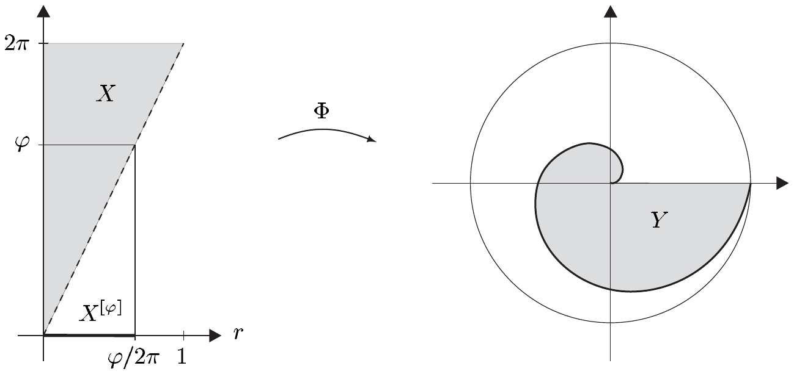
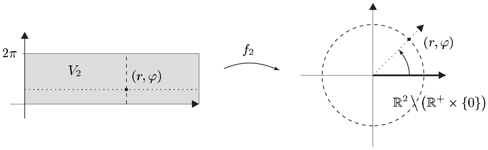

## 8 换元法则

在我们处理柯西–黎曼积分时，曾把定理 VI.5.1 的换元法则作为计算积分的基本工具。引入新变量，即选取适当的坐标，也是高维积分中的一种重要技巧。毫不意外，此情形下换元法则的证明更为困难。不过，我们已经奠定了基础，其形式就是线性映射的换元法则，它已在定理 IX.5.25 中推导过。

除了证明 $ n $ 维勒贝格积分的普遍换元法则之外，本节还将借助若干重要例子说明它的意义。同一个定理也是流形上积分理论的基石，而后者是我们最后一章的主题。

以下假定：

- $ X $ 与 $ Y $ 是 $ \mathbb{R}^{n} $ 的开子集；$ E $ 是巴拿赫空间。

##### 勒贝格测度的拉回

设 $ (X, \mathcal{A}) $ 是可测空间，$ (Y, \mathcal{B}, \nu) $ 是测度空间。若 $ f : X \to Y $ 是双射且满足 $ f(\mathcal{A}) \subset \mathcal{B} $，即其逆映射是 $ \mathcal{B} $-$ \mathcal{A} $-可测的，则容易验证

\[ f^{*}\nu : \mathcal{A} \to [0, \infty] , \quad A \mapsto \nu(f(A)) \]

定义了 $ \mathcal{A} $ 上的一个测度，即测度 $ \nu $ 在 $ f $ 下的**拉回**（或**原像**）。在特殊情形 $ (X, \mathcal{A}) = (\mathbb{R}^{n}, \mathcal{L}(n)) $ 与 $ (Y, \mathcal{B}, \nu) = (\mathbb{R}^{n}, \mathcal{L}(n), \lambda_{n}) $ 下，定理 IX.5.25 所涵盖的换元法则的特殊情形描述了 $ \lambda_{n} $ 在 $ \mathbb{R}^{n} $ 的自同构下的拉回：

\[ \Phi^{*}\lambda_{n} = |\det \Phi| \lambda_{n} \quad \text{对 } \Phi \in \mathcal{L}\mathrm{aut}(\mathbb{R}^{n}) . \]

利用这一结果，我们现在来确定勒贝格测度在任意 $ C^{1} $-微分同胚下的拉回。为此需要一个技术性结果：

8.1 引理 设 $ \Phi \in \mathrm{Diff}^{1}(X, Y) $。则

\[ \lambda_{n}(\Phi(J)) \le \int_{J} |\det \partial\Phi| \, dx \]

对每个形如 $ [a, b) $ 的区间 $ J \subset\subset X $，其中 $ a, b \in \mathbb{Q}^{n} $。

证明 (i) 先考虑中心为 $ x_{0} \in X $、棱长为 $ r > 0 $ 的立方体 $ J = [x_{0} - (r/2)\mathbf{1}, x_{0} + (r/2)\mathbf{1}) $。再令 $ \mathbb{R}^{n}_{\infty} := (\mathbb{R}^{n}, |\cdot|_{\infty}) $ 以及

\[ K := \max_{x\in \overline{J}} \|\partial\Phi(x)\|_{\mathcal{L}(\mathbb{R}^{n}_{\infty})} . \]

由中值定理可得

\[ |\Phi(x) - \Phi(x_{0})|_{\infty} \le K |x - x_{0}|_{\infty} \quad \text{对 } x \in J . \]

因此 $ \Phi(J) $ 包含于 $ \overline{\mathbb{B}}^{n}_{\infty}(\Phi(x_{0}), Kr/2) $，并且我们得到

\[ \lambda_{n}(\Phi(J)) \le (Kr)^{n} = K^{n}\lambda_{n}(J) . \tag{8.1} \]

(ii) 设 $ J \subset\subset X $ 形如 $ [a, b) $，其中 $ a, b \in \mathbb{Q}^{n} $。取 $ \varepsilon > 0 $ 并令 $ M := \max_{x\in \overline{J}} \|[\partial\Phi(x)]^{-1}\|_{\mathcal{L}(\mathbb{R}^{n}_{\infty})} $。由于 $ \partial\Phi $ 在 $ \overline{J} $ 上一致连续，存在 $ \delta > 0 $ 使得

\[ \|\partial\Phi(x) - \partial\Phi(y)\|_{\mathcal{L}(\mathbb{R}^{n}_{\infty})} \le \varepsilon/M \tag{8.2} \]

对所有满足 $ |x - y| < \delta $ 的 $ x, y \in \overline{J} $ 成立。由于 $ a, b \in \mathbb{Q}^{n} $，我们可以把 $ J $（按棱剖分）分解为 $ N $ 个不交的立方体 $ J_{k} $，其形如 $ [\alpha, \beta)^{n} $，其中 $ 0 < \beta - \alpha < \delta $。现在选取 $ x_{k} \in \overline{J}_{k} $ 使得

\[ |\det \partial\Phi(x_{k})| = \min_{y\in \overline{J}_{k}} |\det \partial\Phi(y)| \]

并令 $ T_{k} := \partial\Phi(x_{k}) $ 以及 $ \Phi_{k} := T_{k}^{-1} \circ \Phi $。因为

\[ \partial\Phi_{k}(y) = T_{k}^{-1}\partial\Phi(y) = \mathbf{1}_{n} + [\partial\Phi(x_{k})]^{-1}[\partial\Phi(y) - \partial\Phi(x_{k})] \]

由 (8.2) 与 $ M $ 的定义可得

\[ \max_{y\in \overline{J}_{k}} \|\partial\Phi_{k}(y)\|_{\mathcal{L}(\mathbb{R}^{n}_{\infty})} \le 1 + \varepsilon \quad \text{对 } k \in \{1, \dots, N\} . \tag{8.3} \]

由定理 IX.5.25 中处理的换元法则的特殊情形，我们有

\[ \lambda_{n}(\Phi(J_{k})) = \lambda_{n}(T_{k} T_{k}^{-1}\Phi(J_{k})) = |\det T_{k}| \lambda_{n}(\Phi_{k}(J_{k})) . \]

于是 (8.1) 与 (8.3) 蕴含

\[ \lambda_{n}(\Phi(J_{k})) \le (1 + \varepsilon)^{n} |\det T_{k}| \lambda_{n}(J_{k}) \quad \text{对 } k \in \{1, \dots, N\} . \]

考虑到 $ \Phi $ 的双射性以及 $ x_{k} $ 的选取，我们得到

\[ \begin{aligned} \lambda_{n}(\Phi(J)) &= \lambda_{n}\left(\bigcup_{k=1}^{N} \Phi(J_{k})\right) = \sum_{k=1}^{N} \lambda_{n}(\Phi(J_{k})) \\ &\le (1 + \varepsilon)^{n} \sum_{k=1}^{N} |\det T_{k}| \lambda_{n}(J_{k}) \le (1 + \varepsilon)^{n} \sum_{k=1}^{N} \int_{J_{k}} |\det \partial\Phi| \, dx \\ &= (1 + \varepsilon)^{n} \int_{J} |\det \partial\Phi| \, dx . \end{aligned} \]

令 $ \varepsilon \to 0 $ 取极限即得结论。■

8.2 命题 设 $ \Phi \in \mathrm{Diff}^{1}(X, Y) $。则

\[ \Phi^{*}\lambda_{n}(A) = \lambda_{n}(\Phi(A)) = \int_{A} |\det \partial\Phi| \, dx \quad \text{对 } A \in \mathcal{L}(n)|X . \]

证明 (i) 由单调收敛定理容易推出

\[ \mu_{\Phi} : \mathcal{L}(n)|X \to [0, \infty] , \quad A \mapsto \int_{A} |\det \partial\Phi| \, dx \]

是完备测度（见习题 2.11）。

(ii) 设 $ U $ 是开集且紧包含于 $ X $ 中。由命题 IX.5.6，存在一列不交的区间 $ (J_{k}) $，形如 $ [a, b) $，其中 $ a, b \in \mathbb{Q}^{n} $，使得 $ U = \bigcup_{k} J_{k} $。由 (i) 与引理 8.1 可得

\[ \begin{aligned} \lambda_{n}(\Phi(U)) &= \lambda_{n}\left(\bigcup_{k} \Phi(J_{k})\right) = \sum_{k} \lambda_{n}(\Phi(J_{k})) \le \sum_{k} \int_{J_{k}} |\det \partial\Phi| \, dx \\ &= \sum_{k} \mu_{\Phi}(J_{k}) = \mu_{\Phi}\left(\bigcup_{k} J_{k}\right) = \mu_{\Phi}(U) = \int_{U} |\det \partial\Phi| \, dx . \end{aligned} \]

(iii) 设 $ U $ 是 $ X $ 中的开集。由注 1.16(d) 与 (e)，存在 $ X $ 的一列开子集 $ (U_{k}) $，使得 $ U_{k} \subset\subset U_{k+1} $ 且 $ U = \bigcup_{k} U_{k} $。由 (ii) 以及测度 $ \lambda_{n} $ 与 $ \mu_{\Phi} $ 的下连续性可得

\[ \lambda_{n}(\Phi(U)) = \lim_{k} \lambda_{n}(\Phi(U_{k})) \le \lim_{k} \mu_{\Phi}(U_{k}) = \mu_{\Phi}(U) = \int_{U} |\det \partial\Phi| \, dx . \]

(iv) 设 $ A \in \mathcal{L}(n)|X $ 有界。利用推论 IX.5.5，我们找到 $ X $ 的一列有界开子集 $ (U_{k}) $，使得 $ G := \bigcap_{k} U_{k} \supset A $ 且 $ \lambda_{n}(G) = \lambda_{n}(A) $。由 (iii) 以及测度 $ \lambda_{n} $ 与 $ \mu_{\Phi} $ 的上连续性，我们有

\[ \begin{aligned} \lambda_{n}(\Phi(G)) &= \lim_{k} \lambda_{n}\left(\Phi\left(\bigcap_{j=0}^{k} U_{j}\right)\right) \le \lim_{k} \mu_{\Phi}\left(\bigcap_{j=0}^{k} U_{j}\right) \\ &= \mu_{\Phi}(G) = \int_{G} |\det \partial\Phi| \, dx . \end{aligned} \]

注意到 $ A \subset G $ 且 $ \lambda_{n}(A) = \lambda_{n}(G) $，我们得到

\[ \lambda_{n}(\Phi(A)) \le \lambda_{n}(\Phi(G)) \le \int_{G} |\det \partial\Phi| \, dx = \int_{A} |\det \partial\Phi| \, dx . \]

(v) 取任意 $ A \in \mathcal{L}(n)|X $，并令 $ A_{k} := A \cap k\mathbb{B}^{n} $，$ k \in \mathbb{N} $。由 (iv) 以及测度的下连续性，我们得到

\[ \lambda_{n}(\Phi(A)) = \lim_{k} \lambda_{n}(\Phi(A_{k})) \le \lim_{k} \mu_{\Phi}(A_{k}) = \mu_{\Phi}(A) = \int_{A} |\det \partial\Phi| \, dx . \]

(vi) 设 $ f \in \mathcal{S}(Y, \mathbb{R}^{+}) $ 具有标准形 $ f = \sum_{j=0}^{k} \alpha_{j}\chi_{A_{j}} $。由 (v)，

\[ \begin{aligned} \int_{Y} f \, dy &= \sum_{j=0}^{k} \alpha_{j}\lambda_{n}(A_{j}) = \sum_{j=0}^{k} \alpha_{j}\lambda_{n}(\Phi(\Phi^{-1}(A_{j}))) \\ &\le \sum_{j=0}^{k} \alpha_{j} \int_{\Phi^{-1}(A_{j})} |\det \partial\Phi| \, dx = \int_{X} (f \circ \Phi)|\det \partial\Phi| \, dx . \end{aligned} \]

(vii) 设 $ X $ 有界。给定 $ f \in \mathcal{L}_{0}(Y, \mathbb{R}^{+}) $，设 $ (f_{k}) $ 是 $ \mathcal{S}(Y, \mathbb{R}^{+}) $ 中的序列，使得 $ f_{k} \uparrow f $（见定理 1.12）。则 $ f_{k} \circ \Phi $ 属于 $ \mathcal{S}(X, \mathbb{R}^{+}) $。因为序列 $ (f_{k} \circ \Phi)_{k} $ 递增收敛到 $ f \circ \Phi $，我们知道 $ (f \circ \Phi)|\det \partial\Phi| $ 属于 $ \mathcal{L}_{0}(X, \mathbb{R}^{+}) $。现在 (vi) 与单调收敛定理蕴含

\[ \int_{Y} f \, dy = \lim_{k} \int_{Y} f_{k} \, dy \le \lim_{k} \int_{X} (f_{k} \circ \Phi)|\det \partial\Phi| \, dx = \int_{X} (f \circ \Phi)|\det \partial\Phi| \, dx . \]

(viii) 设 $ X $ 任意，取 $ f \in \mathcal{L}_{0}(Y, \mathbb{R}^{+}) $。鉴于注 1.16(d) 与 (e)，我们可以找到 $ X $ 的一列递增的相对紧开子集 $ X_{k} $，使得 $ X = \bigcup_{k=0}^{\infty} X_{k} $。根据 (vii)，$ g_{k} := \chi_{X_{k}} f|\det \Phi| $ 属于 $ \mathcal{L}_{0}(X, \mathbb{R}^{+}) $，并且 $ g_{k} \uparrow g := f|\det \Phi| $。因此 $ g \in \mathcal{L}_{0}(X, \mathbb{R}^{+}) $。令 $ Y_{k} := \Phi(X_{k}) $，由 (vii) 得到

\[ \int_{Y_{k}} f \, dy \le \int_{X_{k}} (f \circ \Phi)|\det \partial\Phi| \, dx . \]

现在 $ Y = \bigcup_{k=0}^{\infty} Y_{k} $，而单调收敛定理给出

\[ \int_{Y} f \, dy \le \int_{X} (f \circ \Phi)|\det \partial\Phi| \, dx . \tag{8.4} \]

(ix) 设 $ A \in \mathcal{L}(n)|X $。我们在 (viii) 中交换 $ X $ 与 $ Y $ 的角色，并把 (8.4) 应用于 $ C^{1} $-微分同胚 $ \Phi^{-1} : Y \to X $ 以及函数 $ (\chi_{\Phi(A)} \circ \Phi)|\det \partial\Phi| $，后者属于 $ \mathcal{L}_{0}(X, \mathbb{R}^{+}) $。则

\[ \begin{aligned} \int_{X} (\chi_{\Phi(A)} \circ \Phi)|\det \partial\Phi| \, dx &\le \int_{Y} \left[ ((\chi_{\Phi(A)} \circ \Phi)|\det \partial\Phi|) \circ \Phi^{-1} \right] |\det \partial\Phi^{-1}| \, dy \\ &= \int_{Y} \chi_{\Phi(A)} |\det[(\partial\Phi \circ \Phi^{-1})\partial\Phi^{-1}]| \, dy . \end{aligned} \]

进一步注意到

\[ \mathbf{1}_{n} = \partial(\mathrm{id}_{Y}) = \partial(\Phi \circ \Phi^{-1}) = (\partial\Phi \circ \Phi^{-1})\partial\Phi^{-1} \tag{8.5} \]

以及 $ \chi_{\Phi(A)} \circ \Phi = \chi_{A} $，我们得到

\[ \int_{A} |\det \partial\Phi| \, dx \le \int_{Y} \chi_{\Phi(A)} \, dy = \lambda_{n}(\Phi(A)) . \]

由 (v)，即得结论。■

8.3 例 定义 $ X := \{ (r, \varphi) \in \mathbb{R} \times (0, 2\pi) ; 0 < r < \varphi/2\pi \} $ 以及

\[ \Phi : X \to \mathbb{R}^{2} , \quad (r, \varphi) \mapsto (r \cos\varphi, r \sin\varphi) . \]

则 $ Y := \Phi(X) $ 是 $ \mathbb{R}^{2} $ 中的开集，且 $ \Phi \in \mathrm{Diff}^{\infty}(X, Y) $ 满足

\[ \left[\partial\Phi(r, \varphi)\right] = \begin{bmatrix} \cos\varphi & -r\sin\varphi \\ \sin\varphi & r\cos\varphi \end{bmatrix} . \]

因此 $ \det \partial\Phi(r, \varphi) = r $。又 $ \mathrm{pr}_{2}(X) = (0, 2\pi) $，且对 $ \varphi \in (0, 2\pi) $ 有 $ X^{[\varphi]} = (0, \varphi/2\pi) $。于是由命题 8.2 与托内利定理，

\[ \lambda_{2}(Y) = \int_{X} r \, d(r, \varphi) = \int_{0}^{2\pi} \int_{0}^{\varphi/2\pi} r \, dr \, d\varphi = \pi/3 . \]

##### 换元法则：一般情形

有了这些准备之后，证明微分同胚的换元法则就不再困难。我们先考虑标量情形，其证明甚至对跳过向量值函数的富比尼定理之证明的读者也是可读的。本节末尾再处理一般情形。

8.4 定理（换元法则） 设 $ \Phi \in \mathrm{Diff}^{1}(X, Y) $。

(i) 对 $ f \in \mathcal{L}_{0}(Y, \mathbb{R}^{+}) $，

\[ \int_{Y} f \, dy = \int_{X} (f \circ \Phi)|\det \partial\Phi| \, dx . \tag{8.6} \]

(ii) 函数 $ f : Y \to \mathbb{K} $ 可积当且仅当 $ (f \circ \Phi)|\det \partial\Phi| $ 属于 $ \mathcal{L}_{1}(X) $。此时 (8.6) 成立。

证明 (i) 定理 IX.5.12 蕴含 $ \Phi(\mathcal{L}_{X}) \subset \mathcal{L}_{Y} $。因此由推论 1.5，$ f \circ \Phi $ 可测。由于 $ |\det \partial\Phi| $ 连续，因而可测，注 1.2(d) 蕴含 $ g := (f \circ \Phi)|\det \partial\Phi| $ 也可测。由 (8.5) 我们得到 $ f = (g \circ \Phi^{-1})|\det \partial\Phi^{-1}| $。现在把 (8.4) 中的 $ (X, \Phi, f) $ 换成 $ (Y, \Phi^{-1}, g) $，给出

\[ \int_{X} (f \circ \Phi)|\det \partial\Phi| \, dx \le \int_{Y} f \, dy . \]

由 (8.4)，这蕴含 (8.6)。现在 (ii) 由 (i)、推论 2.12 的 (ii) 与 (iii) 部分以及定理 3.14 推出。■

就第 VIII.3 节定义的函数的拉回而言，换元法则 (8.6) 具有易于记忆的形式

\[ \int_{Y} f \, d\lambda_{n} = \int_{\Phi^{-1}(Y)} (\Phi^{*} f) \, d(\Phi^{*}\lambda_{n}) . \]

这由命题 8.2 与习题 2.12 推出。

对于许多应用来说，$ \Phi $ 是微分同胚这一假设过于严格。我们在定理 8.4 的这个简单却重要的推广中把它稍加减弱：\footnote{关于进一步的推广，见习题 7。}

8.5 推论 设 $ M $ 是 $ X $ 的可测子集，使得 $ M \setminus \mathring{M} $ 的勒贝格测度为零。设 $ \Phi \in C^{1}(X, \mathbb{R}^{n}) $ 使得 $ \Phi|_{\mathring{M}} $ 是从 $ \mathring{M} $ 到 $ \Phi(\mathring{M}) $ 的微分同胚。

(i) 对每个 $ f \in \mathcal{L}_{0}(M, \mathbb{R}^{+}) $，

\[ \int_{\Phi(M)} f \, dy = \int_{M} (f \circ \Phi)|\det \partial\Phi| \, dx . \tag{8.7} \]

(ii) 函数 $ f : \Phi(M) \to \mathbb{K} $ 属于 $ \mathcal{L}_{1}(\Phi(M)) $ 当且仅当 $ (f \circ \Phi)|\det \partial\Phi| $ 属于 $ \mathcal{L}_{1}(M) $。此时 (8.7) 成立。

证明 因为 $ \lambda_{n}(M \setminus \mathring{M}) = 0 $，由推论 IX.5.10，集合 $ \Phi(M) \setminus \Phi(\mathring{M}) \subset \Phi(M \setminus \mathring{M}) $ 的测度也为零。于是结论由引理 2.15 与定理 8.4 推出。■

显然，这个推论给出了定理 VI.5.1 的换元法则的一个（部分）推广，尽管局限于微分同胚。与先前考虑的一维情形有一个明显的差别：现在导数项（即函数行列式）以绝对值的形式出现。原因是先前的结论使用了定向积分。

##### 平面极坐标

应用中特别重要的一个特殊情形是由极坐标诱导的微分同胚，我们现在就来引入它。我们从二维情形开始。

设

\[ f_{2} : \mathbb{R}^{2} \to \mathbb{R}^{2} , \quad (r, \varphi) \mapsto (x, y) := (r \cos\varphi, r \sin\varphi) \]

为（**平面**）极坐标映射\footnote{见结论 III.6.21(d)。}，并令 $ V_{2} := (0, \infty) \times (0, 2\pi) $。

则 $ f_{2} $ 光滑，且 $ \det \partial f_{2}(r, \varphi) = r $，如例 8.3 所示。显然 $ \overline{V}_{2} \setminus V_{2} $ 的测度为零；此外

\[ f_{2}(\overline{V}_{2}) = \mathbb{R}^{2} , \quad f_{2}(V_{2}) = \mathbb{R}^{2} \setminus (\mathbb{R}^{+} \times \{0\}) \tag{8.8} \]

以及

\[ f_{2}|_{V_{2}} \in \mathrm{Diff}^{\infty}(V_{2}, f_{2}(V_{2})) . \tag{8.9} \]

因此推论 8.5 适用于 $ M := \overline{V}_{2} $：

8.6 命题（极坐标中的积分）

(i) 对 $ g \in \mathcal{L}_{0}(\mathbb{R}^{2}, \mathbb{R}^{+}) $，我们有

\[ \begin{aligned} \int_{\mathbb{R}^{2}} g(x, y) \, d(x, y) &= \int_{0}^{2\pi} \int_{0}^{\infty} g(r \cos\varphi, r \sin\varphi) r \, dr \, d\varphi \\ &= \int_{0}^{\infty} r \int_{0}^{2\pi} g(r \cos\varphi, r \sin\varphi) \, d\varphi \, dr . \end{aligned} \tag{8.10} \]

(ii) 函数 $ g : \mathbb{R}^{2} \to \mathbb{K} $ 可积当且仅当映射

\[ (0, \infty) \times (0, 2\pi) \to \mathbb{K} , \quad (r, \varphi) \mapsto g(r \cos\varphi, r \sin\varphi) r \]

可积。此时 (8.10) 成立。

证明 这由推论 8.5 连同 (8.8)、(8.9) 以及富比尼–托内利定理推出。■

当 $ f $ 只依赖 $ |x| $，即只依赖 $ r $ 时，这些积分会简化。为说明这一点，我们给出高斯误差积分的一个优雅计算，它不需要关于 $ \Gamma $-函数的知识（比较应用 VI.9.7）。

8.7 例 $ \displaystyle\int_{-\infty}^{\infty} e^{-x^{2}} dx = \sqrt{\pi} $。

证明 托内利定理蕴含

\[ \begin{aligned} \left(\int_{-\infty}^{\infty} e^{-x^{2}} dx\right)^{2} &= \int_{-\infty}^{\infty} e^{-x^{2}} dx \int_{-\infty}^{\infty} e^{-y^{2}} dy = \int_{\mathbb{R}} \left(\int_{\mathbb{R}} e^{-(x^{2}+y^{2})} dx\right) dy \\ &= \int_{\mathbb{R}^{2}} e^{-(x^{2}+y^{2})} \, d(x, y) . \end{aligned} \]

因此命题 8.6(i) 表明

\[ \left(\int_{-\infty}^{\infty} e^{-x^{2}} dx\right)^{2} = \int_{0}^{2\pi} \int_{0}^{\infty} r e^{-r^{2}} \, dr \, d\varphi = 2\pi \int_{0}^{\infty} \frac{d}{dr}\left[-e^{-r^{2}}/2\right] dr = \pi , \]

于是结论得证。■

##### 高维极坐标

对 $ n \ge 1 $，我们通过以下方式递归地定义 $ h_{n} : \mathbb{R}^{n} \to \mathbb{R}^{n+1} $：

\[ h_{1}(z) := (\cos z, \sin z) \quad \text{对 } z \in \mathbb{R} \tag{8.11} \]

以及

\[ h_{n+1}(z) := (h_{n}(z') \sin z_{n+1}, \cos z_{n+1}) \quad \text{对 } z = (z', z_{n+1}) \in \mathbb{R}^{n} \times \mathbb{R} . \tag{8.12} \]

显然 $ h_{n} $ 光滑，并且通过归纳法可以验证

\[ |h_{n}(z)| = 1 \quad \text{对 } z \in \mathbb{R}^{n} . \tag{8.13} \]

现在我们对 $ n \ge 2 $ 定义 $ f_{n} : \mathbb{R}^{n} \to \mathbb{R}^{n} $：

\[ f_{n}(y) := y_{1} h_{n-1}(z) \quad \text{对 } y = (y_{1}, z) \in \mathbb{R} \times \mathbb{R}^{n-1} . \tag{8.14} \]

则 $ f_{n} $ 也光滑，并且我们有

\[ h_{n-1}(z) = f_{n}(1, z) , \quad |f_{n}(y)| = |y_{1}| . \tag{8.15} \]

我们通常按惯例把 $ y $ 坐标重新命名如下：

\[ (r, \varphi, \vartheta_{1}, \dots, \vartheta_{n-2}) := (y_{1}, y_{2}, y_{3}, \dots, y_{n}) . \]

通过归纳法容易验证

\[ f_{n} : \mathbb{R}^{n} \to \mathbb{R}^{n} , \quad (r, \varphi, \vartheta_{1}, \dots, \vartheta_{n-2}) \mapsto (x_{1}, x_{2}, x_{3}, \dots, x_{n}) \tag{8.16} \]
