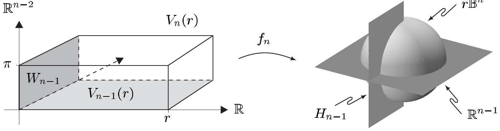

由下式给出

\[ \left. \begin{array}{r@{\;}l} x_{1} & = r\cos\varphi\sin\vartheta_{1}\sin\vartheta_{2}\cdots\sin\vartheta_{n-2}, \\ x_{2} & = r\sin\varphi\sin\vartheta_{1}\sin\vartheta_{2}\cdots\sin\vartheta_{n-2}, \\ x_{3} & = r\cos\vartheta_{1}\sin\vartheta_{2}\cdots\sin\vartheta_{n-2}, \\ & \vdots \\ x_{n-1} & = r\cos\vartheta_{n-3}\sin\vartheta_{n-2}, \\ x_{n} & = r\cos\vartheta_{n-2}. \end{array} \right\} \tag{8.17} \]

因此 $ f_{2} $ 与平面极坐标映射一致，而 $ f_{3} $ 是例 VII.9.11(a) 的**球坐标映射**。在一般情形下，$ f_{n} $ 是 **$ n $ 维极坐标映射**。由 (8.12) 与 (8.14)，递推关系

\[ f_{n}(y) = \left( f_{n-1}(y')\sin y_{n}, y_{1}\cos y_{n} \right) \qquad \text{对 } y = (y', y_{n}) \in \mathbb{R}^{n-1}\times\mathbb{R} \tag{8.18} \]

对 $ n \ge 3 $ 成立。对 $ n \ge 2 $，我们令

\[ W_{n-1} := (0, 2\pi)\times(0, \pi)^{n-2}, \quad V_{n} := (0, \infty)\times W_{n-1}, \tag{8.19} \]

以及

\[ V_{n}(r) := (0, r)\times W_{n-1} \qquad \text{对 } r > 0. \tag{8.20} \]

若把闭的 $ (n-1) $ 维半空间记为

\[ H_{n-1} := \mathbb{R}^{+}\times\{0\}\times\mathbb{R}^{n-2} \subset \mathbb{R}^{n}, \tag{8.21} \]

则得

\[ h_{n-1}(W_{n-1}) = S^{n-1}\setminus H_{n-1}, \quad f_{n}(V_{n}(r)) = r\mathbb{B}^{n}\setminus H_{n-1} \tag{8.22} \]

以及

\[ h_{n-1}(\overline{W}_{n-1}) = S^{n-1}, \quad f_{n}(\overline{V_{n}(r)}) = r\overline{\mathbb{B}^{n}}. \tag{8.23} \]

又有

\[ f_{n}(V_{n}) = \mathbb{R}^{n}\setminus H_{n-1}, \quad f_{n}(\overline{V}_{n}) = \mathbb{R}^{n}. \tag{8.24} \]

此外，映射 $ h_{n-1}|W_{n-1} $ 与 $ f_{n}|V_{n} $ 都是到其像上的双射。

这些结论容易由归纳法得到。

8.8 引理 设 $ n \ge 3 $ 且 $ r > 0 $。则映射 $ f_{n} $ 是从 $ V_{n}(r) $ 到 $ r\mathbb{B}^{n}\setminus H_{n-1} $ 上、以及从 $ V_{n} $ 到 $ \mathbb{R}^{n}\setminus H_{n-1} $ 上的 $ C^{\infty} $ 微分同胚。此外

\[ \det \partial f_{n}(r, \varphi, \vartheta_{1}, \ldots, \vartheta_{n-2}) = (-1)^{n}r^{n-1}\sin\vartheta_{1}\sin^{2}\vartheta_{2}\cdots\sin^{n-2}\vartheta_{n-2} \]

对 $ (r, \varphi, \vartheta_{1}, \ldots, \vartheta_{n-2}) \in \overline{V}_{n} $。

证明 鉴于前面所述，我们只需计算函数行列式 $ \det \partial f_{n}(y) $ 的值。我们递推地进行。由 (8.12) 与 (8.14) 得

\[ [\partial f_{n+1}(y)] = \begin{bmatrix} h_{n-1}(z')\sin z_{n} & \left[ r\partial_{z}\left( h_{n-1}(z')\sin z_{n} \right) \right] \\ \cdots\cdots\cdots\cdots\cdots\cdots\cdots\cdots & \cdots\cdots\cdots\cdots\cdots\cdots\cdots\cdots\cdots \\ \cos z_{n} & 0 \quad \cdots \quad 0 \quad -r\sin z_{n} \end{bmatrix} \]

\[ = \begin{bmatrix} \left[ \partial f_{n}(y')\sin z_{n} \right] & \begin{matrix} * \\ \vdots \\ * \end{matrix} \\ \cdots\cdots\cdots\cdots\cdots & \cdots\cdots\cdots\cdots \\ * \quad \cdots \quad * & -r\sin z_{n} \end{bmatrix} , \]

其中 $ y = (r, z) = (y', z_{n}) $ 且 $ z = (z', z_{n}) \in \mathbb{R}^{n} $。按最后一行展开，得

\[ \det \partial f_{n+1}(y) = (-1)^{n}\cos z_{n}\det S - r\sin^{n+1}z_{n}\det \partial f_{n}(y'), \tag{8.25} \]

其中 $ S := [r\partial_{z}(h_{n-1}(z')\sin z_{n})] $。我们可以假定 $ \sin z_{n} \ne 0 $；否则结论是平凡的。在 $ S $ 的最后一列中有 $ r h_{n-1}(z')\cos z_{n} $。这个向量与矩阵 $ T := [\partial f_{n}(y')\sin z_{n}] $ 的第一列向量 $ h_{n-1}(z')\sin z_{n} $ 只相差因子 $ r\cot z_{n} $。$ S $ 的前 $ n-1 $ 列也与 $ T $ 的后 $ n-1 $ 列按同样的顺序一致。因此

\[ \det S = (-1)^{n-1}r\cot z_{n}\det T = (-1)^{n-1}r\cos z_{n}\sin^{n-1}z_{n}\det \partial_{n}f(y'). \]

于是由 (8.25) 推出

\[ \det \partial f_{n+1}(y) = -r\sin^{n-1}z_{n}\det \partial f_{n}(y'). \]

现在结论成立，因为 $ \det \partial f_{2}(r, \varphi) = r $。■

为简短起见，令

\[ w_{n}(\vartheta) := \sin\vartheta_{1}\sin^{2}\vartheta_{2}\cdots\sin^{n-2}\vartheta_{n-2}, \quad \vartheta := (\vartheta_{1}, \ldots, \vartheta_{n-2}) \in [0, \pi]^{n-2}. \]

8.9 命题（极坐标下的积分） 设 $ n \ge 3 $。

(i) 对 $ g \in \mathcal{L}_{0}(\mathbb{R}^{n}, \mathbb{R}^{+}) $，有

\[ \int_{\mathbb{R}^{n}} g\,dx = \int_{V_{n}} (g\circ f_{n})(r, \varphi, \vartheta)r^{n-1}w_{n}(\vartheta)\, d(r, \varphi, \vartheta). \tag{8.26} \]

(ii) 映射 $ g: \mathbb{R}^{n} \to \mathbb{K} $ 可积当且仅当

\[ V_{n} \to \mathbb{K}, \quad (r, \varphi, \vartheta) \mapsto (g\circ f_{n})(r, \varphi, \vartheta)r^{n-1}w_{n}(\vartheta) \]

可积。此时 (8.26) 成立。

证明 因为 $ \lambda_{n}(\overline{V}_{n}\setminus V_{n}) = 0 $，结论由 (8.24)、推论 8.5 与引理 8.8 推出。■

8.10 例 (a) 对 $ g \in \mathcal{L}_{0}(\mathbb{R}^{3}, \mathbb{R}^{+}) $，有

\[ \int_{\mathbb{R}^{3}} g(x, y, z)\, d(x, y, z) = \int_{0}^{\infty}\int_{0}^{2\pi}\int_{0}^{\pi} g(r\cos\varphi\sin\vartheta, r\sin\varphi\sin\vartheta, r\cos\vartheta)r^{2}\sin\vartheta\, d\vartheta\, d\varphi\, dr. \tag{8.27} \]

右端的积分可以按任意顺序进行。

证明 这由命题 8.9(i) 与托内利定理推出。■

(b) 映射 $ g: \mathbb{R}^{3} \to \mathbb{K} $ 可积当且仅当

\[ V_{3} \to \mathbb{K}, \quad (r, \varphi, \vartheta) \mapsto g(r\cos\varphi\sin\vartheta, r\sin\varphi\sin\vartheta, r\cos\vartheta)r^{2}\sin\vartheta \]

可积。这样的映射满足 (8.27)，且其中的积分可以按任意顺序进行。

证明 这是命题 8.9(ii) 与富比尼–托内利定理的推论。■

(c) 对 $ n \ge 3 $，有

\[ 2\pi\int_{[0, \pi]^{n-2}} w_{n}(\vartheta)\, d\vartheta = n\omega_{n}, \]

其中 $ \omega_{n} = \pi^{n/2}/\Gamma(1 + n/2) $ 是 $ \mathbb{B}^{n} $ 的体积。

证明 由 (8.22)、(8.23)、命题 8.9 与托内利定理推出

\[ \omega_{n} = \int_{\mathbb{B}^{n}} dx = \int_{\mathbb{B}^{n}} 1\,dx = \int_{V_{n}(1)} (1\circ f_{n})(r, \varphi, \vartheta)r^{n-1}w_{n}(\vartheta)\, d(r, \varphi, \vartheta) \]

\[ = \int_{0}^{1} r^{n-1}dr\int_{0}^{2\pi} d\varphi\int_{[0, \pi]^{n-2}} w_{n}(\vartheta)\, d\vartheta = \frac{2\pi}{n}\int_{[0, \pi]^{n-2}} w_{n}(\vartheta)\, d\vartheta, \]

于是证毕。■

##### 旋转对称函数的积分

设 $ 0 \le r_{0} < r_{1} \le \infty $，并令 $ R(r_{0}, r_{1}) := \{ x \in \mathbb{R}^{n} ;\ r_{0} < |x| < r_{1} \} $。称函数 $ g: R(r_{0}, r_{1}) \to E $ 是**旋转对称的**，如果存在映射 $ \dot{g}: (r_{0}, r_{1}) \to E $ 使得

\[ g(x) = \dot{g}(|x|) \qquad \text{对 } x \in R(r_{0}, r_{1}). \]

这种情形出现当且仅当 $ g $ 在每个球面 $ rS^{n-1} $（$ r_{0} < r < r_{1} $）上是常数。对这样的函数，$ \dot{g} $ 由 $ g $ 唯一确定（反之亦然）。

正如我们在例 8.7 中所见，对旋转对称函数而言，积分问题会大大简化。

8.11 定理 设 $ 0 \le r_{0} < r_{1} \le \infty $。

(i) 若 $ g \in \mathcal{L}_{0}(R(r_{0}, r_{1}), \mathbb{R}^{+}) $ 是旋转对称的，则

\[ \int_{R(r_{0}, r_{1})} g\,dx = n\omega_{n}\int_{r_{0}}^{r_{1}} \dot{g}(r)r^{n-1}dr, \tag{8.28} \]

其中 $ \omega_{n} := \lambda_{n}(\mathbb{B}^{n}) = \pi^{n/2}/\Gamma(1 + n/2) $。

(ii) 旋转对称函数 $ g: R(r_{0}, r_{1}) \to \mathbb{K} $ 可积当且仅当

\[ (r_{0}, r_{1}) \to \mathbb{K}, \quad r \mapsto \dot{g}(r)r^{n-1} \]

可积。此时 (8.28) 成立。

证明 $ n = 1 $ 的情形是清楚的（见习题 5.12）。对 $ n \ge 2 $，由 (8.15) 以及 $ g $ 的旋转对称性得

\[ g\circ f_{n}(r, \varphi, \vartheta) = \dot{g}(r) \qquad \text{对 } r_{0} < r < r_{1} \text{ 与 } (\varphi, \vartheta) \in W_{n-1}. \]

现在，结论由命题 8.6 与 8.9（应用于 $ g $ 的平凡延拓）以及例 8.10(c) 推出。■

8.12 例 (a) 设 $ f: \mathbb{R}^{n} \to \mathbb{K} $ 可测，且存在 $ c \ge 0 $、$ \rho > 0 $ 与 $ \varepsilon > 0 $ 使得

\[ |f(x)| \le \begin{cases} c\,|x|^{-n+\varepsilon} & \text{若 } 0 < |x| \le \rho, \\ c\,|x|^{-n-\varepsilon} & \text{若 } |x| \ge \rho. \end{cases} \]

则 $ f $ 可积。

证明 令

\[ g(x) := c\left( |x|^{-n+\varepsilon}\chi_{\rho\mathbb{B}^{n}}(x) + |x|^{-n-\varepsilon}\chi_{(\rho\mathbb{B}^{n})^{c}}(x) \right) \qquad \text{对 } x \in \mathbb{R}^{n}\setminus\{0\} = R(0, \infty). \]

则 $ g $ 是旋转对称的，且 $ |f(x)| \le g(x) $ 对 $ x \in R(0, \infty) $。由例 VI.8.4(a) 与 (b)，$ r \mapsto \dot{g}(r)r^{n-1} $ 属于 $ \mathcal{L}_{1}(\mathbb{R}^{+}) $。因此定理 8.11 推出 $ g $ 也属于 $ \mathcal{L}_{1}(R(0, \infty)) = \mathcal{L}_{1}(\mathbb{R}^{n}) $。现在由定理 3.14 得结论。■

(b) 设 $ \mu \in \mathcal{L}_{\infty}(\mathbb{R}^{n}) $ 具有紧支集。再定义

\[ \frac{1}{r}: \mathbb{R}^{n}\setminus\{0\} \to \mathbb{R}^{+}, \quad x \mapsto \frac{1}{|x|}. \]

则对 $ \alpha < n $，$ (1/r)^{\alpha}*\mu $ 存在，且

\[ \left( \frac{1}{r} \right)^{\alpha}*\mu(x) = \int_{\mathbb{R}^{n}} \frac{\mu(y)}{|x - y|^{\alpha}}\, dy \qquad \text{对 } x \in \mathbb{R}^{n}. \]

证明 取 $ x \in \mathbb{R}^{n} $，令 $ K := \operatorname{supp}(\mu) $ 且 $ g_{x}(y) := \|\mu\|_{\infty}|y|^{-\alpha}\chi_{x-K}(y) $ 对 $ y \ne 0 $。则 $ \widetilde{g}_{x} $ 属于 $ \mathcal{L}_{0}(\mathbb{R}^{n}) $，且

\[ |\mu(x - y)|\,|y|^{-\alpha} \le g_{x}(y) \qquad \text{对 } y \ne 0. \]

因为 $ \alpha < n $，由 (a) 可知 $ \widetilde{g}_{x} $ 可积。现在结论由定理 7.8(ii) 推出。■

对 $ n \ge 3 $，按 (b) 的记号，函数 $ u_{n} := (1/r)^{n-2}*\mu $ 称为与密度 $ \mu $ 相联系的**牛顿势**或**库仑势**。由习题 3.6 我们知道 $ u_{n} $ 在 $ K^{c} $ 中是光滑且调和的，而 (b) 表明 $ u_{n} $ 在整个 $ \mathbb{R}^{n} $ 上有定义。

##### 向量值函数的换元法则

我们现在对向量值函数证明定理 8.4 的换元公式。

8.13 引理 设 $ f \in \mathcal{S}_{c}(Y, E) $ 且 $ \Phi \in \operatorname{Diff}^{1}(X, Y) $。则 $ (f\circ\Phi)|\det \partial\Phi| $ 属于 $ \mathcal{L}_{1}(X, E) $，且

\[ \int_{Y} f\,dy = \int_{X} (f\circ\Phi)|\det \partial\Phi|\,dx. \]

证明 因为 $ \operatorname{supp}(f\circ\Phi) = \Phi^{-1}(\operatorname{supp}(f)) $，$ f\circ\Phi $ 的支集是紧的。特别地，$ f\circ\Phi $ 属于 $ \mathcal{S}_{c}(X, E) $。由此容易推出 $ (f\circ\Phi)|\det \partial\Phi| $ 可积。此外，定理 2.11(iii) 表明，对 $ e \in E $ 与 $ g \in \mathcal{L}_{1}(X, \mathbb{K}) $，函数 $ eg $ 属于 $ \mathcal{L}_{1}(X, E) $ 且 $ e\int_{X} g\,dx = \int_{X} eg\,dx $。令 $ \sum_{j=0}^{m} e_{j}\chi_{A_{j}} $ 为 $ f $ 的标准形，则由命题 8.2 可见

\[ \int_{Y} f\,dy = \sum_{j=0}^{m} e_{j}\lambda_{n}(A_{j}) = \sum_{j=0}^{m} e_{j}\int_{\Phi^{-1}(A_{j})} |\det \partial\Phi|\,dx = \sum_{j=0}^{m}\int_{\Phi^{-1}(A_{j})} e_{j}|\det \partial\Phi|\,dx = \int_{X} (f\circ\Phi)|\det \partial\Phi|\,dx. \quad \blacksquare \]
