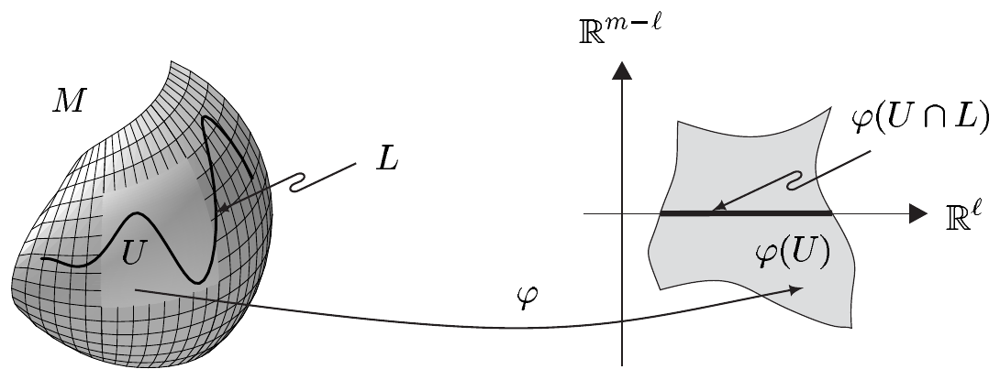
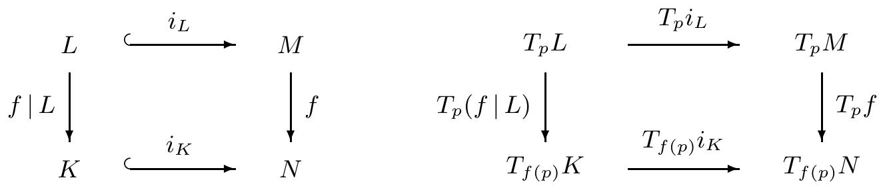
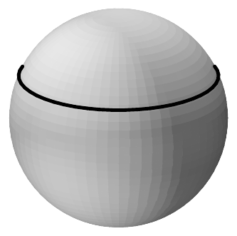
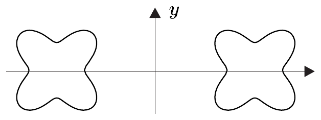
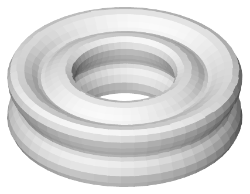

## 1 子流形

本节中，

- $ M $ 是 $ m $ 维流形，$ N $ 是 $ n $ 维流形。

更确切地说，这意味着 $ M $ 是某个 $ \mathbb{R}^{\overline{m}} $ 的 $ m $ 维 $ C^\infty $ 子流形，其中 $ \overline{m}\ge m $；对 $ N $ 有类似的陈述。

为简单起见并突出本质，我们限于研究光滑映射。特别地，我们总把**微分同胚**理解为 $ C^\infty $ 微分同胚，并置
\[ \operatorname{Diff}(M,N):=\operatorname{Diff}^\infty(M,N). \]

然而，下文中凡有证明之处，结论对 $ C^k $ 流形与 $ C^k $ 映射同样成立，其中必要时须对 $ k\in\mathbb{N}^\times $ 作适当限制。我们通常把这些调整放在注\footnote{在小字排印的题为“正则性”的各节中。}中，并把它们的验证留给你。

##### 定义与基本性质

设 $ 0\le\ell\le m $。$ M $ 的子集 $ L $ 称为 $ M $ 的（$ \ell $ 维）子流形，若对每个 $ p\in L $，存在 $ M $ 在 $ p $ 附近的坐标卡 $ (\varphi,U) $，使得\footnote{为避免麻烦的特殊情形，我们把空集看作 $ \ell $ 维子流形，对每个 $ \ell\in\{0,\ldots,m\} $ 皆然（见第 VII.9 节）。}
\[ \varphi(U\cap L)=\varphi(U)\cap(\mathbb{R}^\ell\times\{0\}). \]

每个这样的坐标卡称为 $ M $ 关于 $ L $ 的**子流形坐标卡**。数 $ m-\ell $ 称为 $ L $ 在 $ M $ 中的**余维数**。

显然，这个定义直接推广了 $ \mathbb{R}^m $ 的子流形的概念。

在子流形的语境中，浸入起着重要作用。它们将类比第 VII.9 节给出的定义来引入。

设 $ k\in\mathbb{N}^\times\cup\{\infty\} $。则 $ f\in C^k(M,N) $ 称为 **$ C^k $ 浸入**，若对每个 $ p\in M $，$ T_p f:T_pM\to T_{f(p)}N $ 是单射。我们称 $ C^k $ 浸入 $ f $ 为 $ M $ 在 $ N $ 中的 **$ C^k $ 嵌入**，若 $ f $ 是从 $ M $ 到 $ f(M) $ 的同胚（其中 $ f(M) $ 自然地赋予 $ N $ 的相对拓扑）。代替 $ C^\infty $ 浸入［或 $ C^\infty $ 嵌入］，我们简称**浸入**［或**嵌入**］。

1.1 注 (a) 若 $ L $ 是 $ M $ 的 $ \ell $ 维子流形，且 $ M $ 是 $ N $ 的子流形，则 $ L $ 是 $ N $ 的 $ \ell $ 维子流形。

证明 设 $ p\in L $，并设 $ (\varphi,U) $ 是 $ M $ 关于 $ L $ 在 $ p $ 附近的子流形坐标卡。又设 $ (\psi,V) $ 是 $ N $ 关于 $ M $ 在 $ p $ 附近的子流形坐标卡。我们还可假设 $ U=V\cap M $。令 $ X:=\varphi(U)\subset\mathbb{R}^m $，$ Y:=\operatorname{pr}\circ\psi(V)\subset\mathbb{R}^m $，其中 $ \operatorname{pr}:\mathbb{R}^m\times\mathbb{R}^{n-m}\to\mathbb{R}^m $ 表示标准投影，则
\[ \chi:=\operatorname{pr}\circ\psi\circ\varphi^{-1}\in\operatorname{Diff}(X,Y). \]

现由
\[ \Phi(y,z):=(\chi^{-1}(y),z)\qquad \text{对 } (y,z)\in Y\times\mathbb{R}^{n-m} \]
定义 $ \Phi\in\operatorname{Diff}(Y\times\mathbb{R}^{n-m},X\times\mathbb{R}^{n-m}) $，并置 $ \Psi:=\Phi\circ\psi $。则 $ \Psi(V) $ 在 $ \mathbb{R}^n $ 中开，且 $ \Psi\in\operatorname{Diff}(V,\Psi(V)) $，并有
\[ \Psi(V\cap L)=(\varphi(U\cap L)\times\{0\})\cap(\mathbb{R}^\ell\times\{0\})=\Psi(V)\cap(\mathbb{R}^\ell\times\{0\})\subset\mathbb{R}^n, \]
正如容易验证的那样。因此 $ (\Psi,V) $ 是 $ N $ 关于 $ L $ 在 $ p $ 附近的子流形坐标卡。■

(b) 因为 $ \mathbb{R}^{\overline{m}}=\mathbb{R}^{\overline{m}}\times\{0\}\subset\mathbb{R}^n $ 对 $ n\ge\overline{m} $ 是 $ \mathbb{R}^n $ 的子流形，故由 (a) 推出：对每个 $ n\ge\overline{m} $，$ M $ 是 $ \mathbb{R}^n $ 的 $ m $ 维子流形。这表明，只要只关心 $ M $ 的“内部性质”，即只借助 $ M $ 的坐标卡与切空间描述、不依赖于 $ M $ 如何“处于”周围空间中的那些性质，$ M $ 的“周围空间” $ \mathbb{R}^{\overline{m}} $ 就不起重要作用。\footnote{在第 4 节将会清楚，切空间也有一种“内部”刻画。} 然而，$ M $ 如何处于 $ \mathbb{R}^{\overline{m}} $ 中确实有影响，例如在定义法丛 $ T^\perp M $ 时。

(c) 设 $ L $ 是 $ M $ 的子流形。对 $ M $ 关于 $ L $ 的子流形坐标卡 $ (\varphi,U) $，置
\[ (\varphi_L,U_L):=(\varphi\mid U\cap L,U\cap L). \]
则 $ (\varphi_L,U_L) $ 是 $ L $ 的坐标卡，其中 $ \varphi(U_L) $ 理解为 $ \mathbb{R}^\ell $ 的开子集，即 $ \mathbb{R}^\ell\times\{0\}\subset\mathbb{R}^m $ 与 $ \mathbb{R}^\ell $ 等同。

若 $ \mathcal{A}:=\{(\varphi_\lambda,U_\lambda);\lambda\in\Lambda\} $ 是 $ M $ 关于 $ L $ 的一族子流形坐标卡，使得 $ L $ 被坐标片（坐标区域）$ \{U_\lambda;\lambda\in\Lambda\} $ 覆盖，则 $ \{(\varphi_{\lambda,L},U_{\lambda,L});\lambda\in\Lambda\} $ 是 $ L $ 的图册，称为**由 $ \mathcal{A} $ 诱导的图册**。

证明 简单的验证留给你。■

(d) 设 $ L $ 与 $ K $ 分别是 $ M $ 与 $ N $ 的 $ \ell $ 维与 $ k $ 维子流形。则 $ L\times K $ 是流形 $ M\times N $ 的 $ (\ell+k) $ 维子流形，而 $ M\times N $ 是 $ (m+n) $ 维的。

证明 这直接由定义推出。我们再次把证明留给你。\footnote{见习题 VII.9.4。}■

(e) 设 $ L $ 是 $ M $ 的子流形。则
\[ i:L\to M,\qquad p\mapsto p \]
是嵌入，称为 $ L $ 在 $ M $ 中的**自然嵌入**；我们把它写作 $ i:L\hookrightarrow M $。对 $ p\in L $，我们在单射 $ T_p i $ 下把 $ T_p L $ 与其在 $ T_p M $ 中的像等同，即把 $ T_p L $ 看作 $ T_p M $ 的向量子空间：$ T_p L\subset T_p M $。

证明 设 $ (\varphi,U) $ 是 $ M $ 关于 $ L $ 的子流形坐标卡。则 $ i $ 有局部表示
\[ \varphi\circ i\circ\varphi_L^{-1}:\varphi_L(U_L)\to\varphi(U),\qquad x\mapsto(x,0). \]
现在结论显然。■

(f) 若 $ f:M\to N $ 是浸入，则 $ m\le n $。

(g) 设 $ L $ 是 $ M $ 的 $ \ell $ 维子流形，并设 $ f $ 属于 $ \operatorname{Diff}(M,N) $。则 $ f(L) $ 是 $ N $ 的 $ \ell $ 维子流形。

证明 简单的验证留给你。■

(h) $ M $ 的每个开子集都是 $ M $ 的 $ m $ 维子流形。

(i) 若 $ (\varphi,U) $ 是 $ M $ 的坐标卡，则 $ \varphi:U\to\mathbb{R}^m $ 是嵌入，且 $ \varphi $ 是从 $ U $ 到 $ \varphi(U) $ 的微分同胚。

(j) 设 $ L $ 与 $ K $ 分别是 $ M $ 与 $ N $ 的子流形，$ i_L:L\hookrightarrow M $ 与 $ i_K:K\hookrightarrow N $ 是它们各自的自然嵌入。设 $ k\in\mathbb{N}\cup\{\infty\} $，$ f\in C^k(M,N) $ 且 $ f(L)\subset K $。则 $ f $ 在 $ L $ 上的限制满足
\[ f\mid L:=f\circ i_L\in C^k(L,K), \]
并且下面的图交换。

在 $ T_p i_L $ 下把 $ T_p L $ 与其在 $ T_p M $ 中的像等同，即以典范方式把 $ T_p L $ 看作 $ T_p M $ 的向量子空间，我们特别有 $ T_p(f\mid L)=(T_p f)\mid T_p L $。

证明 这由对例 VII.10.10(b) 的证明作显然的修改得到，而本陈述推广了该例。■

(k)（正则性）当 $ M $ 是 $ C^k $ 流形（$ k\in\mathbb{N}^\times $）时，类似的定义与陈述成立。此时 $ L $ 也是 $ C^k $ 流形，且自然包含 $ i:L\hookrightarrow M $ 属于 $ C^k $ 类。■

下一个定理是命题 VII.9.10 的推广，它表明我们可以用嵌入生成子流形。

1.2 定理

(i) 设 $ f:M\to N $ 是浸入。则 $ f $ 局部地是嵌入，即对 $ M $ 中的每个 $ p $，存在邻域 $ U $，使得 $ f\mid U $ 是嵌入。

(ii) 若 $ f:M\to N $ 是嵌入，则 $ f(M) $ 是 $ N $ 的 $ m $ 维子流形，且 $ f $ 是从 $ M $ 到 $ f(M) $ 的微分同胚。

证明 (i) 设 $ p\in M $，并设 $ (\varphi,U_0) $ 与 $ (\psi,V) $ 分别是 $ M $ 在 $ p $ 附近与 $ N $ 在 $ f(p) $ 附近的坐标卡，使得 $ f(U_0)\subset V $。则
\[ f_{\varphi,\psi}:=\psi\circ f\circ\varphi^{-1}:\varphi(U_0)\to\psi(V) \]
由注 1.1(i) 是浸入。由浸入定理（定理 VII.9.7），存在 $ \varphi(p) $ 在 $ \varphi(U_0) $ 中的开邻域 $ X $，使得 $ f_{\varphi,\psi}(X) $ 是 $ \mathbb{R}^n $ 的 $ m $ 维子流形。于是 $ \psi\in\operatorname{Diff}(V,\psi(V)) $ 与注 1.1(g) 推出：$ f(U) $（其中 $ U:=\varphi^{-1}(X) $）是 $ N $ 的 $ m $ 维子流形。

通过适当缩小 $ X $，注 VII.9.9(d) 表明 $ f_{\varphi,\psi} $ 是从 $ X=\varphi(U) $ 到 $ f_{\varphi,\psi}(X)=\psi\circ f(U) $ 的微分同胚。因此 $ f $ 是从 $ U $ 到 $ f(U) $ 的微分同胚，其中 $ f(U) $ 赋予由 $ N $ 诱导的拓扑。因此 $ f\mid U $ 是嵌入。

(ii) 设 $ f $ 是嵌入。对 $ q\in f(M) $，设 $ (\psi,V) $ 是 $ N $ 在 $ q $ 附近的坐标卡，$ (\varphi,U) $ 是 $ M $ 在 $ p:=f^{-1}(q) $ 附近的坐标卡，且 $ f(U)\subset V $。因为 $ f $ 是从 $ M $ 到 $ f(M) $ 的同胚，我们知道 $ f(U) $ 在 $ f(M) $ 中开。因此可假设 $ f(U)=f(M)\cap V $。现在由 (i) 的证明推出 $ f(M)\cap V $ 是 $ N $ 的 $ m $ 维子流形。由于这对每个 $ q\in f(M) $ 成立，我们得出 $ f(M) $ 是 $ N $ 的 $ m $ 维子流形。

由 (i)，$ f $ 是从 $ M $ 到 $ f(M) $ 的局部微分同胚。因为 $ f $ 是同胚，推出 $ f\in\operatorname{Diff}(M,f(M)) $。■

由注 VII.9.9(c) 我们知道，单浸入的像一般不是子流形。下面的定理给出一个简单的充分条件，用以判断单浸入是否为嵌入。

1.3 定理 设 $ M $ 紧致，$ f:M\to N $ 是单浸入。则 $ f $ 是嵌入，$ f(M) $ 是 $ N $ 的 $ m $ 维子流形，且 $ f\in\operatorname{Diff}(M,f(M)) $。

证明 因为 $ M $ 紧致且 $ f(M) $ 是度量空间，双射连续映射 $ f:M\to f(M) $ 是同胚（见习题 III.3.3）。现在结论由定理 1.2 推出。■

1.4 注（正则性）设 $ k\in\mathbb{N}^\times $。则当 $ M $ 与 $ N $ 是 $ C^k $ 流形且 $ f $ 属于 $ C^k $ 类时，定理 1.2 与 1.3 的相应版本仍然成立。■

1.5 例 (a) 设 $ 1\le\ell<m $，并令 $ (x,y) $ 表示 $ \mathbb{R}^{\ell+1}\times\mathbb{R}^{m-\ell}=\mathbb{R}^{m+1} $ 的一般点。则
\[ L_y:=\sqrt{1-|y|^2}\,S^\ell\times\{y\} \]
是 $ m $ 维球面 $ S^m $ 的 $ \ell $ 维子流形，对每个 $ y\in\mathbb{B}^{m-\ell} $ 成立。它与 $ S^\ell $ 微分同胚。点 $ p\in L_y $ 处的切空间满足
\[ T_p L_y=T_p S^m\cap(p,\mathbb{R}^{\ell+1}\times\{0\})\subset T_p\mathbb{R}^{m+1}. \tag{1.1} \]

证明 对 $ y\in\mathbb{B}^{m-\ell} $，映射
\[ F_y:\mathbb{R}^{\ell+1}\to\mathbb{R}^{m+1},\qquad x\mapsto(\sqrt{1-|y|^2}\,x,y) \tag{1.2} \]
是光滑浸入。因为 $ S^\ell $ 与 $ S^m $ 分别是 $ \mathbb{R}^{\ell+1} $ 与 $ \mathbb{R}^{m+1} $ 的子流形，且 $ F_y(S^\ell)\subset S^m $，注 1.1(j) 取 $ i_\ell:S^\ell\hookrightarrow\mathbb{R}^{\ell+1} $ 给出
\[ f_y:=F_y\mid S^\ell=F_y\circ i_\ell\in C^\infty(S^\ell,S^m). \tag{1.3} \]
显然 $ f_y $ 是单射，且注 VII.10.9(b) 的链式法则推出
\[ T_p f_y=T_p F_y\circ T_p i_\ell\qquad \text{对 } p\in S^\ell. \]
因此 $ T_p f_y $ 是单射（见习题 I.3.3），即 $ f_y $ 是浸入。因为 $ S^\ell $ 紧致，定理 1.3 表明 $ L_y=f_y(S^\ell) $ 是 $ S^m $ 的 $ \ell $ 维子流形，且与 $ S^\ell $ 微分同胚。于是 (1.1) 是 (1.2) 与 (1.3) 的简单推论。■

(b)（**旋转环面型超曲面**）设
\[ \gamma:S^1\to(0,\infty)\times\mathbb{R},\qquad t\mapsto(\rho(t),\sigma(t)) \]
是单浸入，从而由定理 1.3 是嵌入。又设 $ i:S^m\hookrightarrow\mathbb{R}^{m+1} $，并定义
\[ f:S^m\times S^1\to\mathbb{R}^{m+1}\times\mathbb{R},\qquad (q,t)\mapsto(\rho(t)i(q),\sigma(t)). \]
则 $ f $ 是嵌入，且
\[ T^{m+1}:=f(S^m\times S^1) \]
是 $ \mathbb{R}^{m+2} $ 中的超曲面，它与 $ S^m\times S^1 $ 微分同胚。

当 $ m=0 $ 时，集合 $ T^1 $ 由闭光滑曲线 $ \gamma(S^1) $ 的两份拷贝组成，该曲线没有自交点\footnote{这里及以下，“曲线”指一维流形（见注 1.19(a)）。}，并关于 $ y $ 轴对称。

当 $ m=1 $ 时，$ T^2 $ 是 $ \mathbb{R}^3 $ 中由子午曲线
\[ \Gamma:=\{(\rho(t),0,\sigma(t));t\in S^1\} \]
绕 $ z $ 轴旋转生成的旋转曲面（见例 VII.9.11(e)）。$ T^2 $“是一个 2 环面”，即它与 $ \mathsf{T}^2:=S^1\times S^1 $ 微分同胚。特别地，例 VII.9.11(f) 中的 2 环面 $ \mathsf{T}^2_{a,r} $ 与 $ \mathsf{T}^2 $ 微分同胚。

在一般情形，我们称 $ T^{m+1} $ 为**旋转环面型超曲面**。

证明 由例 VII.9.5(b)，$ S^m $ 与 $ S^1 $ 分别是 $ m $ 维与 1 维流形。因此 $ S^m\times S^1 $ 是 $ (m+1) $ 维流形。

设 $ (\varphi\times\psi,U\times V) $ 是 $ S^m\times S^1 $ 的乘积坐标卡\footnote{即 $ (\varphi,U) $ 与 $ (\psi,V) $ 分别是 $ S^m $ 与 $ S^1 $ 的坐标卡，且 $ \varphi\times\psi(q,t):=(\varphi(q),\psi(t)) $。}。因为 $ \gamma $ 是浸入，它关于 $ \psi $（以及 $ \mathbb{R}^2 $ 的平凡坐标卡 $ \operatorname{id}_{\mathbb{R}^2} $）的局部表示，即 $ \gamma_\psi=(r,s) $，其中 $ r:=\rho\circ\psi^{-1} $、$ s:=\sigma\circ\psi^{-1} $，满足
\[ (\dot{r}(y),\dot{s}(y))\ne(0,0)\qquad \text{对 } y\in\psi(V). \tag{1.4} \]
此外，$ f $ 关于 $ \varphi\times\psi $ 的局部表示具有形式
\[ f_{\varphi\times\psi}(x,y)=(r(y)g(x),s(y))\qquad \text{对 } (x,y)\in\varphi(U)\times\psi(V), \]
其中 $ g:=i\circ\varphi^{-1} $ 是属于 $ \varphi $ 的 $ S^m $ 的参数化。由此推出
\[ [\partial f_{\varphi\times\psi}(x,y)]=\begin{bmatrix} r(y)\partial g(x) & \dot{r}(y)g(x)\\ \cdots\cdots\cdots\cdots & \cdots\cdots\cdots\cdots\\ 0 & \dot{s}(y)\end{bmatrix}\in\mathbb{R}^{(m+2)\times(m+1)}. \]
因为 $ r(y)>0 $ 且 $ \partial g(x) $ 是单射，该矩阵的前 $ m $ 列线性无关。若 $ \dot{s}(y)\ne0 $，则矩阵的秩为 $ m+1 $。若 $ \dot{s}(y)=0 $，则由 (1.4) 得 $ \dot{r}(y)\ne0 $。由 $ |g(x)|^2=(g(x)\mid g(x))=1 $（$ x\in\varphi(U) $）推出 $ (g(x)\mid\partial_j g(x))=0 $，其中 $ 1\le j\le m $、$ x\in\varphi(U) $。这表明此时矩阵的秩仍为 $ m+1 $。因此 $ f $ 是浸入。

现在对某个 $ (y,s)\in T^{m+1} $ 考虑方程 $ f(q,t)=(y,s) $。由关系 $ \rho(t)i(q)=y $ 与 $ |i(q)|=1 $ 推出 $ \rho(t)=|y| $。因为 $ \gamma $ 是单射，恰有一个 $ t\in S^1 $ 使 $ (\rho(t),\sigma(t))=(|y|,s) $。同样，恰有一个 $ q\in S^m $ 使 $ i(q)=y/|y| $。因此方程 $ (\rho(t)i(q),\sigma(t))=(y,s) $（其中 $ (y,s) $ 如上）有唯一解（因为 $ y=|y|(y/|y|) $）。因此 $ f $ 是单浸入，
