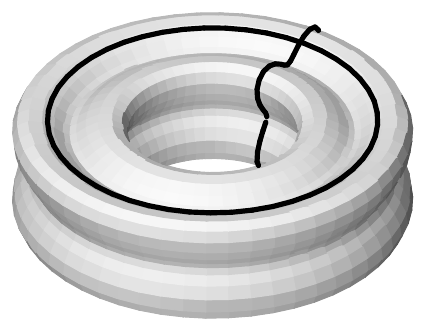
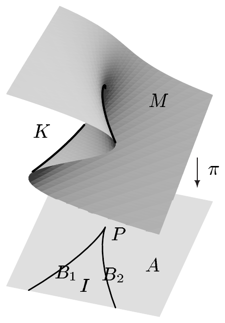
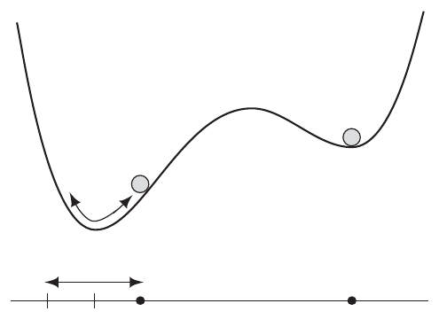
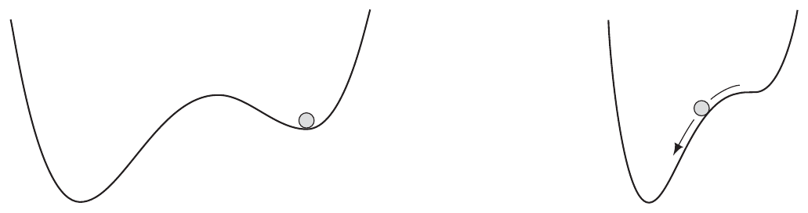

……$ S^m \times S^1 $ 到 $ \mathbb{R}^{m+2} $ 中。现在所有断言都可由定理 1.3 推出，因为 $ S^m \times S^1 $ 是紧的。 ■

(c) 设 $ L $ 与 $ M $ 是 $ N $ 的子流形，且 $ L \subset M $。则 $ L $ 是 $ M $ 的子流形。

证明 因为 $ \operatorname{id}_N \in \operatorname{Diff}(N, N) $，我们知道 $ i := \operatorname{id}_N|_L $ 是 $ L $ 在 $ N $ 中的浸入，且 $ i(L) \subset M $。因此由注 1.1(j) 可知，$ i $ 是 $ L $ 在 $ M $ 中的双射浸入。因为 $ L $ 与 $ M $ 都带有由 $ N $ 诱导的拓扑，并且 $ M $ 在 $ L $ 上诱导出相同的拓扑，所以作为微分同胚的限制，$ i $ 是拓扑的。因此 $ i $ 是嵌入，断言由定理 1.2 推出。 ■

(d) 设 (b) 的假设在 $ m = 1 $ 时得到满足。则对每个 $ (q_0, t_0) \in S^1 \times S^1 $，映射
\[ f(\cdot, t_0): S^1 \to \mathbb{R}^3 \]
与
\[ f(q_0, \cdot): S^1 \to \mathbb{R}^3 \]
的像都是 $ T^2 $ 的一维子流形，并且微分同胚于 $ S^1 $（从而是“圆”）。

证明 因为作为嵌入的限制，$ f(\cdot, t_0) $ 与 $ f(q_0, \cdot) $ 本身都是嵌入，所以 $ f(S^1, t_0) $ 与 $ f(q_0, S^1) $ 是 $ \mathbb{R}^3 $ 中微分同胚于 $ S^1 $ 的子流形，并且它们位于 $ T^2 $ 中。断言现在由 (c) 推出。 ■

##### 淹没

设 $ f \in C^1(M, N) $。若 $ T_p f $ 是满射，则称 $ p \in M $ 是 $ f $ 的**正则点**。否则称 $ p $ 是**奇点**。若每个 $ p \in f^{-1}(q) $ 都是正则点，则称点 $ q \in N $ 是 $ f $ 的**正则值**。若 $ M $ 的每个点都是正则的，则称 $ f $ 是**正则映射**或**淹没**。

这些定义推广了第 VII.8 节引入的概念。

1.6 注 (a) 若 $ p $ 是 $ f $ 的正则点，则 $ m \ge n $。每个 $ q \in N \setminus f(M) $ 都是 $ f $ 的正则值。

(b) 点 $ p \in M $ 是 $ f = (f^1, \ldots, f^n) \in C^1(M, \mathbb{R}^n) $ 的正则点，当且仅当余切向量\footnote{见第 VIII.3 节。}
\[ df^j(p) := d_p f^j = \operatorname{pr}_2 \circ T_p f^j \in T_p^* M \quad \text{对 } 1 \le j \le n \]
线性无关。

(c) $ f \in C^1(M, \mathbb{R}) $ 的奇点也称为**临界点**。因此 $ p \in M $ 是 $ f $ 的临界点，当且仅当 $ df(p) = 0 $。\footnote{见注 VII.3.14(a)。} ■

下面这个定理把正则值定理推广到流形之间映射的情形。

1.7 定理（正则值） 设 $ q \in N $ 是映射 $ f \in C^\infty(M, N) $ 的正则值。则 $ L := f^{-1}(q) $ 是 $ M $ 的余维数为 $ n $ 的子流形。对 $ p \in L $，$ T_p f $ 的核是 $ T_p L $。

证明 设 $ p_0 \in f^{-1}(q) $。设 $ (\varphi, U) $ 是 $ M $ 在 $ p_0 $ 附近的坐标卡，$ (\psi, V) $ 是 $ N $ 在 $ q $ 附近的坐标卡，且 $ f(U) \subset V $。则由链式法则可知，对每个 $ p \in U \cap f^{-1}(q) $，点 $ \varphi(p) $ 是局部表示
\[ f_{\varphi,\psi} := \psi \circ f \circ \varphi^{-1} \in C^\infty(\varphi(U), \mathbb{R}^n) \]
的正则点。

换言之，$ y := \psi(q) $ 是 $ f_{\varphi,\psi} $ 的正则值。因此定理 VII.9.3 保证 $ (f_{\varphi,\psi})^{-1}(y) $ 是 $ \mathbb{R}^m $ 的 $ (m-n) $ 维子流形。从而存在 $ \mathbb{R}^m $ 的开集 $ X $ 与 $ Y $，以及 $ \Phi \in \operatorname{Diff}(X, Y) $，使得
\[ \Phi(X \cap (f_{\varphi,\psi})^{-1}(y)) = Y \cap (\mathbb{R}^{m-n} \times \{0\}). \]

把 $ \varphi(U) $ 与 $ X $ 换成它们的交集，可以假设 $ \varphi(U) = X $。但此时 $ \varphi_1 := \Phi \circ \varphi $ 是 $ M $ 在 $ p $ 附近的坐标卡，满足
\[ \varphi_1(f^{-1}(q) \cap U) = \Phi \circ \varphi(f^{-1} \circ \psi^{-1}(y) \cap U) = \Phi((f_{\varphi,\psi})^{-1}(y) \cap X) = Y \cap (\mathbb{R}^{m-n} \times \{0\}), \]
因此它是 $ M $ 关于 $ f^{-1}(q) $ 的子流形坐标卡。第二个断言现在可由对定理 VII.10.7 证明的显然修改得到。 ■

1.8 注 (a) 定理 1.7 有一个逆命题，它说 $ M $ 的每个子流形都可以局部表示为某个正则映射的纤维。更确切地说，它说：若 $ L $ 是 $ M $ 的 $ \ell $ 维子流形，则对每个 $ p \in L $，存在 $ M $ 中的邻域 $ U $ 与 $ f \in C^\infty(U, \mathbb{R}^{m-\ell}) $，使得 $ f^{-1}(0) = U \cap L $，且 $ 0 $ 是 $ f $ 的正则值。

证明 设 $ (\varphi, U) $ 是 $ M $ 在 $ p $ 附近关于 $ L $ 的子流形坐标卡。则由 $ f(q) := (\varphi^{\ell+1}(q), \ldots, \varphi^m(q)) $（$ q \in U $）定义的函数属于 $ C^\infty(U, \mathbb{R}^{m-\ell}) $，并满足 $ f^{-1}(0) = U \cap L $。因为 $ \varphi $ 是微分同胚，$ 0 $ 是 $ f $ 的正则值。 ■

(b)（正则性） 若 $ q $ 是 $ f \in C^k(M, N) $ 的正则值（对某个 $ k \in \mathbb{N}^\times $），则 $ f^{-1}(q) $ 是 $ M $ 的 $ C^k $ 子流形。此时只需假设 $ M $ 本身是 $ C^k $ 流形。 ■

1.9 例 (a) 设 $ X $ 是 $ \mathbb{R}^m \times \mathbb{R}^n $ 中的开集，$ q \in \mathbb{R}^n $ 是 $ f \in C^\infty(X, \mathbb{R}^n) $ 的正则值，且 $ M := f^{-1}(q) \ne \varnothing $。则 $ M $ 是 $ X $ 的 $ m $ 维子流形。对
\[ \pi := \operatorname{pr}|_M : M \to \mathbb{R}^m \]
其中
\[ \operatorname{pr}: \mathbb{R}^m \times \mathbb{R}^n \to \mathbb{R}^m, \quad (x, y) \mapsto x, \]
我们有 $ \pi \in C^\infty(M, \mathbb{R}^m) $。最后设 $ p \in M $，并假设 $ D_1 f(p) \in \mathcal{L}(\mathbb{R}^m, \mathbb{R}^n) $ 是满射。\footnote{我们采用第 VII.8 节的记号。} 则 $ p $ 是 $ \pi $ 的正则点，当且仅当 $ D_2 f(p) $ 是双射。

证明 正则值定理保证 $ M $ 是 $ X $ 的 $ m $ 维子流形，且对 $ p \in M $ 有 $ T_p M = \ker(T_p f) $。因为 $ \pi $ 是线性映射（从而是光滑映射）的限制，由注 1.1(j) 可知 $ \pi \in C^\infty(M, \mathbb{R}^m) $ 且 $ T_p \pi = T_p \operatorname{pr}|_{T_p M} $。

由 $ T_p \operatorname{pr} = (p, \partial \operatorname{pr}(p)) $ 以及 $ \partial \operatorname{pr}(p)(h, k) = h $（$ (h, k) \in \mathbb{R}^m \times \mathbb{R}^n $）可知，$ T_p \pi $ 是满射，当且仅当对每个 $ y \in \mathbb{R}^m $ 都存在 $ (h, k) \in \mathbb{R}^m \times \mathbb{R}^n $ 使得
\[ \partial f(p)(h, k) = D_1 f(p)h + D_2 f(p)k = 0 \]
且 $ h = y $。这是因为 $ D_1 f(p) $ 是满射，当且仅当对每个 $ z \in \mathbb{R}^n $ 都存在 $ k \in \mathbb{R}^n $ 使 $ D_2 f(p)k = z $；等价地，当且仅当 $ D_2 f(p) $ 本身是满射。由于 $ D_2 f(p) \in \mathcal{L}(\mathbb{R}^n) $，证明完毕。 ■

(b)（“尖点灾变”） 对
\[ f: \mathbb{R}^2 \times \mathbb{R} \to \mathbb{R}, \quad ((u, v), x) \mapsto u + vx + x^3, \]
我们有
\[ [D_1 f(w, x)] = [1, x] \in \mathbb{R}^{1 \times 2}, \quad \text{其中 } w := (u, v). \]
因此 $ 0 $ 是 $ f $ 的正则值，且 $ M := f^{-1}(0) $ 是 $ \mathbb{R}^3 $ 中的曲面。因为 $ D_2 f(w, x) = v + 3x^2 $，由 (a) 可知
\[ K := \{((u, v), x) \in M ; v + 3x^2 = 0\} \]
是投影 $ \pi: M \to \mathbb{R}^2 $ 的奇点集。它满足
\[ K = \gamma(\mathbb{R}) \quad \text{其中 } \gamma: \mathbb{R} \to \mathbb{R}^3, \ t \mapsto (2t^3, -3t^2, t). \tag{1.5} \]

特别地，$ K $ 是 $ M $ 的一维子流形，是一条光滑嵌入的曲线。它的投影 $ B := \pi(K) $ 是
\[ \sigma: \mathbb{R} \to \mathbb{R}^2, \quad t \mapsto (2t^3, -3t^2) \]
的像，即一条尼尔抛物线。\footnote{见注 VII.9.9(a)。} 它是 0 维流形 $ P := \{(0, 0)\} \in \mathbb{R}^2 $（即“尖点”）与两条一维流形 $ B_1 := \sigma((-\infty, 0)) $ 和 $ B_2 := \sigma((0, \infty)) $ 的并。

证明 点 $ (u, v, x) \in \mathbb{R}^3 $ 属于 $ K $，当且仅当它满足方程
\[ u + vx + x^3 = 0 \quad \text{且} \quad v + 3x^2 = 0. \tag{1.6} \]

由第一个方程消去 $ v $，我们看到 (1.6) 等价于
\[ 2x^3 = u \quad \text{且} \quad 3x^2 = -v. \]
这证明了 (1.5)。对映射
\[ g: \mathbb{R}^3 \to \mathbb{R}^2, \quad (u, v, x) \mapsto (u - 2x^3, v + 3x^2) \]
的导数，我们求得
\[ [\partial g(u, v, x)] = \begin{bmatrix} 1 & 0 & -6x^2 \\ 0 & 1 & 6x \end{bmatrix} \in \mathbb{R}^{2 \times 3}. \]
这个矩阵的秩为 2，这表明 $ 0 $ 是 $ g $ 的正则值。因此由正则值定理，$ K = g^{-1}(0) $ 是 $ \mathbb{R}^3 $ 的一维子流形。因为 $ K \subset M $，由注 1.5(c) 可知 $ K $ 是 $ M $ 的子流形。其余部分是显然的。 ■

1.10 注（灾变理论） 我们现在考虑一个质量为 1 的质点沿实轴运动，其势能为 $ U $，总能量为
\[ E(\dot{x}, x) = \frac{\dot{x}^2}{2} + U(x) \quad \text{对 } x \in \mathbb{R}. \]
根据例 VII.6.14(a)，牛顿运动方程是
\[ \ddot{x} = -U'(x). \]
由例 VII.8.17(b) 与 (c) 可知，能量 $ E $ 的临界点恰好是满足 $ U'(x_0) = 0 $ 的点 $ (0, x_0) $。因为 $ E $ 的海森矩阵在 $ (0, x_0) $ 处具有形式
\[ \begin{bmatrix} 1 & 0 \\ 0 & U''(x_0) \end{bmatrix}, \]
所以它正定，当且仅当 $ U''(x_0) > 0 $。因此由定理 VII.5.14 可知，$ (0, x_0) $ 是总能量的孤立极小值点，当且仅当 $ x_0 $ 是势能的孤立极小值点。\footnote{我们只考虑“通有”情形，即当 $ U'(x_0) = 0 $ 时满足 $ U''(x_0) \ne 0 $。} 从图形上看很清楚，总能量的孤立极小值点是“稳定的”，其意义是：若在运动开始时（即 $ t = 0 $ 时）这一性质成立，则对一切 $ t \in \mathbb{R}^+ $，$ (\dot{x}(t), x(t)) $ 都停留在 $ (0, x_0) $ 的“邻域”内。

直观上，可以通过想象一个小球沿 $ U $ 的图像无摩擦地滚动、同时受重力作用，来理解 $ x $ 将如何沿轴 $ \mathbb{R} $ 运动。如果小球位于“势阱底部”，即位于局部极小值点，那么它不会运动，因为 $ \dot{x}(t) = U'(x_0) = 0 $。如果小球在局部极小值点附近被释放，那么小球将滚下坡、越过极小值点，再沿另一侧“山谷的斜坡”向上滚，直到它在原来的高度上“耗尽”动能。然后它将反向运动并滚动，直到再次在最初被释放的位置瞬时静止。因此小球将绕 $ x_0 $ 作周期振动。\footnote{这个看似合理的图景可以用常微分方程理论证明；例如见 [Ama95]。}

我们现在假设 $ U $ 连续依赖于额外的“控制参数” $ u, v, \ldots $。通过改变这些参数，我们可以连续地改变 $ U $ 的图像。这样，可能出现局部极小值先并入鞍点、然后不再是临界点的情形。先前被限制在局部极小值点邻域内的小球，此时就会离开这个邻域，并绕另一个静止点振动。

现在考虑一位能看到小球运动、却不知道过程背后机制的观察者。她将看到，原先平静地静止在某一位置的小球，会突然“无缘无故地”开始滚动，并绕另一个（虚拟的）中心周期振动。这看起来像是情形的突然而剧烈的变化，即一场“灾变”。

为了理解这类灾变（并在必要时避免它们），必须理解它们发生的机制。在上述情形中，这归结为理解势的临界点（特别是相对极小值点）如何依赖于控制参数。

为说明这一点，我们考虑势
\[ U_{(u, v)}: \mathbb{R} \to \mathbb{R}, \quad x \mapsto ux + vx^2/2 + x^4/4 \]
（$ (u, v) \in \mathbb{R}^2 $）。$ U_{(u, v)} $ 的临界点恰好是例 1.9(b) 中函数 $ f $ 的零点。因此，流形 $ M $，即**灾变流形**，描述了势的两参数族 $ \{U_{(u, v)} ; (u, v) \in \mathbb{R}^2\} $ 的所有临界点。特别令人感兴趣的是 $ M $ 的那个子集，即**灾变集** $ K $，它由从 $ M $ 到参数空间的投影 $ \pi $ 的所有奇点组成。在我们的例子中，$ K $ 是光滑嵌入 $ M $ 中的一条曲线，即**折叠曲线**，因为灾变流形沿 $ K $ 被“折叠”。$ K $ 在 $ \pi $ 下的像，即折叠曲线到参数平面上的投影，是**分岔集** $ B $。$ \mathbb{R}^2 \setminus B $ 的每个点都是 $ \pi $ 的正则点。纤维 $ \pi^{-1}(u, v) $ 对 $ (u, v) \in A \cup P $ 恰含一个点，对 $ (u, v) \in B_1 \cup B_2 $ 恰含两个点，对 $ (u, v) \in I $ 恰含三个点，其中 $ A $ 与 $ I $ 在例 1.9(b) 的插图中绘出。下面这些图显示了当 $ (u, v) $ 属于这些集合时势 $ U_{(u, v)} $ 的定性形式。
