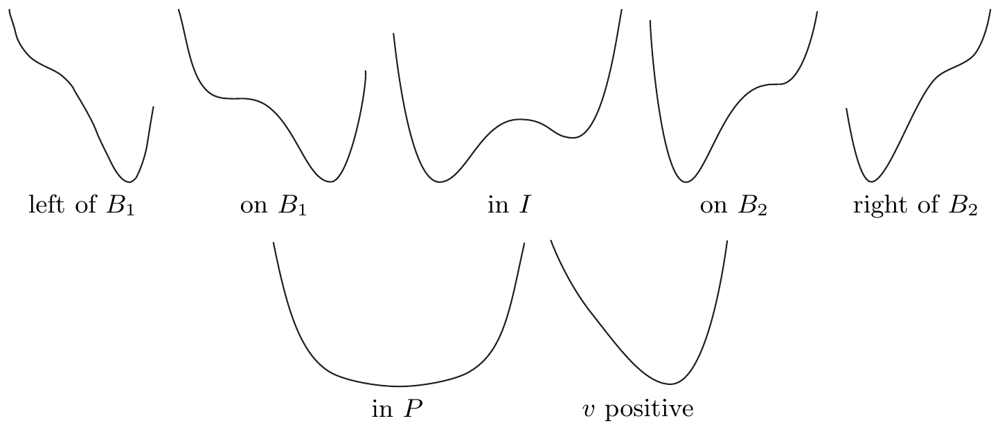
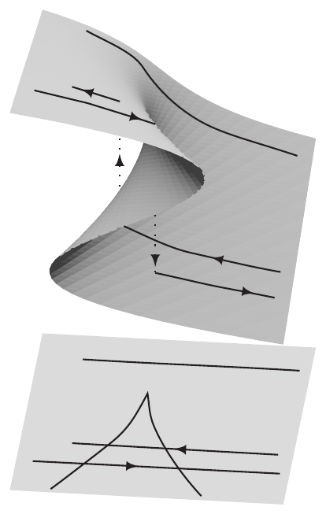
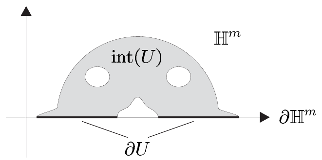
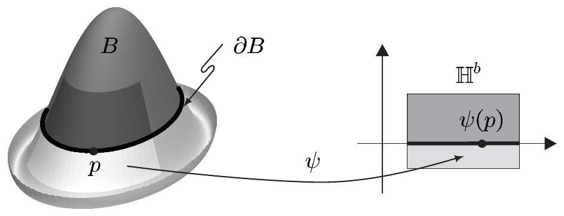
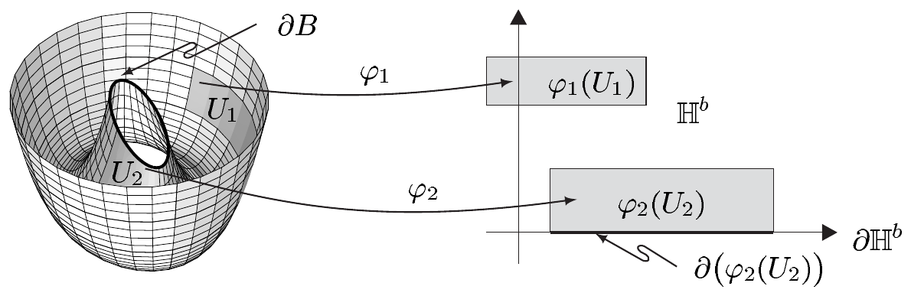
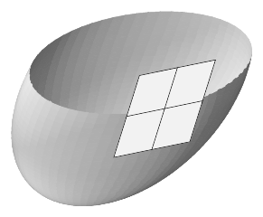

现在考虑参数空间中的一条连续曲线 $ C $，它从 $ A $ 出发、终止于 $ I $（或反向），并且始终停留在 $ B_1\cup B_2 $ 中。沿这条曲线连续移动时，$ \pi $ 的原像中点的个数会突然从 1 变成 3（或从 3 变成 1）。如右图所示，这样一条曲线 $ C $ 可由投影灾变流形 $ M $ 上的一条曲线 $ \Gamma $ 得到，该曲线在穿过折叠曲线时发生“跳变”。简言之，$ x $ 的值经历了一次“灾变”。

这些事实导致了对“灾变理论”的许多解释；这些解释——尤其是因为其名称——被用来获得极大的名声，并且在科普文献中尤其激起了过高的期望，以为这门学科会以某种方式解释或帮助防止现实世界中的灾变。关于灾变理论的批判性、非技术性导论，我们参考 [Arn84]；我们还推荐 [PS78]，其中详细介绍了奇点理论的数学理论及其若干应用，而灾变理论正是其中的一部分。

##### 带边子流形

我们知道，开单位球 $ \mathbb{B}^m $ 及其边界，即 $ (m-1) $ 维球面 $ S^{m-1} $，分别是 $ \mathbb{R}^m $ 的 $ m $ 维与 $ (m-1) $ 维子流形。然而，闭球 $ \overline{\mathbb{B}}^m = \mathbb{B}^m\cup S^{m-1} $ 不是流形，因为点 $ p \in \partial\mathbb{B}^m = S^{m-1} $ 在 $ \overline{\mathbb{B}}^m $ 中没有邻域 $ U $ 能被拓扑地映成 $ \mathbb{R}^m $ 的开集 $ V $；这样的邻域 $ U $ 作为开集 $ V $ 的同胚像，同样须在 $ \mathbb{R}^m $ 中为开，而这是不对的。在 $ p $ 的邻域中，也就是“用很强的显微镜观察”时，$ \overline{\mathbb{B}}^m $ 看起来不像 $ \mathbb{R}^m $，而更像一个半空间。为了也涵盖这类情形，我们必须推广流形的概念，允许把半空间的子集作为参数集。

以下设 $ m \in \mathbb{N}^{\times} $，并令

\[ \mathbb{H}^m := \mathbb{R}^{m-1}\times(0,\infty) \]

为 $ \mathbb{R}^m $ 的**开上半空间**。若不会引起误解，我们将其边界 $ \partial\mathbb{H}^m = \mathbb{R}^{m-1}\times\{0\} $ 与 $ \mathbb{R}^{m-1} $ 等同。若 $ U $ 是 $ \overline{\mathbb{H}}^m := \overline{\mathbb{H}}^m = \mathbb{R}^{m-1}\times\mathbb{R}^{+} $ 的开子集，则称 $ \operatorname{int}(U) := U\cap\mathbb{H}^m $ 为 $ U $ 的**内部**，称 $ \partial U := U\cap\partial\mathbb{H}^m $ 为 $ U $ 的**边界**。注意边界 $ \partial U $ 既不是 $ U $ 在 $ \overline{\mathbb{H}}^m $ 中的拓扑边界\footnote{从今往后，我们只用符号 $ \partial M $ 表示边界；为清楚起见，对拓扑空间子集 $ M $ 的拓扑边界，我们写作 $ \operatorname{Rd}(M) $，即令 $ \operatorname{Rd}(M) := \overline{M}\setminus\mathring{M} $。}，也不是 $ U $ 在 $ \mathbb{R}^m $ 中的拓扑边界（在后一情形除非 $ U = \mathbb{H}^m $）。

设 $ X $ 在 $ \overline{\mathbb{H}}^m $ 中开，$ E $ 是巴拿赫空间。若存在 $ x_0 $ 在 $ \mathbb{R}^m $ 中的邻域 $ U $ 以及可微函数 $ f_U : U \to E $，使得 $ f_U $ 在 $ U\cap X $ 上与 $ f $ 一致，则称 $ f : X \to E $ 在边界点 $ x_0 \in \partial X $ 处**可微**。于是由命题 VII.2.5 可得

\[ \partial_j f_U(x_0) = \lim_{t \to 0+} \left(f_U(x_0 + te_j) - f_U(x_0)\right)/t = \lim_{t \to 0+} \left(f(x_0 + te_j) - f(x_0)\right)/t \]

其中 $ 1 \le j \le m $，$ (e_1,\ldots,e_m) $ 是 $ \mathbb{R}^m $ 的标准基。这与命题 VII.2.8 表明 $ \partial f_U(x_0) $ 已由 $ f $ 确定。因此 $ f $ 的**导数**

\[ \partial f(x_0) := \partial f_U(x_0) \in \mathcal{L}(\mathbb{R}^m,E) \]

在 $ x_0 $ 处是良定义的，即与 $ f $ 的局部延拓 $ f_U $ 的选择无关。

若映射 $ f : X \to E $ 在 $ X $ 的每一点处可微，且映射

\[ \partial f : X \to \mathcal{L}(\mathbb{R}^m,E) ,\quad x \mapsto \partial f(x) \]

连续，则称 $ f $ 是**连续可微的**\footnote{自然，若 $ f|\operatorname{int}(X) $ 在 $ x_0 $ 处可微，则称 $ f $ 在 $ x_0 \in \operatorname{int}(X) $ 处可微。}。

$ f $ 的高阶导数类似地定义，它们也与具体的局部延拓无关。对 $ k \in \mathbb{N}^{\times}\cup\{\infty\} $，从 $ X $ 到 $ E $ 的 $ C^k $ 映射构成一个向量空间，与 $ \mathbb{R}^m $ 的开子集的情形一样，我们把它记作 $ C^k(X,E) $。

设 $ Y $ 在 $ \overline{\mathbb{H}}^m $ 中开。若 $ f $ 是双射，且 $ f $ 与 $ f^{-1} $ 都属于类 $ C^k $，则也称 $ f : X \to Y $ 为 $ C^k $ **微分同胚**，并记 $ f \in \operatorname{Diff}^k(X,Y) $。特别地，$ \operatorname{Diff}(X,Y) := \operatorname{Diff}^{\infty}(X,Y) $ 是从 $ X $ 到 $ Y $ 的所有光滑（即 $ C^{\infty} $）微分同胚的集合。

1.11 注 设 $ X $ 与 $ Y $ 在 $ \overline{\mathbb{H}}^m $ 中开，且对某个 $ k \in \mathbb{N}^{\times}\cup\{\infty\} $，$ f : X \to Y $ 是 $ C^k $ 微分同胚。

(a) 若 $ \partial X $ 非空，则 $ \partial Y \neq \varnothing $，且 $ f|\partial X $ 是从 $ \partial X $ 到 $ \partial Y $ 的 $ C^k $ 微分同胚。又 $ f|\operatorname{int}(X) $ 属于 $ \operatorname{Diff}^k(\operatorname{int}(X),\operatorname{int}(Y)) $。

证明 设 $ p \in \partial X $，且 $ q := f(p) $ 属于 $ \operatorname{int}(Y) $。则由反函数定理（定理 VII.7.3，施用于 $ f $ 的一个局部延拓）可知 $ \partial f^{-1}(q) $ 是 $ \mathbb{R}^m $ 的自同构。于是再由定理 VII.7.3 可知，$ f^{-1} $ 把 $ q $ 在 $ \operatorname{int}(Y) $ 中的某个适当邻域 $ V $ 映为 $ p $ 在 $ \mathbb{R}^m $ 中的开邻域 $ U $。但由于 $ f^{-1}(V) \subset X \subset \overline{\mathbb{H}}^m $ 且 $ p = f^{-1}(q) \in \partial X $，这是不可能的。因此 $ f(\partial X) \subset \partial Y $。类似地可得 $ f^{-1}(\partial Y) \subset \partial X $。这就表明 $ f(\partial X) = \partial Y $。

由于 $ X $ 与 $ Y $ 在 $ \overline{\mathbb{H}}^m $ 中开，$ \partial X $ 与 $ \partial Y $ 都在 $ \partial\mathbb{H}^m = \mathbb{R}^{m-1} $ 中开，且 $ f|\partial X $ 是从 $ \partial X $ 到 $ \partial Y $ 的双射。因为 $ f|\partial X $ 与 $ f^{-1}|\partial Y $ 显然属于类 $ C^k $，所以 $ f|\partial X $ 是从 $ \partial X $ 到 $ \partial Y $ 的 $ C^k $ 微分同胚。最后一个断言现在清楚了。■

(b) 对 $ p \in \partial X $，有 $ \partial f(p)(\partial\mathbb{H}^m) \subset \partial\mathbb{H}^m $ 以及 $ \partial f(p)(\pm\mathbb{H}^m) \subset \pm\mathbb{H}^m $。

证明 由 $ f(\partial X) = \partial Y $ 可知，对 $ f $ 的第 $ m $ 个坐标函数 $ f^m $ 有 $ f^m|\partial X = 0 $。由此得到 $ \partial_j f^m(p) = 0 $，$ 1 \le j \le m-1 $。因此 $ f $ 在 $ p $ 处的雅可比矩阵形如

\[ [\partial f(p)] = \begin{bmatrix} & \partial(f\mid\partial\mathbb{H}^m)(p) & \vdots & \partial_m f^1(p) \\ & & \vdots & \vdots \\ & & \vdots & \partial_m f^{m-1}(p) \\ \cdots & \cdots\cdots\cdots\cdots & \cdots & \cdots\cdots\cdots \\ 0 & \cdots & 0 & \partial_m f^m(p) \end{bmatrix} \tag{1.7} \]

因为 $ f(X) \subset Y \subset \overline{\mathbb{H}}^m $，所以对 $ q \in X $ 有不等式 $ f^m(q) \ge 0 $。于是

\[ \partial_m f^m(p) = \lim_{t \to 0+} t^{-1}\left(f^m(p + te_m) - f^m(p)\right) = \lim_{t \to 0+} t^{-1} f^m(p + te_m) \ge 0 . \]

由于 $ \partial f(p) \in \mathcal{L}\mathrm{aut}(\mathbb{R}^m) $（见注 VII.7.4(d)）且 $ \partial_m f^m(p) \ge 0 $，我们有 $ \partial_m f^m(p) > 0 $。由 (1.7) 可读出

\[ (\partial f(p)x)^m = \partial_m f^m(p)t \quad \text{对 } x := (y,t) \in \mathbb{R}^{m-1}\times\mathbb{R} . \]

因此 $ \partial f(p)x $ 的第 $ m $ 个坐标的符号与 $ \operatorname{sign}(t) $ 一致，证毕。■

现在我们可以定义带边子流形的概念。若对每个 $ p \in B $，都存在 $ N $ 的一个围绕 $ p $ 的坐标卡 $ (\psi,V) $——即 $ N $ 关于 $ B $ 的一个围绕 $ p $ 的**子流形坐标卡**——使得

\[ \psi(V\cap B) = \psi(V)\cap(\overline{\mathbb{H}}^b\times\{0\}) \subset \mathbb{R}^n , \tag{1.8} \]

则称 $ n $ 维流形 $ N $ 的子集 $ B $ 为 $ N $ 的**带边 $ b $ 维子流形**。

这里，若 $ \psi(p) $ 落在 $ \partial\mathbb{H}^b := \partial\mathbb{H}^b\times\{0\} $ 中，则称 $ p $ 是 $ B $ 的**边界点**。

所有边界点的集合构成 $ B $ 的**边界**\footnote{注意边界 $ \partial B $ 与内部 $ \operatorname{int}(B) $ 通常不同于 $ B $ 的拓扑边界 $ \operatorname{Rd}(B) $ 与拓扑内部 $ \mathring{B} $。在关于流形的陈述中，我们将在上述定义的意义下理解“边界”与“内部”。} $ \partial B $。集合 $ \operatorname{int}(B) := B\setminus\partial B $ 称为带边子流形 $ B $ 的**内部**。最后，若 $ b = n-1 $，则称 $ B $ 是 $ N $ 中的**带边超曲面**。

1.12 注

(a) 本节开头意义下的 $ N $ 的每个子流形 $ M $ 都是带边子流形，但其边界为空。我们称这样的对象为**无边（子）流形**。

(b) 边界 $ \partial B $ 与内部 $ \operatorname{int}(B) $ 是良定义的，即与坐标卡无关。

证明 设 $ (\chi,W) $ 是 $ N $ 的另一个关于 $ B $ 的、围绕 $ p $ 的子流形坐标卡。又设 $ f $ 是转移函数 $ \chi\circ\psi^{-1} $ 在 $ \psi(V\cap W)\cap(\overline{\mathbb{H}}^b\times\{0\}) $ 上的限制，把它看作 $ \overline{\mathbb{H}}^b $ 的开子集。则由注 1.11(a) 可知，$ \chi(p) $ 属于 $ \partial\mathbb{H}^b $ 当且仅当 $ \psi(p) $ 属于 $ \partial\mathbb{H}^b $。■

(c) 设 $ p \in \operatorname{int}(B) $。则 (1.8) 蕴含

\[ \psi(V\cap\operatorname{int}(B)) = \psi(V)\cap(\mathbb{H}^b\times\{0\}) . \]

因为 $ \mathbb{H}^b $ 微分同胚于 $ \mathbb{R}^b $，这表明 $ \operatorname{int}(B) $ 是 $ N $ 的无边 $ b $ 维子流形。

(d) 在 $ p \in \partial B $ 的情形，由 (1.8) 可得

\[ \psi(V\cap\partial B) = \psi(V)\cap(\mathbb{R}^{b-1}\times\{0\}) . \]

因此 $ \partial B $ 是 $ N $ 的无边 $ (b-1) $ 维子流形。

(e) $ N $ 的每个带边 $ b $ 维子流形都是 $ \mathbb{R}^n $ 的带边 $ b $ 维子流形。

证明 这类似于注 1.1(a) 的证明。■

(f)（正则性）对 $ k \in \mathbb{N}^{\times} $，$ C^k $ 带边子流形如何定义是清楚的，且 (a)–(c) 的类似结论仍然成立。■

##### 局部坐标卡

设 $ B $ 是 $ N $ 的带边 $ b $ 维子流形。若以下条件成立，则称映射 $ \varphi $ 为 $ B $ 在 $ p $ 处的（$ b $ 维局部）**坐标卡**：

- $ U := \operatorname{dom}(\varphi) $ 在 $ B $ 中是开集，其中 $ B $ 带有由 $ N $（从而由 $ \mathbb{R}^n $）诱导的拓扑；
- $ \varphi $ 是从 $ U $ 到 $ \overline{\mathbb{H}}^b $ 的开子集 $ X $ 的同胚；
- $ i_B\circ\varphi^{-1} : X \to N $ 是浸入，其中 $ i_B : B \to N $，$ p \mapsto p $ 表示单射。

注意，除了 $ \varphi(U) $ 在 $ \overline{\mathbb{H}}^b $ 中是开集、且 $ \mathbb{R}^n $ 被替换为 $ N $ 之外，这个定义与 $ \mathbb{R}^n $ 的子流形的 $ C^{\infty} $ 坐标卡的定义逐字一致（见第 VII.9 节）。

1.13 注 (a) 若 $ (\psi,V) $ 是 $ N $ 关于 $ B $ 的子流形坐标卡，则相交坐标卡 $ (\varphi,U) := (\psi|V\cap B, V\cap B) $ 是 $ B $ 的 $ b $ 维坐标卡。

(b) 若 $ (\varphi_1,U_1) $ 与 $ (\varphi_2,U_2) $ 是 $ B $ 在 $ p \in B $ 处的坐标卡，则 $ \varphi_j(U_1\cap U_2) $ 在 $ \overline{\mathbb{H}}^b $ 中开，$ j = 1,2 $，且**转移函数** $ \varphi_2\circ\varphi_1^{-1} $ 满足

\[ \varphi_2\circ\varphi_1^{-1} \in \operatorname{Diff}(\varphi_1(U_1\cap U_2), \varphi_2(U_1\cap U_2)) . \]

(c) 设 $ (\varphi,U) $ 是 $ B $ 在 $ p \in \partial B $ 处的坐标卡。则

\[ (\varphi_{\partial B}, U_{\partial B}) := (\varphi|U\cap\partial B, U\cap\partial B) \]

是 $ \partial B $（$ N $ 的无边 $ (b-1) $ 维子流形）的坐标卡。

(d) 所有能用流形的坐标卡描述的概念与定义，例如映射的可微性与局部表示，都直截了当地推广到带边子流形。特别地，$ i_B : B \hookrightarrow N $，即 $ B $ 在 $ N $ 中的自然嵌入 $ p \mapsto p $，是光滑映射。

(e) 若 $ C $ 是 $ M $ 的带边子流形且 $ f \in \operatorname{Diff}(B,C) $，则 $ f(\partial B) = \partial C $，且 $ f|\partial B $ 是从 $ \partial B $ 到 $ \partial C $ 的微分同胚。

证明 这由注 1.11(a) 推出。■

(f) 设 $ B $ 是 $ N $ 的带边 $ b $ 维子流形，且 $ f \in C^{\infty}(B,M) $ 是**嵌入**，即 $ f $ 是双射浸入并且是从 $ B $ 到 $ f(B) $ 的同胚。则 $ f(B) $ 是 $ M $ 的带边 $ b $ 维子流形，满足 $ \partial f(B) = f(\partial B) $，且 $ f $ 是从 $ B $ 到 $ f(B) $ 的微分同胚。

证明 定理 1.2(ii) 的证明同样适用。■

(g)（正则性）前面所有结论都逐字转移到 $ C^k $ 带边子流形。■

我们自然再次称 $ B $ 的一个坐标卡族 $ \{(\varphi_{\alpha},U_{\alpha}) ; \alpha \in A\} $（满足 $ B = \bigcup_{\alpha}U_{\alpha} $）为 $ B $ 的**图册**。

##### 切空间与法空间

设 $ B $ 是 $ N $ 的带边子流形，并设 $ p \in \partial B $。又设 $ (\varphi,U) $ 是 $ B $ 在 $ p $ 处的坐标卡。则定义 $ B $ 在点 $ p $ 处的**切空间** $ T_pB $ 为

\[ T_pB := T_{\varphi(p)}(i_B\circ\varphi^{-1})(T_{\varphi(p)}\mathbb{R}^b) , \]

其中 $ b := \dim(B) $。因此 $ T_pB $ 是 $ N $ 在 $ p $ 处的切空间 $ T_pN $ 的一个（“满”）$ b $ 维向量子空间（而不是，比如说，一个半空间）。对注 VII.10.3(a) 的证明作显然的修改即可表明 $ T_pB $ 是良定义的，即与所用的坐标卡无关。此时，我们通过 $ TB := \bigcup_{p\in B}T_pB $ 定义 $ B $ 的**切丛** $ TB $。

1.14 注 (a) 对 $ p \in \partial B $，$ T_p\partial B $ 是 $ T_pB $ 的 $ (b-1) $ 维向量子空间。

证明 这是注 1.12(d) 与 1.13(c) 的简单推论。■

(b) 设 $ p \in \partial B $，且 $ (\varphi,U) $ 是 $ B $ 在 $ p $ 处的坐标卡。令

\[ T_p^{\pm}B := T_{\varphi(p)}(i_B\circ\varphi^{-1})(\varphi(p), \pm\overline{\mathbb{H}}^b) , \]

则 $ T_pB = T_p^{+}B\cup T_p^{-}B $ 且 $ T_p^{+}B\cap T_p^{-}B = T_p(\partial B) $。向量 $ v $ 是**内指**［或**外指**］切向量，当且仅当 $ v $ 属于集合 $ T_p^{+}B\setminus T_p(\partial B) $［或 $ T_p^{-}B\setminus T_p(\partial B) $］。这成立当且仅当 $ (T_p\varphi)v $ 的第 $ b $ 个分量为正［或为负］。

证明 由注 1.11(b) 与 1.13(b) 容易推出，$ T_p^{\pm}B $ 的定义与坐标无关。■

(c) 设 $ C $ 是 $ M $ 的带边或无边子流形。对 $ f \in C^1(C,N) $，$ f $ 在 $ p \in C $ 处的**切映射** $ T_pf $ 按无边流形的情形定义。于是注 VII.10.9 的类似结论仍然成立。■
