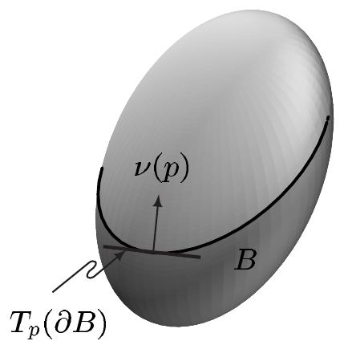
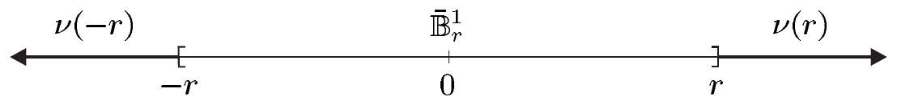
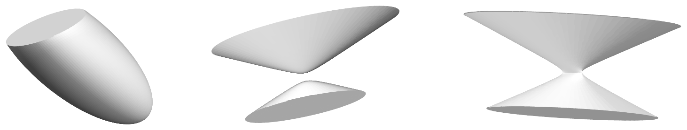
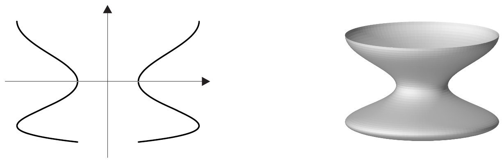
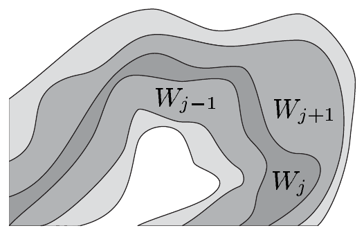

设 $ p \in \partial B $。则 $ T_{p}(\partial B) $ 是 $ b $ 维向量空间 $ T_{p}B $ 的 $ (b-1) $ 维向量子空间。作为 $ T_{p}N $（从而也是 $ T_{p}\mathbb{R}^{\overline{n}} $）的向量子空间，$ T_{p}B $ 以 $ \mathbb{R}^{\overline{n}} $ 上欧几里得标量积诱导的内积 $ (\cdot \mid \cdot)_{p} $ 构成内积空间。因此 $ T_{p}^{-}B $ 中恰有一个与 $ T_{p}(\partial B) $ 正交的单位向量 $ \nu(p) $，我们称它为 $ \partial B $ 在 $ p $ 处的**外向（单位）法向量**。显然 $ -\nu(p) \in T_{p}^{+}B $ 是 $ T_{p}B $ 中与 $ T_{p}(\partial B) $ 正交的唯一内指向量，我们称它为 $ \partial B $ 在 $ p $ 处的**内向（单位）法向量**。

##### 正则值定理

我们已经看到，无边界子流形在许多情形下（事实上局部总是如此）可以表示成正则映射的纤维。现在我们把这一重要而简单的判别准则推广到带边子流形的情形。

1.15 定理（正则值） 设 $ c $ 是 $ f \in C^{\infty}(N, \mathbb{R}) $ 的正则值。则

\[ B := f^{-1}((-\infty, c]) = \{p \in N ; f(p) \le c\} \]

是 $ N $ 的 $ n $ 维带边子流形，且 $ \partial B = f^{-1}(c) $、$ \operatorname{int}(B) = f^{-1}((-\infty, c)) $。对 $ p \in \partial B $，有 $ T_{p}(\partial B) = \ker(d_{p}f) $，并且 $ \partial B $ 上的外向单位法向量 $ \nu(p) $ 由 $ \nabla_{p}f(p)/|\nabla_{p}f|_{p} $ 给出。

证明 由于 $ f^{-1}((-\infty, c)) $ 在 $ N $ 中是开的，从而是 $ N $ 的 $ n $ 维子流形，故只需考虑 $ p \in f^{-1}(c) $。

因此设 $ p \in f^{-1}(c) $，并设 $ (\psi, V) $ 是 $ N $ 在 $ p $ 附近的坐标卡，使得 $ \psi(p) = 0 $。则 $ g := c - f \circ \psi^{-1} $ 属于 $ C^{\infty}(\psi(V), \mathbb{R}) $，且满足 $ g(0) = 0 $，并且 $ g(x) \ge 0 $ 当且仅当 $ x $ 落在 $ \psi(V \cap B) $ 中。此外 $ 0 $ 是 $ g $ 的正则点。通过重新命名坐标（即用 $ \psi $ 与一个置换复合），我们可以假设 $ \partial_{n}g(0) \ne 0 $，从而 $ \partial_{n}g(0) > 0 $。

考虑由 $ \varphi(x) := (x^{1}, \ldots, x^{n-1}, g(x)) $ 定义的映射 $ \varphi \in C^{\infty}(\psi(V), \mathbb{R}^{n}) $。它满足 $ \varphi(0) = 0 $，并且

\[ \partial\varphi = \begin{bmatrix} 1_{n-1} & & & 0 \\ & & & \vdots \\ & & & 0 \\ \partial_{1}g & \cdots & \partial_{n-1}g & \partial_{n}g \end{bmatrix} \]

因此 $ \partial\varphi(0) $ 是 $ \mathbb{R}^{n} $ 的自同构，而定理 VII.7.3（反函数定理）保证存在 $ 0 $ 在 $ \psi(V) $ 中的开邻域 $ U $ 与 $ W $，使得 $ \varphi|U $ 是从 $ U $ 到 $ W $ 的微分同胚。

令 $ V_{0} := \psi^{-1}(U) $、$ \chi := \varphi \circ \psi|V_{0} $，我们看到 $ (\chi, V_{0}) $ 是 $ N $ 在 $ p $ 附近的坐标卡，且 $ \chi(p) = 0 $、$ \chi(B \cap V_{0}) = \chi(V_{0}) \cap \overline{\mathbb{H}}^{n} $。这表明 $ B $ 是 $ N $ 的带边子流形，且 $ \partial B = f^{-1}(c) $、$ \operatorname{int}(B) = f^{-1}((-\infty, c)) $。于是由定理 1.7 得到

\[ T_{p}(\partial B) = \ker(T_{p}f) = \ker(d_{p}f) \quad \text{对 } p \in \partial B. \tag{1.9} \]

由于对 $ v \in T_{p}N $ 有 $ \langle d_{p}f, v \rangle_{p} = (\nabla_{p}f \mid v)_{p} $，由 (1.9) 可得 $ \nabla_{p}f $ 与 $ T_{p}(\partial B) $ 正交。

最后，设 $ \lambda: (-\varepsilon, \varepsilon) \to N $ 是 $ N $ 中的 $ C^{1} $ 道路，满足 $ \lambda(0) = p $ 且 $ \dot{\lambda}(0) = \nabla_{p}f $（见定理 VII.10.6）。则

\[ (f \circ \lambda)^{\cdot}(0) = \langle d_{p}f, \nabla_{p}f \rangle = |\nabla_{p}f|_{p}^{2} > 0. \]

因此由推论 IV.3.3 的泰勒公式可得

\[ f(\lambda(t)) = c + t|\nabla_{p}f|_{p}^{2} + o(t) \quad (t \to 0). \]

从而对充分小的正 $ t $ 有 $ f(\lambda(t)) > c $，即 $ f(\lambda(t)) \notin B $。这表明 $ \nabla_{p}f $ 是 $ B $ 在 $ p $ 处的外向切向量。现在最后一个断言也清楚了。■

1.16 注 （a）由于我们可以局部地把子流形表示成正则映射的纤维（见注 1.8(a)），我们也可以局部地把带边子流形表示成半开区间的原像。更确切地说，设 $ B $ 是 $ N $ 的 $ n $ 维带边子流形。则对每一点 $ p \in B $，存在 $ N $ 中的邻域 $ U $ 及函数 $ f \in C^{\infty}(U, \mathbb{R}) $，使得当 $ p \in \operatorname{int}(B) $ 时 $ B \cap U = f^{-1}((-\infty, 1)) $，而当 $ p \in \partial B $ 时 $ f(p) = 0 $ 且 $ B \cap U = f^{-1}((-\infty, 0]) $，并且 $ 0 $ 是它的正则值。

证明 设 $ (\varphi, U) $ 是 $ N $ 在 $ p $ 附近关于 $ B $ 的子流形坐标卡，且 $ \varphi(p) = 0 $。我们可以假设 $ \varphi(U) $ 包含在 $ \mathbb{B}_{\infty}^{n} $ 中。若 $ p $ 是 $ B $ 的内点，我们对 $ q \in U $ 令 $ f(q) := \varphi^{n}(q) $。则 $ f $ 属于 $ C^{\infty}(U, \mathbb{R}) $，且 $ f^{-1}((-\infty, 1)) = U $。若 $ p $ 属于 $ \partial B $，我们对 $ q \in U $ 令 $ f(q) := -\varphi^{n}(q) $。则 $ f(p) = 0 $，且 $ f^{-1}((-\infty, 0]) = U \cap B $。因为 $ \varphi \in \operatorname{Diff}(U, \varphi(U)) $，我们知道 $ f $ 是淹没。因此 $ 0 $ 是 $ f $ 的正则值。■

（b）（正则性）设 $ c $ 是 $ f \in C^{k}(N, \mathbb{R}) $ 的正则值，其中 $ k \in \mathbb{N}^{\times} $。则 $ f^{-1}((-\infty, c]) $ 是 $ N $ 中的 $ n $ 维带边子流形。此时只需假设 $ N $ 是 $ C^{k} $ 流形。■

1.17 例 （a）对每个 $ r > 0 $，$ \overline{\mathbb{B}}_{r}^{n} := r\overline{\mathbb{B}}^{n} = \{x \in \mathbb{R}^{n} ; |x| \le r\} $ 是 $ \mathbb{R}^{n} $ 的 $ n $ 维带边子流形。它的边界与拓扑边界重合，从而与半径为 $ r $ 的 $ (n-1) $ 维球面重合，即 $ \partial\overline{\mathbb{B}}_{r}^{n} = rS^{n-1} $。在 $ p \in \partial\overline{\mathbb{B}}_{r}^{n} $ 处的外向法向量 $ \nu(p) $ 由 $ (p, p/|p|) $ 给出。

当 $ n = 1 $ 时，球 $ \overline{\mathbb{B}}_{r}^{1} $ 是 $ \mathbb{R} $ 中的闭区间 $ [-r, r] $，而半径为 $ r $ 的 0 维球面由 $ S_{r}^{0} = \{-r\} \cup \{r\} $ 给出。外向法向量为 $ \nu(-r) = (-r, -1) $ 和 $ \nu(r) = (r, 1) $。

证明 这由定理 1.15 取 $ N := \mathbb{R}^{n} $ 及 $ f(x) := |x|^{2} $（$ x \in \mathbb{R}^{n} $）即得。■

（b）设 $ A \in \mathbb{R}_{\mathrm{Sym}}^{(n+1) \times (n+1)} $ 及 $ c \in \mathbb{R}^{\times} $。又设

\[ V_{c} := \{x \in \mathbb{R}^{n+1} ; (Ax \mid x) \le c\} \]

非空。若 $ A $ 正定且 $ c > 0 $，则 $ V_{c} $ 是一个 $ (n+1) $ 维立体，其边界是 $ n $ 维椭球

\[ K_{c} := \{x \in \mathbb{R}^{n+1} ; (Ax \mid x) = c\}. \]

若 $ A $ 负定且 $ c < 0 $，则 $ V_{c} $ 是 $ V_{-c} $ 内部的补集，而 $ V_{-c} $ 的边界是 $ n $ 维椭球 $ K_{-c} $。若 $ A $ 不定但可逆，则 $ V_{c} $ 是某个界定 $ V_{c} $ 的 $ n $ 维双曲面 $ K_{c} $ 的“内部”或“外部”。在每种情形下，$ Ax/|Ax| $ 都是 $ V_{c} $ 在 $ K_{c} $ 处的外向法向量。（将此与注 VII.10.18 比较，并相应地解释那里的图。）

（c）设 $ A \in \mathbb{R}^{(n+1) \times (n+1)} $ 是对称的，$ c \in \mathbb{R}^{\times} $ 且 $ K_{c} \ne \varnothing $。又设 $ v \in \mathbb{R}^{n+1} \setminus \{0\} $、$ \alpha, \beta \in \mathbb{R} $ 且 $ \alpha < \beta $。则

\[ B := \{x \in K_{c} ; \alpha \le (v \mid x) \le \beta\} \]

是 $ K_{c} $ 中位于两个平行超平面

\[ H_{\gamma} := \{x \in \mathbb{R}^{n+1} ; (v \mid x) = \gamma\} \quad \text{对 } \gamma \in \{\alpha, \beta\}. \]

之间的部分。若 $ H_{\alpha} $ 与 $ H_{\beta} $ 不是 $ K_{c} $ 的切超平面，则 $ B $ 是 $ K_{c} $ 的 $ n $ 维带边子流形，且

\[ \partial B = \{x \in K_{c} ; (v \mid x) \in \{\alpha, \beta\}\}. \]

证明 因为映射 $ g := (v \mid \cdot)|K_{c}: K_{c} \to \mathbb{R} $ 由注 1.1(j) 是光滑的，我们知道 $ g^{-1}((\alpha, \beta)) $ 在 $ K_{c} $ 中是开的。因此 $ g^{-1}((\alpha, \beta)) $ 是 $ K_{c} $ 的 $ n $ 维子流形。

因此只需证明每个 $ p \in g^{-1}(\{\alpha, \beta\}) $ 都是 $ B $ 的边界点。于是设 $ V $ 是 $ K_{c} $ 中包含 $ p \in g^{-1}(\beta) $ 的开邻域，使得 $ g^{-1}(\alpha) \cap V = \varnothing $。$ H_{\beta} $ 不是切超平面这一假设蕴涵 $ \beta $ 是 $ f := g|V $ 的正则值（请证明这一点！）。现在由定理 1.15 应用于流形 $ V $ 与函数 $ f $ 即得该断言。类似的论证表明每个 $ p \in g^{-1}(\alpha) $ 都是 $ B $ 的边界点。■

（d）（类圆柱旋转超曲面）设

\[ \gamma: [0, 1] \to (0, \infty) \times \mathbb{R}, \quad t \mapsto (\rho(t), \sigma(t)) \]

是光滑嵌入。又设 $ i: S^{m} \hookrightarrow \mathbb{R}^{m+1} $ 及

\[ f: S^{m} \times [0, 1] \to \mathbb{R}^{m+1} \times \mathbb{R}, \quad (q, t) \mapsto (\rho(t)i(q), \sigma(t)). \]

则 $ f $ 是光滑嵌入，且

\[ Z^{m+1} := f(S^{m} \times [0, 1]) \]

是 $ \mathbb{R}^{m+2} $ 中的带边超曲面，它微分同胚于“球面柱面” $ S^{m} \times [0, 1] $。

当 $ m = 0 $ 时，$ Z^{1} $ 由两条光滑、不自交的紧曲线\footnote{即带边的一维流形。} $ \gamma([0, 1]) $ 组成，它们关于 $ y $ 轴对称。

当 $ m = 1 $ 时，$ Z^{2} $ 是 $ \mathbb{R}^{3} $ 中把**子午曲线**

\[ \Gamma := \{(\rho(t), 0, \sigma(t)) ; t \in [0, 1]\} \]

绕 $ z $ 轴旋转所得的旋转曲面。

在一般情形下，我们称 $ Z^{m+1} $ 为**带边类圆柱旋转曲面**。其边界满足

\[ \partial Z^{m+1} = f(S^{m} \times \{0\}) \cup f(S^{m} \times \{1\}), \]

而其内部有

\[ \operatorname{int}(Z^{m+1}) = f(S^{m} \times (0, 1)). \]

特别地，$ \operatorname{int}(Z^{m+1}) $ 是无边界的类圆柱旋转超曲面。当 $ m = 1 $ 时，它由把子午曲线

\[ \operatorname{int}(\Gamma) := \{(\rho(t), 0, \sigma(t)) ; 0 < t < 1\} \]

绕 $ z $ 轴旋转生成。

证明 容易看出\footnote{见习题 4。} $ S^{m} \times [0, 1] $ 是 $ \mathbb{R}^{m+2} $ 的带边子流形，且其边界为 $ (S^{m} \times \{0\}) \cup (S^{m} \times \{1\}) $。对例 1.5(b) 的证明作显然的修改可知 $ f $ 是嵌入。现在这些断言由注 1.13(f) 得到。■

##### 一维流形

显然 $ \mathbb{R} $ 中每个完美区间 $ J $ 都是 $ \mathbb{R}^{n} $ 的一维子流形，带或不带边界，取决于 $ J $ 是否开。又，我们已经知道 1 维球面 $ S^{1} $ 是 $ \mathbb{R}^{n} $ 的一维子流形，只要 $ n \ge 2 $。容易看出\footnote{见习题 7。}，非空完美区间在开时微分同胚于 $ (0, 1) $，在一侧闭时微分同胚于 $ [0, 1) $，在紧时微分同胚于 $ [0, 1] $。下面的重要分类定理表明，这些区间与 $ S^{1} $ 在微分同胚意义下是一维连通流形的全部。

1.18 定理 设 $ C $ 是 $ N $ 的连通一维子流形，它带 [或不带] 边界。则 $ C $ 微分同胚于 $ [0, 1] $ 或 $ [0, 1) $ [或 $ (0, 1) $] 或 $ S^{1} $。

证明 证明可参看 [BG88] 的 3.4 节，那里处理的是无边界流形。对那里的论证作显然的修改也可覆盖带边流形的情形（见 [Mil65] 的附录）。■

1.19 注 （a）我们把嵌入 $ N $ 中的（光滑）**曲线** $ C $ 理解为完美区间或 $ S^{1} $ 在（光滑）嵌入下的像。在后一情形，我们也称 $ C $ 为**嵌入 $ N $ 中的 1 维球面**。于是定理 1.18 表明：$ N $ 的每个连通一维子流形（带或不带边界）都是嵌入曲线，反之亦然。

（b）（正则性）定理 1.18 对 $ C^{1} $ 流形仍成立。■

##### 单位分解

我们以证明一个技术性结果来结束本节，它在从局部到整体（以及反之）的过渡中将特别有用。

设 $ X $ 是 $ \mathbb{R}^{\overline{n}} $ 的 $ n $ 维子流形，带或不带边界，其中 $ \overline{n} \in \mathbb{N}^{\times} $。又设 $ \{U_{\alpha} ; \alpha \in \mathsf{A}\} $ 是 $ X $ 的开覆盖。则若族 $ \{\pi_{\alpha} ; \alpha \in \mathsf{A}\} $ 满足下列性质，我们称它为从属于该覆盖的**光滑单位分解**：

（i）$ \pi_{\alpha} \in C^{\infty}(X, [0, 1]) $，且 $ \operatorname{supp}(\pi_{\alpha}) \subset\subset U_{\alpha} $（$ \alpha \in \mathsf{A} $）；

（ii）族 $ \{\pi_{\alpha} ; \alpha \in \mathsf{A}\} $ 是**局部有限的**，即对每个 $ p \in X $ 存在开邻域 $ V $，使得除有限多个 $ \alpha \in \mathsf{A} $ 外 $ \operatorname{supp}(\pi_{\alpha}) \cap V = \varnothing $；

（iii）对每个 $ p \in X $ 有 $ \sum_{\alpha \in \mathsf{A}} \pi_{\alpha}(p) = 1 $。

1.20 命题 $ X $ 的每个开覆盖都有从属于它的光滑单位分解。

证明 （i）设 $ (\varphi, U) $ 是 $ X $ 中 $ p $ 附近的坐标卡。则 $ \varphi(U) $ 在 $ \overline{\mathbb{H}}^{n} $ 中是开的。因此存在 $ \varphi(p) $ 在 $ \overline{\mathbb{H}}^{n} $ 中的紧邻域 $ K' $，使得 $ K' \subset \varphi(U) $。因为 $ \varphi $ 是同胚，$ K := \varphi^{-1}(K') $ 是 $ X $ 中 $ p $ 的紧邻域，且 $ K \subset U $，并且 $ (\varphi|\mathring{K}, \mathring{K}) $ 是 $ p $ 附近的坐标卡。特别地，$ X $ 是局部紧的。

命题 X.7.14 蕴涵存在 $ \chi' \in C^{\infty}(\varphi(U), [0, 1]) $，使得 $ \chi'|K' = 1 $ 且 $ \operatorname{supp}(\chi') \subset\subset \varphi(U) $。我们对 $ q \in U $ 令 $ \chi(q) := \varphi^{\ast}\chi'(q) $，而对 $ q \in X \setminus U $ 令 $ \chi(q) := 0 $。则 $ \chi $ 属于 $ C^{\infty}(X, [0, 1]) $ 且具有紧支撑，该支撑包含在 $ U $ 中。

（ii）由推论 IX.1.9(ii) 与注 X.1.16(e)，存在 $ X $ 的可数覆盖 $ \{V_{j} ; j \in \mathbb{N}\} $，它由相对紧的开集组成。我们令 $ K_{0} := \overline{V}_{0} $。则存在 $ i_{0}, \ldots, i_{m} \in \mathbb{N} $，使得 $ K_{0} $ 被 $ \{V_{i_{0}}, \ldots, V_{i_{m}}\} $ 覆盖。此外，我们令 $ j_{1} := \max\{i_{0}, \ldots, i_{m}\} + 1 $ 及 $ K_{1} := \bigcup_{i=0}^{j_{1}} \overline{V}_{i} $。集合 $ K_{1} $ 是紧的，且 $ K_{0} \subset\subset K_{1} $。然后我们归纳地得到紧集序列 $ (K_{j}) $，满足 $ K_{j} \subset\subset K_{j+1} $，且 $ \bigcup_{j=0}^{\infty} K_{j} = \bigcup_{j=0}^{\infty} V_{j} = X $。

（iii）我们首先假设对 $ j \in \mathbb{N} $ 有 $ K_{j} \ne K_{j+1} $，并对 $ j \in \mathbb{N} $ 令 $ W_{j} := K_{j} \setminus \mathring{K}_{j-1} $，其中 $ K_{-1} := \varnothing $。则 $ W_{j} $ 是紧的，且当 $ |j - k| \ge 2 $ 时 $ W_{j} \cap W_{k} = \varnothing $。我们还有 $ \bigcup_{j=0}^{\infty} W_{j} = X $。

设 $ \mathcal{U} := \{U_{\alpha} ; \alpha \in \mathsf{A}\} $ 是 $ X $ 的开覆盖。由 (i) 及 $ W_{j} $ 的紧性可得，对每个 $ j \in \mathbb{N} $ 都存在 $ W_{j} $ 的有限覆盖 $ \{\widetilde{U}_{j,i} \in \mathcal{U} ; 0 \le i \le m(j)\} $。

我们令

\[ U_{j,i} := \widetilde{U}_{j,i} \cap (\mathring{W}_{j-1} \cup W_{j} \cup \mathring{W}_{j+1}) \]

并选取函数 $ \chi_{j,i} \in C^{\infty}(U_{j,i}, [0, 1]) $，使得

\[ \operatorname{supp}(\chi_{j,i}) \subset\subset U_{j,i} \subset \mathring{W}_{j-1} \cup W_{j} \cup \mathring{W}_{j+1} \quad \text{对 } 0 \le i \le m(j), \]
