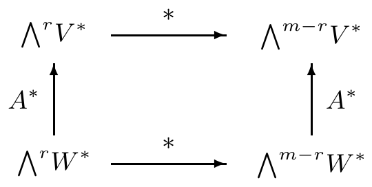

证明 我们将这个简单的证明留给你。■

(e) $ \bigwedge^{r}V^{*} $ 是 $ T_{r}^{0}(V) $ 的向量子空间。

(f) 对偶配对 $ \langle\cdot,\cdot\rangle: V^{*}\times V \to \mathbb{R} $ 是 $ V $ 上的 $ (1,1) $ 张量。■

##### 习题

1 对 $ T \in \mathcal{L}^{r}(V,\mathbb{R}) $，**交错化算子** $ \operatorname{Alt}(T) $ 由下式定义：

\[ \operatorname{Alt}(T)(v_{1},\ldots,v_{r}) := \frac{1}{r!}\sum_{\sigma\in S_{r}}\operatorname{sign}(\sigma)T(v_{\sigma(1)},\ldots,v_{\sigma(r)}) \]

其中 $ v_{1},\ldots,v_{r} \in V $。证明：

(a) $ \operatorname{Alt} \in \mathcal{L}(\mathcal{L}^{r}(V,\mathbb{R}),\bigwedge^{r}V^{*}) $；

(b) $ \operatorname{Alt}^{2} = \operatorname{Alt} $。

2 对 $ S \in \mathcal{L}^{s}(V,\mathbb{R}) $ 与 $ T \in \mathcal{L}^{t}(V,\mathbb{R}) $，定义 $ S\otimes T \in \mathcal{L}^{s+t}(V,\mathbb{R}) $ 为

\[ S\otimes T(v_{1},\ldots,v_{s},v_{s+1},\ldots,v_{s+t}) := S(v_{1},\ldots,v_{s})T(v_{s+1},\ldots,v_{s+t}), \]

其中 $ v_{1},\ldots,v_{s+t} \in V $。证明：对 $ \alpha \in \bigwedge^{r}V^{*} $ 与 $ \beta \in \bigwedge^{s}V^{*} $，

\[ \alpha\wedge\beta = \frac{(r+s)!}{r!\,s!}\operatorname{Alt}(\alpha\otimes\beta). \]

在习题 3–8 中，设 $ (V,(\cdot\mid\cdot),\mathcal{O}r) $ 是定向内积空间，$ \omega $ 是它的体积元，$ \Theta $ 是里斯同构。

3 设 $ \dim(V) = 3 $。则 $ V $ 上的**向量积或叉积** $ \times $ 由下式定义\footnote{见注 VIII.2.14。}：

\[ \times: V\times V \to V, \quad (v,w)\mapsto v\times w := \Theta^{-1}\omega(v,w,\cdot). \]

证明以下各项：

(a) 对 $ u,v,w \in V $，有 $ (v\times w\mid u) = \omega(v,w,u) $。

(b) 向量积是双线性的且交错的。

(c) 向量 $ v\times w $ 不为零当且仅当 $ v $ 与 $ w $ 线性无关。

(d) 若 $ v $ 与 $ w $ 线性无关，则 $ (v,w,v\times w) $ 是 $ V $ 的正定向基。

(e) 向量 $ v\times w $ 与 $ v $ 和 $ w $ 都正交。

(f) 对 $ v,w \in V\setminus\{0\} $，有

\[ |v\times w| = \sqrt{|v|^{2}|w|^{2} - (v\mid w)^{2}} = |v|\,|w|\sin\varphi, \]

其中 $ \varphi \in [0,\pi] $ 是向量 $ v $ 与 $ w $ 之间的（非定向）夹角。

(g) 设 $ (e_{1},e_{2},e_{3}) $ 是 $ V $ 的正定向标准正交基。则对 $ v = \sum_{j}\xi^{j}e_{j} $ 与 $ w = \sum_{j}\eta^{j}e_{j} $，有

\[ v\times w = (\xi^{2}\eta^{3} - \xi^{3}\eta^{2})e_{1} + (\xi^{3}\eta^{1} - \xi^{1}\eta^{3})e_{2} + (\xi^{1}\eta^{2} - \xi^{2}\eta^{1})e_{3}. \]

(h) （格拉斯曼恒等式）$ v_{1}\times(v_{2}\times v_{3}) = (v_{1}\mid v_{3})v_{2} - (v_{1}\mid v_{2})v_{3} $。

(i) 向量积不是结合的。

(j) $ (v_{1}\times v_{2})\times(v_{3}\times v_{4}) = \omega(v_{1},v_{2},v_{4})v_{3} - \omega(v_{1},v_{2},v_{3})v_{4} $。

(k) （雅可比恒等式）$ v_{1}\times(v_{2}\times v_{3}) + v_{2}\times(v_{3}\times v_{1}) + v_{3}\times(v_{1}\times v_{2}) = 0 $。

（提示：(f) 回忆命题 2.13 与 (a)。(h) 向量积由它在基 $ (e_{1},e_{2},e_{3}) $ 上的值确定。）

4 对 $ 0 \le r \le m $，验证以下公式：

(a) 对 $ \alpha \in \bigwedge^{r}V^{*} $ 与 $ \beta \in \bigwedge^{m-r}V^{*} $，有 $ (\ast\alpha\mid\beta)_{m-r} = (-1)^{r(m-r)}(\alpha\mid\ast\beta)_{r} $。

(b) 对 $ \alpha,\beta \in \bigwedge^{r}V^{*} $，有 $ (\ast\alpha)\wedge\beta = (\ast\beta)\wedge\alpha $。

(c) 对 $ v,w \in V $，有 $ \ast(\Theta v\wedge\ast\Theta w) = (v\mid w) $。

5 设 $ (b_{1},\ldots,b_{m}) $ 是 $ V $ 的正定向基，其对偶基为 $ (\beta^{1},\ldots,\beta^{m}) $。证明：

(a) 对 $ 1 \le j,k \le m $，有 $ \beta^{j}\wedge\ast\beta^{k} = g^{jk}\sqrt{G}\,\beta^{1}\wedge\cdots\wedge\beta^{m} $。

(b) 对 $ 1 \le j \le m $，有 $ \ast\beta^{j} = \sum_{k=1}^{m}(-1)^{k-1}g^{jk}\sqrt{G}\,\beta^{1}\wedge\cdots\wedge\widehat{\beta^{k}}\wedge\cdots\wedge\beta^{m} $。若 $ V $ 是三维的，则证明

\[ \ast(\beta^{j}\wedge\beta^{k}) = \frac{1}{\sqrt{G}}\operatorname{sign}(j,k,\ell)\sum_{i=1}^{3}g_{\ell i}\beta^{i} = \frac{1}{G}\operatorname{sign}(j,k,\ell)\Theta b_{\ell} \]

对 $ (j,k,\ell) \in \mathbb{S}_{3} $。

6 在 $ \dim(V) = 3 $ 的情形，证明对 $ v,w \in V $ 有 $ v\times w = \Theta^{-1}(\ast(\Theta v\wedge\Theta w)) $。

7 设 $ (b_{1},b_{2},b_{3}) $ 是 $ V $ 的正定向基，其对偶基为 $ (\beta^{1},\beta^{2},\beta^{3}) $。证明

\[ b_{j}\times b_{k} = \sqrt{G}\operatorname{sign}(j,k,\ell)\sum_{i=1}^{3}g^{\ell i}b_{i} = \sqrt{G}\operatorname{sign}(j,k,\ell)\Theta^{-1}\beta^{\ell} \]

对 $ (j,k,\ell) \in \mathbb{S}_{3} $。

8 设 $ (W,(\cdot\mid\cdot)_{W},\mathcal{O}r(W)) $ 是定向内积空间，$ A \in \mathcal{L}(V,W) $ 是保定向的等距（即 $ A^{*}\omega_{W} = \omega_{V} $）。证明下面的图对 $ 0 \le r \le m $ 交换：

9 对不定内积空间叙述并证明习题 4 与习题 5 的断言。

10 对 $ k \in \mathbb{N} $，设 $ \mathbb{K}_{k}[X] $ 是 $ \mathbb{K} $ 上次数 $ \le k $ 的多项式的向量空间。证明 $ \mathbb{K}[X] = \bigoplus_{k\ge 0}\mathbb{K}_{k}[X] $ 关于多项式的通常乘法，即关于 §I.8 的卷积，是分次交换代数。

11 设 $ (\varepsilon^{0},\varepsilon^{1},\varepsilon^{2},\varepsilon^{3}) $ 是 $ \mathbb{R}^{4} $ 的标准基的对偶基。对 $ c,E_{j},H_{j} \in \mathbb{R} $，置

\[ \begin{aligned} \alpha &:= (E_{1}\varepsilon^{1} + E_{2}\varepsilon^{2} + E_{3}\varepsilon^{3})\wedge c\varepsilon^{0} + (H_{1}\varepsilon^{2}\wedge\varepsilon^{3} + H_{2}\varepsilon^{3}\wedge\varepsilon^{1} + H_{3}\varepsilon^{1}\wedge\varepsilon^{2}), \\ \beta &:= -(H_{1}\varepsilon^{1} + H_{2}\varepsilon^{2} + H_{3}\varepsilon^{3})\wedge c\varepsilon^{0} + (E_{1}\varepsilon^{2}\wedge\varepsilon^{3} + E_{2}\varepsilon^{3}\wedge\varepsilon^{1} + E_{3}\varepsilon^{1}\wedge\varepsilon^{2}) \end{aligned} \]

并计算关于 $ (\cdot\mid\cdot)_{1,3} $ 的 $ \ast\alpha $ 与 $ \ast\beta $。
