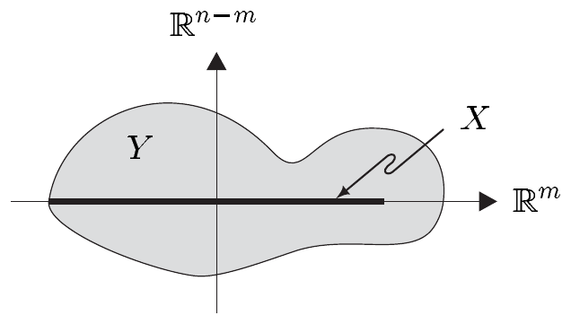

(d) 每个 $ \alpha \in \Omega^{m}(X) $ 都具有形式 $ a\,dx^{1} \wedge \cdots \wedge dx^{m} $，其中 $ a \in \mathcal{E}(X) $。

(e) 对 $ m = 3 $，楔积
\[ \alpha = a_{1}\,dx^{1} + a_{2}\,dx^{2} + a_{3}\,dx^{3} \quad \text{与} \quad \beta = b_{1}\,dx^{1} + b_{2}\,dx^{2} + b_{3}\,dx^{3} \]
是
\[ \alpha \wedge \beta = (a_{2}b_{3} - a_{3}b_{2})\,dx^{2} \wedge dx^{3} + (a_{3}b_{1} - a_{1}b_{3})\,dx^{3} \wedge dx^{1} + (a_{1}b_{2} - a_{2}b_{1})\,dx^{1} \wedge dx^{2}. \]

证明 这由注 3.1(f) 推出。■

##### 拉回

设 $ Y $ 是 $ \mathbb{R}^{n} $ 中的开集，$ \varphi \in C^{\infty}(X, Y) $。作为普法夫形式拉回的一种推广，我们引入微分形式经 $ \varphi $ 的**拉回**。它是映射
\[ \varphi^{*}: \Omega(Y) \to \Omega(X) \tag{3.10} \]
定义如下：
\[ (\varphi^{*}\beta)(x) := (T_{x}\varphi)^{*}\beta(\varphi(x)) \quad \text{对 } x \in X \text{ 和 } \beta \in \Omega(Y). \tag{3.11} \]

若 $ \beta \in \Omega^{r}(Y) $，则由于 $ T_{x}\varphi \in \mathcal{L}(T_{x}X, T_{\varphi(x)}Y) $ 且由注 2.9(a)，$ (T_{x}\varphi)^{*}\beta(\varphi(x)) $ 与 $ \beta(\varphi(x)) \in \bigwedge^{r}T_{\varphi(x)}^{*}Y $ 都落在 $ \bigwedge^{r}T_{x}^{*}X $ 中。由 $ T_{x}\varphi = (\varphi(x), \partial\varphi(x)) $ 以及
\[ \partial\varphi \in C^{\infty}(X, \mathcal{L}(\mathbb{R}^{m}, \mathbb{R}^{n})) \]
并且 (3.4) 蕴含
\[ \varphi^{*}\beta(v_{1}, \ldots, v_{r}) = (\beta \circ \varphi)((\partial\varphi)v_{1}, \ldots, (\partial\varphi)v_{r}) \quad \text{对 } v_{1}, \ldots, v_{r} \in \mathcal{V}(X), \]
由注 3.1(e) 可见 $ \varphi^{*}\beta $ 属于 $ \Omega^{r}(X) $。因此 (3.10) 通过 (3.11) 得到良定义。

3.3 注 (a) 映射 (3.10) 是 $ \mathbb{R} $ 线性的，且满足
\[ (\psi \circ \varphi)^{*} = \varphi^{*} \circ \psi^{*} \quad \text{与} \quad (\mathrm{id}_{X})^{*} = \mathrm{id}_{\Omega(X)}, \]
即拉回反变地作用。它也与外积相容，即
\[ \varphi^{*}(\alpha \wedge \beta) = \varphi^{*}\alpha \wedge \varphi^{*}\beta \quad \text{对 } \alpha, \beta \in \Omega(Y). \]
因此 $ \varphi^{*} $ 是从 $ \Omega(Y) $ 到 $ \Omega(X) $ 的代数同态。

证明 这由注 2.9 以及注 VII.10.2(b) 中给出的链式法则推出。■

(b)（正则性）拉回也可对 $ \varphi \in C^{k+1}(X, Y) $ 自然地定义。若 $ 1 \le r \le m $，则一个 $ C^{k+1} $ 类的 $ r $ 形式一般只成为一个 $ C^{k} $ 类的 $ r $ 形式，而一个 $ C^{k} $ 类的 $ r $ 形式仍留在同一类中。当 $ r = 0 $ 时，拉回保持正则性。■

3.4 例 设 $ (x^{1}, \ldots, x^{m}) $ 与 $ (y^{1}, \ldots, y^{n}) $ 分别是 $ X $ 与 $ Y $ 的欧几里得坐标。

(a)
\[ \varphi^{*}dy^{j} = d\varphi^{j} = \sum_{k=1}^{m} \partial_{k}\varphi^{j}\,dx^{k} \quad \text{且} \quad 1 \le j \le n. \]
证明 见例 VIII.3.14(a)。■

(b) 对
\[ \beta = \sum_{(j) \in \mathbb{J}_{r}} b_{(j)}\,dy^{(j)} \in \Omega^{r}(Y), \]
我们有
\[ \varphi^{*}\beta = \sum_{(j) \in \mathbb{J}_{r}} (\varphi^{*}b_{(j)})\,d\varphi^{(j)}. \]
证明 这是 (a) 和注 3.3(a) 的推论。■

(c) 当 $ m = n $ 时，我们有
\[ \varphi^{*}(dy^{1} \wedge \cdots \wedge dy^{m}) = d\varphi^{1} \wedge \cdots \wedge d\varphi^{m} = (\det\partial\varphi)\,dx^{1} \wedge \cdots \wedge dx^{m}. \]
证明 第一个等号由 (b) 推出。因为对 $ x \in X $ 有 $ \det T_{x}\varphi = \det\partial\varphi(x) $，所以论断由命题 2.10 以及基形式 $ dx^{1} \wedge \cdots \wedge dx^{m} $ 在 $ X $ 上的常性推出。■

(d) 设 $ m = 2 $、$ n = 3 $，并设 $ (u, v) $ 与 $ (x, y, z) $ 分别是 $ X $ 与 $ Y $ 的欧几里得坐标。则\footnote{见注 VII.7.9。}
\[ \varphi^{*}(a\,dy \wedge dz + b\,dz \wedge dx + c\,dx \wedge dy) = \left[a \circ \varphi\,\frac{\partial(\varphi^{2}, \varphi^{3})}{\partial(u, v)} + b \circ \varphi\,\frac{\partial(\varphi^{3}, \varphi^{1})}{\partial(u, v)} + c \circ \varphi\,\frac{\partial(\varphi^{1}, \varphi^{2})}{\partial(u, v)}\right] du \wedge dv. \]
证明 因为对 $ 1 \le j \le 3 $ 有 $ d\varphi^{j} = \varphi_{u}^{j}\,du + \varphi_{v}^{j}\,dv $，并且
\[ \frac{\partial(\varphi^{2}, \varphi^{3})}{\partial(u, v)} = \det\begin{bmatrix} \varphi_{u}^{2} & \varphi_{v}^{2} \\ \varphi_{u}^{3} & \varphi_{v}^{3} \end{bmatrix} = \varphi_{u}^{2}\varphi_{v}^{3} - \varphi_{u}^{3}\varphi_{v}^{2} \]
等等，所以该论断由 (b) 和例 3.2(e) 推出。■

(e)（平面极坐标）设
\[ f_{2}: \mathbb{R}^{2} \to \mathbb{R}^{2}, \quad (r, \varphi) \mapsto (x, y) := (r\cos\varphi, r\sin\varphi) \]
为极坐标映射。则
\[ f_{2}^{*}(dx \wedge dy) = r\,dr \wedge d\varphi. \]
证明 这由 (c) 和例 X.8.7 推出。■

(f)（球坐标）对球坐标映射
\[ f_{3}: \mathbb{R}^{3} \to \mathbb{R}^{3}, \quad (r, \varphi, \vartheta) \mapsto (x, y, z) := (r\cos\varphi\sin\vartheta, r\sin\varphi\sin\vartheta, r\cos\vartheta), \]
我们有
\[ f_{3}^{*}(dx \wedge dy \wedge dz) = -r^{2}\sin\vartheta\,dr \wedge d\varphi \wedge d\vartheta. \]
证明 引理 X.8.8 和 (c)。■

(g)（m 维极坐标）设
\[ f_{m}: \mathbb{R}^{m} \to \mathbb{R}^{m}, \quad (r, \varphi, \vartheta_{1}, \ldots, \vartheta_{m-2}) \mapsto (x^{1}, \ldots, x^{m}) \]
为 $ m $ 维极坐标映射 (X.8.17)。则
\[ f_{m}^{*}dx^{1} \wedge \cdots \wedge dx^{m} = (-1)^{m}r^{m-1}w_{m}(\vartheta)\,dr \wedge d\varphi \wedge d\vartheta_{1} \wedge \cdots \wedge d\vartheta_{m-2}, \]
其中 $ w_{m}(\vartheta) := \sin\vartheta_{1}\sin^{2}\vartheta_{2} \cdots \sin^{m-2}\vartheta_{m-2} $。
证明 这由引理 X.8.8 推出。■

(h)（柱坐标）设
\[ f: \mathbb{R}^{3} \to \mathbb{R}^{3}, \quad (r, \varphi, z) \mapsto (x, y, z) := (r\cos\varphi, r\sin\varphi, z) \]
为柱坐标映射。则
\[ f^{*}(dx \wedge dy \wedge dz) = r\,dr \wedge d\varphi \wedge dz. \]
证明 例 VII.9.11(c) 和 (c)。■

(i) 若 $ \varphi $ 是常值映射，则对 $ r \ge 1 $ 的 $ \alpha \in \Omega^{r}(Y) $ 有 $ \varphi^{*}\alpha = 0 $。
证明 因为对 $ 1 \le j \le n $ 有 $ d\varphi^{j} = 0 $，所以该论断是 (b) 的推论。■

(j) 设 $ m \le n $，并设 $ i: \mathbb{R}^{m} \hookrightarrow \mathbb{R}^{n} $ 是把 $ \mathbb{R}^{m} $ 与 $ \mathbb{R}^{m} \times \{0\} \subset \mathbb{R}^{n} $ 等同起来的自然嵌入。又设 $ Y $ 是 $ \mathbb{R}^{n} $ 中的开集，满足
\[ Y \cap (\mathbb{R}^{m} \times \{0\}) \supset i(X). \]
注意 $ X $ 是 $ Y $ 的 $ m $ 维子流形。

对 $ \alpha \in \Omega^{r}(Y) $，定义 $ \alpha \mid X $，即 $ \alpha $ 在 $ X $ 上的**限制**，为
\[ (\alpha \mid X)(x) := \alpha(x, 0) \mid (T_{x}X)^{r} \quad \text{对 } x \in X. \]
换言之，当 $ \alpha $ 具有基表示
\[ \alpha = \sum_{(j) \in \mathbb{J}_{r}^{n}} a_{(j)}\,dx^{(j)}, \]
由此推出
\[ (\alpha \mid X)(x) = \sum_{\substack{(j) \in \mathbb{J}_{r}^{n} \\ j_{r} \le m}} a_{(j)}(x, 0)\,dx^{(j)} \quad \text{对 } x \in X. \]
则 $ i^{*}\alpha = \alpha \mid X $。
证明 由于 $ i^{*} $ 与限制映射
\[ \Omega^{r}(Y) \to \Omega^{r}(X), \quad \alpha \mapsto \alpha \mid X \]
的线性性，只需考虑 $ \alpha = a\,dx^{(j)} $（$ (j) \in \mathbb{J}_{r}^{n} $）的情形。于是由 (b) 推出
\[ i^{*}\alpha = (i^{*}a)\,di^{(j)}. \]
由 $ (i^{*}a)(x) = a(x, 0) $ 以及 $ i^{k} = \mathrm{pr}_{k}i = 0 $（$ m+1 \le k \le n $，其中 $ \mathrm{pr}_{k}: \mathbb{R}^{n} \to \mathbb{R} $ 是标准投影），我们有 $ di^{(j)} = 0 $（$ j_{r} > m $）。对 $ j_{r} \le m $，可得 $ di^{(j)} = dx^{(j)} $。现在论断显而易见。■

(k) 设 $ (q, p) \in \mathbb{R}^{m} \times \mathbb{R}^{m} = \mathbb{R}^{2m} $ 是 $ \mathbb{R}^{2m} $ 的任意一点。我们通过
\[ \sigma := \sum_{j=1}^{m} dp^{j} \wedge dq^{j} \]
定义 $ \mathbb{R}^{2m} $ 上的（标准）**辛形式**。
我们用 $ \mathrm{Sp}(2m) $ 表示所有满足 $ S^{*}\sigma = \sigma $ 的 $ S \in \mathcal{L}(\mathbb{R}^{2m}) $ 的集合。则 $ \mathrm{Sp}(2m) $ 是 $ \mathcal{L}\mathrm{aut}(\mathbb{R}^{2m}) $ 的子群，即辛群。任何 $ S \in \mathrm{Sp}(2m) $ 都满足 $ \det(S) = 1 $。
证明 我们通过 $ \alpha := \sigma \wedge \cdots \wedge \sigma $（$ m $ 个因子）定义 $ \alpha \in \Omega^{2m}(\mathbb{R}^{2m}) $。则存在 $ a \in \mathbb{R}^{\times} $ 使 $ \alpha = a\omega $，其中 $ \omega $ 表示 $ \mathbb{R}^{2m} $ 的体积元。现设 $ S \in \mathrm{Sp}(2m) $。则由 $ S^{*}\sigma = \sigma $ 和注 3.3(a) 推出
\[ S^{*}\alpha = S^{*}\sigma \wedge \cdots \wedge S^{*}\sigma = \sigma \wedge \cdots \wedge \sigma = \alpha. \]
因为 $ S^{*}\alpha = S^{*}(a\omega) = aS^{*}\omega $，并且由 (c) 得
\[ \alpha = S^{*}\alpha = a\det(S)\omega = \det(S)\alpha, \]
因此 $ \det(S) = 1 $。我们把 $ \mathrm{Sp}(2m) $ 是 $ \mathcal{L}\mathrm{aut}(\mathbb{R}^{2m}) $ 的子群这一证明留作练习。■

##### 外微分

在 §VIII.3 中我们看到，函数 $ f \in \mathcal{E}(X) = \Omega^{0}(X) $ 的微分 $ df $ 是光滑普法夫形式，从而是 $ \Omega^{1}(X) $ 的元素。显然 $ d: \Omega^{0}(X) \to \Omega^{1}(X) $ 是线性的。此外，由命题 VIII.3.12 我们知道 $ d $ 与拉回可交换。下面的定理表明，$ d $ 可延拓为从微分形式模 $ \Omega(X) $ 到自身的 $ \mathbb{R} $ 线性映射；该映射同样与拉回可交换。

3.5 定理 恰有一个映射
\[ d: \Omega(X) \to \Omega(X), \]
即**外微分**\footnote{有时外微分也称为\textbf{嘉当导数}。}，具有性质 (i)–(iv)：
(i) $ d $ 是 $ \mathbb{R} $ 线性的，并把 $ \Omega^{r}(X) $ 映到 $ \Omega^{r+1}(X) $。
(ii) $ d $ 满足**乘积法则**
\[ d(\alpha \wedge \beta) = d\alpha \wedge \beta + (-1)^{r}\alpha \wedge d\beta \quad \text{对 } \alpha \in \Omega^{r}(X) \text{ 和 } \beta \in \Omega(X). \]
(iii) $ d^{2} := d \circ d = 0 $。
(iv) 对 $ f \in \mathcal{E}(X) $，外微分 $ df $ 等于 $ f $ 的微分。
若 $ Y $ 是 $ \mathbb{R}^{n} $ 中的开集且 $ \varphi \in C^{\infty}(X, Y) $，则
\[ d \circ \varphi^{*} = \varphi^{*} \circ d, \tag{3.12} \]
即外微分与拉回可交换。

证明 (a)（唯一性）对
\[ \alpha = \sum_{(j) \in \mathbb{J}_{r}} a_{(j)}\,dx^{(j)} \in \Omega^{r}(X), \tag{3.13} \]
由 (i)–(iv) 容易推出
\[ d\alpha = \sum_{(j) \in \mathbb{J}_{r}} da_{(j)} \wedge dx^{(j)} \in \Omega^{r+1}(X). \tag{3.14} \]
这表明至多有一个映射能满足性质 (i)–(iv)。

(b)（存在性）对按 (3.13) 展开的 $ \alpha \in \Omega^{r}(X) $，我们用 (3.14) 定义 $ d\alpha $。于是 $ d $ 显然满足要求 (i) 与 (iv)。

为证 (ii)，注意 (i) 意味着我们只需考虑 $ \alpha = a\,dx^{(j)} $ 与 $ \beta = b\,dx^{(k)} $（$ (j) \in \mathbb{J}_{r} $，$ (k) \in \mathbb{J}_{s} $）的情形。于是由 (3.14)、外积的性质以及推论 VII.3.8 中的普通乘积法则推出
\[ \begin{aligned} d(\alpha \wedge \beta) &= d(ab\,dx^{(j)} \wedge dx^{(k)}) = d(ab) \wedge dx^{(j)} \wedge dx^{(k)} \\ &= da \wedge dx^{(j)} \wedge b\,dx^{(k)} + (-1)^{r}a\,dx^{(j)} \wedge db \wedge dx^{(k)} \\ &= d(a\,dx^{(j)}) \wedge b\,dx^{(k)} + (-1)^{r}a\,dx^{(j)} \wedge d(b\,dx^{(k)}) \\ &= d\alpha \wedge \beta + (-1)^{r}\alpha \wedge d\beta, \end{aligned} \]
正如所愿。

为证 (iii)，我们可以利用 $ d $ 的线性性再次限制到 $ \alpha = a\,dx^{(j)} $（$ (j) \in \mathbb{J}_{r} $）的情形。于是由 (3.14) 和 (ii) 推出
\[ d(d\alpha) = d(da \wedge dx^{(j)}) = d^{2}a \wedge dx^{(j)} - da \wedge d(dx^{(j)}). \]
对 $ d(dx^{(j)}) $ 反复应用乘积法则 (ii)，我们看到：只要能够证明对 $ a \in \Omega^{0}(X) = \mathcal{E}(X) $ 有 $ d^{2}a = 0 $，论断便成立。

因此设 $ a \in \mathcal{E}(X) $。则我们可以利用 (i)、(ii) 与 (iv) 导出关系
\[ \begin{aligned} d(da) &= d\left(\sum_{k=1}^{m} \partial_{k}a\,dx^{k}\right) = \sum_{k=1}^{m} d(\partial_{k}a) \wedge dx^{k} \\ &= \sum_{j,k=1}^{m} \partial_{j}\partial_{k}a\,dx^{j} \wedge dx^{k} = \sum_{1 \le j < k \le m} (\partial_{j}\partial_{k}a - \partial_{k}\partial_{j}a)\,dx^{j} \wedge dx^{k} = 0, \end{aligned} \]
其中最后一个等号由施瓦茨定理（推论 VII.5.5）推出。因此 (iii) 得到满足。

(c) 设 $ \varphi \in C^{\infty}(X, Y) $，$ (j) \in \mathbb{J}_{r}^{n} $。令 $ \beta = b\,dy^{(j)} \in \Omega^{r}(Y) $。则根据例 3.4(b)，我们有
\[ \varphi^{*}\beta = \varphi^{*}b\,d\varphi^{(j)} \in \Omega^{r}(X). \tag{3.15} \]
由 (3.14) 以及注 3.3(a) 中说明的拉回性质，我们得到
\[ \varphi^{*}d\beta = \varphi^{*}(db \wedge dy^{(j)}) = \varphi^{*}db \wedge \varphi^{*}dy^{(j)} = \varphi^{*}db \wedge d\varphi^{(j)}. \]
命题 VIII.3.12 蕴含 $ \varphi^{*}db = d(\varphi^{*}b) $。因此利用 (i)、(iii) 和 (3.15) 得到
\[ \begin{aligned} \varphi^{*}d\beta &= d(\varphi^{*}b) \wedge d\varphi^{(j)} = d(\varphi^{*}b) \wedge d\varphi^{(j)} + (-1)^{1}\varphi^{*}b \wedge d(d\varphi^{(j)}) \\ &= d(\varphi^{*}b \wedge d\varphi^{(j)}) = d(\varphi^{*}\beta). \end{aligned} \]
现在 (3.12) 由 $ \varphi^{*} $ 与 $ d $ 的线性性以及注 3.1(e) 推出。■

3.6 注 (a) 对 $ \alpha = \sum_{(j) \in \mathbb{J}_{r}} a_{(j)}dx^{(j)} \in \Omega^{r}(X) $，我们有
\[ d\alpha = \sum_{(j) \in \mathbb{J}_{r}} da_{(j)} \wedge dx^{(j)}. \]
证明 这就是陈述 (3.13)、(3.14)。■
