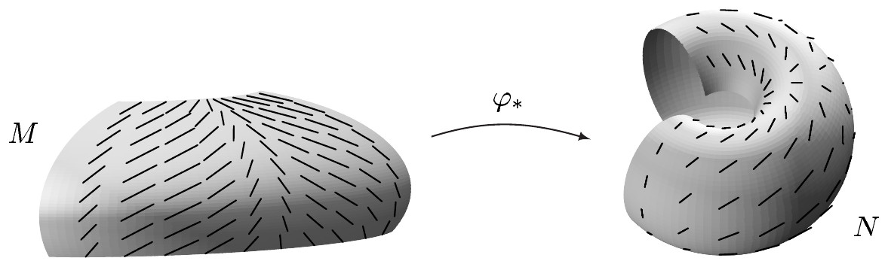
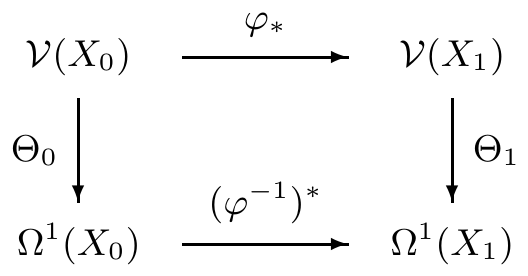
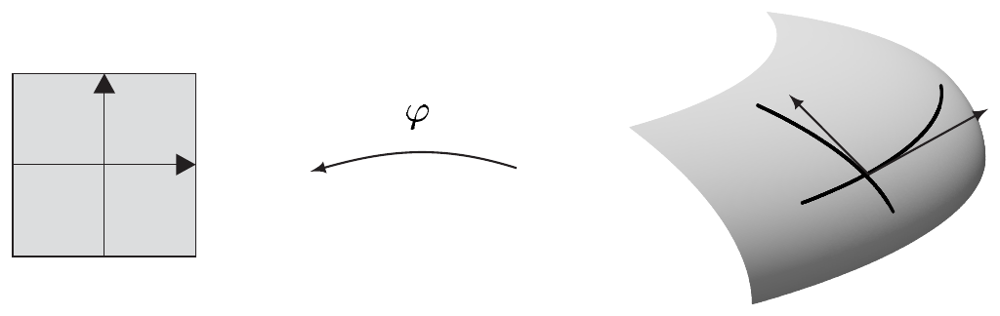

## 4 向量场与微分形式

本节致力于微分形式的整体理论，即流形上的微分形式。第一部分本质上只是局部理论的简单移植，它要求我们关注正则性问题。借助一个关于单位分解的定理，我们进而可以把外微分这一重要概念推广到流形的情形，并证明我们为局部理论所建立的法则仍然适用。

整体理论引出了一个重要的新思想：流形的可定向性。我们给出刻画这一核心概念的多种方式，并考察大量例子。为了给流形上的积分理论作准备，我们给出许多重要流形的体积元的显式表示。

本节中，

- $ M $ 是 $ m $ 维的，而 $ N $ 是 $ n $ 维流形；
- $ r \in \mathbb{N} $。

##### 向量场

所谓 $ M $ 上的**向量场** $ v $，是指一个映射

\[ v : M \to TM \qquad \text{其中 } v(p) \in T_{p}M \text{ 对 } p \in M , \]

即切丛的一个截面。若 $ v $ 是 $ M $ 上的向量场，则我们可以用从 $ M $ 到 $ N $ 的微分同胚把它“移植”过去。于是，对 $ \varphi \in \operatorname{Diff}^{1}(M,N) $，我们通过令

\[ \varphi_{*}v(q) := (T_{\varphi^{-1}(q)}\varphi)v(\varphi^{-1}(q)) , \quad q \in N . \]

来定义 $ v $ 沿 $ \varphi $ 的**前推** $ \varphi_{*}v $。

因此 $ \varphi_{*}v $ 是 $ N $ 上的向量场。对于 $ M $ 上的函数，双射 $ \psi : M \to N $ 的**前推**是如下对应：

\[ \psi_{*} : \mathbb{R}^{M} \to \mathbb{R}^{N} , \quad a \mapsto \psi_{*}a := a \circ \psi^{-1} . \]

4.1 注 (a) 对于函数，前推 $ \psi_{*} $ 显然与拉回 $ \psi^{-1} $ 相同：$ \psi_{*} = (\psi^{-1})^{*} $。然而要注意，与拉回不同，前推只对双射有定义。特别地，必有 $ \dim(M) = \dim(N) $。\footnote{见习题 VII.10.9。}

(b) 设 $ \varphi \in \operatorname{Diff}^{1}(M,N) $。则

\[ \varphi_{*}(a+b) = \varphi_{*}a + \varphi_{*}b , \quad \varphi_{*}(v+w) = \varphi_{*}v + \varphi_{*}w , \]

以及

\[ \varphi_{*}(av) = \varphi_{*}a\,\varphi_{*}v \]

对 $ a, b \in \mathbb{R}^{M} $ 与 $ M $ 上的向量场 $ v $ 和 $ w $ 成立。

(c) 设 $ \varphi \in \operatorname{Diff}(M,N) $ 与 $ \psi \in \operatorname{Diff}(N,L) $，其中 $ L $ 是另一个流形。则

\[ (\psi \circ \varphi)_{*} = \psi_{*} \circ \varphi_{*} \quad \text{且} \quad (\operatorname{id}_{M})_{*} = \operatorname{id}_{\mathcal{F}(M)} \tag{4.1} \]

对 $ \mathcal{F}(M) := \mathcal{E}(M) $ 或 $ \mathcal{F}(M) := \mathcal{V}(M) $ 成立。法则 (4.1) 意味着前推是**协变地**作用的。

证明 该陈述对函数的前推是显然的。对于向量场，(4.1) 由注 VII.10.9(b) 的链式法则与注 1.14(c) 推出。■

设 $ k \in \mathbb{N} \cup \{\infty\} $。$ M $ 上的向量场 $ v $ 属于类 $ C^{k} $（即它是 $ k $ 次**连续可微**的，或在 $ k = \infty $ 的情形是**光滑**的），若 $ M $ 的每一点 $ p $ 都有一个 $ p $ 附近的坐标卡 $ (\varphi,U) $，使得\footnote{见第 VIII.3 节。那里所说的对 $ \mathbb{H}^{m} $ 的开子集同样成立。} $ \varphi_{*}v \in \mathcal{V}^{k}(\varphi(U)) $。我们把 $ M $ 上所有 $ C^{k} $ 类向量场的集合记作 $ \mathcal{V}^{k}(M) $。为记号简便，我们置

\[ \mathcal{V}(M) := \mathcal{V}^{\infty}(M) \quad \text{且} \quad \mathcal{E}(M) := C^{\infty}(M) . \]

4.2 注 (a) $ C^{k} $ 向量场的定义与坐标无关。若 $ v $ 是 $ C^{k} $ 向量场，且 $ (\psi,V) $ 是 $ M $ 的任意坐标卡，则 $ \psi_{*}v $ 属于类 $ C^{k} $。

证明 因此设 $ (\psi,V) $ 是 $ M $ 的坐标卡。则我们需要证明 $ \psi_{*}v $ 属于类 $ C^{k} $。每个 $ q \in V $ 都有 $ M $ 的一个包含它的坐标卡 $ (\varphi,U) $，使得 $ \varphi_{*}v \in \mathcal{V}^{k}(\varphi(U)) $。于是由 (4.1) 推出 $ \psi_{*}v = (\psi \circ \varphi^{-1})_{*}\varphi_{*}v $。因为

\[ \psi \circ \varphi^{-1} \in \operatorname{Diff}(\varphi(U \cap V), \psi(U \cap V)) \]

且 $ \varphi_{*}v \in \mathcal{V}^{k}(\varphi(U)) $，我们得到 $ \psi_{*}v \in \mathcal{V}^{k}(\psi(U \cap V)) $。由于这对每个 $ q \in V $ 都成立，且可微性是局部性质，我们推出 $ \psi_{*}v \in \mathcal{V}^{k}(\psi(V)) $。■

(b) 逐点定义的运算

\[ \mathcal{V}(M) \times \mathcal{V}(M) \to \mathcal{V}(M) , \quad (v,w) \mapsto v + w \]

以及

\[ \mathcal{E}(M) \times \mathcal{V}(M) \to \mathcal{V}(M) , \quad (a,v) \mapsto av \]

使 $ \mathcal{V}(M) $ 成为 $ \mathcal{E}(M) $-模。特别地，$ \mathcal{E}(M) $ 与 $ \mathcal{V}(M) $ 是（无限维的）$ \mathbb{R} $-向量空间。

若 $ \varphi \in \operatorname{Diff}(M,N) $，则 $ \varphi_{*} $ 是从 $ \mathcal{E}(M) $ 到 $ \mathcal{E}(N) $ 以及从 $ \mathcal{V}(M) $ 到 $ \mathcal{V}(N) $ 的模同构。

证明 由 (4.1) 推出

\[ \operatorname{id}_{M} = (\varphi^{-1} \circ \varphi)_{*} = (\varphi^{-1})_{*}\varphi_{*} \quad \text{且} \quad \operatorname{id}_{N} = (\varphi \circ \varphi^{-1})_{*} = \varphi_{*}(\varphi^{-1})_{*} . \]

因此 $ \varphi_{*} $ 是双射，且 $ \varphi_{*}^{-1} = (\varphi^{-1})_{*} $。其余断言是注 4.1(b) 与 $ \mathbb{H}^{m} $ 的开子集上向量场的性质（见第 VIII.3 节）的简单推论。■

(c) 设 $ X_{0} $ 与 $ X_{1} $ 在 $ \mathbb{R}^{m} $ 中开，并设 $ \varphi \in \operatorname{Diff}(X_{0},X_{1}) $。又对 $ j = 0,1 $，用 $ \Theta_{j} : \mathcal{V}(X_{j}) \to \Omega^{1}(X_{j}) $ 表示注 VIII.3.3(g) 中定义的那个典范模同构。则

\[ (\varphi^{-1})^{*} \circ \Theta_{0} = \Theta_{1} \circ \varphi_{*} , \]

也就是说，下图交换。

（d）（正则性）设 $ k \in \mathbb{N} $。对 $ \varphi \in \operatorname{Diff}^{k+1}(M,N) $ 与 $ 0 \le \ell \le k $，前推 $ \varphi_{*} $ 把 $ C^{\ell}(M) $ 映到 $ C^{\ell}(N) $，把 $ \mathcal{V}^{\ell}(M) $ 映到 $ \mathcal{V}^{\ell}(N) $，但这一陈述（去掉不等式）对 $ \ell = k+1 $ 不成立。

若 $ M $ 是 $ C^{k+1} $ 流形，则 $ C^{\ell}(M) $-模 $ C^{\ell}(M) $ 与 $ \mathcal{V}^{\ell}(M) $ 对 $ 0 \le \ell \le k $ 有定义；然而\footnote{平凡情形除外。}模 $ C^{k+1}(M) $ 与 $ \mathcal{V}^{k+1}(M) $ 则没有定义。

证明 这是因为切映射“失去”一阶导数。■

##### 局部基表示

设 $ (\varphi,U) $ 是 $ M $ 在 $ p $ 附近的坐标卡。则我们用

\[ \partial_{j}|_{p} = \left.\frac{\partial}{\partial x^{j}}\right|_{p} \in T_{p}M \quad \text{对 } 1 \le j \le m \]

表示 $ T_{p}M $ 的对应于局部坐标 $ \varphi = (x^{1},\ldots,x^{m}) $ 的基向量。换言之，$ \partial_{j}|_{p} $ 是坐标路径 $ t \mapsto \varphi^{-1}(\varphi(p) + te_{j}) $ 在点\footnote{若 $ p $ 在 $ M $ 的内部。若 $ p $ 是边界点，我们必须把 $ \varphi $ 取作 $ M $ 在 $ p $ 附近的 $ \mathbb{R}^{\overline{m}} $ 的子流形坐标卡。} $ p $ 处的切向量，即

\[ \partial_{j}|_{p} := (T_{p}\varphi)^{-1}(\varphi(p), e_{j}) , \quad \text{对 } 1 \le j \le m , \tag{4.2} \]

其中 $ (e_{1},\ldots,e_{m}) $ 是 $ \mathbb{R}^{m} $ 的典范基。

4.3 注 (a) 设 $ i_{M} : M \hookrightarrow \mathbb{R}^{\overline{m}} $，并设 $ g_{\varphi} := i_{M} \circ \varphi^{-1} : \varphi(U) \to \mathbb{R}^{\overline{m}} $ 是属于 $ \varphi $ 的参数化。则

\[ (T_{p}i_{M})\partial_{j}|_{p} = (p, \partial_{j}g_{\varphi}(\varphi(p))) \in T_{p}\mathbb{R}^{\overline{m}} \quad \text{对 } 1 \le j \le m . \]

这意味着，若我们在典范单射

\[ T_{p}i_{M} : T_{p}M \to T_{p}\mathbb{R}^{\overline{m}} , \]

下把 $ \partial_{j}|_{p} \in T_{p}M $ 与它在 $ T_{p}\mathbb{R}^{\overline{m}} $ 中的像等同，则我们得到 $ \partial_{j}|_{p} = (p, \partial_{j}g_{\varphi}(\varphi(p))) $。

证明 由例 VII.10.9(b) 与注 1.14(c)，我们得到

\[ T_{\varphi(p)}g_{\varphi} = T_{\varphi(p)}(i_{M} \circ \varphi^{-1}) = T_{p}i_{M} \circ T_{\varphi(p)}(\varphi^{-1}) = T_{p}i_{M} \circ (T_{p}\varphi)^{-1} . \]

于是由 (4.2) 推出

\[ (T_{p}i_{M})\partial_{j}|_{p} = (T_{\varphi(p)}g_{\varphi})(\varphi(p), e_{j}) = (p, \partial g_{\varphi}(\varphi(p))e_{j}) = (p, \partial_{j}g_{\varphi}(\varphi(p))) . \quad \blacksquare \]

(b) 映射

\[ \partial_{j} = \frac{\partial}{\partial x^{j}} : U \to TU , \quad p \mapsto \partial_{j}|_{p} \quad \text{对 } 1 \le j \le m \]

是 $ U $ 上的光滑向量场。

证明 这是显然的，因为对 $ p \in U $ 与 $ 1 \le j \le m $，有

\[ (\varphi_{*}\partial_{j})(\varphi(p)) = (T_{p}\varphi)(T_{p}\varphi)^{-1}(\varphi(p), e_{j}) = (\varphi(p), e_{j}) . \quad \blacksquare \]
