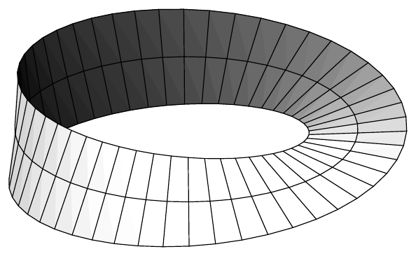

$ \{ (v_1)_p, \ldots, (v_m)_p \} $ 是 $ T_{p}(r(p)S^{m}) $ 的一组基。若 $ m $ 元组 $ (w_1)_p, \ldots, (w_m)_p $ 含有向量 $ (p)_p $，则令 $ \omega := dx^{1} \wedge \cdots \wedge dx^{m+1} $，我们可由 (b) 得到

\[ \alpha(p)((w_1)_p,\ldots,(w_m)_p) = ((p)_p \lrcorner \omega)((w_1)_p,\ldots,(w_m)_p) = \omega((p)_p,(w_1)_p,\ldots,(w_m)_p) = 0 , \]

因为有两个分量相同。因此 $ r^{-(m+1)}(p)\alpha(p) $ 也在这个 $ m $ 元组上为零。我们还得到

\[ \rho^{*}\omega_{S^{m}}(p)((w_1)_p,\ldots,(w_m)_p) = \omega_{S^{m}}(\rho(p))((T_{p}\rho)(w_1)_p,\ldots,(T_{p}\rho)(w_m)_p) \]

其中

\[ (T_{p}\rho)(w_j)_p = (\rho(p), \partial\rho(p)w_j) , \]

这里按命题 VII.2.5，有

\[ \partial\rho(p)w_j = \partial_{t}\rho(p + tw_j)\big|_{t=0} \qquad \text{对 } 1 \le j \le m . \]

因为 $ \rho(p+tp) = \rho(p) $（$ t \in (-1,1) $），特别地推出 $ (T_{p}\rho)(p)_p = 0 $。因此当 $ m $ 元组 $ (w_1)_p, \ldots, (w_m)_p $ 含有向量 $ (p)_p $ 时，$ \rho^{*}\omega_{S^{m}}(p)((w_1)_p,\ldots,(w_m)_p) $ 也为零。

剩下要证明

\[ \rho^{*}\omega_{S^{m}}(p)((v_1)_p,\ldots,(v_m)_p) = \frac{1}{r(p)^{m+1}} \alpha(p)((v_1)_p,\ldots,(v_m)_p) . \tag{4.23} \]

对 $ (v)_p \in T_{p}(r(p)S^{m}) $，定理 VII.10.6 给出 $ \varepsilon > 0 $ 与 $ \gamma \in C^{1}((-\varepsilon,\varepsilon), r(p)S^{m}) $，使得 $ \gamma(0) = p $ 且 $ \dot{\gamma}(0) = v $。现在我们利用 $ \rho \circ \gamma(t) = \gamma(t)/r(p) $ 得到

\[ \partial\rho(p)v = (\rho \circ \gamma)'(0) = v/r(p) . \]

由此推出

\[ \rho^{*}\omega_{S^{m}}(p)((v_1)_p,\ldots,(v_m)_p) = r(p)^{-m}\alpha(\rho(p))((v_1)_p,\ldots,(v_m)_p) , \]

这蕴含 (4.23)，从而完成了证明。■

(d)（正则性）设 $ k \in \mathbb{N} $，并设 $ M $ 是 $ C^{k+1} $ 流形。对 $ \alpha \in \Omega^{r+1}_{(k)}(M) $ 与 $ v \in \mathcal{V}^{k}(M) $，缩并 $ v \lrcorner \alpha $ 属于 $ \Omega^{r}_{(k)}(M) $。■

##### 可定向性

正如我们在 §2 中学到的，$ T_{p}M $ 可通过选取体积形式 $ \alpha(p) \in \Lambda^{m}T_{p}^{*}M $ 来定向。由此得到 $ M $ 上的一个 $ m $ 形式 $ \alpha $，满足 $ \alpha(p) \neq 0 $（$ p \in M $）。反之，每个映射 $ p \mapsto \alpha(p) \in \Lambda^{m}T_{p}^{*}M $，只要 $ \alpha(p) \neq 0 $（$ p \in M $），就在每个 $ T_{p}M $ 上诱导一个定向。然而这样的 $ \alpha $ 一般不会连续。直观地说，这意味着切空间的定向并不“协调”，即切空间在从一点移动到下一点时可以“翻转”。为避免这一点，我们还要求 $ \alpha $ 是光滑的（更确切地说，具有流形的正则性所允许的正则性）。

流形 $ M $ 称为**可定向的**，若存在 $ \alpha \in \Omega^{m}(M) $ 使 $ \alpha(p) \neq 0 $ 对每个 $ p \in M $ 成立；这样的 $ m $ 形式 $ \alpha $ 称为 $ M $ 上的**体积形式**。

4.14 注 (a) 若 $ M $ 可定向，则 $ \Omega^{m}(M) $ 是一维 $ \mathcal{E}(M) $ 模。

证明 设 $ \alpha $ 是 $ M $ 上的体积形式，并设 $ \beta \in \Omega^{m}(M) $。因为 $ \dim \bigwedge^{m}T_{p}^{*}M = 1 $（$ p \in M $），存在 $ f: M \to \mathbb{R} $ 使 $ \beta = f\alpha $。我们必须证明 $ f $ 是光滑的。在局部坐标下，有

\[ \alpha \mid U = a\,dx^{1} \wedge \cdots \wedge dx^{m} \qquad \text{且} \qquad \beta \mid U = b\,dx^{1} \wedge \cdots \wedge dx^{m} \]

其中 $ a, b \in \mathcal{E}(U) $ 且 $ a(p) \neq 0 $（$ p \in U $）。由此推出 $ \beta \mid U = f\alpha \mid U $，其中 $ f := b/a $ 属于 $ \mathcal{E}(U) $。■

(b)（正则性）设 $ k \in \mathbb{N} $，$ M $ 是 $ C^{k+1} $ 流形。则 $ M $ 可定向当且仅当存在 $ \alpha \in \Omega^{m}_{(k)}(M) $ 使 $ \alpha(p) \neq 0 $（$ p \in M $）。这又当且仅当 $ C^{k}(M) $ 模 $ \Omega^{m}_{(k)}(M) $ 是一维的。■

下一个命题表明，也可以用坐标卡来刻画流形的可定向性。

若 $ X $ 与 $ Y $ 在 $ \mathbb{H}^{m} $ 中开，则称 $ \varphi \in \operatorname{Diff}(X,Y) $ 是**保定向的**[或**反定向的**]，若对每个 $ x \in X $ 有 $ \det \partial\varphi(x) > 0 $[或 $ \det \partial\varphi(x) < 0 $]，也就是说，若对每个 $ x \in X $，$ \partial\varphi(x) \in \mathcal{L}(\mathbb{R}^{m}) $ 是保定向的[或反定向的]自同构。流形 $ M $ 的图册称为**定向的**，若其所有转移函数都是保定向的。

4.15 命题 维数 $ \ge 2 $ 的流形可定向当且仅当它具有定向图册。

证明 (a) 设 $ M $ 可定向，$ \alpha \in \Omega^{m}(M) $ 是体积形式。此外，设 $ \{ (\varphi_{\kappa}, U_{\kappa}) ; \kappa \in K \} $ 是 $ M $ 的图册。则在 $ X_{\kappa} := \varphi_{\kappa}(U_{\kappa}) \subset \mathbb{H}^{m} $ 上 $ (\varphi_{\kappa})_{\ast}\alpha = a_{\kappa}\,dx^{1} \wedge \cdots \wedge dx^{m} $，其中 $ a_{\kappa}(x) \neq 0 $（$ x \in X_{\kappa} $）。因为必要时可作坐标变换 $ x \mapsto (-x^{1}, x^{2}, \ldots, x^{m}) $，我们可以假定对某个 $ x_{\kappa} \in X_{\kappa} $，$ a_{\kappa}(x_{\kappa}) $ 严格为正。又因为可以假定 $ U_{\kappa} $ 从而 $ X_{\kappa} $ 是连通的，由介值定理（定理 III.4.7）推出 $ a_{\kappa}(x) > 0 $ 对所有 $ x \in X_{\kappa} $ 与每个 $ \kappa \in K $ 成立。

现设 $ (\varphi_{\kappa}, U_{\kappa}) $ 与 $ (\varphi_{\lambda}, U_{\lambda}) $ 是满足 $ U_{\kappa} \cap U_{\lambda} \neq \varnothing $ 的局部坐标卡。又设 $ \varphi_{\kappa} = (x^{1}, \ldots, x^{m}) $，$ \varphi_{\lambda} = (y^{1}, \ldots, y^{m}) $。则得到

\[ \begin{aligned} &(\varphi_{\lambda} \circ \varphi_{\kappa}^{-1})^{*}(a_{\lambda}\,dy^{1} \wedge \cdots \wedge dy^{m} \mid \varphi_{\lambda}(U_{\kappa} \cap U_{\lambda})) \\ &= (\varphi_{\kappa})_{\ast}\varphi_{\lambda}^{*}(a_{\lambda}\,dy^{1} \wedge \cdots \wedge dy^{m} \mid \varphi_{\lambda}(U_{\kappa} \cap U_{\lambda})) \\ &= (\varphi_{\kappa})_{\ast}\alpha \mid (U_{\kappa} \cap U_{\lambda}) = a_{\kappa}\,dx^{1} \wedge \cdots \wedge dx^{m} . \end{aligned} \tag{4.24} \]

由例 3.4(c)，有

\[ (\varphi_{\lambda} \circ \varphi_{\kappa}^{-1})^{*}dy^{1} \wedge \cdots \wedge dy^{m} = \det \partial(\varphi_{\lambda} \circ \varphi_{\kappa}^{-1})\,dx^{1} \wedge \cdots \wedge dx^{m} . \]

与 (4.24) 比较，我们看到

\[ (\varphi_{\lambda} \circ \varphi_{\kappa}^{-1})^{*}a_{\lambda}(x) \det \partial(\varphi_{\lambda} \circ \varphi_{\kappa}^{-1})(x) = a_{\kappa}(x) > 0 \qquad \text{对 } x \in \varphi_{\kappa}(U_{\kappa} \cap U_{\lambda}) . \]

因为 $ a_{\lambda} $ 为正，推出 $ M $ 具有定向图册。

(b) 设 $ \{ (\varphi_{\kappa}, U_{\kappa}) ; \kappa \in K \} $ 是定向图册。命题 1.20 保证存在从属于 $ M $ 的覆盖 $ \{ U_{\kappa} ; \kappa \in K \} $ 的光滑单位分解 $ \{ \pi_{\kappa} ; \kappa \in K \} $。对 $ \kappa \in K $，定义 $ \alpha_{\kappa} \in \Omega^{m}(U_{\kappa}) $ 为

\[ \alpha_{\kappa} := \begin{cases} \pi_{\kappa}\varphi_{\kappa}^{*}\,dx^{1} \wedge \cdots \wedge dx^{m} & \text{在 } U_{\kappa} \text{ 中} , \\ 0 & \text{其他情形} . \end{cases} \]

容易验证，定义

\[ \alpha := \sum_{\kappa \in K} \alpha_{\kappa} \in \Omega^{m}(M) \]

是有意义的。我们必须证明 $ \alpha(p) \neq 0 $（$ p \in M $）。

设 $ p \in M $，选取 $ \kappa \in K $ 使 $ \pi_{\kappa}(p) > 0 $。对满足 $ \lambda \neq \kappa $ 且 $ U_{\kappa} \cap U_{\lambda} \neq \varnothing $ 的 $ \lambda \in K $，如在 (a) 中那样，推出

\[ \begin{aligned} \alpha_{\lambda} = \pi_{\lambda}\varphi_{\lambda}^{*}\,dy^{1} \wedge \cdots \wedge dy^{m} &= \pi_{\lambda}\varphi_{\kappa}^{*}(\varphi_{\lambda} \circ \varphi_{\kappa}^{-1})^{*}\,dy^{1} \wedge \cdots \wedge dy^{m} \\ &= \pi_{\lambda}\big(\varphi_{\kappa}^{*}\det\big(\partial(\varphi_{\lambda} \circ \varphi_{\kappa}^{-1})\big)\big)\varphi_{\kappa}^{*}\,dx^{1} \wedge \cdots \wedge dx^{m} . \end{aligned} \]

由此得到

\[ \alpha(p) = \Big( \pi_{\kappa}(p) + \sum_{\substack{\lambda \in K \\ \lambda \neq \kappa}} \pi_{\lambda}(p)\det\big(\partial(\varphi_{\lambda} \circ \varphi_{\kappa}^{-1})\big)(\varphi_{\kappa}(p)) \Big)\varphi_{\kappa}^{*}\,dx^{1} \wedge \cdots \wedge dx^{m}(p) , \]

其中只有有限多个被加项不为零。因为 $ \pi_{\lambda}(p) \ge 0 $，且转移函数保定向，我们看到 $ \alpha(p) \neq 0 $。因此 $ \alpha $ 是体积形式，$ M $ 可定向。■

设 $ M $ 可定向。则称两个体积形式 $ \alpha, \beta \in \Omega^{m}(M) $ 是**等价的**，若存在 $ f \in \mathcal{E}(M) $ 使 $ f(p) > 0 $（$ p \in M $）且 $ \alpha = f\beta $。这显然是 $ M $ 上所有体积形式之集上的等价关系。关于此关系的每个等价类称为 $ M $ 上的一个**定向**。给定 $ M $ 的定向 $ \mathcal{O}r := \mathcal{O}r(M) $，则称 $ (M, \mathcal{O}r) $ 为**定向流形**。若 $ M $ 的定向由上下文清楚，我们可以把 $ (M, \mathcal{O}r) $ 简写为 $ M $。

若 $ \alpha \in \mathcal{O}r $，则 $ -\alpha $ 是不属于 $ \mathcal{O}r $ 的体积形式。我们把相应的等价类记作 $ -\mathcal{O}r $，并称它为**与 $ \mathcal{O}r $ 相反的定向**。显然 $ -\mathcal{O}r $ 与它的具体代表无关。

4.16 注 (a) 可定向流形连通当且仅当它恰好有两个定向。

证明 设 $ M $ 连通，$ \alpha $ 与 $ \beta $ 是两个体积形式。由注 4.14(a)，存在 $ f \in \mathcal{E}(M) $ 使 $ \alpha = f\beta $。因为 $ \alpha $ 处处不为零，我们有 $ f(p) \neq 0 $（$ p \in M $）。因为 $ M $ 连通，介值定理（见定理 III.4.7）蕴含对每个 $ p \in M $，或者 $ f(p) > 0 $，或者 $ f(p) < 0 $。因此 $ \alpha $ 或者等价于 $ \beta $，或者等价于 $ -\beta $。所以 $ M $ 恰有两个定向。

现设 $ M $ 连通。命题 III.4.2 保证存在 $ M $ 的非空、既开又闭的真子集 $ X $。对 $ M $ 上的体积形式 $ \alpha $，我们置

\[ \beta(p) := \begin{cases} \alpha(p) & \text{若 } p \in X , \\ -\alpha(p) & \text{若 } p \in M \setminus X . \end{cases} \]

则 $ \beta $ 显然是体积形式，且 $ \beta \notin \mathcal{O}r \cup (-\mathcal{O}r) $，其中 $ \mathcal{O}r $ 是 $ \alpha $ 的等价类。因此 $ M $ 有两个以上的定向。■

(b) 设 $ M = (M, \mathcal{O}r) $ 是定向流形。称 $ M $ 的坐标卡 $ (\varphi, U) $ 是**正向的（正定向的）**，若对 $ \alpha \in \mathcal{O}r $，$ \varphi_{\ast}(\alpha \mid U) $ 等价于 $ m $ 形式 $ dx^{1} \wedge \cdots \wedge dx^{m} \mid \varphi(U) $。否则称它是**负向的（负定向的）**。$ M $ 具有仅由正向坐标卡组成的图册，即定向图册。

证明 对 $ \beta \in \mathcal{O}r $，有 $ \alpha = f\beta $，其中 $ f \in \mathcal{E}(M) $ 且 $ f(p) > 0 $（$ p \in M $）。以 $ i: U \hookrightarrow M $ 表示包含映射，由此推出

\[ \varphi_{\ast}\alpha \mid U = \varphi_{\ast}i^{\ast}\alpha = \varphi_{\ast}i^{\ast}(f\beta) = (\varphi_{\ast}i^{\ast}f)(\varphi_{\ast}i^{\ast}\beta) = g\varphi_{\ast}(\beta \mid U) , \]

其中 $ g := f \circ \varphi^{-1} \in \mathcal{E}(\varphi(U)) $ 且 $ g(x) > 0 $（$ x \in \varphi(U) $）。这表明该定义与所选的代表无关。确实存在由正向坐标卡组成的图册，这一点已在命题 4.15 的证明的 (a) 部分中说明。■

(c) 设 $ M $ 已定向。则 $ (\varphi, U) $ 是正向坐标卡当且仅当 $ (\partial_1|_p, \ldots, \partial_m|_p) $ 是 $ T_{p}M $ 的正向基（$ p \in U $）。

证明 对 $ \alpha \in \Omega^{m}(M) $，注 4.5(c) 说局部坐标下的基表示为

\[ \alpha \mid U = a\,dx^{1} \wedge \cdots \wedge dx^{m} \]

其中 $ a(p) = \alpha(p)(\partial_1|_p, \ldots, \partial_m|_p) $（$ p \in U $）。现在断言清楚了。■

4.17 例 (a) 可定向流形 $ M $ 的每个开子集 $ U $ 本身可定向。\footnote{我们约定空集是可定向的。}

证明 对 $ \alpha \in \mathcal{O}r(M) $，限制 $ \alpha \mid U $ 是 $ U $ 上的体积形式。■

(b) 若 $ M $ 与 $ N $ 可定向，且这两个流形中有一个没有边界，则乘积流形\footnote{见习题 VII.9.4 与习题 3。为什么我们假定这两个流形中有一个没有边界？} $ M \times N $ 可定向。

证明 若 $ \{ (\varphi_{\kappa}, U_{\kappa}) ; \kappa \in K \} $ 与 $ \{ (\psi_{\lambda}, V_{\lambda}) ; \lambda \in L \} $ 分别是 $ M $ 与 $ N $ 的定向图册，则容易看出 $ \{ \varphi_{\kappa} \times \psi_{\lambda} ; (\kappa, \lambda) \in K \times L \} $ 是 $ M \times N $ 的定向图册，其中

\[ \varphi_{\kappa} \times \psi_{\lambda}(p,q) := (\varphi_{\kappa}(p), \psi_{\lambda}(q)) \in \mathbb{R}^{m} \times \mathbb{R}^{n} \qquad \text{对 } (p,q) \in U_{\kappa} \times V_{\lambda} , \]

因为可以不失一般性地假定 $ M $ 与 $ N $ 都至少是一维的，断言由命题 4.15 推出。■

(c) 任何可由单个坐标卡描述的流形（即具有只含一个坐标卡的图册的流形）都是可定向的。

证明 这是平凡的（见命题 4.15 的证明的第一部分）。■

(d)（图像）设 $ X $ 在 $ \mathbb{R}^{m} $ 中开，$ f \in C^{\infty}(X, \mathbb{R}^{n}) $。则 $ \operatorname{graph}(f) $ 是 $ \mathbb{R}^{m+n} $ 的 $ m $ 维可定向子流形。

证明 由命题 VII.9.2，我们知道 $ \operatorname{graph}(f) $ 是 $ \mathbb{R}^{m+n} $ 的 $ m $ 维子流形。该结果的证明表明

\[ \varphi: \operatorname{graph}(f) \to X , \quad (x,f(x)) \mapsto x \]

是描述 $ \operatorname{graph}(f) $ 的坐标卡。因此断言由 (c) 推出。■

(e)（正则映射的纤维）设 $ X $ 在 $ \mathbb{R}^{m} $ 中开，$ \ell \in \{ 0, \ldots, m-1 \} $。又设 $ q $ 是 $ f \in C^{\infty}(X, \mathbb{R}^{m-\ell}) $ 的正则值。则 $ X $ 的 $ \ell $ 维子流形 $ f^{-1}(q) $ 是可定向的。

证明 令 $ \omega := dx^{1} \wedge \cdots \wedge dx^{m} \mid X $ 以及

\[ \nabla f^{k} := \sum_{j=1}^{m} \partial_j f^{k} \frac{\partial}{\partial x^{j}} \in \mathcal{V}(X) \qquad \text{对 } 1 \le k \le m - \ell . \]

采用注 VII.10.11(a) 的记号，我们有 $ \nabla f^{k}(p) = \nabla_{p}f^{k} $（$ p \in X $）。我们可以假定 $ L := f^{-1}(q) $ 非空。于是

\[ \alpha := \nabla f^{1} \lrcorner \big( \nabla f^{2} \lrcorner ( \cdots \lrcorner ( \nabla f^{m-\ell} \lrcorner\, \omega ) \cdots ) \big) \mid L \in \Omega^{\ell}(L) . \]

命题 VII.10.13 保证 $ \nabla f^{1}(p), \ldots, \nabla f^{m-\ell}(p) $ 线性无关。因此

\[ \alpha(p) = \omega(\nabla f^{m-\ell}(p), \ldots, \nabla f^{1}(p), \ldots) \neq 0 \qquad \text{对 } p \in L , \]

也就是说，$ \alpha $ 是 $ L $ 上的体积形式。■

(f) 若 $ M $ 与 $ N $ 微分同胚，则 $ M $ 可定向当且仅当 $ N $ 可定向。

证明 设 $ f \in \operatorname{Diff}(M,N) $，并设 $ (\varphi, U) $ 是 $ M $ 的坐标卡。则 $ \psi := \varphi \circ f^{-1} $ 是 $ N $ 的坐标卡，其中 $ V := f(U) = \operatorname{dom}(\psi) $。因为 $ M $ 与 $ N $ 微分同胚，$ m = n $。现设 $ \beta \in \Omega^{m}(N) $ 是 $ N $ 上的体积形式。局部坐标 $ (y^{1}, \ldots, y^{m}) = \psi $ 给出 $ \beta $ 的表示 $ \beta \mid V = b\,dy^{1} \wedge \cdots \wedge dy^{m} $，其中 $ b(q) \neq 0 $（$ q \in V $）。由此推出

\[ f^{*}(\beta \mid V) = (f^{*}b)f^{*}(dy^{1} \wedge \cdots \wedge dy^{m}) = b \circ f\,dx^{1} \wedge \cdots \wedge dx^{m} , \]

因为 $ f^{*}y^{j} = \operatorname{pr}_j \circ \psi \circ f = \operatorname{pr}_j \circ \varphi = x^{j} $，其中 $ (x^{1}, \ldots, x^{m}) = \varphi $。因为 $ b \circ f(p) \neq 0 $（$ p \in U $），我们看到 $ f^{*}\beta $ 是 $ M $ 上的体积形式。现在断言立刻可得。■

(g) 每个一维流形都是可定向的。

证明 我们可以假定流形 $ M $ 连通，因为只需证明每个连通分支可定向。于是由定理 1.18，$ M $ 微分同胚于区间 $ J $ 或 $ S^{1} $。因为 $ J $ 与 $ S^{1} $ 可定向（其中 $ S^{1} $ 的可定向性例如由 (e) 推出），断言由 (f) 蕴含。■

(h)（超曲面）$ \mathbb{R}^{m+1} $ 中的超曲面 $ M $ 可定向当且仅当 $ M $ 上存在光滑的**单位法向量场**，即存在 $ \nu \in C^{\infty}(M, \mathbb{R}^{m+1}) $，使得 $ |\nu(p)| = 1 $ 且 $ \boldsymbol{\nu}(p) = (p, \nu(p)) \in T_{p}^{\perp}M $（$ p \in M $）。

证明 若 $ \nu $ 是 $ M $ 上的单位法向量场，则 $ (\boldsymbol{\nu} \lrcorner\, dx^{1} \wedge \cdots \wedge dx^{m+1}) \mid M $ 是 $ M $ 上的体积形式。因此 $ M $ 可定向。

设 $ M $ 可定向。若 $ (\varphi, U) $ 是正向坐标卡，$ \varphi = (x^{1}, \ldots, x^{m}) $，则因为 $ \dim(T_{p}^{\perp}M) = 1 $，对每个 $ p \in U $ 恰有一个 $ \boldsymbol{\nu}(p) = (p, \nu(p)) \in T_{p}^{\perp}M $ 满足 $ |\nu(p)| = 1 $，使得

\[ \big( \boldsymbol{\nu}(p), \frac{\partial}{\partial x^{1}}\big|_p, \ldots, \frac{\partial}{\partial x^{m}}\big|_p \big) \]

是 $ T_{p}\mathbb{R}^{m+1} $ 的正向基。通过缩小 $ U $，我们可以假定存在 $ \mathbb{R}^{m+1} $ 的开集 $ \widetilde{U} $ 与 $ \widetilde{V} $，满足 $ U = \widetilde{U} \cap M $，并存在 $ \Phi \in \operatorname{Diff}(\widetilde{U}, \widetilde{V}) $ 使 $ U = f^{-1}(0) $，其中 $ f := \Phi^{m+1} \in \mathcal{E}(\widetilde{U}) $。因为 $ \nabla f(p) \neq 0 $（$ p \in \widetilde{U} $），推出 $ f $ 是正则的。因此由命题 VII.10.13 推出

\[ \nu(p) = \varepsilon \nabla f(p)/|\nabla f(p)| \qquad \text{对 } p \in U \]

其中 $ \varepsilon \in \{ \pm 1 \} $。这表明 $ \nu $ 是光滑的。

现设 $ (\psi, V) $ 是第二个正向坐标卡，$ U \cap V \neq \varnothing $，$ \psi = (y^{1}, \ldots, y^{m}) $，并设 $ \boldsymbol{\mu}(q) = (q, \mu(q)) \in T_{q}^{\perp}M $ 满足 $ \mu \in C^{\infty}(V, \mathbb{R}^{m+1}) $ 且 $ |\mu(q)| = 1 $（$ q \in V $）。又设 $ (\boldsymbol{\mu}(q), \frac{\partial}{\partial y^{1}}|_q, \ldots, \frac{\partial}{\partial y^{m}}|_q) $ 是 $ T_{q}\mathbb{R}^{m+1} $ 的正向基（$ q \in V $）。因为两个基

\[ \big( \frac{\partial}{\partial x^{1}}\big|_p, \ldots, \frac{\partial}{\partial x^{m}}\big|_p \big) \qquad \text{与} \qquad \big( \frac{\partial}{\partial y^{1}}\big|_p, \ldots, \frac{\partial}{\partial y^{m}}\big|_p \big) \]

对 $ p \in U \cap V $ 具有相同的定向，推出 $ \mu(p) = \nu(p) $（$ p \in U \cap V $）。于是单位法向量场的存在性由 $ M $ 的定向图册的存在性推出。■

(i)（莫比乌斯带）设 $ R > 0 $，定义

\[ f: [-\pi, \pi) \times (-1,1) \to \mathbb{R}^{3} \]

为

\[ f(\theta,t) := \Big( \big( R + t\cos\frac{\theta}{2} \big)\cos\theta, \big( R + t\cos\frac{\theta}{2} \big)\sin\theta, t\sin\frac{\theta}{2} \Big) . \]

则 $ f $ 的像 $ M $ 是不可定向曲面，即**莫比乌斯带**。直观上，映射 $ f $ 的作用如下：因为

\[ f(\pm\pi, t) = (-R, 0, \pm t) , \]

它把矩形 $ [-\pi, \pi] \times (-1,1) $ 的末端 $ \{ \pi \} \times (-1,1) $ 相对于起点 $ \{ -\pi \} \times (-1,1) $ 扭转 180 度。这两个末端随后被粘合在一起。

将 $ f $ 表示为

\[ f(\theta,t) = R(\cos\theta, \sin\theta, 0) + tg(\theta) \]

其中 $ g(\theta) := (\cos(\theta/2)\cos\theta, \sin(\theta/2)\sin\theta, \sin(\theta/2)) $，我们就得到 $ f $ 的参数化的一种解释：以角速度 1 运动的点描出 $ (x,y) $ 平面内以 0 为圆心、以 $ R $ 为半径的圆；这描述第一项。长度为 2 的杆的中点（沿其长度方向）固定在该点上，并允许它同时以角速度 $ 1/2 $ 绕自身中点旋转，使得转一圈后其方向反转；这就是第二项。

证明 关于 $ M $ 是光滑曲面的证明留给你。

对 $ -\pi \le \theta \le \pi $，有

\[ \begin{aligned} v_1(\theta) &:= \partial_1 f(\theta,0) = R(-\sin\theta, \cos\theta, 0) , \\ v_2(\theta) &:= \partial_2 f(\theta,0) = (\cos(\theta/2)\cos\theta, \cos(\theta/2)\sin\theta, \sin(\theta/2)) . \end{aligned} \]

由此推出，对每个 $ \theta \in [-\pi,\pi) $，附着在 $ p(\theta) := f(\theta,0) $ 上的向量 $ v_1(\theta), v_2(\theta) $ 构成 $ T_{p(\theta)}M $ 的一组基。因此附着在 $ p(\theta) $ 上的向量

\[ n(\theta) := (-v_1(\theta) \times v_2(\theta))/R = (-\cos\theta\sin(\theta/2), -\sin\theta\sin(\theta/2), \cos(\theta/2)) \]

对 $ -\pi \le \theta < \pi $ 是单位法向量。特别地，$ n(0) = e_3 $。

我们假定 $ \nu: M \to \mathbb{R}^{3} $ 是单位法向量场，且 $ \nu(p(0)) = e_3 $。则因为 $ T_{p(\theta)}^{\perp}M $ 是连续且一维的，推出向量 $ \nu(p(\theta)) $ 与 $ n(\theta) $ 在 $ -\pi \le \theta < \pi $ 上重合。由此并结合关系 $ p(-\pi) = p(\pi) $，当 $ \theta \to \pi $ 时得到

\[ -e_1 = n(-\pi) = \nu(p(-\pi)) = \nu(p(\pi)) = n(\pi) = e_1 , \]

这是不可能的。因此 $ M $ 上不存在光滑（甚至连续）的单位法向量场；由 (h)，这表明 $ M $ 不可定向。■

(j)（正则性）作明显的修改后，上述结论对 $ C^{1} $ 流形仍然成立。■

##### 张量场

设 $ r, s \in \mathbb{N} $。则按 §2，由 $ r $ 逆变与 $ s $ 协变张量组成的向量空间 $ T_{s}^{r}(T_{p}M) $ 在 $ T_{p}M $ 上是良好定义的。因此 $ M $ 上的 **(r,s)-张量丛**，

\[ T_{s}^{r}(M) := \bigcup_{p \in M} T_{s}^{r}(T_{p}M) , \]

也是良好定义的。$ M $ 上的一个 **(r,s)-张量**（更确切地说，一个 $ r $ 逆变与 $ s $ 协变张量）是这个丛的一个截面，即它是一个映射

\[ \gamma: M \to T_{s}^{r}(M) \qquad \text{其中 } \gamma(p) \in T_{s}^{r}(T_{p}M) \text{ 对 } p \in M . \]

若 $ \gamma $ 与 $ \delta $ 是 $ M $ 上的 $ (r,s) $ 张量，$ f \in \mathbb{R}^{M} $，则**和** $ \gamma + \delta $、**与函数的乘积** $ f\gamma $ 以及**张量积** $ \gamma \otimes \delta $ 仍逐点定义为

\[ (\gamma + \delta)(p) := \gamma(p) + \delta(p) , \quad (f\gamma)(p) := f(p)\gamma(p) , \quad \gamma \otimes \delta(p) := \gamma(p) \otimes \delta(p) \]

（$ p \in M $）。同样，$ \gamma \in T_{s}^{r}(M) $ 对普法夫形式的 $ r $ 元组 $ \alpha_1, \ldots, \alpha_r $ 与向量场的 $ s $ 元组 $ v_1, \ldots, v_s $ 的作用逐点定义为

\[ \gamma(\alpha_1, \ldots, \alpha_r, v_1, \ldots, v_s)(p) := \gamma(p)(\alpha_1(p), \ldots, \alpha_r(p), v_1(p), \ldots, v_s(p)) \qquad \text{对 } p \in M . \]

最后，设 $ \varphi \in \operatorname{Diff}^{1}(M,N) $。则定义 $ \gamma \in T_{s}^{r}(M) $ 经 $ \varphi $ 的**前推**为

\[ (\varphi_{\ast}\gamma)(\alpha_1, \ldots, \alpha_r, v_1, \ldots, v_s) := (\gamma \circ \varphi^{-1})(\varphi^{\ast}\alpha_1, \ldots, \varphi^{\ast}\alpha_r, \varphi^{\ast}v_1, \ldots, \varphi^{\ast}v_s) , \]

其中 $ \alpha_1, \ldots, \alpha_r $ 是 $ N $ 上的普法夫形式，$ v_1, \ldots, v_s $ 是 $ N $ 上的向量场，并置

\[ \varphi^{\ast}v := (\varphi^{-1})_{\ast}v \tag{4.25} \]

其中 $ v $ 是 $ N $ 上的向量场。自然，$ \varphi^{\ast}\gamma := (\varphi^{-1})_{\ast}\gamma $ 就是 $ \gamma \in T_{s}^{r}(N) $ 的**拉回**。

设 $ k \in \mathbb{N} \cup \{ \infty \} $。则 $ (r,s) $ 张量 $ \gamma $ 属于类 $ C^{k} $（或者说，是 $ k $ 次**连续可微**的，或当 $ k = \infty $ 时是**光滑**的），若 $ M $ 的每个点都有坐标卡 $ (\varphi, U) $，使得 $ \varphi_{\ast}\gamma $ 是 $ \varphi(U) $ 上类 $ C^{k} $ 的 $ (r,s) $ 张量。我们把 $ M $ 上所有光滑 $ (r,s) $ 张量之集记作

\[ \mathcal{T}_{s}^{r}(M) . \]

下列注的证明可由 §2 与 §3\footnote{若先建立（初等的）向量丛理论，这种重复是可以避免的。} 中关于微分形式的相应证明直接搬来。因此我们把这些证明留给你。

4.18 注 (a) 可微性的定义与坐标无关。

(b) $ T_{s}^{r}(M) $ 是 $ \mathcal{E}(M) $ 模。张量积映射

\[ \otimes: T_{s_1}^{r_1}(M) \times T_{s_2}^{r_2}(M) \to T_{s_1+s_2}^{r_1+r_2}(M) , \quad (\gamma, \delta) \mapsto \gamma \otimes \delta \]

是 $ \mathcal{E}(M) $ 双线性的且结合的。

(c) $ M $ 上的 $ (r,s) $ 张量 $ \gamma $ 光滑当且仅当

\[ \gamma(\alpha_1, \ldots, \alpha_r, v_1, \ldots, v_s) \in \mathcal{E}(M) \]

对所有 $ v_1, \ldots, v_s \in \mathcal{V}(M) $ 与 $ \alpha_1, \ldots, \alpha_r \in \Omega^{1}(M) $ 成立。
