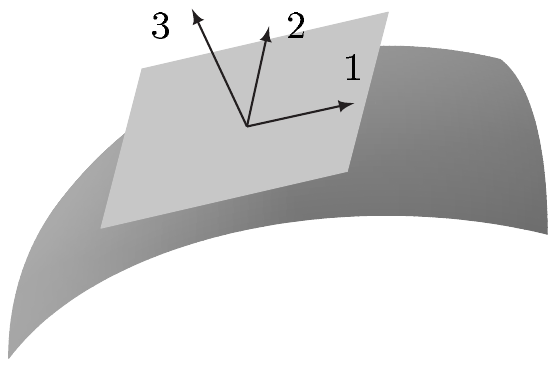
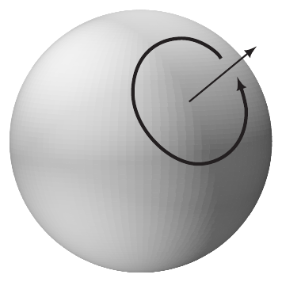

## 5 黎曼度量

我们已从第 VII.10 节知道，$ \mathbb{R}^{\overline{m}} $ 上的欧几里得内积 $ (\cdot|\cdot) $ 通过限制到子流形 $ M $ 的切空间 $ T_p M $ 上，可以定义另一个内积。这就给出了在 $ T_p M $ 上度量长度与角度的方法。所以，例如，我们可以通过验证切空间 $ T_p\Gamma_1 $ 与 $ T_p\Gamma_2 $ 在 $ T_p M $ 中彼此正交，来确定 $ M $ 上的两条曲线 $ \Gamma_1 $ 与 $ \Gamma_2 $ 是否在点 $ p $ 处正交相交。

$ \mathbb{R}^{\overline{m}} $ 的欧几里得结构在 $ M $ 上——确切地说，在 $ M $ 的切丛上——诱导出一个欧几里得结构，这是流形上积分理论的基础，我们将在下一章讨论该理论。在本节中，我们探讨 $ M $ 上存在欧几里得结构的若干推论，并研究几个例子。我们还引入霍奇星算子与余微分，它们对更深入地研究微分形式理论具有重要意义——特别地，这些概念在（理论）物理学中很重要。

为便于引入材料，我们首先考虑由 $ (\cdot|\cdot) $ 在 $ M $ 上诱导的欧几里得结构的情形。然而，后面将会清楚，所有抽象定理在本质上更一般的框架，即黎曼几何的框架中仍然成立。由于这些事实具有重大的理论与实际意义，我们将引入（伪）黎曼度量的概念，它构成我们后续讨论的一般框架。

本节自始至终作如下假设：

- $ M $ 是 $ \mathbb{R}^{\overline{m}} $ 的 $ m $ 维子流形；$ N $ 是 $ \mathbb{R}^{\overline{n}} $ 的 $ n $ 维子流形。
- 除非另有说明，指标 $ i, j, k, l $ 总取 $ 1 $ 到 $ m $ 的值，而 $ \sum_{j} $ 表示 $ j $ 从 $ 1 $ 到 $ m $ 求和。

##### 体积元

设 $ M $ 已定向。则 $ \mathcal{O}r $ 在每个切空间 $ T_p M $ 上诱导一个定向。又 $ T_p M $ 是内积空间，其内积 $ (\cdot|\cdot)_p $ 由周围空间 $ \mathbb{R}^{\overline{m}} $ 的欧几里得标量积诱导。于是由注 2.12(b)，$ T_p M $ 上存在唯一的体积元 $ \omega_p $。因此
\[ \omega_M(p) := \omega_p \qquad \text{对 } p \in M \]
在 $ M $ 上定义一个 $ m $ 形式，即 $ M $ 上的**体积元**。

5.1 命题 设 $ M $ 已定向。则 $ \omega_M $ 属于 $ \mathcal{O}r(M) $。若 $ (\varphi, U) $ 是正向坐标卡，且 $ \varphi = (x^1, \ldots, x^m) $，则
\[ \omega_M|U = \sqrt{G}\, dx^1 \wedge \cdots \wedge dx^m , \tag{5.1} \]
其中 $ G := \det[g_{jk}] \in \mathcal{E}(U) $ 是**格拉姆行列式**，且
\[ g_{jk}(p) := (\partial_j|_p | \partial_k|_p)_p \qquad \text{对 } 1 \le j, k \le m \text{ 及 } p \in U . \]

设 $ g_\varphi := i \circ \varphi^{-1} \in C^\infty(\varphi(U), \mathbb{R}^{\overline{m}}) $ 是属于 $ \varphi $ 的参数化，其中 $ i : M \hookrightarrow \mathbb{R}^{\overline{m}} $，则
\[ \varphi_{*}g_{jk}(x) = (\partial_j g_\varphi(x) | \partial_k g_\varphi(x)) \qquad \text{对 } 1 \le j, k \le m \text{ 及 } x \in \varphi(U) . \tag{5.2} \]

证明 因为 $ (\partial_1|_p, \ldots, \partial_m|_p) $ 是 $ T_p M $ 的正向基，故由命题 2.13 推出
\[ \omega_p = \sqrt{G(p)}\, dx^1 \wedge \cdots \wedge dx^m(p) \qquad \text{对 } p \in U . \]
因此 (5.1) 成立。因为
\[ \varphi_{*}(\omega_M|U) = \varphi_{*}\sqrt{G}\, dx^1 \wedge \cdots \wedge dx^m \,|\, \varphi(U) \]
且 $ \varphi_{*}\sqrt{G} = \sqrt{G \circ \varphi^{-1}} $，故由注 4.3(a) 推出 (5.2) 成立。由于标量积与行列式函数是光滑的（见命题 VII.4.6 与习题 VII.4.2），且 $ \sqrt{G(p)} > 0 $ 对 $ p \in U $ 成立，链式法则给出 $ \varphi_{*}\sqrt{G} \in \mathcal{E}(\varphi(U)) $。因此 $ \omega_M|U $ 是光滑的，从而证明了 $ \omega_M \in \mathcal{O}r $。 ■

5.2 注（正则性） 以显然的方式修改本命题的陈述，我们发现当 $ M $ 是 $ C^1 $ 流形时它仍然成立。 ■

5.3 例 (a)（$ \overline{\mathbb{H}}^m $ 中的开集） 设 $ X $ 是 $ \overline{\mathbb{H}}^m $ 的非空开子集。则 $ X $ 被赋予一个**自然定向**，关于它，每个切空间 $ T_p X = T_p\mathbb{R}^m $（$ p \in X $）都自然地定向，也就是说，该定向使典范基 $ ((e_1)_p, \ldots, (e_m)_p) $ 为正向。于是 $ X $ 的体积元由
\[ \omega_X = dx^1 \wedge \cdots \wedge dx^m \,|\, X \]
给出。平凡坐标卡 $ (\operatorname{id}_X, X) $ 是正向的。

(b)（正则映射的纤维） 设 $ X $ 在 $ \mathbb{R}^m $ 中开，$ q $ 是 $ f \in \mathcal{E}(X) $ 的正则值，且 $ M := f^{-1}(q) \ne \varnothing $。我们按如下方式给超曲面 $ M $ 赋予**由 $ \nabla f $ 诱导的定向 $ \mathcal{O}r(M, \nabla f) $**：对每个 $ p \in M $，$ T_p M $ 的基 $ (v_1, \ldots, v_{m-1}) $ 为正向，当且仅当 $ T_p X = T_p\mathbb{R}^m $ 的基
\[ (\nabla f(p), v_1, \ldots, v_{m-1}) \]
为正向，其中 $ \nabla f = \sum_{k} \partial_k f\, \partial/\partial x^k $。以
\[ \nu := \nabla f/|\nabla f| \]
表示 $ M $ 的单位法向量场，则 $ (M, \mathcal{O}r(M, \nabla f)) $ 的体积元由
\[ \omega_M := (\nu \lrcorner \omega_X)|M \]
给出。

若 $ m = 3 $，则 $ T_p M $ 的基 $ (v_1(p), v_2(p)) $ 为正向，当且仅当三个向量 $ (v_1, v_2, \nu(p)) $ 构成 $ T_p\mathbb{R}^3 $ 的“右手基”。这里 $ (w_1, w_2, w_3) $ 是**右手基**，是指可以伸出右手的拇指、食指与中指（中指弯向掌心），使这三根手指指向这三个向量的方向（且顺序相同）。这称为**右手定则**。

证明 因为 $ q $ 是正则点，$ \nabla f(q) \ne 0 $ 对 $ q \in M $ 成立。由正则值定理，$ M $ 是 $ X $ 中的光滑超曲面。例 4.17(e) 的证明表明 $ \omega_M $ 是光滑体积形式。现在一切都很清楚了。 ■

(c)（球面） 对 $ m \in \mathbb{N} $，$ \mathbb{R}^{m+1} $ 中的 $ m $ 维球面 $ S^m $ 由外向单位法向量场
\[ \nu(x) := (x, x) \in T_x\mathbb{R}^{m+1} \]
**典范地**定向。

若 $ m = 0 $，则 $ S^0 $ 由两个点 $ \{\pm 1\} \subset \mathbb{R} $ 组成，而在 $ 1 $ 处[或在 $ -1 $ 处]的外向单位法向量场由 $ (1,1) \in T_1\mathbb{R} $[或 $ (-1,-1) \in T_{-1}\mathbb{R} $]给出。\footnote{见例 1.17(a)。}

当 $ m = 1 $ 时，$ S^1 $ 的典范定向与注 VIII.5.8 中给出的相同。因此，“沿 $ S^1 $ 行进的方向就是正方向”恰好在行进为逆时针时成立。此时，$ \nu $ 与弗雷内二标架意义下的负单位法向量 $ -\mathbf{n} $ 重合。

典范定向的 $ m $ 维球面的体积元是 $ m $ 形式\footnote{这为例 4.6 与例 4.13(c) 中所用的记号提供了依据。}：
\[ \begin{aligned} \omega_{S^m} &= (\nu \lrcorner \omega_{\mathbb{R}^{m+1}})|S^m \\ &= \sum_{j=1}^{m+1} (-1)^{j-1} x^j dx^1 \wedge \cdots \wedge \widehat{dx^j} \wedge \cdots \wedge dx^{m+1} \,|\, S^m . \end{aligned} \]

坐标卡 $ (\varphi_{\pm}, S_{\pm}^m) $ 描述上半[或下半]半球面 $ S_{\pm}^m $，它沿 $ x^{m+1} $ 轴投影到 $ \mathbb{B}^m \times \{0\} $ 上；当 $ m $ 为偶数[或奇数]时，该坐标卡是正向的；当 $ m $ 为奇数[或偶数]时，它是反向的。

$ S^1 $ 的球坐标卡是正向的，而 $ S^2 $ 的球坐标卡是反向的。

证明 $ \omega_{S^m} $ 的公式是 (b) 的特例。关于 $ S^m $ 的各种坐标卡的陈述由例 4.6(a)–(b) 推出。 ■

(d)（图像） 设 $ X $ 在 $ \overline{\mathbb{H}}^m $ 中开，$ f \in C^\infty(X, \mathbb{R}^n) $。则图像 $ M := \operatorname{graph}(f) $ 的**自然定向**是使自然坐标卡 $ (\varphi, M) $ 为正的那个定向，其中
\[ \varphi : M \to \mathbb{R}^m , \quad (x, f(x)) \mapsto x . \]
在 $ n = 1 $ 的情形，体积元 $ \omega_M $ 有局部表示
\[ \omega_M|M = \sqrt{1 + |\nabla f|^2}\, dx^1 \wedge \cdots \wedge dx^m \]
其中 $ \nabla f = \sum_{j=1}^{m} \partial_j f\, \partial_j $。

证明 因为 $ g_\varphi(x) = (x, f(x)) $ 对 $ x \in X = \varphi(M) $ 成立，故由注 4.3(a) 推出
\[ \partial_j|_p = (p, (e_j, \partial_j f(x))) \in T_p\mathbb{R}^{m+1} \qquad \text{对 } p = (x, f(x)) \in M \text{ 及 } 1 \le j \le m , \]
其中 $ T_p M $ 与 $ T_p\mathbb{R}^{m+1} $ 的向量子空间 $ (T_p i_M)(T_p M) $ 被典范地等同起来。置 $ d_j := \partial_j f $，我们便得到 $ g_{jk} = \delta_{jk} + d_j d_k $。

设 $ D_m := [\varphi_{*}g_{jk}] $。则由此推出
\[ \begin{aligned} G &= \det D_m = \det\begin{bmatrix} 1+d_1^2 & d_1 d_2 & \cdots & d_1 d_m \\ d_2 d_1 & 1+d_2^2 & \cdots & d_2 d_m \\ \vdots & \vdots & \ddots & \vdots \\ d_m d_1 & d_m d_2 & \cdots & 1+d_m^2 \end{bmatrix} \\ &= \det\begin{bmatrix} D_{m-1} & \begin{matrix} 0 \\ \vdots \\ 0 \end{matrix} \\ \begin{matrix} d_m d_1 & \cdots & d_m d_{m-1} \end{matrix} & 1 \end{bmatrix} + d_m^2 \det\begin{bmatrix} D_{m-1} & \begin{matrix} d_1 \\ \vdots \\ d_{m-1} \end{matrix} \\ \begin{matrix} d_1 & \cdots & d_{m-1} \end{matrix} & 1 \end{bmatrix} . \end{aligned} \]

为计算最后一个行列式，对 $ 1 \le j \le m-1 $，从第 $ j $ 列减去 $ d_j $ 倍最后一列，于是发现其值为 $ 1 $。这就给出递推公式
\[ \det D_m = \det D_{m-1} + d_m^2 . \]
因为 $ \det D_1 = 1 + d_1^2 $，递推给出
\[ G = \det D_m = 1 + d_1^2 + \cdots + d_m^2 = 1 + |\nabla f|^2 , \]
从而断言得证。 ■

(e)（曲线） 设 $ J $ 是 $ \mathbb{R} $ 中的完全区间，$ \gamma : J \to \mathbb{R}^m $ 是光滑嵌入。则 $ M := \gamma(J) $ 是 $ \mathbb{R}^m $ 中的嵌入曲线。又设 $ M $ 由 $ \gamma $ **定向**，即设 $ (\gamma(t), \dot{\gamma}(t)) $ 是 $ T_{\gamma(t)}M $ 的正向基（$ t \in J $）。最后，设 $ \varphi : M \to \mathbb{R} $ 是属于 $ \gamma $ 的 $ M $ 的坐标卡，且 $ \gamma = i_M \circ \varphi^{-1} $。则 $ \omega_M = |\dot{\gamma}|\, dt $。

证明 这是命题 5.1 的直接推论。 ■

(f)（参数曲面） 设 $ X $ 在 $ \overline{\mathbb{H}}^2 $ 中开，$ h : X \to \mathbb{R}^n $ 是光滑嵌入。则 $ M := h(X) $ 是 $ \mathbb{R}^n $ 中的二维子流形，即 $ \mathbb{R}^n $ 中的一张**曲面**，它可由单个坐标卡描述。因此 $ M $ 是可定向的。所谓**由参数化 $ h $ 诱导的定向**，我们指的是使 $ (\partial_1 h(x), \partial_2 h(x)) $ 为 $ T_{h(x)}M $ 的正向基（对每个 $ x \in X $）的那个定向。
