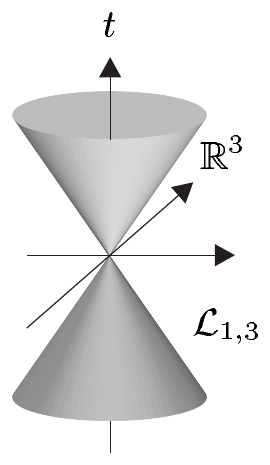
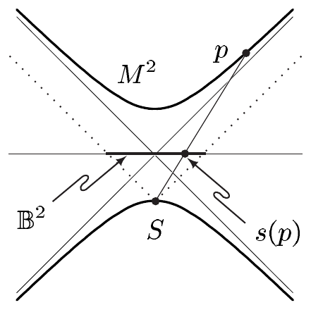

对 $ 1 \le j \le m-2 $。由 (5.7)，这证明了

\[ |\partial_m f_m(z)|^2 = r^2 \quad \text{且} \quad (\partial_j f_m \mid \partial_m f_m) = 0 \quad \text{对 } 2 \le j \le m-1. \tag{5.12} \]

最后，(5.11) 蕴含

\[ (\partial_j h_{m-1}(z) \mid \partial_k h_{m-1}(z)) = \sin^2 z_{m-1} (\partial_j h_{m-2}(z') \mid \partial_k h_{m-2}(z')) \quad \text{对 } 1 \le j \le m-2. \]

因此 (5.7) 与 (5.10) 给出递推公式

\[ (\partial_j f_m(y) \mid \partial_k f_m(y)) = \sin^2 z_{m-1} (\partial_j f_{m-1}(y') \mid \partial_k f_{m-1}(y')) \tag{5.13} \]

对 $ 2 \le j,k \le m-1 $，其中 $ y = (y', y_m) \in \mathbb{R}^{m-1} \times \mathbb{R} $。因为 (5.8) 与 (5.12) 对所有 $ m \ge 3 $ 成立，对 (5.13) 作归纳给出

\[ |\partial_j f_m|^2 = r^2 a_{m,j-2} \quad \text{对 } 2 \le j \le m-1, \tag{5.14} \]

以及

\[ (\partial_j f_m \mid \partial_k f_m) = 0 \quad \text{对 } 2 \le j,k \le m-1 \text{ 且 } j \ne k. \tag{5.15} \]

现在论断由 (5.8)、(5.9)、(5.12)、(5.14)、(5.15) 与 (b) 推出。■

**(h)（m 维球坐标）** 对 $ m \ge 2 $，令

\[ h_m : W_m \to \mathbb{R}^{m+1}, \quad (\varphi, \vartheta_1, \ldots, \vartheta_{m-1}) \mapsto (y^1, y^2, \ldots, y^{m+1}), \]

其中 $ W_m := (0, 2\pi) \times (0, \pi)^{m-1} $，且

\[ \begin{aligned} y^1 &= \cos\varphi \sin\vartheta_1 \sin\vartheta_2 \cdots \sin\vartheta_{m-1}, \\ y^2 &= \sin\varphi \sin\vartheta_1 \sin\vartheta_2 \cdots \sin\vartheta_{m-1}, \\ y^3 &= \cos\vartheta_1 \sin\vartheta_2 \cdots \sin\vartheta_{m-1}, \\ & \vdots \\ y^m &= \cos\vartheta_{m-2} \sin\vartheta_{m-1}, \\ y^{m+1} &= \cos\vartheta_{m-1} \end{aligned} \]

是（$ m $ 维）球坐标。\footnote{见例 VII.9.11(b)。} 于是 $ h_m $ 是 $ m $ 球面的开子集 $ U_m := S^m \setminus H_m $ 的参数化。$ S^m $ 的标准度量 $ g_{S^m} $ 满足

\[ g_{S^m} = a_{m+1,0}(d\varphi)^2 + \sum_{k=1}^{m-1} a_{m+1,k}(d\vartheta_k)^2. \]

在 2 球面（取 $ \vartheta := \vartheta_1 $）的情形，这成为

\[ g_{S^2} = \sin^2\vartheta (d\varphi)^2 + (d\vartheta)^2. \]

证明 因为 $ h_m = f_{m+1}(1, \cdot) $，所以论断是 (g) 的简单推论。■

**(i)（闵可夫斯基度量）** 我们把 $ \mathbb{R}^4 $ 的欧几里得坐标记作 $ (t, x, y, z) $ 或 $ (x^0, x^1, x^2, x^3) $，并置 $ \mathbb{R}^4_{1,3} := (\mathbb{R}^4, (\cdot\mid\cdot)_{1,3}) $，其中闵可夫斯基度量为

\[ (\cdot\mid\cdot)_{1,3} = (dt)^2 - (dx)^2 - (dy)^2 - (dz)^2 = (dx^0)^2 - \sum_{j=1}^{3}(dx^j)^2. \]

则 $ \mathbb{R}^4_{1,3} $ 是伪黎曼流形，即（狭义）相对论的**时空**或**闵可夫斯基空间**。

对 $ v = (v^0, \ldots, v^3) \subset \mathbb{R}^4_{1,3} $，我们称

\[ |v|^2_{1,3} := (v\mid v)_{1,3} = (v^0)^2 - \sum_{j=1}^{3}(v^j)^2 \]

为向量 $ v $ 的**闵可夫斯基范数**。具有正闵可夫斯基范数的向量称为**类时**的；具有负范数的称为**类空**的。闵可夫斯基范数为零的向量称为**类光**的；在 $ \mathbb{R}^4_{1,3} $ 中，类光向量构成一个（双）锥，即**光锥** $ \mathcal{L}_{1,3} $。

**(j)（伪球坐标）** 令 $ V_{1,3} := \mathbb{R} \times V_3 $，且

\[ f_{1,3} : V_{1,3} \to \mathbb{R}^4, \quad (\rho, \chi, \varphi, \vartheta) \mapsto (x^0, x^1, x^2, x^3) \]

其中

\[ \begin{aligned} x^0 &= \rho \cosh\chi, \\ x^1 &= \rho \sinh\chi \cos\varphi \sin\vartheta, \\ x^2 &= \rho \sinh\chi \sin\varphi \sin\vartheta, \\ x^3 &= \rho \sinh\chi \cos\vartheta; \end{aligned} \]

这就是**伪球坐标映射**。于是 $ f_{1,3} $ 是从 $ V_{1,3}\setminus\{0\} $ 到光锥的**内部**

\[ \mathring{\mathcal{L}}_{1,3} := \{ x \in \mathbb{R}^4 ; |x|^2_{1,3} > 0 \} \]

的光滑微分同胚，且

\[ (\cdot\mid\cdot)_{1,3} = (d\rho)^2 - \rho^2\Bigl[ (d\chi)^2 + \sinh^2\chi \sin^2\vartheta (d\varphi)^2 + \sinh^2\chi (d\vartheta)^2 \Bigr]. \]

证明 这容易由 $ \sinh $ 与 $ \cosh $ 的性质（见习题 III.6.5 与 IV.2.5）以及注 5.4(d) 推出。■

**(k)（双曲空间）** 为推广闵可夫斯基空间，我们置

\[ (\cdot\mid\cdot)_{1,m} := (dx^0)^2 - \sum_{j=1}^{m}(dx^j)^2 \]

对 $ n \in \mathbb{N}^\times $。则 $ \mathbb{R}^{m+1}_{1,m} := (\mathbb{R}^{m+1}, (\cdot\mid\cdot)_{1,m}) $ 是 $ m $ 维伪黎曼流形。

令

\[ M^m := \{ (x^0, x) \in \mathbb{R} \times \mathbb{R}^m ; (x^0)^2 - |x|^2 = 1, x^0 > 0 \}, \]

即 $ M^m $ 是 $ m $ 维双叶双曲面的上连通分支

\[ K_1 := \{ x \in \mathbb{R}^{m+1} ; (Ax\mid x) = 1 \}, \quad \text{其中 } A := \operatorname{diag}(1, -1, \ldots, -1) \]

（见例 1.17(b)）。又令 $ i : M^m \hookrightarrow \mathbb{R}^{m+1} $ 为标准嵌入，并令

\[ g_{H^m} := -i^*(\cdot\mid\cdot)_{1,m}. \]

则

\[ H^m := (M^m, g_{H^m}) \]

是 $ m $ 维黎曼流形，即 $ m $ 维**双曲空间**。若 $ N := (N, g) $ 与 $ H^m $ 等距同构，则称 $ N $ 是 $ H^m $ 的一个**模型**。特别地，若给 $ \mathbb{R}^m $ 配上度量

\[ \frac{(dr)^2}{1+r^2} + r^2 g_{S^{m-1}}, \]

写于“极坐标” $ (r, \sigma) \in \mathbb{R}^+ \times S^{m-1} $ 之下，则 $ \mathbb{R}^m $ 是 $ H^m $ 的一个模型。

证明 对 $ u : \mathbb{R}^m \to \mathbb{R}^{m+1} $，$ x \mapsto \sqrt{1+|x|^2} $，有 $ M^m = \operatorname{graph}(u) $。因此

\[ \varphi : M^m \to \mathbb{R}^m, \quad (h(x), x) \mapsto x \]

是从 $ \mathbb{R}^{m+1} $ 中的超曲面 $ M^m $ 到 $ \mathbb{R}^m $ 的微分同胚。因此我们只需证明由 $ -(\cdot\mid\cdot)_{1,m} $ 在 $ M $ 上诱导的双线性形式 $ g_{H^m}(0) $ 是正定的，且 $ \varphi_* g_{H^m} $ 具有所指出的形式，因为由此可以看出，对每个 $ p \in M \setminus \{\varphi^{-1}(0)\} $，$ g_{H^m}(p) $ 都是正定的。

对 $ x \in \mathbb{R}^m $ 令 $ h(x) := (u(x), x) $，则 $ h = i \circ \varphi^{-1} $，且

\[ \partial_j h = (\partial_j u, e_j) \quad \text{对 } 1 \le j \le m, \]

其中 $ e_j $ 是 $ \mathbb{R}^m $ 的第 $ j $ 个标准基向量。因为 $ \partial_j u(x) = x^j/u(x) $，所以

\[ (\varphi_* g_{H^m})_{jk}(x) = (\partial_j h \mid \partial_k h)_{1,m}(x) = (\delta_{jk} - x^j x^k)/u^2(x) \quad \text{对 } x \in \mathbb{R}^m; \]

特别地，$ (\varphi_* g_{H^m})(0) = \sum_j (dx^j)^2 $。

如同 (g) 中那样，令

\[ f_m : (0, \infty) \times W_{m-1} \to \mathbb{R}^m, \quad (r, \vartheta) \mapsto r h_{m-1}(\vartheta) \]

为 $ m $ 维极坐标映射。则 $ \psi := f_m^{-1} \circ \varphi $ 是 $ M $ 的局部坐标卡，且 $ a := i \circ \psi^{-1} = h \circ f_m = f_m^* h $ 是相伴的参数化。这满足

\[ a(r, \vartheta) = (\sqrt{1+r^2}, r h_{m-1}(\vartheta)), \]

因此

\[ \partial_r a(r, \vartheta) = \left( \frac{r}{\sqrt{1+r^2}}, h_{m-1}(\vartheta) \right), \quad \partial_{\vartheta^j} a(r, \vartheta) = (0, r\partial_j h_{m-1}(r, \vartheta)) \]

对 $ (r, \vartheta) \in (0, \infty) \times W_{m-1} $。因为 $ |h_{m-1}| = 1 $，我们得到

\[ \psi_* g_{H^m} = -a^*(\cdot\mid\cdot)_{1,m} \]

\[ = r^2 \sum_{j,k} (\partial_j h_{m-1} \mid \partial_k h_{m-1}) dx^j dx^k + \left( 1 - \frac{r^2}{\sqrt{1+r^2}} \right)(dr)^2. \]

现在论断由此推出，因为 (h)，并且 $ M^m \setminus \{\varphi^{-1}(0)\} $ 中仍然缺失的部分可以类似地通过绕 $ x^0 $ 轴旋转 $ M^m $ 来参数化。■

**(l)（庞加莱模型）** 类比于球面到平面的球极投影，考虑**伪球面**

\[ S^2_{1,3} := \{ (t, x, y) \in \mathbb{R}^3 ; t^2 - x^2 - y^2 = 1 \} \]

的球极投影。我们置 $ N := (1, 0, 0) $，即 $ S^2_{1,3} $ 的**北极**，并把**南极**定义为 $ S := (-1, 0, 0) $。于是**球极投影** $ s : M^2 \to \mathbb{R}^2 $ 在点 $ p \in M^2 $ 处的值 $ s(p) $ 定义为：从 $ S $ 到 $ p $ 的直线与 $ \mathbb{R}^3 $ 中平面 $ \mathbb{R}^2 \times \{0\} $ 的交点。

若 $ p \in M^2 $ 的（欧几里得）坐标是 $ (t, x, y) $，而 $ s(p) $ 的坐标是 $ (u, v) $，则从上面这张图可以看出

\[ \frac{x}{u} = \frac{t+1}{1} \quad \text{且} \quad \frac{y}{v} = \frac{t+1}{1}. \]

因为 $ t^2 - x^2 - y^2 = 1 $，所以 $ t^2 - (u^2+v^2)(t+1)^2 = 1 $。由此算得

\[ t = \frac{1+u^2+v^2}{1-u^2-v^2}, \quad x = \frac{2u}{1-u^2-v^2}, \quad y = \frac{2v}{1-u^2-v^2}. \]

这表明

\[ \pi : \mathbb{B}^2 \to M^2, \quad (u, v) \mapsto \left( \frac{1+u^2+v^2}{1-u^2-v^2}, \frac{2u}{1-u^2-v^2}, \frac{2v}{1-u^2-v^2} \right) \]

是 $ M^2 $ 在 $ \mathbb{B}^2 $ 上的参数化。它满足

\[ \pi^* g_{H^2} = 4\frac{(du)^2+(dv)^2}{(1-u^2-v^2)^2}. \]

因此

\[ \left( \mathbb{B}^2, 4\frac{(dx)^2+(dy)^2}{(1-x^2-y^2)^2} \right) \]

是双曲平面的一个模型，即**庞加莱模型**。

证明 $ \pi^* g_{H^2} $ 具有给定形式一事留作习题。■

**(m)（罗巴切夫斯基模型）** 仿照 (h) 与 (j) 中的做法，我们可以用**伪球坐标**参数化 $ M^2 $：

\[ h_{1,2} : \mathbb{R}^+ \times [0, 2\pi) \to \mathbb{R}^3, \quad (\chi, \varphi) \mapsto (t, x, y) \]

其中

\[ t = \cosh\chi, \quad x = \sinh\chi \cos\varphi, \quad y = \sinh\chi \sin\varphi. \]

它们满足 $ h^*_{1,2} g_{H^3} = (d\chi)^2 + \sinh^2\chi (d\varphi)^2 $。因此

\[ (\mathbb{R}^+ \times [0, 2\pi), (d\chi)^2 + \sinh^2\chi (d\varphi)^2) \]

是双曲平面 $ H^2 $ 的一个模型，即**罗巴切夫斯基模型**。

证明 验证所给公式同样留作习题。■

**(n)（一般伪黎曼度量）** 设 $ X $ 在 $ \overline{\mathbb{H}}^m $ 中开，且设 $ g_{jk} = g_{kj} \in \mathcal{E}(X) $ 对 $ 1 \le j,k \le m $ 成立，并且 $ \det[g_{jk}(x)] \ne 0 $ 对 $ x \in X $ 成立。则

\[ g := \sum_{j,k} g_{jk} dx^j dx^k \]

定义了 $ X $ 上的一个伪黎曼度量。若矩阵 $ [g_{jk}(x)] $ 对每个 $ x \in X $ 都正定，则 $ g $ 是 $ X $ 上的黎曼度量。

现在设 $ \{ (\varphi_\alpha, U_\alpha) ; \alpha \in \mathrm{A} \} $ 是 $ M $ 的图册，

\[ g_{\alpha,jk} = g_{\alpha,kj} \in \mathcal{E}(\varphi_\alpha(U_\alpha)) \quad \text{对 } 1 \le j,k \le m, \]

且 $ \det[g_{\alpha,jk}(x)] \ne 0 $ 对 $ x \in \varphi_\alpha(U_\alpha) $ 与 $ \alpha \in \mathrm{A} $ 成立。则存在唯一的 $ M $ 上的伪黎曼度量 $ g $，使得

\[ g\mid U_\alpha = g_\alpha := \sum_{j,k} g_{\alpha,jk} dx^j dx^k \]

只要转移函数 $ h := \varphi_\beta^{-1} \circ \varphi_\alpha $ 满足

\[ g_{\beta,rs} = \sum_{j,k} \frac{\partial h^j}{\partial x^r} \frac{\partial h^k}{\partial x^s} g_{\alpha,jk} \]

对满足 $ U_\alpha \cap U_\beta \ne \varnothing $ 的 $ \alpha, \beta \in \mathrm{A} $。

证明 这是注 5.4(d) 的推论。■

黎曼流形在每个切空间上都有欧几里得结构，从而可以度量长度与角度。这使得欧几里得几何中的许多概念得以推广。例如，我们在第 VIII.1 节中介绍了
