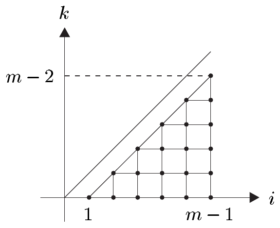

（c）（球坐标）设 $ h_2: W_2 \to \mathbb{R}^3 $，$ (\varphi,\vartheta) \mapsto (x,y,z) $ 是 2 维球面 $ S^2 $ 的开子集 $ U_2 := S^2\setminus H_2 $ 的参数化。则对 $ f \in C^1(U_2,\mathbb{R}) $，有
\[ \operatorname{grad}_{S^2} f = \frac{1}{\sin^2\vartheta}\frac{\partial f}{\partial\varphi}\frac{\partial}{\partial\varphi} + \frac{\partial f}{\partial\vartheta}\frac{\partial}{\partial\vartheta}. \]

证明 这可以从例 5.5(h) 中 $ g_{S^2} $ 的表示读出。■

（d）（闵可夫斯基度量）设 $ X $ 是 $ \mathbb{R}^4_{1,3} $ 中的开集，$ f \in C^1(X,\mathbb{R}) $。则在闵可夫斯基度量下，有
\[ \operatorname{grad} f = \frac{\partial f}{\partial t}\frac{\partial}{\partial t} - \frac{\partial f}{\partial x}\frac{\partial}{\partial x} - \frac{\partial f}{\partial y}\frac{\partial}{\partial y} - \frac{\partial f}{\partial z}\frac{\partial}{\partial z}, \]
正如我们从 $ (\cdot\mid\cdot)_{1,3} $ 的定义立即看到的。■

##### 散度

现在设 $ M $ 是定向的，且 $ \omega_M $ 表示 $ (M,g) $ 的体积元。则映射
\[ \bullet\,\omega_{M}: \mathcal{E}(M) \to \Omega^{m}(M), \quad a \mapsto a\omega_{M} \tag{6.7} \]
与
\[ \lrcorner\,\omega_{M}: \mathcal{V}(M) \to \Omega^{m-1}(M), \quad v \mapsto v\lrcorner\,\omega_{M} \tag{6.8} \]
是逐点定义的。

6.5 引理 映射 (6.7) 与 (6.8) 是良定义的 $ \mathcal{E}(M) $-模同构。若 $ ((x^1,\ldots,x^m),U) $ 是 $ M $ 的坐标卡，则
\[ a\omega_{M}|U = \pm a\sqrt{|G|}\,dx^{1}\wedge\cdots\wedge dx^{m} \tag{6.9} \]
与
\[ \Bigl(\sum_{j}v^{j}\frac{\partial}{\partial x^{j}}\Bigr)\lrcorner\,\omega_{M} = \sum_{j}(-1)^{j-1}v^{j}\sqrt{|G|}\,dx^{1}\wedge\cdots\wedge\widehat{dx^{j}}\wedge\cdots\wedge dx^{m}, \tag{6.10} \]
其中当坐标卡为正定向时，(6.9) 中使用正号，否则使用负号。

证明 (i) 由 $ \bullet\,\omega_M $ 的逐点定义以及注 5.4(c) 与 (g)，(6.9) 的成立立即推出。由此以及注 4.5(c)，我们断定对 $ a \in \mathcal{E}(M) $ 有 $ a\omega_M \in \Omega^{m}(M) $。因此映射 (6.7) 是良定义的。它显然是 $ \mathcal{E}(M) $-线性的。由注 4.14(a)，每个 $ \alpha \in \Omega^{m}(M) $ 都有唯一的 $ a \in \mathcal{E}(M) $ 使 $ \alpha = a\omega_M $。因此 (6.7) 也是双射。

(ii) 若坐标卡是正的，则由注 4.13(b) 推出 (6.10) 的成立。否则我们替换\footnote{考虑对于带边一维流形的情形，这个证明应如何修改。} $ x^1 $ 为 $ -x^1 $。于是 $ v^1 $ 被 $ -v^1 $ 取代。这表明 (6.10) 与坐标卡的定向无关。

因为 $ \sqrt{|G|} \in \mathcal{E}(U) $，(6.10) 与注 4.5(c) 表明对 $ v \in \mathcal{V}(M) $ 有 $ v\lrcorner\,\omega_M \in \Omega^{m-1}(M) $。因此映射 (6.8) 是良定义的，且显然是 $ \mathcal{E}(M) $-线性的。

设 $ \alpha \in \Omega^{m-1}(M) $。则由例 3.2(b) 与注 4.5(c) 推出存在唯一的 $ a_j \in \mathcal{E}(U) $ 使
\[ \alpha|U = \sum_{j}(-1)^{j-1}a_j\,dx^{1}\wedge\cdots\wedge\widehat{dx^{j}}\wedge\cdots\wedge dx^{m}. \]
于是 $ v^{j} := a_j/\sqrt{|G|} $ 属于 $ \mathcal{E}(U) $。因此
\[ v := \sum_{j}v^{j}\frac{\partial}{\partial x^{j}} \in \mathcal{V}(U), \]
而 (6.10) 表明 $ (v\lrcorner\,\omega_M)|U = \alpha|U $。这蕴含映射 $ \lrcorner\,\omega_M $ 是满射。由于其单射性是显然的，我们看到它是从 $ \mathcal{V}(M) $ 到 $ \Omega^{m-1}(M) $ 的同构。■

6.6 注 (a) 设 $ (N,\tilde{g}) $ 是定向伪黎曼流形，并设 $ \varphi \in C^\infty(M,N) $ 满足对某个 $ \mu \ne 0 $ 有 $ \varphi^{*}\omega_N = \mu\omega_M $。则图
\[ \begin{array}{ccc} \mathcal{E}(M) & \xrightarrow{\mu(\bullet\,\omega_{M})} & \Omega^{m}(M) \\ \varphi^{*}\uparrow & & \uparrow\varphi^{*} \\ \mathcal{E}(N) & \xrightarrow{\bullet\,\omega_{N}} & \Omega^{n}(N) \end{array} \]
交换，即
\[ \mu(\varphi^{*}a)\cdot\omega_{M} = \varphi^{*}(a\cdot\omega_{N}), \quad \text{对 } a \in \mathcal{E}(N). \]

证明 这立即由（外）积在拉回下的行为推出。■

(b) 设 $ (N,\tilde{g}) $ 是定向伪黎曼流形，并设 $ \varphi $ 属于 $ \operatorname{Diff}(M,N) $ 且对某个 $ \mu \ne 0 $ 满足 $ \varphi^{*}\omega_N = \mu\omega_M $。则
\[ \begin{array}{ccc} \mathcal{V}(M) & \xrightarrow[\cong]{\mu(\lrcorner\,\omega_{M})} & \Omega^{m-1}(M) \\ \varphi^{*}\uparrow & & \uparrow\varphi^{*} \\ \mathcal{V}(N) & \xrightarrow[\cong]{\lrcorner\,\omega_{N}} & \Omega^{m-1}(N) \end{array} \]
是交换图，即对 $ v \in \mathcal{V}(N) $ 有 $ \mu((\varphi^{*}v)\lrcorner\,\omega_M) = \varphi^{*}(v\lrcorner\,\omega_N) $。

证明 由注 4.13(a)，我们推出
\[ \mu((\varphi^{*}v)\lrcorner\,\omega_{M}) = \varphi^{*}v\lrcorner\,(\mu\omega_{M}) = \varphi^{*}v\lrcorner\,\varphi^{*}\omega_{N} = \varphi^{*}(\varphi_{*}\varphi^{*}v\lrcorner\,\omega_{N}) = \varphi^{*}(v\lrcorner\,\omega_{N}) \]
对 $ v \in \mathcal{V}(N) $ 成立。■

(c)（正则性）设 $ k \in \mathbb{N} $。则显然
\[ \bullet\,\omega_{M}: C^{k}(M) \to \Omega^{m}_{(k)}(M) \]
与
\[ \lrcorner\,\omega_{M}: \mathcal{V}^{k}(M) \to \Omega^{m-1}_{(k)}(M), \]
且这些映射是 $ C^{k}(M) $-模同构。因此只需假设 $ M $ 是 $ C^{k+1} $ 流形。■

借助同构 (6.7) 与 (6.8)，我们定义映射
\[ \operatorname{div}_{g}: \mathcal{V}(M) \to \mathcal{E}(M), \quad v \mapsto \operatorname{div}_{g} v \tag{6.11} \]
要求图
\[ \begin{array}{ccc} \mathcal{V}(M) & \xrightarrow{\operatorname{div}_{g}} & \mathcal{E}(M) \\ \lrcorner\,\omega_{M}\downarrow\cong & & \cong\downarrow\bullet\,\omega_{M} \\ \Omega^{m-1}(M) & \xrightarrow{d} & \Omega^{m}(M) \end{array} \tag{6.12} \]
交换。换言之，对 $ v \in \mathcal{V}(M) $，定向伪黎曼流形 $ (M,g) $（或关于 $ g $）上的向量场 $ v $ 的**散度** $ \operatorname{div}_g v $ 由关系
\[ (\operatorname{div}_{g} v)\omega_{M} = d(v\lrcorner\,\omega_{M}) \tag{6.13} \]
定义。代替 $ \operatorname{div}_g $，我们也可以写 $ \operatorname{div}_M $，或者若不预期混淆就简单地写 $ \operatorname{div} $。

6.7 注 (a) 映射 (6.11) 是 $ \mathbb{R} $-线性的。

(b) 设 $ ((x^1,\ldots,x^m),U) $ 是 $ M $ 的坐标卡。对 $ v := \sum_j v^j\partial/\partial x^j \in \mathcal{V}(U) $，有
\[ \operatorname{div} v = \frac{1}{\sqrt{|G|}}\sum_{j}\frac{\partial}{\partial x^{j}}\left(\sqrt{|G|}\,v^{j}\right). \tag{6.14} \]
在正交坐标中，我们还有 $ \sqrt{|G|} = \sqrt{|g_{11}\cdot g_{22}\cdot\cdots\cdot g_{mm}|} $。

证明 设 $ \varepsilon := 1 $ 若坐标卡是正的；若它是负的则用 $ \varepsilon := -1 $。由 (6.9)、(6.10) 与 (6.13)，我们（在 $ U $ 上）得到
\[ \begin{aligned} \operatorname{div}(v)\omega_{M} &= d(v\lrcorner\,\omega_{M}) = \varepsilon d\Bigl(\sum_{j}(-1)^{j-1}v^{j}\sqrt{|G|}\,dx^{1}\wedge\cdots\wedge\widehat{dx^{j}}\wedge\cdots\wedge dx^{m}\Bigr) \\ &= \varepsilon\sum_{j,k}(-1)^{j-1}\frac{\partial(v^{j}\sqrt{|G|})}{\partial x^{k}}\,dx^{k}\wedge dx^{1}\wedge\cdots\wedge\widehat{dx^{j}}\wedge\cdots\wedge dx^{m} \\ &= \varepsilon\Bigl(\sum_{j}\frac{\partial(v^{j}\sqrt{|G|})}{\partial x^{j}}\Bigr)dx^{1}\wedge\cdots\wedge dx^{m} \\ &= \Bigl(\frac{1}{\sqrt{|G|}}\sum_{j}\frac{\partial(v^{j}\sqrt{|G|})}{\partial x^{j}}\Bigr)\omega_{M} \end{aligned} \]
对 $ v \in \mathcal{V}(M) $ 成立。■

(c) 设 $ (N,\tilde{g}) $ 是定向伪黎曼流形，映射 $ \varphi \in \operatorname{Diff}(M,N) $ 对某个 $ \mu \ne 0 $ 满足 $ \varphi^{*}\omega_N = \mu\omega_M $。则
\[ \begin{array}{ccc} \mathcal{V}(M) & \xrightarrow{\operatorname{div}_{M}} & \mathcal{E}(M) \\ \varphi^{*}\uparrow & & \uparrow\varphi^{*} \\ \mathcal{V}(N) & \xrightarrow{\operatorname{div}_{N}} & \mathcal{E}(N) \end{array} \]
是交换图，即 $ \operatorname{div}_M\circ\varphi^{*} = \varphi^{*}\circ\operatorname{div}_N $。

证明 由注 6.6(b) 与 (6.13)，利用 $ d\circ\varphi^{*} = \varphi^{*}\circ d $，我们得到
\[ \begin{aligned} \mu\operatorname{div}_{M}(\varphi^{*}v)\omega_{M} &= \mu\,d(\varphi^{*}v\lrcorner\,\omega_{M}) = d\varphi^{*}(v\lrcorner\,\omega_{N}) = \varphi^{*}d(v\lrcorner\,\omega_{N}) \\ &= \varphi^{*}[(\operatorname{div}_{N}v)\omega_{N}] = \varphi^{*}(\operatorname{div}_{N}v)\varphi^{*}\omega_{N} = \mu\varphi^{*}(\operatorname{div}_{N}v)\omega_{M} \end{aligned} \]
对 $ v \in \mathcal{V}(N) $ 成立。现在断言由引理 6.5 推出。■

(d)（正则性）设 $ k \in \mathbb{N} $。则对 $ v \in \mathcal{V}^{k+1}(M) $ 有 $ \operatorname{div} v \in C^{k}(M) $，且映射
\[ \operatorname{div}: \mathcal{V}^{k+1}(M) \to C^{k}(M), \quad v \mapsto \operatorname{div} v \]
是 $ \mathbb{R} $-线性的。因此只需假设 $ M $ 是 $ C^{k+2} $ 流形。

证明 这是注 4.11(b) 与 6.6(c) 的推论。■

正如我们将在下一章看到的，向量场的散度具有有趣的几何与物理解释。

6.8 例 (a)（欧几里得坐标）设 $ U $ 是 $ \mathbb{R}^m $ 中的开集。记欧几里得坐标为 $ (x^1,\ldots,x^m) $，我们有
\[ \operatorname{div} v = \sum_{j}\frac{\partial v^{j}}{\partial x^{j}} \]
对 $ v = \sum_j v^j\partial/\partial x^j $。当 $ ((x^1,\ldots,x^m),U) $ 是 $ (M,g) $ 上任何其他标准正交坐标时，该公式也成立。

(b)（平面极坐标）设 $ V_2 := (0,\infty)\times(0,2\pi) $，并设
\[ f_2: V_2 \to \mathbb{R}^{2}, \quad (r,\varphi) \mapsto (x,y) := (r\cos\varphi, r\sin\varphi) \]
是平面极坐标映射。则关于标准度量，我们有
\[ \operatorname{div}\Bigl(v^{1}\frac{\partial}{\partial r} + v^{2}\frac{\partial}{\partial\varphi}\Bigr) = \frac{1}{r}\frac{\partial(rv^{1})}{\partial r} + \frac{\partial v^{2}}{\partial\varphi} = \frac{v^{1}}{r} + \frac{\partial v^{1}}{\partial r} + \frac{\partial v^{2}}{\partial\varphi}. \]

证明 这由 $ \sqrt{G} = r $ 推出，可以从例 5.5(e) 中给出的 $ g_2 $ 的表示读出。■

(c)（球坐标）设 $ V_3 := (0,\infty)\times(0,2\pi)\times(0,\pi) $，并设
\[ f_3: V_3 \to \mathbb{R}^{3}, \quad (r,\varphi,\vartheta) \mapsto (x,y,z) \]
是例 5.5(g) 的球坐标映射。关于标准度量 $ g_3 := (dx)^2 + (dy)^2 + (dz)^2 $，我们有
\[ \begin{aligned} \operatorname{div}\Bigl(v^{1}\frac{\partial}{\partial r} + v^{2}\frac{\partial}{\partial\varphi} + v^{3}\frac{\partial}{\partial\vartheta}\Bigr) &= \frac{1}{r^{2}}\frac{\partial(r^{2}v^{1})}{\partial r} + \frac{\partial v^{2}}{\partial\varphi} + \frac{1}{\sin\vartheta}\frac{\partial(v^{3}\sin\vartheta)}{\partial\vartheta} \\ &= \frac{2}{r}v^{1} + \frac{\partial v^{1}}{\partial r} + \frac{\partial v^{2}}{\partial\varphi} + \cot(\vartheta)v^{3} + \frac{\partial v^{3}}{\partial\vartheta}. \end{aligned} \]

证明 例 5.5(g) 给出 $ \sqrt{|G|} = r^{2}\sin\vartheta $，这正是断言所需要的。■

(d)（闵可夫斯基度量）设 $ M := \mathbb{R}^4_{1,3} $，$ g := (dt)^2 - (dx)^2 - (dy)^2 - (dz)^2 $。则
\[ \operatorname{div}\Bigl(v^{0}\frac{\partial}{\partial t} + v^{1}\frac{\partial}{\partial x} + v^{2}\frac{\partial}{\partial y} + v^{3}\frac{\partial}{\partial z}\Bigr) = \frac{\partial v^{0}}{\partial t} - \frac{\partial v^{1}}{\partial x} - \frac{\partial v^{2}}{\partial y} - \frac{\partial v^{3}}{\partial z} \]
对 $ v^{j} \in \mathcal{E}(\mathbb{R}^4_{1,3}) $，$ 0 \le j \le 3 $。■

##### 拉普拉斯–贝尔特拉米算子

通过组合两个一阶微分算子 $ \operatorname{grad} $ 与 $ \operatorname{div} $，我们得到最重要的二阶微分算子，即**拉普拉斯–贝尔特拉米算子** $ \Delta_g $。

设 $ (M,g) $ 是定向伪黎曼流形。则我们通过
\[ \Delta_{g} := \operatorname{div}_{g}\operatorname{grad}_{g} \]
定义 $ \Delta_g $，或等价地，通过要求图
\[ \begin{array}{ccc} \mathcal{E}(M) & \xrightarrow{\Delta_{g}} & \mathcal{E}(M) \\ \operatorname{grad}_{g}\searrow & & \nearrow\operatorname{div}_{g} \\ & \mathcal{V}(M) & \end{array} \]
交换来定义。代替 $ \Delta_g $，我们也可以写 $ \Delta_M $，或者若 $ g $ 从上下文清楚则简单地写 $ \Delta $。

6.9 注 (a) 映射 $ \Delta_M: \mathcal{E}(M) \to \mathcal{E}(M) $ 是 $ \mathbb{R} $-线性的。

(b) 若 $ ((x^1,\ldots,x^m),U) $ 是 $ M $ 的坐标卡，则
\[ \Delta_{M} f = \frac{1}{\sqrt{|G|}}\sum_{j,k}\frac{\partial}{\partial x^{j}}\left(\sqrt{|G|}\,g^{jk}\frac{\partial f}{\partial x^{k}}\right), \quad \text{对 } f \in \mathcal{E}(U). \tag{6.15} \]
在正交坐标中，(6.15) 简化为
\[ \Delta_{M} f = \frac{1}{\sqrt{|G|}}\sum_{j}\frac{\partial}{\partial x^{j}}\left(\sqrt{|G|}\,g^{jj}\frac{\partial f}{\partial x^{j}}\right), \quad \text{对 } f \in \mathcal{E}(U), \tag{6.16} \]
其中 $ \sqrt{|G|} = \sqrt{|g_{11}\cdot g_{22}\cdot\cdots\cdot g_{mm}|} $。

证明 这由注 6.3(c) 与 (d) 以及注 6.7(b) 推出。■

(c) 设 $ (N,\tilde{g}) $ 是定向伪黎曼流形。又设 $ \varphi \in \operatorname{Diff}(M,N) $，并设存在 $ \lambda \ne 0 $ 与 $ \mu \ne 0 $ 使 $ \varphi_{*}g = \lambda\tilde{g} $ 且 $ \varphi^{*}\omega_N = \mu\omega_M $。则图
\[ \begin{array}{ccc} \mathcal{E}(M) & \xrightarrow{\lambda\Delta_{M}} & \mathcal{E}(M) \\ \varphi^{*}\uparrow\cong & & \cong\uparrow\varphi^{*} \\ \mathcal{E}(N) & \xrightarrow{\Delta_{N}} & \mathcal{E}(N) \end{array} \]
交换：$ \lambda\Delta_M\circ\varphi^{*} = \varphi^{*}\circ\Delta_N $。

证明 这是注 6.3(e) 与 6.7(c) 的推论。■

(d)（正则性）设 $ k \in \mathbb{N} $。则显然
\[ \Delta_{M}: C^{k+2}(M) \to C^{k}(M), \]
且该映射是 $ \mathbb{R} $-线性的。这里只需假设 $ M $ 是 $ C^{k+2} $ 流形。■

6.10 例 (a)（欧几里得坐标）设 $ M $ 是 $ \mathbb{R}^m $ 中的开集，欧几里得坐标为 $ ((x^1,\ldots,x^m),M) $。则 $ \Delta_M $ 与（通常的）**m 维拉普拉斯算子**
\[ \Delta_{m} := \sum_{j}\partial_{j}^{2}. \]
相同。参见习题 VII.5.3。

(b)（圆坐标）关于 $ S^1\setminus\{(1,0)\} $ 的参数化
\[ h: (0,2\pi) \to \mathbb{R}^{2}, \quad \varphi \mapsto (\cos\varphi, \sin\varphi) \]
（以及标准度量），我们有 $ \Delta_{S^1} = \partial_{\varphi}^{2} $。

证明 注 6.9(b) 与例 5.5(f)。■

(c)（平面极坐标）在平面极坐标
\[ (0,\infty)\times(0,2\pi) \to \mathbb{R}^{2}, \quad (r,\varphi) \mapsto (r\cos\varphi, r\sin\varphi), \]
中，拉普拉斯–贝尔特拉米算子（关于 $ \mathbb{R}^2 $ 的标准度量）为
\[ \Delta_{2} = \frac{1}{r}\partial_{r}(r\partial_{r}\,\cdot) + \frac{1}{r^{2}}\partial_{\varphi}^{2} = \partial_{r}^{2} + \frac{1}{r}\partial_{r} + \frac{1}{r^{2}}\partial_{\varphi}^{2} = \frac{1}{r^{2}}\left[(r\partial_{r})^{2} + \Delta_{S^1}\right]. \]

证明 这由注 6.9(b)、例 5.5(e) 以及 (b) 推出。■

(d)（m 维球坐标）对 $ m \ge 2 $，$ S^m $ 的拉普拉斯–贝尔特拉米算子（关于标准度量）在例 5.5(h) 的球坐标下具有形式
\[ \Delta_{S^{m}} = \frac{1}{\sin^{2}\vartheta_{1}\cdot\cdots\cdot\sin^{2}\vartheta_{m-1}}\frac{\partial^{2}}{\partial\varphi^{2}} + \sum_{k=1}^{m-1}\frac{1}{\sin^{k}\vartheta_{k}\sin^{2}\vartheta_{k+1}\cdot\cdots\cdot\sin^{2}\vartheta_{m-1}}\frac{\partial}{\partial\vartheta_{k}}\Bigl(\sin^{k}\vartheta_{k}\frac{\partial}{\partial\vartheta_{k}}\Bigr). \]
特别地，
\[ \Delta_{S^{2}} = \frac{1}{\sin^{2}\vartheta}\partial_{\varphi}^{2} + \frac{1}{\sin\vartheta}\partial_{\vartheta}(\sin\vartheta\,\partial_{\vartheta}\,\cdot) = \frac{1}{\sin^{2}\vartheta}\partial_{\varphi}^{2} + \partial_{\vartheta}^{2} + \cot\vartheta\,\partial_{\vartheta}. \]

证明 由例 5.5(g) 与 (h) 推出
\[ G = \prod_{k=0}^{m-1}a_{m+1,k} = \prod_{k=0}^{m-2}\prod_{i=k+1}^{m-1}\sin^{2}\vartheta_{i}. \]

交换两个乘积的次序给出
\[ G = \prod_{i=1}^{m-1}\sin^{2i}\vartheta_{i} = \left[w_{m+1}(\vartheta)\right]^{2}, \tag{6.17} \]
其中我们使用了命题 X.8.9 中引入的简写记号。

由球坐标的正交性，从已给出的例子还推出
\[ g^{jj} = \frac{1}{a_{m+1,j-1}} = \frac{1}{\prod_{i=j}^{m-1}\sin^{2}\vartheta_{i}}, \quad \text{对 } 1 \le j \le m. \]
由此我们读出
\[ \sqrt{G}\,g^{jj} = \Bigl(\prod_{i=1,\,i\ne j-1}^{m-1}\sin^{i}\vartheta_{i}\prod_{k=j}^{m-1}\frac{1}{\sin^{2}\vartheta_{k}}\Bigr)\sin^{j-1}\vartheta_{j-1} \]
对 $ 2 \le j \le m $。于是我们得到
\[ \frac{1}{\sqrt{G}}\frac{\partial}{\partial\vartheta_{j-1}}\Bigl(\sqrt{G}\,g^{jj}\frac{\partial}{\partial\vartheta_{j-1}}\Bigr) = \frac{1}{\sin^{j-1}\vartheta_{j-1}\prod_{i=j}^{m-1}\sin^{2}\vartheta_{i}}\frac{\partial}{\partial\vartheta_{j-1}}\Bigl(\sin^{j-1}\vartheta_{j-1}\frac{\partial}{\partial\vartheta_{j-1}}\Bigr) \]
对 $ 2 \le j \le m $。现在断言清楚了。■

(e)（m 维极坐标）在 $ m \ge 2 $ 的 $ m $ 维极坐标中，m 维拉普拉斯算子为
\[ \begin{aligned} \Delta_{m} &= \frac{1}{r^{m-1}}\partial_{r}(r^{m-1}\partial_{r}\,\cdot) + \frac{1}{r^{2}}\Delta_{S^{m-1}} = \partial_{r}^{2} + \frac{m-1}{r}\partial_{r} + \frac{1}{r^{2}}\Delta_{S^{m-1}} \\ &= \frac{1}{r^{2}}\left[(r\partial_{r})^{2} + (m-2)r\partial_{r} + \Delta_{S^{m-1}}\right]. \end{aligned} \]

证明 由例 5.5(g) 与 (h)，我们读出 $ g_m = (dr)^{2} + r^{2}g_{S^{m-1}} $。这便蕴含 $ G = r^{2(m-1)}G_{S^{m-1}} $。它还蕴含 $ g^{11} = 1 $ 以及
\[ g^{jj} = \frac{1}{r^{2}}g^{(j-1)(j-1)}_{S^{m-1}}, \quad \text{对 } 2 \le j \le m. \]
现在由 (6.16) 以及坐标的正交性得到断言。■

(f)（闵可夫斯基度量）在标准正交坐标中，闵可夫斯基空间 $ \mathbb{R}^4_{1,3} $ 的拉普拉斯–贝尔特拉米算子具有形式 $ \partial_{t}^{2} - \Delta_{3} $，其中 $ \Delta_3 $ 是三维（欧几里得）拉普拉斯算子。也就是说，闵可夫斯基空间中的拉普拉斯–贝尔特拉米算子恰好就是波动算子。\footnote{参见习题 VII.5.10。}

证明 这是 (6.16) 的直接推论。■

在下一个命题中，我们列出向量分析中使用的微分算子的一些基本性质。这里以及下文中，我们用 $ (\cdot\mid\cdot)_M $ 表示 $ M $ 的伪黎曼度量。

6.11 命题 设 $ (M,(\cdot\mid\cdot)_M) $ 是定向伪黎曼流形，$ f, g \in \mathcal{E}(M) $，$ v, w \in \mathcal{V}(M) $。则

(i) $ \operatorname{grad}(fg) = f\operatorname{grad} g + g\operatorname{grad} f $；

(ii) $ \operatorname{div}(fv) = f\operatorname{div} v + (\operatorname{grad} f\mid v)_M $；

(iii) $ \Delta(fg) = f\Delta g + 2(\operatorname{grad} f\mid\operatorname{grad} g)_M + g\Delta f $；

(iv) $ f\Delta g - g\Delta f = \operatorname{div}(f\operatorname{grad} g) - \operatorname{div}(g\operatorname{grad} f) $。

证明 (i) 因为 $ \Theta $ 是模同构，由 (6.4) 推出 (i) 等价于
\[ d(fg) = f\,dg + g\,df. \tag{6.18} \]
因为 (6.18) 是局部陈述，所以只需在局部坐标中证明该公式。此时，它是乘积法则的直接推论。

(ii) 由 $ (fv)\lrcorner\,\omega_M = f(v\lrcorner\,\omega_M) = f\wedge(v\lrcorner\,\omega_M) $ 以及定理 4.10 的乘积法则推出
\[ d((fv)\lrcorner\,\omega_{M}) = d(f\wedge(v\lrcorner\,\omega_{M})) = df\wedge(v\lrcorner\,\omega_{M}) + f\,d(v\lrcorner\,\omega_{M}). \tag{6.19} \]
因为这也是局部陈述，我们可以使用局部表示。于是，取 $ v = \sum_j v^j\partial/\partial x^j $ 与正坐标卡，由 (6.9) 与 (6.10) 得到
\[ \begin{aligned} df\wedge(v\lrcorner\,\omega_{M}) &= \Bigl(\sum_{j}\frac{\partial f}{\partial x^{j}}dx^{j}\Bigr)\wedge\sum_{k}(-1)^{k-1}v^{k}\sqrt{|G|}\,dx^{1}\wedge\cdots\wedge\widehat{dx^{k}}\wedge\cdots\wedge dx^{m} \\ &= \Bigl(\sum_{j}\frac{\partial f}{\partial x^{j}}v^{j}\Bigr)\sqrt{|G|}\,dx^{1}\wedge\cdots\wedge dx^{m} = \sum_{j}\frac{\partial f}{\partial x^{j}}v^{j}\omega_{M}. \end{aligned} \tag{6.20} \]
然后由注 6.3(b) 与 (4.4) 读出
\[ (\operatorname{grad} f\mid v)_M = \langle df, v\rangle = \sum_{j}\Bigl\langle df, \frac{\partial}{\partial x^{j}}\Bigr\rangle v^{j} = \sum_{j}\frac{\partial f}{\partial x^{j}}v^{j}. \tag{6.21} \]
因此由 (6.19)–(6.21) 与定义 (6.13) 推出
\[ \operatorname{div}(fv)\omega_{M} = d((fv)\lrcorner\,\omega_{M}) = (\operatorname{grad} f\mid v)_M\omega_{M} + f\operatorname{div} v\,\omega_{M}, \]
这蕴含断言。

(iii) 这立即由 $ \Delta = \operatorname{div}\operatorname{grad} $ 以及 (i)、(ii) 得到。

(iv) 由 (ii) 推出
\[ \operatorname{div}(f\operatorname{grad} g) = f\Delta g + (\operatorname{grad} f\mid\operatorname{grad} g)_M. \tag{6.22} \]
交换 $ f $ 与 $ g $ 并从 (6.22) 中减去所得结果，便得到 (iv)。■
