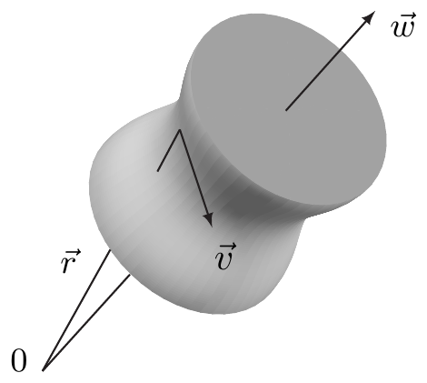

##### 旋度

设 $ (M, g) $ 是 3 维定向伪黎曼流形。于是我们通过要求下图交换来定义向量场 $ v \in \mathcal{V}(M) $ 的**旋度** $ \operatorname{curl} v $（有时写作 rot，是“rotation”的缩写）：

\[ \begin{tikzcd}[row sep=large, column sep=large] \mathcal{V}(M) \arrow[r, "\Theta", "\cong"'] \arrow[d, "\operatorname{curl}"'] & \Omega^{1}(M) \arrow[d, "d"] \\ \mathcal{V}(M) \arrow[r, "\lrcorner\,\omega_{M}", "\cong"'] & \Omega^{2}(M) \end{tikzcd} \tag{6.23} \]

也就是要求

\[ (\operatorname{curl} v) \lrcorner\, \omega_{M} = d(\Theta v) \qquad \text{对 } v \in \mathcal{V}(M) . \tag{6.24} \]

这个定义显然只在 $ m = 3 $ 的情形下才可能。

6.12 注 （a）映射 $ \operatorname{curl} : \mathcal{V}(M) \to \mathcal{V}(M) $，$ v \mapsto \operatorname{curl} v $ 是 $ \mathbb{R} $ 线性的。

（b）设 $ ((x^{1}, x^{2}, x^{3}), U) $ 是 $ M $ 的坐标卡。则

\[ \operatorname{curl} v = \frac{1}{\sqrt{|G|}} \sum_{i=1}^{3} \sum_{(j,k,\ell) \in S_{3}} \operatorname{sign}(j, k, \ell) \frac{\partial}{\partial x^{j}} (g_{ki} v^{i}) \frac{\partial}{\partial x^{\ell}} \]

对 $ v = \sum_{j=1}^{3} v^{j} \partial/\partial x^{j} $。若坐标是正交的，这个表达式简化为

\[ \begin{aligned} \operatorname{curl} v &= \frac{1}{\sqrt{|G|}} \sum_{(j,k,\ell) \in S_{3}} \operatorname{sign}(j, k, \ell) \frac{\partial}{\partial x^{j}} (g_{kk} v^{k}) \frac{\partial}{\partial x^{\ell}} \\ &= \frac{1}{\sqrt{|G|}} \left[ \bigl(\partial_{2}(g_{33} v^{3}) - \partial_{3}(g_{22} v^{2})\bigr) \frac{\partial}{\partial x^{1}} + \bigl(\partial_{3}(g_{11} v^{1}) - \partial_{1}(g_{33} v^{3})\bigr) \frac{\partial}{\partial x^{2}} + \bigl(\partial_{1}(g_{22} v^{2}) - \partial_{2}(g_{11} v^{1})\bigr) \frac{\partial}{\partial x^{3}} \right] \end{aligned} \]

其中 $ \sqrt{|G|} = \sqrt{|g_{11} g_{22} g_{33}|} $。若坐标是正交规范的，这成为

\[ \operatorname{curl} v = (\partial_{2} v^{3} - \partial_{3} v^{2}) \frac{\partial}{\partial x^{1}} + (\partial_{3} v^{1} - \partial_{1} v^{3}) \frac{\partial}{\partial x^{2}} + (\partial_{1} v^{2} - \partial_{2} v^{1}) \frac{\partial}{\partial x^{3}} . \]

证明 注 6.1(b) 与外微分的性质给出

\[ d(\Theta v) = d \sum_{k} \Bigl( \sum_{i} g_{ki} v^{i} \Bigr) dx^{k} = \sum_{k} \sum_{j \neq k} \frac{\partial}{\partial x^{j}} \Bigl( \sum_{i} g_{ki} v^{i} \Bigr) dx^{j} \wedge dx^{k} . \]

由 (6.10)，我们读出

\[ \operatorname{curl} v \lrcorner\, \omega_{M} = \sqrt{|G|} \Bigl( (\operatorname{curl} v)^{1} dx^{2} \wedge dx^{3} + (\operatorname{curl} v)^{2} dx^{3} \wedge dx^{1} + (\operatorname{curl} v)^{3} dx^{1} \wedge dx^{2} \Bigr) . \tag{6.25} \]

因此断言由 (6.24) 推出。■

（c）（正则性）设 $ k \in \mathbb{N} $。则对 $ v \in \mathcal{V}^{k+1}(M) $ 有 $ \operatorname{curl} v \in \mathcal{V}^{k}(M) $。所以这里只需假设 $ M $ 是 $ C^{k+2} $ 流形。■

在 $ m = 3 $ 的情形，算子 $ \operatorname{grad} $、$ \operatorname{div} $ 与 $ \operatorname{curl} $ 之间有重要的关系。下面的定理以图示方式把它们总结起来。

6.13 定理 设 $ (M, g) $ 是 3 维定向（伪）黎曼流形。

（i）下图交换。

\[ \begin{tikzcd}[row sep=large, column sep=large] \mathcal{E}(M) \arrow[r, "\operatorname{grad}"] \arrow[d, equal, "\cong"'] & \mathcal{V}(M) \arrow[r, "\operatorname{curl}"] \arrow[d, "\Theta_{M}", "\cong"'] & \mathcal{V}(M) \arrow[r, "\operatorname{div}"] \arrow[d, "\lrcorner\,\omega_{M}", "\cong"'] & \mathcal{E}(M) \arrow[d, "\cdot\,\omega_{M}", "\cong"'] \\ \Omega^{0}(M) \arrow[r, "d"] & \Omega^{1}(M) \arrow[r, "d"] & \Omega^{2}(M) \arrow[r, "d"] & \Omega^{3}(M) \end{tikzcd} \tag{6.26} \]

（ii）$ \operatorname{curl} \circ \operatorname{grad} = 0 $。

（iii）$ \operatorname{div} \circ \operatorname{curl} = 0 $。

证明 （i）立即由图 (6.4)、(6.12) 与 (6.23) 的交换性推出。（ii）与（iii）现在由 $ d^{2} = 0 $ 直接推出。■

6.14 推论 设 $ X $ 在 $ \mathbb{R}^{3} $ 中开且可缩。又设 $ v $ 是 $ X $ 上的光滑向量场。

（i）若 $ \operatorname{curl} v = 0 $，则存在 $ f \in \mathcal{E}(X) $ 使 $ v = \operatorname{grad} f $，即 $ v $ 的一个**势**。

（ii）若 $ \operatorname{div} v = 0 $，则存在 $ w \in \mathcal{V}(X) $ 使 $ v = \operatorname{curl} w $，即 $ v $ 的一个**向量势**。

证明 （i）由 (6.26) 我们得知 $ \operatorname{curl} v = 0 $ 等价于 $ d(\Theta_{X} v) = 0 $。因此 1 形式 $ \Theta_{M} v $ 是闭的，而庞加莱引理（定理 3.11）保证存在 $ f \in \Omega^{0}(X) = \mathcal{E}(X) $ 使 $ \Theta_{X} v = df $。由此推出 $ v = \Theta_{X}^{-1} df = \operatorname{grad} f $。

（ii）与（i）类似，由 $ \operatorname{div} v = 0 $ 推出 2 形式 $ v \lrcorner\, \omega_{X} $ 是闭的，从而再次由庞加莱引理是恰当的。于是存在 $ \alpha \in \Omega^{1}(X) $ 使 $ d\alpha = v \lrcorner\, \omega_{X} $。那么 $ w := \Theta_{X}^{-1} \alpha \in \mathcal{V}(X) $ 由 (6.26) 中间“回路”的交换性满足 $ \operatorname{curl} w = v $。■

6.15 注 设 $ X $ 在 $ \mathbb{R}^{3} $ 中开。

（a）在欧几里得坐标中，等式 $ \operatorname{curl} v = 0 $ 等价于可积性条件

\[ \partial_{j} v^{k} = \partial_{k} v^{j} \qquad \text{对 } 1 \le j, k \le 3 , \]

这可由注 6.12(b) 看出。因此推论 6.14(i) 是注 VIII.4.10(a) 的特例。

（b）（经典记号）在欧几里得坐标中，由例 6.4(a) 我们知道 $ \operatorname{grad} f $ 与命题 VII.2.16 中的 $ \nabla f $ 一致。物理与工程文献以及许多数学教材使用形式的 **nabla 向量**

\[ \nabla := \left( \frac{\partial}{\partial x}, \frac{\partial}{\partial y}, \frac{\partial}{\partial z} \right) . \]

以 $ x \cdot y $ 记 $ \mathbb{R}^{3} $ 中的欧几里得内积、以 $ x \times y $ 记向量积，则 nabla 向量记号导致（形式的）关系

\[ \operatorname{div} v = \nabla \cdot v , \qquad \operatorname{curl} v = \nabla \times v , \qquad \Delta v = (\nabla \cdot \nabla) v =: \nabla^{2} v . \]

这些容易由这些算子的相应局部表示以及注 VIII.2.14(d) 推出。特别地，向量 $ \operatorname{curl} v $ 的分量可通过沿第一行展开（形式的）行列式

\[ \begin{vmatrix} \vec{e}_{1} & \vec{e}_{2} & \vec{e}_{3} \\ \partial/\partial x & \partial/\partial y & \partial/\partial z \\ v^{1} & v^{2} & v^{3} \end{vmatrix} \]

得到。这里 $ \vec{e}_{1}, \vec{e}_{2}, \vec{e}_{3} $ 是 $ \mathbb{R}^{3} $ 的标准基向量，而 $ \partial/\partial x $、$ \partial/\partial y $、$ \partial/\partial z $ **不是**被解释为切向量，而是被解释为微分算子。

由于符号 $ \nabla $ 在黎曼几何的语境中有另一含义，在本书余下部分我们会很少使用 nabla 向量。

（c）（旋度的物理意义\footnote{向量场旋度的更深解释见第 XII.3 节。}）我们考虑一个绕固定轴以常（角）速度旋转的刚体。我们然后选取一个标准正交基 $ (\vec{e}_{1}, \vec{e}_{2}, \vec{e}_{3}) $ 与坐标原点，使 $ \vec{e}_{3} $ 指向旋转轴方向。又设 $ \omega $ 是**角速度**，即 $ \omega $ 是旋转刚体中固定在距旋转轴单位距离处的任一点 $ P $ 的速率。若 $ \vec{r} $ 是点 $ P $ 的半径向量，也就是点 $ P $ 在坐标系 $ (O; \vec{e}_{1}, \vec{e}_{2}, \vec{e}_{3}) $ 中的位置向量（见注 I.12.6 之后的陈述），且若 $ \theta $ 是 $ \vec{e}_{3} $ 与 $ \vec{r} $ 之间的夹角（在 $ \vec{e}_{3} $ 与 $ \vec{r} $ 张成的平面内），则 $ P $ 到旋转轴的距离 $ a $ 满足 $ a = |\vec{r}| \sin \theta $。因此点 $ P $ 的速度向量 $ \vec{v} $ 的模由

\[ |\vec{v}| = \omega a = \omega |\vec{r}| \sin \theta . \]

给出。

记 $ \vec{w} := \omega \vec{e}_{3} $ 为“角速度向量”，并给它定向，使刚体绕它顺时针旋转。则由向量积的性质推出

\[ \vec{v} = \vec{w} \times \vec{r} , \tag{6.27} \]

因为点 $ P $ 以常速率 $ \omega $ 在以 $ \vec{e}_{3} $ 轴为中心、且位于与 $ \vec{e}_{3} $ 轴正交的平面内的圆周上运动。\footnote{(6.27) 的形式证明留给你。}

设 $ (x, y, z) $ 是 $ P $ 关于 $ (O; \vec{e}_{1}, \vec{e}_{2}, \vec{e}_{3}) $ 的坐标。则

\[ \vec{r} = x \frac{\partial}{\partial x} + y \frac{\partial}{\partial y} + z \frac{\partial}{\partial z} \quad \text{且} \quad \vec{w} = \omega \frac{\partial}{\partial z} . \]

因此

\[ \vec{v} = \vec{w} \times \vec{r} = -\omega y \frac{\partial}{\partial x} + \omega x \frac{\partial}{\partial y} . \]

对向量场 $ \vec{v} $ 的旋度，我们求出 $ \operatorname{curl} \vec{v} = 2\omega\, \partial/\partial z = 2\vec{w} $。也就是说，对于绕固定轴旋转的刚体，速度向量的旋度是一个向量场，其元素平行于旋转轴，且绝对值为角速度的两倍。

（d）（正则性）定理 6.13 与推论 6.14 的陈述可以在更弱的可微性假设下证明，这些假设容易由前面关于正则性的注推出。■

##### 李导数

现在再设 $ M $ 是任意流形。对 $ f \in \mathcal{E}(M) $ 与 $ v \in \mathcal{V}(M) $，我们置

\[ L_{v} f := \langle df, v \rangle \in \mathcal{E}(M) \]

并称 $ L_{v} f $ 为 $ f $ 关于 $ v $ 的**李导数**。

6.16 命题

（i）映射 $ L_{v} : \mathcal{E}(M) \to \mathcal{E}(M) $，即关于 $ v $ 的李导数，具有性质

（α）$ L_{v} $ 是 $ \mathbb{R} $ 线性的；

（β）对 $ f, g \in \mathcal{E}(M) $ 有 $ L_{v}(fg) = L_{v}(f) g + f L_{v} g $。

（ii）在局部坐标中，

\[ L_{v} f = \sum_{j} v^{j} \frac{\partial f}{\partial x^{j}} \quad \text{且} \quad v = \sum_{j} v^{j} \frac{\partial}{\partial x^{j}} . \]

证明 （i）立即由 $ d $ 的性质推出（见 (6.18)）。（ii）是 (4.4) 的推论。■

6.17 注 （a）命题 6.16(ii) 表明，李导数推广了第 VII.2 节的方向导数。

（b）设 $ A $ 是 $ \mathbb{R} $ 代数。若映射 $ D : A \to A $ 是 $ \mathbb{R} $ 线性的并且满足乘积法则

\[ D(ab) = (Da)b + a(Db) \qquad \text{对 } a, b \in A , \]

则称 $ D $ 是（$ A $ 的）**导子**。因此关于 $ v \in \mathcal{V}(M) $ 的李导数是代数 $ \mathcal{E}(M) $ 的导子。

（c）若 $ A $ 是有单位元 $ e $ 的代数、$ D $ 是 $ A $ 的导子，则 $ De = 0 $。

证明 乘积法则给出

\[ De = D(ee) = (De)e + e(De) = De + De = 2De \]

从而得证。■

下一个定理表明，$ \mathcal{E}(M) $ 的每个导子都由一个李导数给出。

6.18 定理 设 $ D $ 是 $ \mathcal{E}(M) $ 的导子。则恰有一个 $ v \in \mathcal{V}(M) $ 使 $ D = L_{v} $。

证明 （i）我们先证明 $ D $ 是“局部算子”。设 $ U $ 是 $ p \in M $ 的开邻域、$ K $ 是 $ p $ 的紧邻域，且 $ K \subset\subset U $。注 1.21(a) 保证存在 $ \chi \in \mathcal{E}(M) $ 使 $ \chi|_{K} = 1 $ 且 $ \operatorname{supp}(\chi) \subset\subset U $。

设 $ f \in \mathcal{E}(M) $ 满足 $ f|_{U} = 0 $。则 $ f = f\chi + f(1 - \chi) = f(1 - \chi) $，从而

\[ Df(p) = Df(p)\bigl(1 - \chi(p)\bigr) + f(p) D(1 - \chi)(p) = 0 . \]

由于这对每个 $ p \in U $ 成立，推出 $ D(f)|_{U} = 0 $。若 $ \chi_{1} \in \mathcal{E}(M) $ 是另一个满足 $ \operatorname{supp}(\chi_{1}) \subset\subset U $ 且在 $ p $ 的某邻域内恒等于 1 的函数，则对 $ f \in \mathcal{E}(U) $ 有 $ f\chi - f\chi_{1} \in \mathcal{E}(M) $ 在 $ p $ 的某邻域内为零。于是由上述结果推出 $ D(f\chi) = D(f\chi_{1}) $ 对 $ f \in \mathcal{E}(U) $ 成立。因此“$ D $ 到 $ U $ 的限制”由

\[ D_{U} f := D(f\chi) \qquad \text{对 } f \in \mathcal{E}(U) \]

良定义，且与 $ \chi $ 的特殊选择无关。

（ii）现在设 $ (\varphi, U) $ 是坐标卡，$ \varphi = (x^{1}, \ldots, x^{m}) $。我们可以假设 $ X := \varphi(U) $ 是凸的。对每个固定的 $ p \in U $，由积分形式的中值定理（定理 VII.3.10），取 $ a := \varphi(p) $，得到

\[ (\varphi_{*} f)(x) = (\varphi_{*} f)(a) + \sum_{j} (x^{j} - a^{j}) \widetilde{f}_{j}(x) \qquad \text{对 } x \in X , \]

其中我们置

\[ \widetilde{f}_{j}(x) := \int_{0}^{1} \partial_{j} f\bigl(a + t(x - a)\bigr) dt \qquad \text{对 } x \in X . \]

因此

\[ f_{j} := \varphi^{*} \widetilde{f}_{j} \in \mathcal{E}(U) , \qquad f_{j}(p) = \frac{\partial f}{\partial x^{j}}(p) , \]

并且

\[ f(q) = f(p) + \sum_{j} \bigl(\varphi^{j}(q) - \varphi^{j}(p)\bigr) f_{j}(q) \qquad \text{对 } q \in U . \]

由此、$ D $ 的性质以及注 6.17(c)，推出

\[ Df(p) = \sum_{j} D\varphi^{j}(p) \frac{\partial f}{\partial x^{j}}(p) \qquad \text{对 } p \in U , \tag{6.28} \]

其中我们把 $ D_{U} $ 写成了 $ D $。

（iii）设 $ (\psi, V) $ 是 $ p $ 附近的第二个坐标卡，$ \psi = (y^{1}, \ldots, y^{m}) $。现在定义转移函数 $ k := \psi \circ \varphi^{-1} $。那么，与（ii）类似，并由于我们可以假设 $ U = V $，我们有

\[ k^{j}(x) = k^{j}(a) + \sum_{\ell} (x^{\ell} - a^{\ell}) k_{\ell}^{j}(x) \qquad \text{对 } x \in X , \tag{6.29} \]

其中 $ k_{\ell}^{j} \in \mathcal{E}(X) $ 且 $ k_{\ell}^{j}(a) = \partial_{\ell} k^{j}(a) $。因为 $ \varphi^{*} k = \psi $，把 $ \varphi^{*} $ 作用于 (6.29) 给出

\[ \psi^{j}(q) = \psi^{j}(p) + \sum_{\ell} \bigl(\varphi^{\ell}(q) - \varphi^{\ell}(p)\bigr) h_{\ell}^{j}(q) \qquad \text{对 } q \in U , \tag{6.30} \]

其中 $ h_{\ell}^{j} := \varphi^{*} k_{\ell}^{j} \in \mathcal{E}(U) $ 且

\[ h_{\ell}^{j}(p) = (\varphi^{*} \partial_{\ell} k^{j})(p) = \frac{\partial y^{j}}{\partial x^{\ell}}(p) . \]

这与 (6.30) 蕴涵

\[ D\psi^{j}(p) = \sum_{k} D\varphi^{k}(p) \frac{\partial y^{j}}{\partial x^{k}}(p) \qquad \text{对 } p \in U \text{ 及 } 1 \le j, k \le m . \tag{6.31} \]

现在我们置

\[ v_{\varphi} := \sum_{j} D\varphi^{j} \frac{\partial}{\partial x^{j}} \quad \text{且} \quad v_{\psi} := \sum_{j} D\psi^{j} \frac{\partial}{\partial y^{j}} . \tag{6.32} \]

于是由 (6.31) 与命题 4.7 推出

\[ v_{\psi} = \sum_{j} \sum_{k} D\varphi^{k} \frac{\partial y^{j}}{\partial x^{k}} \frac{\partial}{\partial y^{j}} = \sum_{k} D\varphi^{k} \frac{\partial}{\partial x^{k}} = v_{\varphi} . \]

这表明 (6.32) 在 $ U $ 上定义一个与所选坐标无关的向量场 $ v_{U} \in \mathcal{V}(U) $。由 (6.28)、(6.31) 与命题 6.16(ii)，我们读出 $ D_{U} f = L_{v_{U}} f $ 对 $ f \in \mathcal{E}(U) $ 成立。

（iv）现在设 $ \{ (\varphi_{\alpha}, U_{\alpha}) ; \alpha \in A \} $ 是 $ M $ 的图册。则由（iii）推出，对每个 $ \alpha \in A $ 存在 $ v_{\alpha} \in \mathcal{V}(U_{\alpha}) $ 使 $ D_{U_{\alpha}} f = L_{v_{\alpha}} f $ 对 $ f \in \mathcal{E}(U_{\alpha}) $ 成立。此外，（iii）中的观察表明恰有一个 $ v \in \mathcal{V}(M) $ 使 $ v|_{U_{\alpha}} = v_{\alpha} $ 对 $ \alpha \in A $ 成立。现在（i）与命题 6.16(ii) 给出 $ D = L_{v} $。

（v）设 $ v, w \in \mathcal{V}(M) $ 且 $ D = L_{v} $、$ D = L_{w} $。则 $ L_{v} f = L_{w} f $ 对每个 $ f \in \mathcal{E}(M) $ 成立。在任意局部坐标卡 $ ((x^{1}, \ldots, x^{m}), U) $ 中，我们于是有

\[ \sum_{j} (v^{j} - w^{j}) \frac{\partial f}{\partial x^{j}} = 0 \qquad \text{对 } f \in \mathcal{E}(U) . \]

取 $ f := x^{k} $，我们得到 $ \partial f/\partial x^{j} = \delta_{j}^{k} $，因此 $ v^{k} - w^{k} = 0 $。这对 $ 1 \le k \le m $ 成立蕴涵 $ v|_{U} = w|_{U} $，从而 $ v = w $。于是完成。■

6.19 引理 对 $ v, w \in \mathcal{V}(M) $，$ L_{v} L_{w} - L_{w} L_{v} $ 是 $ \mathcal{E}(M) $ 的导子。

证明 显然 $ L_{v} L_{w} - L_{w} L_{v} $ 是 $ \mathcal{E}(M) $ 到自身的 $ \mathbb{R} $ 线性映射。对 $ f, g \in \mathcal{E}(M) $，由于 $ \mathcal{E}(M) $ 可交换，我们知道

\[ \begin{aligned} L_{v} L_{w}(fg) &= L_{v}\bigl(L_{w}(f) g + f L_{w} g\bigr) \\ &= g L_{v} L_{w} f + L_{v} f L_{w} g + L_{v} g L_{w} f + f L_{v} L_{w} g . \end{aligned} \]

断言现在显然。■

设 $ v, w \in \mathcal{V}(M) $。则由定理 6.18 与引理 6.19 推出，恰有一个 $ M $ 上的光滑向量场 $ [v, w] $ 使

\[ L_{[v, w]} = L_{v} L_{w} - L_{w} L_{v} . \tag{6.33} \]

我们称 $ [v, w] $ 为 $ v $ 与 $ w $ 的**李括号**或**换位子**。

6.20 命题

（i）映射 $ \mathcal{V}(M) \times \mathcal{V}(M) \to \mathcal{V}(M) $，$ (v, w) \mapsto [v, w] $ 具有性质

（α）（双线性）$ [\,\cdot\, , \cdot\,] $ 是 $ \mathbb{R} $ 双线性的。

（β）（斜对称性）$ [v, w] = -[w, v] $ 对 $ v, w \in \mathcal{V}(M) $。
