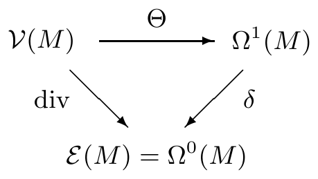
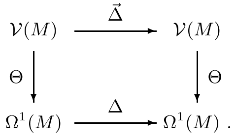
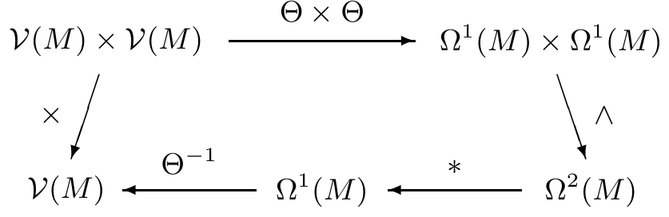
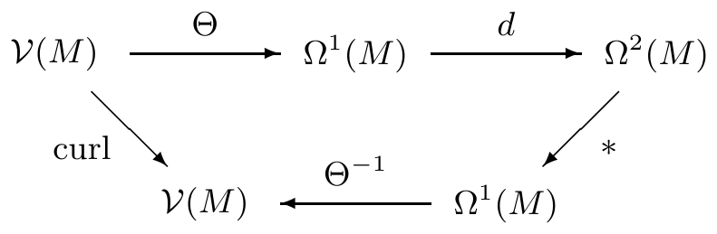

(γ)（雅可比恒等式）$ u, v, w \in \mathcal{V}(M) $ 满足关系

\[ [u,[v,w]] + [v,[w,u]] + [w,[u,v]] = 0 . \]

(ii) 在局部坐标下，

\[ [v,w] = \sum_{j,k} \left( v^{k} \frac{\partial w^{j}}{\partial x^{k}} - w^{k} \frac{\partial v^{j}}{\partial x^{k}} \right) \frac{\partial}{\partial x^{j}} \tag{6.34} \]

其中 $ v = \sum_{j} v^{j}\, \partial/\partial x^{j} $，$ w = \sum_{j} w^{j}\, \partial/\partial x^{j} $。

证明 简单的证明留给你。 ■

6.21 注 (a) 设 $ M $ 是 $ \mathbb{R}^{m} $ 中的开集，$ (x^{1},\ldots,x^{m}) $ 是 $ M $ 上的欧几里得坐标。利用 nabla 向量 $ \nabla $，(6.34) 可以符号地写成直观形式

\[ [v,w] = (v\cdot\nabla)w - (w\cdot\nabla)v . \]

(b) 设 $ V $ 是向量空间，$ [\,\cdot\,,\cdot\,] : V\times V \to V $ 是具有命题 6.20(i) 中性质 (α)–(γ) 的映射。则 $ (V,[\,\cdot\,,\cdot\,]) $ 称为一个**李代数**。由于 (β)，“乘法” $ [\,\cdot\,,\cdot\,] $ 一般不是交换的。由 (β) 和 (γ) 推出

\[ [a,[b,c]] - [[a,b],c] = [[c,a],b] \quad \text{对 } a, b, c \in V . \]

所以该乘法一般也不是结合的。于是李代数一般是不可交换、非结合的代数。\footnote{在平凡的可交换情形，即对 $ a, b \in V $ 有 $ [a,b] = 0 $ 时，它当然是可交换且结合的。} 因此 $ (\mathcal{V}(M),[\,\cdot\,,\cdot\,]) $ 是李代数。

(c)（正则性）设 $ k \in \mathbb{N} $，$ v, w \in \mathcal{V}^{k}(M) $。设 $ M $ 是 $ C^{k+1} $ 类流形。则 $ L_{v} $ 不是 $ \mathcal{E}^{k+1}(M) $ 上的导子，因为对 $ f \in \mathcal{E}^{k+1}(M) $，$ L_{v}f $ 一般只属于 $ \mathcal{E}^{k}(M) $。因此李括号也不能通过 (6.33) 来定义。我们只能选取局部坐标，并通过 (6.34) 对 $ v, w \in \mathcal{V}^{k}(M) $ 定义 $ [v,w] $。\footnote{你也许可以考虑一下，这样定义的 $ [v,w] $ 为什么在整个 $ M $ 上良定义。} 于是 $ [v,w] \in \mathcal{V}^{k-1}(M) $。 ■

##### 霍奇–拉普拉斯算子

在本节余下的部分，我们利用余微分和星算子，从向量分析中导出一些更重要的关系。

设 $ (M,(\cdot\mid\cdot)_{M}) $ 是定向伪黎曼流形。首先我们用余微分写出散度。

6.22 命题 下图

是交换的，即 $ \operatorname{div} = \delta\circ\Theta $。

证明 只需在局部证明该等式。设 $ ((x^{1},\ldots,x^{m}),U) $ 是局部坐标。则对 $ v = \sum_{j} v^{j}\, \partial/\partial x^{j} \in \mathcal{V}(U) $，注 6.1(b) 与 5.11(b) 蕴含

\[ \delta\Theta v = \delta\sum_{j}\left(\sum_{k} g_{jk}v^{k}\right) dx^{j} = \frac{1}{\sqrt{|G|}}\sum_{j}\frac{\partial}{\partial x^{j}}\left(\sqrt{|G|}\, v^{j}\right) . \]

因此结论由 (6.14) 推出。 ■

利用外微分和余微分，我们对 $ 0 \le r \le m $ 用下式在 $ \Omega^{r}(M) $ 上定义一个 $ \mathbb{R} $ 线性映射

\[ \Delta_{M} := d\delta + \delta d : \Omega^{r}(M) \to \Omega^{r}(M) . \tag{6.35} \]

这就是**霍奇–拉普拉斯算子**。对 $ a \in \mathcal{E}(M) $，由 (6.4) 和命题 6.22 推出

\[ (d\delta + \delta d)a = \delta d a = \delta\Theta(\Theta^{-1}da) = \operatorname{div}\operatorname{grad} a . \]

因此 $ \Omega^{0}(M) = \mathcal{E}(M) $ 上的霍奇–拉普拉斯算子与拉普拉斯–贝尔特拉米算子相同，这就解释了该记号。当 $ M $ 由上下文清楚时，我们写 $ \Delta $ 表示 $ \Delta_{M} $。 ■

6.23 注 (a) $ \ast\Delta = \Delta\ast $。

证明 注 5.9(b) 与 5.11(a) 给出

\[ \ast\Delta = \ast d\delta + \ast\delta d = \delta d\ast + d\delta\ast = \Delta\ast \]

因此结论成立。 ■

(b) $ d\Delta = \Delta d = d\delta d $，且 $ \delta\Delta = \Delta\delta = \delta d\delta $。

证明 由 $ d^{2} = 0 $ 得到

\[ d\Delta = dd\delta + d\delta d = d\delta d = d\delta d + \delta dd = \Delta d . \]

第二个结论类似可得。 ■

(c) 设 $ M $ 是 $ \mathbb{R}^{m} $ 中的开集，$ (x^{1},\ldots,x^{m}) $ 是欧几里得坐标。则对 $ 1 \le r \le m $ 有

\[ \Delta\left(\sum_{(j)\in\mathbb{J}_{r}} a_{(j)}\, dx^{(j)}\right) = \sum_{(j)\in\mathbb{J}_{r}} \Delta a_{(j)}\, dx^{(j)} \]

证明 由线性性，只需对满足 $ (j) \in \mathbb{J}_{r} $ 的 $ \alpha := a\, dx^{(j)} $ 证明该结论。利用例 5.10(e)，我们得到

\[ \begin{aligned} d\delta\alpha &= d\left(\sum_{k=1}^{r}(-1)^{k-1}\partial_{j_{k}}a\, dx^{j_{1}}\wedge\cdots\wedge\widehat{dx^{j_{k}}}\wedge\cdots\wedge dx^{j_{r}}\right) \\ &= \sum_{k=1}^{r}(-1)^{k-1}\sum_{\ell=1}^{m}\partial_{\ell}\partial_{j_{k}}a\, dx^{\ell}\wedge dx^{j_{1}}\wedge\cdots\wedge\widehat{dx^{j_{k}}}\wedge\cdots\wedge dx^{j_{r}} \\ &= \sum_{k=1}^{r}\partial_{j_{k}}^{2}a\, dx^{(j)} + \sum_{k=1}^{r}(-1)^{k-1}\sum_{\ell\notin\{j_{1},\ldots,j_{r}\}}^{m}\partial_{\ell}\partial_{j_{k}}a\, dx^{\ell}\wedge dx^{j_{1}}\wedge\cdots\wedge\widehat{dx^{j_{k}}}\wedge\cdots\wedge dx^{j_{r}} . \end{aligned} \]

类似地，我们得到

\[ \begin{aligned} \delta d\alpha &= \delta\sum_{\substack{\ell=1\\ \ell\notin\{j_{1},\ldots,j_{r}\}}}^{m}\partial_{\ell}a\, dx^{\ell}\wedge dx^{(j)} = \sum_{\substack{\ell=1\\ \ell\notin\{j_{1},\ldots,j_{r}\}}}^{m}\partial_{\ell}^{2}a\, dx^{(j)} \\ &\quad - \sum_{\substack{\ell=1\\ \ell\notin\{j_{1},\ldots,j_{r}\}}}^{m}\sum_{k=1}^{r}(-1)^{k-1}\partial_{j_{k}}\partial_{\ell}a\, dx^{\ell}\wedge dx^{j_{1}}\wedge\cdots\wedge\widehat{dx^{j_{k}}}\wedge\cdots\wedge dx^{j_{r}} . \end{aligned} \]

由此推出\footnote{我们之所以把 $ \delta $ 定义中的符号取为 $ (-1)^{m(r+1)} $，是为了让该公式取这种形式。对于几何中常用的符号约定，该公式为 $ (d\delta+\delta d)\alpha = -(\Delta a)\, dx^{(j)} $。}

\[ \Delta_{M}\alpha = (d\delta + \delta d)\alpha = \left(\sum_{k}\partial_{k}^{2}a\right) dx^{(j)} = (\Delta a)\, dx^{(j)} \]

因此结论成立。 ■

(d)（正则性）显然，当 $ 0 \le r \le m $、$ k \in \mathbb{N} $ 且 $ k \ge 2 $ 时，$ \Delta_{M} $ 是从 $ \Omega^{r}_{(k)}(M) $ 到 $ \Omega^{r}_{(k-2)}(M) $ 的 $ \mathbb{R} $ 线性映射。此时只需假设 $ M $ 是 $ C^{k+2} $ 流形。 ■

最后，我们定义**向量场的拉普拉斯算子**，即 $ \vec{\Delta} $，定义为

\[ \vec{\Delta} := \vec{\Delta}_{M} := \Theta_{M}^{-1}\circ\Delta_{M}\circ\Theta_{M} : \mathcal{V}(M) \to \mathcal{V}(M) \]

从而由该图的交换性

6.24 注 (a) 命题 6.22 与 (6.4) 给出 $ \vec{\Delta} = \operatorname{grad}\operatorname{div} + \Theta^{-1}\delta d\Theta $。

(b) 设 $ M $ 是 $ \mathbb{R}^{m} $ 中的开集，$ (x^{1},\ldots,x^{m}) $ 是 $ M $ 上的欧几里得坐标。则

\[ \vec{\Delta}\left(\sum_{j} v^{j}\frac{\partial}{\partial x^{j}}\right) = \sum_{j} \Delta v^{j}\frac{\partial}{\partial x^{j}} . \]

若按通常做法把向量场 $ v = \sum_{j} v^{j}\, \partial/\partial x^{j} $ 与 $ (v^{1},\ldots,v^{m}) $ 等同，则 $ \vec{\Delta}v $ 意味着拉普拉斯算子可以按分量作用

\[ \vec{\Delta}v = (\Delta v^{1},\ldots,\Delta v^{m}) . \]

此时我们通常写 $ \Delta $，而不写 $ \vec{\Delta} $。

证明 这由例 6.2(a) 与注 6.23(c) 推出。 ■

(c)（正则性）设 $ k \in \mathbb{N} $。则 $ \vec{\Delta} $ 把 $ \mathbb{R} $ 向量空间 $ \mathcal{V}^{k+2}(M) $ 线性地映入 $ \mathcal{V}^{k}(M) $。所以这里只需假设 $ M $ 是 $ C^{k+2} $ 流形。 ■

##### 向量积与旋度

在这最后一部分，我们导出旋度算子最重要的性质。

设 $ (M,(\cdot\mid\cdot)_{M}) $ 是具有体积元 $ \omega_{M} $ 的三维定向黎曼\footnote{为简单起见，这里我们将只限于讨论黎曼度量，因为它们在应用中最为重要。}流形。

在 $ \mathcal{V}(M) $ 上，我们定义**向量积**或**叉积**

\[ \times : \mathcal{V}(M)\times\mathcal{V}(M) \to \mathcal{V}(M), \quad (v,w) \mapsto v\times w, \tag{6.36} \]

为

\[ v\times w := \Theta_{M}^{-1}\omega_{M}(v,w,\cdot) . \tag{6.37} \]

显然该映射是良定义的。

6.25 注 (a) 设 $ (M,(\cdot\mid\cdot)_{M}) = (\mathbb{R}^{3},(\cdot\mid\cdot)) $。则在常向量场的情形，(6.37) 与第 VIII.2 节的定义一致。

(b) 向量积是双线性的、交错的（斜对称的），并且满足

\[ (u\mid v\times w)_{M} = \omega_{M}(u,v,w) \quad \text{对 } u, v, w \in \mathcal{V}(M) . \tag{6.38} \]

对 $ p \in M $，向量积 $ (v\times w)(p) $ 关于 $ T_{p}M $ 的内积 $ (\cdot\mid\cdot)_{M}(p) $ 与 $ v(p) $ 和 $ w(p) $ 正交。令 $ |v|_{M} := \sqrt{(v\mid v)_{M}} $，我们有

\[ |v\times w|_{M} = \sqrt{|v|_{M}^{2}|w|_{M}^{2} - (v\mid w)_{M}^{2}} = |v|_{M}|w|_{M}\sin\varphi, \]

其中对 $ p \in M $、$ v, w \in \mathcal{V}(M) $，$ \varphi(p) \in [0,\pi] $ 是向量 $ v(p) $ 与 $ w(p) $ 之间的夹角。

向量积满足**格拉斯曼恒等式**

\[ v_{1}\times(v_{2}\times v_{3}) = (v_{1}\mid v_{3})_{M}v_{2} - (v_{1}\mid v_{2})_{M}v_{3}, \]

**雅可比恒等式**

\[ v_{1}\times(v_{2}\times v_{3}) + v_{2}\times(v_{3}\times v_{1}) + v_{3}\times(v_{1}\times v_{2}) = 0 \]

以及关系

\[ (v_{1}\times v_{2})\times(v_{3}\times v_{4}) = \omega_{M}(v_{1},v_{2},v_{4})v_{3} - \omega_{M}(v_{1},v_{2},v_{3})v_{4} \]

对 $ v_{1}, v_{2}, v_{3}, v_{4} \in \mathcal{V}(M) $ 成立。特别地，$ (\mathcal{V}(M),\times) $ 是李代数。

证明 所有这些都容易化为已在习题 2.3 中证明的逐点陈述。 ■

(c) 设 $ ((x^{1},x^{2},x^{3}),U) $ 是 $ M $ 上的正向标准正交坐标\footnote{即 $ (\partial/\partial x^{1},\partial/\partial x^{2},\partial/\partial x^{3}) $ 是正向标准正交标架。}。则向量场 $ v = \sum_{j} v^{j}\, \partial/\partial x^{j} $ 与 $ w = \sum_{j} w^{j}\, \partial/\partial x^{j} $ 的叉积具有形式

\[ v\times w = (v^{2}w^{3} - v^{3}w^{2})\frac{\partial}{\partial x^{1}} + (v^{3}w^{1} - v^{1}w^{3})\frac{\partial}{\partial x^{2}} + (v^{1}w^{2} - v^{2}w^{1})\frac{\partial}{\partial x^{3}} . \]

证明 习题 2.3。 ■

(d)（正则性）对 $ k \in \mathbb{N} $，上述陈述对 $ C^{k} $ 向量场仍成立，且只需假设 $ M $ 是 $ C^{k+1} $ 流形。 ■

下一个定理表明向量积与 1 形式的外积有何关系。

6.26 命题 对 $ v, w \in \mathcal{V}(M) $，我们有 $ v\times w = \Theta^{-1}\ast(\Theta v\wedge\Theta w) $，即下图

交换。

证明 只需在局部证明该等式，在那里我们可以选取正向标准正交坐标 $ ((x^{1},x^{2},x^{3}),U) $。若 $ (v^{1},v^{2},v^{3}) $ 与 $ (w^{1},w^{2},w^{3}) $ 是向量场 $ v, w \in \mathcal{V}(M) $ 的分量，则由注 6.1(e) 推出

\[ \begin{aligned} \Theta v\wedge\Theta w &= \sum_{j} v^{j}\, dx^{j} \wedge \sum_{k} w^{k}\, dx^{k} \\ &= (v^{2}w^{3} - v^{3}w^{2})\, dx^{2}\wedge dx^{3} + (v^{3}w^{1} - v^{1}w^{3})\, dx^{3}\wedge dx^{1} \\ &\quad + (v^{1}w^{2} - v^{2}w^{1})\, dx^{1}\wedge dx^{2} . \end{aligned} \]

由例 5.7(d) 的证明，我们知道

\[ \ast(dx^{2}\wedge dx^{3}) = dx^{1}, \quad \ast(dx^{3}\wedge dx^{1}) = dx^{2}, \quad \ast(dx^{1}\wedge dx^{2}) = dx^{3} . \tag{6.39} \]

现在结论由注 6.1(e) 与 6.25(c) 推出。 ■

下面我们导出旋度算子的一种表示。

6.27 命题 下图

交换，即 $ \operatorname{curl} = \Theta^{-1}\ast d\Theta $。

证明 同样只需在正向标准正交坐标 $ ((x^{1},x^{2},x^{3}),U) $ 中局部证明该等式。则对 $ v = \sum_{j=1}^{3} v^{j}\, \partial/\partial x^{j} $，利用注 6.1(e) 可得

\[ \begin{aligned} d(\Theta v) &= d\left(\sum_{j} v^{j}\, dx^{j}\right) = \sum_{j,k}\frac{\partial v^{j}}{\partial x^{k}}\, dx^{k}\wedge dx^{j} \\ &= \left(\frac{\partial v^{3}}{\partial x^{2}} - \frac{\partial v^{2}}{\partial x^{3}}\right) dx^{2}\wedge dx^{3} + \left(\frac{\partial v^{1}}{\partial x^{3}} - \frac{\partial v^{3}}{\partial x^{1}}\right) dx^{3}\wedge dx^{1} \\ &\quad + \left(\frac{\partial v^{2}}{\partial x^{1}} - \frac{\partial v^{1}}{\partial x^{2}}\right) dx^{1}\wedge dx^{2} . \end{aligned} \]

于是结论由 (6.39) 及注 6.1(e) 与 6.12(b) 推出。 ■

现在我们准备导出若干涉及三维向量场的重要微分恒等式。

6.28 命题 对 $ f \in \mathcal{E}(M) $ 与 $ v, w \in \mathcal{V}(M) $，

(i) $ \operatorname{div}(v\times w) = (\operatorname{curl} v\mid w)_{M} - (v\mid\operatorname{curl} w)_{M} $；

(ii) $ \operatorname{curl}(fv) = f\operatorname{curl} v + \operatorname{grad} f\times v $；

(iii) $ \operatorname{curl}(v\times w) = (\operatorname{div} w)v - (\operatorname{div} v)w - [v,w] $；

(iv) $ \operatorname{curl}(\operatorname{curl} v) = \operatorname{grad}\operatorname{div} v - \vec{\Delta}v $。

证明 (i) 在注 5.9(d) 中取 $ m = 3 $，我们得到

\[ \ast\delta\alpha = (-1)^{m(r+1)}\ast\ast d\ast\alpha = d\ast\alpha \quad \text{对 } \alpha \in \Omega^{2}(M) . \]

现在我们用命题 6.22 与 6.26 推出

\[ \begin{aligned} \operatorname{div}(v\times w) &= \delta\Theta\left(\Theta^{-1}\ast(\Theta v\wedge\Theta w)\right) = \delta\ast(\Theta v\wedge\Theta w) \\ &= \ast d(\Theta v\wedge\Theta w) = \ast(d\Theta v\wedge\Theta w - \Theta v\wedge d\Theta w) . \end{aligned} \]

由命题 6.27 推出 $ \Theta\operatorname{curl} = \ast d\Theta $。现在注 2.19(d) 蕴含 $ d\Theta = \ast\Theta\operatorname{curl} $，因为 $ m = 3 $ 且 $ r = 2 $。于是我们得到

\[ \begin{aligned} \operatorname{div}(v\times w) &= \ast\left((\ast\Theta\operatorname{curl} v)\wedge\Theta w - \Theta v\wedge\ast\Theta\operatorname{curl} w\right) \\ &= \ast(\Theta w\wedge\ast\Theta\operatorname{curl} v - \Theta v\wedge\ast\Theta\operatorname{curl} w), \end{aligned} \]

其中我们用到了 $ \ast\Theta\operatorname{curl} v \in \Omega^{2}(M) $。现在 (2.22)（取 $ r = 1 $）与 (2.13) 给出

\[ \operatorname{div}(v\times w) = \ast\left[(w\mid\operatorname{curl} v)_{M} - (v\mid\operatorname{curl} w)\right]\omega_{M} . \]

结论现在由 $ \ast\omega_{M} = 1 $ 推出。

(ii) 命题 6.27 给出

\[ \begin{aligned} \operatorname{curl}(fv) &= \Theta^{-1}\ast d\Theta(fv) = \Theta^{-1}\ast d(f\Theta v) \\ &= \Theta^{-1}\ast(df\wedge\Theta v + f\, d\Theta v) \\ &= \Theta^{-1}\ast(\Theta\operatorname{grad} f\wedge\Theta v) + f\Theta^{-1}\ast d\Theta v \\ &= \operatorname{grad} f\times v + f\operatorname{curl} v . \end{aligned} \]

这里我们还用到了命题 6.26 以及 $ d $ 的性质。

(iii) 只需在局部证明该陈述。我们可以使用正向标准正交坐标。于是经过一个简单的计算，结论由注 6.12(b) 与 6.25(c) 的局部表示以及命题 6.20 推出，我们把这个计算留给你。

(iv) 由命题 6.27 与 $ \delta $ 的定义推出

\[ \begin{aligned} \operatorname{curl}\operatorname{curl} v &= \Theta^{-1}\ast d\Theta\Theta^{-1}\ast d\Theta v = \Theta^{-1}\ast d\ast d\Theta v \\ &= (-1)^{3(2+1)}\Theta^{-1}\delta d\Theta v = -\Theta^{-1}\delta d\Theta v . \end{aligned} \]

现在结论由注 6.24(a) 推出。 ■

为了展示这套新演算的力量，我们利用余微分和星算子的性质证明了 (i)。当然，我们也可以在正向坐标卡的标准正交坐标中计算。换言之，我们可以假设 $ M $ 是 $ \mathbb{R}^{3} $ 中的开集，且 $ (\cdot\mid\cdot)_{M} $ 是标准度量 $ (\cdot\mid\cdot) $。利用 (6.38) 中的（形式）nabla 算子，我们得到

\[ \begin{aligned} \nabla\cdot(v\times w) &= \det[\nabla, v, w] \\ &= \partial_{1}(v^{2}w^{3} - v^{3}w^{2}) + \partial_{2}(v^{3}w^{1} - v^{1}w^{3}) + \partial_{3}(v^{1}w^{2} - v^{2}w^{1}) \end{aligned} \]

这是把（形式）行列式按第一行展开得到的。利用乘积法则，我们容易看出最后一行与表达式 $ w\cdot\operatorname{curl} v - v\cdot\operatorname{curl} w $ 一致，正如 (i) 所述。
