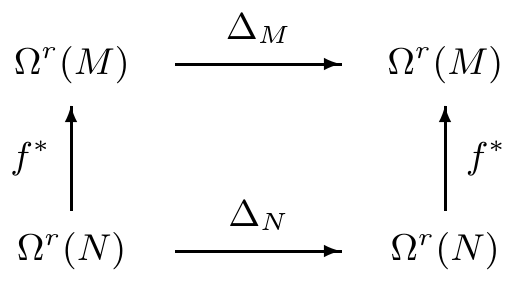
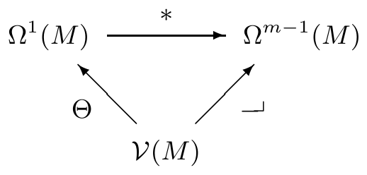

然而，以 nabla 算子进行的形式运算必须谨慎使用。例如，若用格拉斯曼恒等式形式地计算 $ \operatorname{curl}(v \times w) = \nabla \times (v \times w) $，便会得到错误的命题

\[ \nabla \times (v \times w) = (\nabla \cdot w)v - (\nabla \cdot v)w . \]

错在哪里？

##### 习题

1 求拉普拉斯–贝尔特拉米算子关于下列各项的表示：

(i) 柱坐标 $ (0, 2\pi) \times \mathbb{R} \to \mathbb{R}^{3} $，$ (\varphi, z) \mapsto (\cos\varphi, \sin\varphi, z) $；

(ii) 例 VII.9.11(f) 中 2 环面 $ \mathrm{T}_{2,1}^{2} $ 的参数化

\[ (0, 2\pi)^{2} \to \mathbb{R}^{3}, \quad (\alpha, \beta) \mapsto ((2 + \cos\alpha)\cos\beta, (2 + \cos\alpha)\sin\beta, \sin\alpha) \]；

(iii) 当 $ X $ 是 $ \mathbb{R}^{2} $ 中的开集时，$ f \in \mathcal{E}(X) $ 的图像的参数化 $ X \to \mathbb{R}^{3} $，$ x \mapsto (x, f(x)) $。

2 设 $ (M_{j}, g_{j}) $（$ j = 1, 2 $）是黎曼流形，且 $ \partial M_{1} = \varnothing $；并设 $ \pi_{j} $ 表示典范投影 $ M_{1} \times M_{2} \to M_{j} $。证明

\[ \Delta_{M_{1} \times M_{2}} = \pi_{1}^{*}\Delta_{M_{1}} + \pi_{2}^{*}\Delta_{M_{2}} . \]

3 设 $ M $ 与 $ N $ 是黎曼流形，$ f: M \to N $ 是等距微分同胚。则对 $ 0 \le r \le m $，证明下图交换：

4 设 $ (M, g) $ 是伪黎曼流形。证明下图交换：

并导出关系

(i) $ \operatorname{div} = \ast d\ast\Theta $；

(ii) $ \operatorname{curl} = \Theta^{-1}\ast d\Theta $（$ m = 3 $）；

(iii) $ \Delta_{M} = \ast d\ast d $，其中 $ \Delta_{M} $ 是 $ M $ 的拉普拉斯–贝尔特拉米算子。

5 设 $ \Omega $ 是 $ \mathbb{R}^{3} $ 中的开集。对 $ E, B, j \in C^{\infty}(\mathbb{R} \times \Omega, \mathbb{R}^{3}) $、$ \rho \in C^{\infty}(\mathbb{R} \times \Omega, \mathbb{R}) $ 及 $ c > 0 $，置

\[ F := \Theta_{e}E \wedge (c\,dt) + \ast(\Theta_{e}B \wedge (c\,dt)), \quad J := \Theta_{e}j - \rho\,dt \in \Omega(\mathbb{R}^{4}_{1,3}), \]

其中 $ E $、$ B $、$ j $ 视为依赖时间的向量场，$ \rho $ 视为 $ \Omega $ 上依赖时间的函数，而 $ \Theta_{e}: \mathcal{V}(\mathbb{R}^{3}) \to \Omega^{1}(\mathbb{R}^{3}) $ 表示（欧氏）里斯同构。又设 $ dt $ 是 $ \Omega^{1}(\mathbb{R}^{4}_{1,3}) $ 中的第一个标准基向量。现证明以下事实：

(a) 下列命题等价：

(i) $ dF = 0 $；

(ii) $ \partial B/\partial t + c\operatorname{curl}E = 0 $ 且 $ \operatorname{div}B = 0 $。

（这些是齐次麦克斯韦方程。）也就是说，2 形式 $ F $ 是闭的，当且仅当向量场 $ E $ 与 $ B $ 满足麦克斯韦方程组中的这两个方程。

(b) 下列命题等价：

(i) $ dF = 4\pi J $；

(ii) $ \partial E/\partial t - c\operatorname{curl}B = 4\pi j $ 且 $ \operatorname{div}E = 4\pi\rho $。

（这些是带源的麦克斯韦方程。）

(c) 下列命题等价：

(i) $ \Delta_{\mathbb{R}^{4}_{1,3}}F = 0 $；

(ii) $ \partial B/\partial t + c\operatorname{curl}E = 0 $，$ \partial E/\partial t - c\operatorname{curl}B = 0 $，$ \operatorname{div}E = 0 $，$ \operatorname{div}B = 0 $。

因此，2 形式 $ F $ 是调和的，当且仅当向量场 $ E $ 与 $ B $ 满足齐次麦克斯韦方程。

(d) 若 $ dF = 0 $，则 $ j $ 与 $ \rho $ 满足**连续性方程**

\[ \partial\rho/\partial t + \operatorname{div}j = 0 , \]

它也可写成 $ \operatorname{grad}_{\mathbb{R}^{4}_{1,3}}J = 0 $。

(e) 下列两个命题等价：

(i) $ F $ 是恰当的；

(ii) 存在**向量势** $ A \in C^{\infty}(\mathbb{R} \times \Omega, \mathbb{R}) $ 与**标量势** $ \Phi \in C^{\infty}(\mathbb{R} \times \Omega, \mathbb{R}) $，使得

\[ \operatorname{curl}A = B \quad \text{且} \quad -\partial A/\partial t - \operatorname{grad}\Phi = E . \]

6 设 $ X $ 是 $ \mathbb{R}^{3} $ 中的开集且可缩。又设 $ f, g \in \mathcal{E}(X) $。证明：

(i) 存在 $ v \in \mathcal{V}(X) $，使得 $ \operatorname{grad}f \times \operatorname{grad}g = \operatorname{curl}v $。

(ii) 若对 $ x \in X $ 有 $ f(x) \ne 0 $，则存在 $ h \in \mathcal{E}(X) $，使得 $ (\operatorname{grad}f)/f = \operatorname{grad}h $。

7 证明：对 $ f \in \mathcal{E}(M) $ 有

\[ \vec{\Delta}_{M}(f\operatorname{grad}f) = \operatorname{grad}\operatorname{div}(f\operatorname{grad}f) = \Delta_{M}f\operatorname{grad}f + \operatorname{grad}|\operatorname{grad}f|_{M}^{2} + f\operatorname{grad}\Delta_{M}f , \]

其中 $ |v|_{M}^{2} := (v \mid v)_{M} $，$ v \in \mathcal{V}(M) $。

8 证明 $ \alpha \in \Omega^{1}(M) $ 与 $ v, w \in \mathcal{V}(M) $ 满足

\[ d\alpha(v, w) = \mathcal{L}_{v}\langle \alpha, w \rangle - \mathcal{L}_{w}\langle \alpha, v \rangle - \langle \alpha, [v, w] \rangle . \]

9 设 $ M $ 与 $ N $ 是 $ m $ 维流形，并设 $ \varphi \in \operatorname{Diff}(M, N) $。证明

\[ \varphi_{*}[v, w] = [\varphi_{*}v, \varphi_{*}w] \quad \text{对 } v, w \in \mathcal{V}(M) . \]

10 设 $ T^{2} := S^{1} \times S^{2} \subset \mathbb{R}^{4} $，并设 $ \alpha, \beta \in \Omega^{1}(T^{2}) $ 满足

\[ \alpha := -x^{2}dx^{1} + x^{1}dx^{2}, \quad \beta := -x^{4}dx^{3} + x^{3}dx^{4} . \]

证明 $ \Delta\alpha = \Delta\beta = 0 $。

11 证明：对 $ H \in \mathcal{E}(\mathbb{R}^{2m}) $，向量场 $ \operatorname{sgrad}H \in \mathcal{V}(\mathbb{R}^{2m}) $ 的散度为零。
