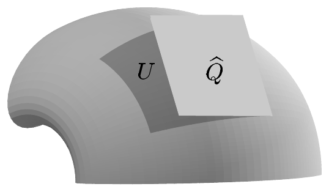
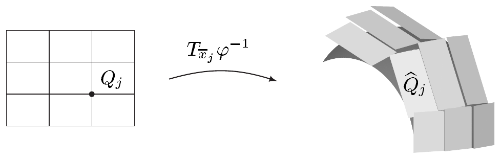

## 1 体积测度

在 VIII.1 节中，我们学习了如何计算曲线的长度。我们也知道如何求图形下方的面积以及简单立体的体积。现在我们转向确定曲面面积与一般流形容度的问题。

在本节中，我们引入伪黎曼流形的黎曼–勒贝格体积测度，并证明它是完备的 massive 拉东测度。于是第 X 章发展起来的整个积分理论也将适用于流形。借助局部表示，我们在许多情形下都能显式计算流形上的积分，正如我们的例子将要展示的那样。

在本节中

- $ M $ 是 $ m $ 维流形，$ m \in \mathbb{N}^{\times} $。

##### M 的勒贝格 σ-代数

由于流形局部“看起来”像 $ \overline{\mathbb{H}}^m $ 的开子集，显然可测性可以借助局部坐标卡从 $ \overline{\mathbb{H}}^m $ “提升”到 $ M $。

称 $ M $ 的子集 $ A $ 是（**勒贝格**）**可测的**，若对每个 $ p \in A $，在 $ p $ 附近存在坐标卡 $ (\varphi, U) $，使得 $ \varphi(A \cap U) $ 属于 $ \mathcal{L}(m) $，即 $ \varphi(A \cap U) $ 是 $ \lambda_m $-可测的。我们令

\[ \mathcal{L}_M := \{ A \subset M ; A \text{ 可测} \} . \]

下面的注说明这个定义是有意义的。

1.1 注 (a) 该定义与坐标无关。

证明 设 $ A \subset M $，$ (\varphi_p, U_p) $ 是 $ p \in A $ 处的坐标卡，且 $ \varphi_p(A \cap U_p) \in \mathcal{L}(m) $。又设 $ (\psi, V) $ 是 $ M $ 的坐标卡，$ q \in A \cap V $。由于集合 $ \varphi_p(U_q \cap V) $ 在 $ \overline{\mathbb{H}}^m $ 中是开的，它是 $ \lambda_m $-可测的，因此

\[ \varphi_q(A \cap V \cap U_q) = \varphi_q(A \cap U_q) \cap \varphi_q(V \cap U_q) \]

也是 $ \lambda_m $-可测的。由推论 IX.5.13，从

\[ \psi(A \cap V \cap U_q) = \psi \circ \varphi_q^{-1}\left(\varphi_q(A \cap V \cap U_q)\right) \]

可知 $ \psi(A \cap V \cap U_q) $ 属于 $ \mathcal{L}(m) $。这对每个 $ q \in A \cap V $ 都成立，而根据注 IX.5.14(c)，可测性是局部性质。因此 $ \psi(A \cap V) \in \mathcal{L}(m) $，证毕。■

(b) 若 $ M $ 在 $ \mathbb{R}^m $ 中是开的，则 $ \mathcal{L}_M = \mathcal{L}(m)|M $。因此这里引入的记号与 X.5 节的记号一致。

证明 这可由使用平凡坐标卡 $ (\operatorname{id}, M) $ 得到。■

1.2 命题 $ \mathcal{L}_M $ 是 $ M $ 上的 σ-代数，即 $ M $ 的**勒贝格 σ-代数**。它包含博雷尔 σ-代数 $ \mathcal{B}(M) $。

证明 设 $ (\varphi, U) $ 是 $ M $ 的坐标卡。若 $ A \in \mathcal{L}_M $，则 $ \varphi(A \cap U) $ 属于 $ \mathcal{L}(m) $。由于 $ \mathcal{L}(m) $ 是 σ-代数，我们有 $ \varphi(A^c \cap U) = \varphi(U) \setminus \varphi(A \cap U) \in \mathcal{L}(m) $。由于这对每个坐标卡都成立，故 $ A^c \in \mathcal{L}_M $。

若 $ (A_j) $ 是 $ \mathcal{L}_M $ 中的序列，则类似地得到

\[ \varphi\left(\left(\bigcup_j A_j\right) \cap U\right) = \varphi\left(\bigcup_j (A_j \cap U)\right) = \bigcup_j \varphi(A_j \cap U) \in \mathcal{L}(m) , \]

从而 $ \bigcup_j A_j \in \mathcal{L}_M $。

最后，显然 $ M $ 属于 $ \mathcal{L}_M $。于是我们证明了 $ \mathcal{L}_M $ 是 σ-代数。

若 $ O $ 在 $ M $ 中是开的，则 $ \varphi(O \cap U) $ 在 $ \overline{\mathbb{H}}^m $ 中是开的，因而属于 $ \mathcal{L}(m) $。所以 $ O $ 属于 $ \mathcal{L}_M $，这意味着 $ \mathcal{L}_M \supset \mathcal{B}(M) $。■

##### 体积测度的定义

现在设 $ g $ 是 $ M $ 上的伪黎曼度量，$ (\varphi, U) $ 是 $ M $ 的坐标卡，$ \varphi = (x^1, \ldots, x^m) $。则格拉姆行列式 $ G = \det[g_{jk}] $ 有定义，其中 $ g_{jk} = g(\partial/\partial x^j, \partial/\partial x^k) $，且 $ \sqrt{|G|} \in \mathcal{E}(U) $。对 $ A \in \mathcal{L}_M $，$ A \subset U $，我们令

\[ \operatorname{vol}_{g,U}(A) := \int_{\varphi(A)} \varphi_*\sqrt{|G|} \, d\lambda_m = \int_{\varphi(A)} \varphi_*\sqrt{|G|} \, dx . \tag{1.1} \]

1.3 引理 对 $ A \in \mathcal{L}_M $，当 $ A \subset U $ 时，体积 $ \operatorname{vol}_{g,U}(A) $ 与坐标卡 $ (\varphi, U) $ 无关。

证明 设 $ (\psi, V) $ 是另一个坐标卡，$ A \subset V $，$ \psi = (y^1, \ldots, y^m) $。我们可以假定 $ V = U $。现在把 $ U $ 视为带有正图册 $ \{(\varphi, U)\} $ 的定向流形。于是根据注 XI.5.4(g)，

\[ \omega_U := \sqrt{|G|} \, dx^1 \wedge \cdots \wedge dx^m \in \Omega^m(U) \]

是 $ U $ 的体积元。又

\[ \omega_U = \pm\sqrt{|G|} \, dy^1 \wedge \cdots \wedge dy^m , \]

其中若 $ \psi $ 是正定向的则取正号，否则取负号。由于 $ f := \psi \circ \varphi^{-1} \in \operatorname{Diff}(\varphi(U), \psi(U)) $ 且 $ \varphi = f^{-1} \circ \psi $，由例 XI.3.4(c) 可得

\[ \begin{aligned} \varphi_*\sqrt{|G|} \, dx^1 \wedge \cdots \wedge dx^m &= \varphi_*\omega_U = (f^{-1})_*\psi_*\omega_U = f^*\psi_*\omega_U \\ &= \pm f^*\left(\psi_*\sqrt{|G|} \, dy^1 \wedge \cdots \wedge dy^m\right) \\ &= \pm f^*\left(\psi_*\sqrt{|G|}\right)\det(\partial f) \, dx^1 \wedge \cdots \wedge dx^m \\ &= f^*\left(\psi_*\sqrt{|G|}\right)|\det(\partial f)| \, dx^1 \wedge \cdots \wedge dx^m , \end{aligned} \]

因为 $ f $ 保持定向当且仅当 $ \psi $ 是正定向的，而 $ f $ 在其余情形反向定向。因此

\[ \varphi_*\sqrt{|G|} = \left(\psi_*\sqrt{|G|}\right) \circ f \, |\det(\partial f)| . \]

由于 $ \varphi(U \cap \partial M) = \varphi(U) \cap \partial\mathbb{H}^m $ 是 $ \lambda_m $-零集，且 $ \varphi(U \setminus \partial M) = \varphi(U) \setminus \partial\mathbb{H}^m $ 在 $ \mathbb{R}^m $ 中是开的，又由于 $ f(\varphi(U)) = \psi(U) $，由推论 X.8.5 版本的变换定理可得

\[ \int_{\varphi(U)} \varphi_*\sqrt{|G|} \, dx = \int_{\psi(U)} \psi_*\sqrt{|G|} \, dy . \]

这便证明了断言。■

由注 XI.1.21(b) 与命题 IX.1.8，$ M $ 是林德勒夫空间。因此 $ M $ 有可数图册 $ \mathfrak{A} := \{(\varphi_j, U_j) ; j \in \mathbb{N}\} $。对 $ A \in \mathcal{L}_M $，我们令

\[ A_0 := A \cap U_0 \quad \text{且} \quad A_{n+1} := (A \cap U_{n+1}) \setminus \bigcup_{k=0}^{n} A_k \quad \text{对 } n \in \mathbb{N} . \]

于是 $ (A_j) $ 是 $ \mathcal{L}_M $ 中满足 $ A_j \subset U_j $ 的不交序列，且 $ A = \bigcup_j A_j $。因此

\[ \operatorname{vol}_g(A) := \sum_{j=0}^{\infty} \operatorname{vol}_{g,U_j}(A_j) \tag{1.2} \]

是 $ \overline{\mathbb{R}}^+ $ 中一个有定义的元素。

1.4 引理 定义 (1.2) 与图册的特殊选取无关。

证明 设 $ \widetilde{\mathfrak{A}} := \{(\tilde{\varphi}_j, \tilde{U}_j) ; j \in \mathbb{N}\} $ 是另一个可数图册，并设 $ \tilde{A}_j $ 是仿照 $ A_j $、但用 $ \tilde{U}_j $ 代替 $ U_j $ 而定义的。现在 $ \operatorname{vol}_{g,U_j} $ 与 $ \operatorname{vol}_{g,\tilde{U}_k} $ 分别是 $ U_j $ 与 $ \tilde{U}_k $ 上的测度，因而都是 σ-可加的。于是由 $ \bigcup_j A_j = \bigcup_k \tilde{A}_k = A $ 可得

\[ \operatorname{vol}_{g,U_j}(A_j) = \operatorname{vol}_{g,U_j}(A_j \cap A) = \operatorname{vol}_{g,U_j}\left(A_j \cap \bigcup_k \tilde{A}_k\right) = \operatorname{vol}_{g,U_j}\left(\bigcup_k (A_j \cap \tilde{A}_k)\right) = \sum_k \operatorname{vol}_{g,U_j}(A_j \cap \tilde{A}_k) . \]

交换 $ \mathfrak{A} $ 与 $ \widetilde{\mathfrak{A}} $ 的角色，我们类似地得到

\[ \operatorname{vol}_{g,\tilde{U}_k}(\tilde{A}_k) = \sum_j \operatorname{vol}_{g,\tilde{U}_k}(\tilde{A}_k \cap A_j) . \]

由于 $ A_j \cap \tilde{A}_k \subset U_j \cap \tilde{U}_k $，引理 1.3 给出

\[ \operatorname{vol}_{g,U_j}(A_j \cap \tilde{A}_k) = \operatorname{vol}_{g,\tilde{U}_k}(\tilde{A}_k \cap A_j) . \]

再由注 X.3.6(b)，我们得到

\[ \begin{aligned} \sum_j \operatorname{vol}_{g,U_j}(A_j) &= \sum_j \sum_k \operatorname{vol}_{g,U_j}(A_j \cap \tilde{A}_k) = \sum_j \sum_k \operatorname{vol}_{g,\tilde{U}_k}(\tilde{A}_k \cap A_j) \\ &= \sum_k \sum_j \operatorname{vol}_{g,\tilde{U}_k}(\tilde{A}_k \cap A_j) = \sum_k \operatorname{vol}_{g,\tilde{U}_k}(\tilde{A}_k) , \end{aligned} \]

即所求。■

显然，$ \operatorname{vol}_g(A) $ 应表示 $ A \subset M $ 的“体积”，它相对于度量张量 $ g $ 来度量。我们现在来思考这应当如何理解。

定义 (1.2) 表明，$ M $ 的任意可测子集 $ A $ 被分解成可数多个两两不交的部分 $ A_j $，而 $ A $ 的“体积”正是这些部分的体积的“和”。该定义要求每个 $ A_j $ 都包含在图册的某个坐标卡中。因此，只需弄清当 $ A $ 包含在坐标卡 $ (\varphi, U) $ 的定义域 $ U $ 中时，$ \operatorname{vol}_g(A) $ 应如何解释。

于是设 $ \bar x \in \varphi(U) $，$ \bar p := \varphi^{-1}(\bar x) $，并设 $ \ell^1, \ldots, \ell^m $ 是正数，使得

\[ Q := \prod_{j=1}^{m} [\bar x^j, \bar x^j + \ell^j] , \]

即以 $ \bar x $ 为“左下角”、体积为 $ \lambda_m(Q) = \ell^1 \cdot \ldots \cdot \ell^m $ 的矩形仍完全落在 $ \varphi(U) $ 中。若边长 $ \ell^j $ 足够小，则由向量

\[ \ell^1 \left.\frac{\partial}{\partial x^1}\right|_{\bar p} , \ldots , \ell^m \left.\frac{\partial}{\partial x^m}\right|_{\bar p} \]

张成的平行多面体 $ \widehat{Q} := T_{\bar x}\varphi^{-1}(Q) $ 在 $ T_{\bar p}M $ 中就会很好地逼近 $ Q $ 在 $ M $ 中的像 $ A := \varphi^{-1}(Q) $。

我们可以假定 $ (\varphi, U) $ 是 $ U $ 的正坐标卡。则由注 XI.2.12(c) 可知 $ \widehat{Q} $ 的体积满足

\[ \begin{aligned} \omega(\bar p)\left(\ell^1 \left.\frac{\partial}{\partial x^1}\right|_{\bar p}, \ldots, \ell^m \left.\frac{\partial}{\partial x^m}\right|_{\bar p}\right) &= \omega(\bar p)\left(\left.\frac{\partial}{\partial x^1}\right|_{\bar p}, \ldots, \left.\frac{\partial}{\partial x^m}\right|_{\bar p}\right)\ell^1 \cdot \ldots \cdot \ell^m \\ &= \sqrt{|G|}(\bar p)\lambda_m(Q) = \varphi_*\sqrt{|G|}(\bar x)\lambda_m(Q) . \end{aligned} \]

现在我们把 $ Q $ 分解为有限多个矩形 $ Q_j $（其边沿笛卡尔轴），它们至多沿公共边相交。

我们用 $ \bar x_j $ 表示 $ Q_j $ 的左下角，并令 $ \bar p_j := \varphi^{-1}(\bar x_j) $。再令 $ \widehat{Q}_j $ 为 $ Q_j $ 在切映射 $ T_{\bar x_j}\varphi^{-1} $ 下于 $ T_{\bar p_j}M $ 中的像。于是由上面的考虑可得

\[ \operatorname{vol}_g(A) = \int_Q \varphi_*\sqrt{|G|} \, dx \approx \sum_j \varphi_*\sqrt{|G|}(\bar x_j)\lambda_m(Q_j) . \]

这表明 $ \operatorname{vol}_g(\varphi^{-1}(Q)) $ 近似等于那些逼近 $ A \subset M $ 的平行多面体的体积之和。通过“无限细分”，这些和趋近于积分，因而趋近于 $ \operatorname{vol}_g(A) $，同时 $ \widehat{Q}_j $ 任意接近 $ A $。这表明 $ \operatorname{vol}_g(A) $ 确实与我们通常对 $ A $ 的体积的理解一致。

下文我们令 $ \lambda_{(M,g)} := \operatorname{vol}_g $。在上下文允许时，我们也可以把它写作 $ \lambda_M $ 或 $ \lambda_g $。又

\[ \operatorname{vol}(M) := \lambda_M(M) \]

是 $ M $ 的**体积**；当 $ m = 2 $ 时，它是 $ M $ 的**面积**。

1.5 命题 $ \lambda_M $ 是 $ M $ 上的拉东测度，即 $ M $ 的**黎曼–勒贝格体积测度**。

证明 (a) 显然，$ \lambda_M $ 把 σ-代数 $ \mathcal{L}_M $ 映到 $ [0, \infty] $，并把空集赋值为 0。

设 $ \{(\varphi_j, U_j) ; j \in \mathbb{N}\} $ 是可数图册，$ (A_k) $ 是 $ \mathcal{L}_M $ 中的不交序列。则 $ (A_k \cap U_j)_{k \in \mathbb{N}} $ 是 $ U_j $ 中的不交序列。因此，取 $ A := \bigcup_k A_k $、$ \lambda_{M,U_j} := \operatorname{vol}_{g,U_j} $，命题 1.2 给出

\[ \lambda_{M,U_j}(A \cap U_j) = \sum_k \lambda_{M,U_j}(A_k \cap U_j) . \]

由于 $ \lambda_M(A_k) = \sum_j \lambda_{M,U_j}(A_k \cap U_j) $，我们得到

\[ \begin{aligned} \lambda_M(A) &= \sum_j \lambda_{M,U_j}(A \cap U_j) = \sum_j \sum_k \lambda_{M,U_j}(A_k \cap U_j) \\ &= \sum_k \sum_j \lambda_{M,U_j}(A_k \cap U_j) = \sum_k \lambda_M(A_k) , \end{aligned} \]

其中我们再次引用了注 X.3.6(b)。因此 $ \lambda_M $ 是 σ-可加函数，从而是一个测度。

(b) 设 $ A \in \mathcal{L}_M $，并设 $ (\varphi, U) $ 是满足 $ A \subset U $ 的坐标卡。则由推论 IX.5.5，在 $ \varphi(U) $ 中存在 $ G_\delta $ 集 $ \widetilde{G} $ 与 $ F_\sigma $ 集 $ \widetilde{F} $，使得 $ \widetilde{F} \subset \varphi(A) \subset \widetilde{G} $ 且 $ \lambda_m(\widetilde{F}) = \lambda_m(\varphi(A)) = \lambda_m(\widetilde{G}) $。于是

\[ \int_{\widetilde{F}} \varphi_*\sqrt{|G|} \, dx = \int_{\varphi(A)} \varphi_*\sqrt{|G|} \, dx = \int_{\widetilde{G}} \varphi_*\sqrt{|G|} \, dx . \]

因此可以找到 $ \widetilde{F} $ 的紧致子集 $ \widetilde{F}_j $ 组成的递增序列，使得 $ \bigcup_j \widetilde{F}_j = \widetilde{F} $。于是 $ F_j := \varphi^{-1}(\widetilde{F}_j) $ 是 $ A $ 的紧致子集，而单调收敛定理给出

\[ \lambda_M(F_j) = \int_{\widetilde{F}_j} \varphi_*\sqrt{|G|} \, dx \uparrow \int_{\widetilde{F}} \varphi_*\sqrt{|G|} \, dx = \int_{\varphi(A)} \varphi_*\sqrt{|G|} \, dx = \lambda_M(A) . \]

因此

\[ \lambda_M(A) = \sup\{ \lambda_M(K) ; K \subset A, K \text{ 在 } M \text{ 中紧致} \} . \tag{1.3} \]

类似地，我们证明

\[ \lambda_M(A) = \inf\{ \lambda_M(O) ; O \supset A, O \text{ 在 } M \text{ 中开} \} . \tag{1.4} \]

(c) 现在设 $ A $ 是 $ \mathcal{L}_M $ 中的任意集合。则引理 1.4 的证明表明，存在 $ \mathcal{L}_M $ 中的不交序列 $ (A_j) $，使得 $ A_j \subset U_j $ 且 $ \bigcup_j A_j = A $。若对某个 $ j_0 \in \mathbb{N} $ 有 $ \lambda_M(A_{j_0}) = \infty $，则 $ \lambda_M(A) = \infty $。此时 (b) 还表明，对每个 $ \alpha > 0 $ 都存在紧致集 $ K $，使得 $ K \subset A_{j_0} \subset A $ 且 $ \lambda_M(K) > \alpha $。由此可知，在这一情形下 (1.3) 也成立。因此设 $ \lambda_M(A_j) < \infty $（$ j \in \mathbb{N} $），并设 $ \alpha < \beta < \lambda_M(A) $。则存在 $ N $，使得 $ \sum_{j=0}^{N} \lambda_M(A_j) > \beta > \alpha $。根据 (b)，对每个 $ j $ 都能找到 $ A_j $ 的紧致子集 $ K_j $，使得 $ \lambda_M(K_j) > \lambda_M(A_j) - (\beta - \alpha)2^{-j-1} $。于是 $ K := \bigcup_{j=0}^{N} K_j $ 是 $ A $ 的紧致子集，并且

\[ \lambda_M(K) = \sum_{j=0}^{N} \lambda_M(K_j) > \sum_{j=0}^{N} \lambda_M(A_j) - (\beta - \alpha)\sum_{j=0}^{N} 2^{-j-1} > \beta - (\beta - \alpha) = \alpha . \]

由于这对每个 $ \alpha < \lambda_M(A) $ 都成立，我们看到 (1.3) 在这一情形下也成立。

由 (b) 还可推出，对每个 $ \varepsilon > 0 $ 与 $ j \in \mathbb{N} $，存在开集 $ O_j $，使得 $ A \subset O_j \subset U_j $ 且 $ \lambda_M(O_j) < \lambda_M(A_j) + \varepsilon 2^{-j-1} $。于是 $ O := \bigcup_j O_j $ 在 $ M $ 中是开的，并且满足 $ O \supset A $ 以及

\[ \lambda_M(O) \le \sum_j \lambda_M(O_j) < \sum_j \lambda_M(A_j) + \varepsilon = \lambda_M(A) + \varepsilon . \]

这表明 (1.4) 也成立。

(d) 设 $ p \in M $，$ (\varphi, U) $ 是 $ p $ 附近的坐标卡。则存在 $ p $ 在 $ M $ 中的紧致邻域 $ K $，使得 $ K \subset U $。由于 $ \varphi(K) $ 在 $ \overline{\mathbb{H}}^m $ 中紧致，因而在 $ \mathbb{R}^m $ 中也紧致，由 (1.1)、$ \varphi_*\sqrt{|G|} $ 的连续性、定理 X.5.1(i) 与推论 X.3.15(iii) 可知 $ \varphi_*\sqrt{|G|} $ 在 $ \varphi(K) $ 上可积。因此 $ \lambda_M(K) $ 有限，这表明 $ \lambda_M $ 局部有限。于是它是拉东测度。■
