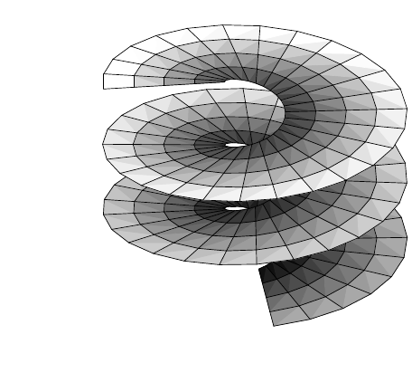

##### 性质

下一个命题刻画 $ \lambda_M $-零集。

1.6 命题 设 $ A \in \mathcal{L}_M $。下列陈述等价：

(i) $ \lambda_M(A) = 0 $；

(ii) 对每张坐标卡 $ (\varphi, U) $ 都有 $ \lambda_m(\varphi(A \cap U)) = 0 $；

(iii) 对 $ M $ 的某个可数图册中的每张坐标卡都有 $ \lambda_m(\varphi(A \cap U)) = 0 $。

证明 “(i)$ \Rightarrow $(ii)” 因为 $ A \cap U \in \mathcal{L}_M $ 且 $ A \cap U \subset A $，所以

\[ 0 = \lambda_M(A) \ge \lambda_M(A \cap U) = \int_{\varphi(A \cap U)} \varphi_*\sqrt{|G|} \, dx . \]

因为 $ \varphi_*\sqrt{|G|} $ 连续且逐点严格为正，注 X.3.3(c) 给出 $ \lambda_m(\varphi(A \cap U)) = 0 $。

“(ii)$ \Rightarrow $(iii)” 这是显然的。

“(iii)$ \Rightarrow $(i)” 由 $ \lambda_m(\varphi(A \cap U)) = 0 $ 及 (1.1) 可得 $ \lambda_M(A \cap U) = 0 $。设 $ \{(\varphi_j, U_j) ; j \in \mathbb{N}\} $ 是可数图册。则 $ A = A \cap \bigcup_j U_j = \bigcup_j (A \cap U_j) $，而结论由 $ \lambda_M $ 的 σ-次可加性得到。■

该命题表明，$ \lambda_M $-零集这一概念与所选取的伪黎曼度量无关。因此我们可以径直把 $ \lambda_M $-零集称为 **零集**，或称为 $ M $ 的**勒贝格零集**。

下一个定理列出黎曼–勒贝格测度的基本性质。

1.7 定理 设 $ (M, g) $ 是伪黎曼流形。

(i) $ (M, \mathcal{L}_M, \lambda_M) $ 是 σ-紧致的完备测度空间。

(ii) $ \lambda_M $ 是 massive 拉东测度。

(iii) $ M $ 的一切满足 $ n < m $ 的 $ n $ 维子流形都是 $ M $ 中的零集，$ \partial M $ 也是 $ M $ 中的零集。

(iv) 若 $ M $ 是 $ \mathbb{R}^m $ 的 $ m $ 维子流形，则 $ \lambda_M = \lambda_m $。

证明 (i) 因为 $ M $ 是局部紧致的度量空间，且是 Lindelöf 空间，由注 X.1.16(e) 知 $ (M, \mathcal{L}_M, \lambda_M) $ 是 σ-紧致的。其完备性由命题 1.5、1.6 以及勒贝格测度的完备性得到。

(ii) 设 $ O $ 是 $ M $ 中的非空开集，$ (\varphi, U) $ 是满足 $ U \cap O \ne \varnothing $ 的坐标卡。则 $ \varphi(O \cap U) $ 具有正的勒贝格测度。因为 $ \varphi_*\sqrt{|G|} $ 连续且逐点严格为正，注 X.3.3(c) 给出

\[ \lambda_M(O) \ge \lambda_M(O \cap U) = \int_{\varphi(O \cap U)} \varphi_*\sqrt{|G|} \, dx > 0 . \]

于是由 (i) 与命题 1.5 得到 (ii)。

(iii) 这由命题 1.6 与例 IX.5.2 得到。

(iv) 使用平凡坐标卡，我们得到

\[ \lambda_M(A) = \int_A dx = \lambda_m(A) \quad \text{对 } A \in \mathcal{L}_M , \]

这正是所要的。■

##### 可积性

设 $ E := (E, |\cdot|) $ 是巴拿赫空间。由定理 1.7，我们可以使用 X.1–X.4 节中发展起来的整套积分理论。特别地，对 $ p \in [1, \infty] \cup \{0\} $ 定义了空间 $ \mathcal{L}_p(M, \lambda_M, E) $ 与 $ L_p(M, \lambda_M, E) $。

1.8 命题 对 $ f: M \to E $，下列陈述等价：

(i) $ f \in \mathcal{L}_0(M, \lambda_M, E) $；

(ii) 对 $ M $ 的每张坐标卡 $ (\varphi, U) $ 都有 $ \varphi_* f \in \mathcal{L}_0(\varphi(U), E) $；

(iii) 对 $ M $ 的某个可数图册中的每张坐标卡都有 $ \varphi_* f \in \mathcal{L}_0(\varphi(U), E) $。

证明 “(i)$ \Rightarrow $(ii)” 设 $ f $ 是 $ \lambda_M $-可测的。则由定理 X.1.4，$ f $ 是 $ \lambda_M $-几乎可分值的且 $ \mathcal{L}_M $-可测的。由命题 1.6 与 $ \mathcal{L}_M $ 的定义，容易推出 $ \varphi_* f: \varphi(U) \to E $ 是 $ \lambda_m $-几乎可分值的且 $ \mathcal{L}_{\varphi(U)} $-可测的。因此定理 X.1.4 蕴含 $ \varphi_* f $ 属于 $ \mathcal{L}_0(\varphi(U), E) $。

“(ii)$ \Rightarrow $(iii)” 这是平凡的。

“(iii)$ \Rightarrow $(i)” 设 $ \{(\varphi_j, U_j) ; j \in \mathbb{N}\} $ 是 $ M $ 的可数图册，并设对 $ j \in \mathbb{N} $ 有 $ \varphi_{j*} f \in \mathcal{L}_0(\varphi_j(U_j), E) $。命题 XI.1.20 保证存在从属于 $ M $ 的覆盖 $ \{U_j ; j \in \mathbb{N}\} $ 的光滑单位分解 $ \{\pi_j ; j \in \mathbb{N}\} $。则对 $ j \in \mathbb{N} $ 有 $ \varphi_{j*}\pi_j \in C^\infty(\varphi_j(U_j)) $。因此由注 X.1.2(d) 得到

\[ \varphi_{j*}(\pi_j f) = (\varphi_{j*}\pi_j)(\varphi_{j*} f) \in \mathcal{L}_0(\varphi_j(U_j), E) \quad \text{对 } j \in \mathbb{N} . \]

与证明的第一部分一样，我们可以推出对 $ j \in \mathbb{N} $ 有 $ \pi_j f \in \mathcal{L}_0(M, \lambda_M, E) $。因为 $ f = (\sum_{j=1}^{\infty}\pi_j)f = \sum_{j=1}^{\infty}\pi_j f $，所以由定理 X.1.14 即得 $ f $ 的 $ \lambda_M $-可测性。■

因为 $ \lambda_M $ 是 massive 拉东测度，所以我们可以使用在命题 X.4.17 之后设定的约定。这一点在下一个命题中要注意。

1.9 命题

(a) 在向量子空间的意义下，下列结论成立：

(i) $ C(M, E) \subset L_0(M, \lambda_M, E) $。

(ii) 当 $ 1 \le p < \infty $ 时，$ C_c(M, E) $ 在 $ L_p(M, \lambda_M, E) $ 中稠密。

(b) 若 $ K $ 是 $ M $ 的紧致子集，则

\[ \left|\int_K f \, d\lambda_M\right| \le \int_K |f| \, d\lambda_M \le \|f\|_{C(K,E)} \lambda_M(K) \quad \text{对 } f \in C(M, E) . \]

证明 由于定理 1.7，本命题由定理 X.4.18(i) 与推论 X.3.15(iii) 得到。■

现在说明如何把 $ \int_M f \, d\lambda_M $ 的计算化为局部坐标中的积分。因此先考虑局部情形。

1.10 定理 设 $ (\varphi, U) $ 是 $ M $ 的坐标卡，$ f \in \mathcal{L}_0(U, \lambda_M, E) $。则 $ f $ 属于 $ \mathcal{L}_1(U, \lambda_M, E) $ 当且仅当 $ (\varphi_* f)\varphi_*\sqrt{|G|} $ 属于 $ \mathcal{L}_1(\varphi(u), \lambda_m, E) $。此时有

\[ \int_U f \, d\lambda_M = \int_{\varphi(U)} (\varphi_* f)\varphi_*\sqrt{|G|} \, dx . \tag{1.5} \]

证明 (i) 设 $ f = \chi_A $，其中 $ A \in \mathcal{L}_M $ 且 $ A \subset U $。则

\[ \int_U f \, d\lambda_M = \int_A d\lambda_M = \int_{\varphi(A)} \varphi_*\sqrt{|G|} \, dx = \int_{\varphi(U)} (\varphi_* f)\varphi_*\sqrt{|G|} \, dx \]

因为 $ \varphi_* f = \varphi_*\chi_A = \chi_{\varphi(A)} $。现在可知 (1.5) 对简单函数成立。

(ii) 设 $ f \in \mathcal{L}_1(U, \lambda_M, E) $。则存在由简单函数组成的 $ \mathcal{L}_1 $-柯西序列 $ (f_j) $，使得 $ f_j \to f $ $ \lambda_M $-几乎处处，且

\[ \int_U f_j \, d\lambda_M \to \int_U f \, d\lambda_M . \tag{1.6} \]

进一步，$ (\varphi_* f_j) $ 是 $ \mathcal{S}(\varphi(U), E) $ 中的序列，且

\[ (\varphi_* f_j)\varphi_*\sqrt{|G|} \to (\varphi_* f)\varphi_*\sqrt{|G|} \quad \text{在 } \varphi(U) \text{ 中 } \lambda_m\text{-几乎处处} . \]

此外，由 (1.5) 对简单函数成立可得

\[ \int_U |f_j - f_k| \, d\lambda_M = \int_{\varphi(U)} |\varphi_* f_j - \varphi_* f_k|\varphi_*\sqrt{|G|} \, dx = \int_{\varphi(U)} |h_j - h_k| \, dx , \]

其中 $ h_j := \varphi_*(f_j\sqrt{|G|}) $。因此 $ (h_j) $ 是 $ F := \mathcal{L}_1(\varphi(U), E) $ 中的 $ \mathcal{L}_1 $-柯西序列。由定理 X.2.10(ii)，存在 $ h \in F $ 使 $ h_j \to h $ 于 $ F $。于是由定理 X.2.18(i) 知存在 $ (h_j) $ 的子序列 $ (h_{j_k})_{k \in \mathbb{N}} $，使得当 $ k \to \infty $ 时 $ h_{j_k} \to h $ $ \lambda_m $-几乎处处。因为 $ f_j \to f $ $ \lambda_M $-几乎处处蕴含 $ h_j \to \varphi_*(f\sqrt{|G|}) $ $ \lambda_m $-几乎处处，所以 $ h $ 与 $ \varphi_*(f\sqrt{|G|}) $ $ \lambda_m $-几乎处处相等。于是定理 X.2.18(ii) 蕴含

\[ \int_U f_j \, d\lambda_M = \int_{\varphi(U)} h_j \, dx \to \int_{\varphi(U)} \varphi_*(f\sqrt{|G|}) \, dx . \]

因此由 (1.6) 即得结论。■

我们现在处理一般情形。先引入一个有用的缩写：设 $ \{(\varphi_j, U_j) ; j \in \mathbb{N}\} $ 是 $ M $ 的可数图册，并设 $ \{\pi_j ; j \in \mathbb{N}\} $ 是从属于 $ M $ 的覆盖 $ \{U_j ; j \in \mathbb{N}\} $ 的光滑单位分解。则称 $ \{(\varphi_j, U_j, \pi_j) ; j \in \mathbb{N}\} $ 为 $ M $ 的**局部系统**。这类系统的存在性由命题 XI.1.20 保证。

1.11 命题 设 $ \{(\varphi_j, U_j, \pi_j) ; j \in \mathbb{N}\} $ 是 $ M $ 的局部系统。则 $ f \in \mathcal{L}_0(M, \lambda_M, E) $ 属于 $ \mathcal{L}_1(M, \lambda_M, E) $ 当且仅当对每个 $ j \in \mathbb{N} $ 有 $ \pi_j f \in \mathcal{L}_1(U_j, \lambda_M, E) $，且

\[ \sum_{j=0}^{\infty} \int_{U_j} \pi_j |f| \, d\lambda_M < \infty . \tag{1.7} \]

此时有

\[ \int_M f \, d\lambda_M = \sum_{j=0}^{\infty} \int_{U_j} \pi_j f \, d\lambda_M . \tag{1.8} \]

证明 (i) 设 $ f \in \mathcal{L}_1(M, \lambda_M, E) $。则 $ f = (\sum_{j=0}^{\infty}\pi_j)f = \sum_{j=0}^{\infty}\pi_j f $ 逐点成立，且

\[ |\pi_k f| \le \sum_{j=0}^{n} |\pi_j f| = \sum_{j=0}^{n} \pi_j |f| \le |f| \quad \text{对 } 0 \le k \le n < \infty . \]

因此由 $ \operatorname{supp}(\pi_k) \subset\subset U_k $ 得到 $ \pi_k f \in \mathcal{L}_1(U_k, \lambda_M, E) $。定理 X.3.9、1.10 与勒贝格定理现在蕴含 (1.7) 与 (1.8)。

(ii) 设对 $ j \in \mathbb{N} $ 有 $ \pi_j f \in \mathcal{L}_1(U_j, \lambda_M, E) $，并设 (1.7) 成立。令 $ h_n := \sum_{j=0}^{n} \pi_j f $（$ n \in \mathbb{N} $），可得

\[ \int_M |h_j - h_k| \, d\lambda_M \le \sum_{i=j+1}^{k} \int_{U_i} \pi_i |f| \, d\lambda_M \quad \text{对 } 0 \le j < k < \infty . \]

因此 $ (h_j) $ 是 $ \mathcal{L}_1(M, \lambda_M, E) $ 中的 $ \mathcal{L}_1 $-柯西序列。因为 $ (h_j) $ 逐点收敛于 $ f $，所以由 $ \mathcal{L}_1(M, \lambda_M, E) $ 的完备性及定理 X.2.18 知 $ f $ 关于测度 $ \lambda_M $ 可积。■

1.12 注（正则性） 显然，上面的所有定义与命题在 $ M $ 是 $ C^1 $ 流形时仍然成立。■

##### 若干体积的计算

当然，命题 1.11 主要具有理论意义。在实际情形中，人们往往处于这样一种舒适的情形：$ M $ 除一个（可能存在的）零集之外可由单张坐标卡描述。此时可以使用定理 1.10。在下面的例子中，我们在 $ f = 1 $ 的特殊情形下考虑这类情形。

1.13 例 除另有说明外，我们在 $ M $ 上使用标准度量。

(a)（曲线） 设 $ \gamma: J \to \mathbb{R}^m $ 是完全区间 $ J \subset \mathbb{R} $ 的嵌入。则 $ M := \gamma(J) $ 是 $ \mathbb{R}^m $ 中的嵌入曲线，且 $ \operatorname{vol}(M) = L(M) $，其中 $ L $ 表示弧长。更一般地，$ f \in \mathcal{L}_1(M, \lambda_M, E) $ 满足

\[ \int_M f \, d\lambda_M = \int_J (f \circ \gamma)|\dot\gamma| \, dt . \]

在此情形下，我们令 $ ds := \sqrt{G} \, dt $，并称 $ ds $ 为**弧长元**，其动机来自定理 VIII.1.7。

证明 这由例 XI.5.3(e) 与定理 VIII.1.7 得到。■

(b)（图像） 设 $ X $ 是 $ \mathbb{R}^m $ 中的开集，$ f \in C^\infty(X, \mathbb{R}) $。则\footnote{见例 VIII.1.9(a)。}

\[ \operatorname{vol}(\operatorname{graph}(f)) = \int_X \sqrt{1 + |\nabla f|^2} \, dx . \]

证明 例 XI.5.3(d)。■

(c)（球面） 设 $ m \in \mathbb{N}^\times $，$ r > 0 $。则

\[ r \operatorname{vol}(rS^m) = (m+1)\operatorname{vol}(r\mathbb{B}^{m+1}) . \]

特别地，$ \operatorname{vol}(rS^1) = 2\pi r $，$ \operatorname{vol}(rS^2) = 4\pi r^2 $，$ \operatorname{vol}(rS^3) = 2\pi^2 r^3 $。

证明 由注 IX.5.26(b) 知

\[ \operatorname{vol}(r\mathbb{B}^{m+1}) = r^{m+1}\operatorname{vol}(\mathbb{B}^{m+1}) . \tag{1.9} \]

于是由例 VIII.1.9(c)，我们可以假定 $ m \ge 2 $。令

\[ h_\pm: \mathbb{B}^m_r \to \mathbb{R} , \quad x \mapsto \pm\sqrt{r^2 - |x|^2} \]

为上半球面与下半球面 $ rS^m_\pm $ 的参数化。对这些参数化可得 $ \nabla h_\pm(x) = -x/h_\pm(x) $，从而对 $ x \in r\mathbb{B}^m $ 有 $ |\nabla h_\pm(x)|^2 = |x|^2/(r^2 - |x|^2) $。因此由 (b) 与变换定理可得

\[ \operatorname{vol}(rS^m_\pm) = \int_{r\mathbb{B}^m} \sqrt{r^2/(r^2 - |x|^2)} \, dx = r^m \int_{\mathbb{B}^m} \sqrt{1/(1 - |y|^2)} \, dy = r^m \operatorname{vol}(S^m_\pm) . \]

因为 $ S^m = S^m_+ \cup S^m_- \cup S^{m-1} $，其中 $ S^{m-1} $ 与 $ S^m $ 的“赤道球面” $ S^{m-1} \times \{0\} $ 等同，且 $ \lambda_{S^m}(S^{m-1}) = 0 $，所以我们得到

\[ \operatorname{vol}(rS^m) = r^m \operatorname{vol}(S^m) . \tag{1.10} \]

由 (1.9) 与 (1.10)，只需证明

\[ \operatorname{vol}(S^m) = (m+1)\operatorname{vol}(\mathbb{B}^{m+1}) . \]

我们使用例 XI.5.5(h) 中考虑过的 $ S^m \setminus H_m $ 的参数化 $ h_m: W_m \to \mathbb{R}^{m+1} $，并将其坐标卡记为 $ \psi $。于是从那里给出的 $ g_{S^m} $ 的公式（因为基本矩阵是对角的）可以读出

\[ \psi_* G = \prod_{k=0}^{m-1} a_{m+1,k} = \prod_{k=0}^{m-1} \prod_{i=k+1}^{m-1} \sin^2 \vartheta_i = w_{m+1}^2(\vartheta) , \]

其中

\[ w_{m+1}(\vartheta) := \sin\vartheta_1 \sin^2\vartheta_2 \cdot \ldots \cdot \sin^{m-1}\vartheta_{m-1} \quad \text{对 } \vartheta = (\vartheta_1, \ldots, \vartheta_{m-1}) \in [0, \pi]^{m-1} . \]

因为 $ W_m = (0, 2\pi) \times (0, \pi)^{m-1} $，由例 X.8.10(c) 与富比尼定理可得

\[ \lambda_{S^m}(S^m \setminus H_m) = \int_{W_m} \psi_*\sqrt{G} \, d(\varphi, \vartheta) = 2\pi \int_{(0, \pi)^{m-1}} w_{m+1}(\vartheta) \, d\vartheta = (m+1)\omega_{m+1} , \]

其中 $ \omega_{m+1} := \operatorname{vol}(\mathbb{B}^{m+1}) $。因为 $ S^m \cap H_m $ 是 $ S^m $ 的零集，故结论成立。■

(d)（螺旋面） 设 $ 0 \le \alpha < \beta < \infty $，$ a \ge 0 $。令 $ T > 0 $，并定义

\[ h : (\alpha, \beta) \times (0, T) \to \mathbb{R}^3 \]

为

\[ h(s, t) := (s\cos t, s\sin t, at) . \]

则 $ h $ 是螺旋面 $ F $ 的参数化。它是这样生成的：从 $ t = 0 $ 开始，取位于 $ x $ 轴上、由区间 $ (\alpha, \beta) $ 构成的“杆”，然后令其绕 $ z $ 轴以角速度 1 旋转，同时以速度 $ a $ 上升。它满足

\[ \operatorname{vol}(F) = \frac{T}{2}\left[ s\sqrt{s^2 + a^2} + a^2 \log\left(s + \sqrt{s^2 + a^2}\right)\right]\bigg|_{\alpha}^{\beta} . \]
