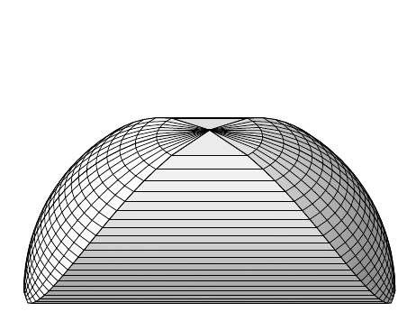
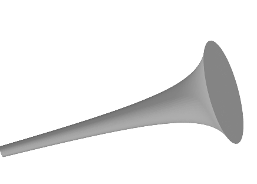

特别地，取 $ \alpha = 0 $、$ \beta = 1 $、$ T = 2\pi $——即长为 $ 1 $ 的杆绕其端点作整周旋转——我们有

\[ \operatorname{vol}(F)=\pi\left[\sqrt{1+a^{2}}+a^{2}\log\left(1+\sqrt{1+a^{2}}\right)-a^{2}\log a\right]=\pi\left[\sqrt{1+a^{2}}+a^{2}\log\left(\sqrt{1+1/a^{2}}+1/a\right)\right]. \]

这个公式在若干特殊情形下给出了我们所期望的结果：当 $ a=0 $ 时，我们得到面积为 $ \pi $ 的单位圆盘，而当 $ a>0 $ 时 $ \operatorname{vol}(F)>\pi $。

证明 简单计算表明 $ \varphi_{*}\sqrt{G}=\sqrt{s^{2}+a^{2}} $，其中 $ \varphi $ 是属于 $ h $ 的坐标卡，即 $ h=i\circ\varphi^{-1} $。因为

\[ \left[s\sqrt{s^{2}+a^{2}}+a^{2}\log\left(s+\sqrt{s^{2}+a^{2}}\right)\right]^{\cdot}=2\sqrt{s^{2}+a^{2}}, \]

由富比尼定理即得结论。■

(e) 双曲平面 $ H^{2} $ 中圆盘 $ R\mathbb{B}^{2} $ 的体积满足

\[ \operatorname{vol}_{g_{H^{2}}}\left(R\mathbb{B}^{2}\right)=2\pi\left(\sqrt{1+R^{2}}-1\right). \]

当 $ R $ 变大时，该表达式近似表现为 $ 2\pi R $，而在欧氏情形下体积按 $ R^{2} $ 增长。

证明 使用极坐标，我们回顾例 XI.5.5(k)：

\[ g_{H^{2}}=\frac{(dr)^{2}}{1+r^{2}}+r^{2}(d\varphi)^{2}. \]

由此读出

\[ \omega_{H^{2}}=\frac{r}{\sqrt{1+r^{2}}}\,dr\wedge d\varphi. \]

因为 $ H^{2} $ 的单点集是零集，由此得到

\[ \operatorname{vol}_{g_{H^{2}}}\left(R\mathbb{B}^{2}\right)=\int_{0}^{R}\int_{0}^{2\pi}\frac{r}{\sqrt{1+r^{2}}}\,dr\,d\varphi=2\pi\int_{0}^{R}\frac{r\,dr}{\sqrt{1+r^{2}}}, \]

如所求。■

##### 习题

1 设 $ N $ 是 $ m $ 维流形，$ f\in\operatorname{Diff}^{1}(M,N) $。证明 $ A\in\mathcal{L}_{M} \iff f(A)\in\mathcal{L}_{N} $。

2 对双曲面 $ H:=\{(x,y,z)\in\mathbb{R}^{3} ; x^{2}+y^{2}-z^{2}=1\} $，关于标准度量与参数化

\[ (t,\varphi)\mapsto(\cosh t\cos\varphi,\cosh t\sin\varphi,\sinh t) \]

确定 $ \omega_{M} $。再计算 $ H $ 中满足 $ 0<z<1 $ 的部分的体积。

3 设 $ Z:=S^{1}\times(-1,1) $ 是 $ \mathbb{R}^{3} $ 中的圆柱面。计算 $ \int_{Z}|x|^{2}\,d\lambda_{Z} $。

4 计算积分 $ \int_{S^{2}}x^{2}y^{2}z^{2}\,d\lambda_{S^{2}} $。

5 从球 $ R\mathbb{B}^{3} $ 中被圆柱面

\[ Z_{R}:=\{(x,y,z)\in\mathbb{R}^{3} ; x^{2}+y^{2}=Rx\} \]

截出的立体称为 **维维亚尼立体** $ V_{R} $。

证明

(i) $ \operatorname{vol}(V_{R})=2(\pi-4/3)R^{3}/3 $；

(ii) $ Z_{R} $ 与 $ RS^{2} $ 的交 $ D_{R} $（图中 $ V_{R} $ 的左、右两个“帽”）的面积等于 $ 4R^{2}(\pi/2-1) $。

6 证明：若 $ N $ 是无边的 $ n $ 维流形，则 $ \operatorname{vol}(M\times N)=\operatorname{vol}(M)\operatorname{vol}(N) $。

7 设 $ \gamma:[0,1]\to(0,\infty)\times\mathbb{R} $，$ t\mapsto(\rho(t),\sigma(t)) $ 是光滑嵌入，$ i:S^{1}\hookrightarrow\mathbb{R}^{2} $，且

\[ f:S^{1}\times[0,1]\to\mathbb{R}^{3},\quad (q,t)\mapsto(\rho(t)i(q),\sigma(t)). \]

最后记 $ Z_{\gamma}^{2}:=f\left(S^{1}\times[0,1]\right) $ 为 $ \mathbb{R}^{3} $ 中由 $ \gamma $ 生成的旋转曲面。证明

\[ \operatorname{vol}(Z_{\gamma}^{2})=2\pi\int_{0}^{1}\rho(t)|\gamma'(t)|\,dt. \]

8 设 $ E_{a,b} $ 是 $ \mathbb{R}^{3} $ 中半轴为 $ a\ge b>0 $ 的旋转椭球。再令 $ k:=\sqrt{a^{2}-b^{2}}/a $。于是\footnote{见注 VIII.2.3(b)。}

\[ \operatorname{vol}(E_{a,b})=4\pi ab\int_{0}^{\pi/2}\sqrt{1-k^{2}\sin t}\,dt. \]

9 证明：$ a>1 $ 的环面 $ \mathbb{T}_{a,1}^{2} $ 满足 $ \operatorname{vol}(\mathbb{T}_{a,1}^{2})=4\pi^{2}a $。

10 设 $ \alpha\in(1/2,1] $，$ r(x):=x^{-\alpha} $（$ x\ge 1 $）。证明集合

\[ \{(x,y,z)\in[1,\infty)\times\mathbb{R}^{2} ; y^{2}+z^{2}\le r^{2}(x)\} \]

的体积有限，尽管其表面积无限。

11 设 $ \mathbb{H}^{2}:=\{(x,y)\in\mathbb{R}^{2} ; y>0\} $，$ i:S^{1}\hookrightarrow\mathbb{R}^{2} $。又设 $ M $ 是 $ \mathbb{H}^{2} $ 的紧致子流形，$ \dim(M)=2 $。则

\[ R_{M}:=\{(x,u)\in\mathbb{R}\times\mathbb{R}^{2} ; (x,|u|)\in M\}\subset\mathbb{R}^{3} \]

是由 $ M $ 绕 $ x $ 轴旋转生成的旋转对称立体。证明以下事实：

(a) $ R_{M}\to M\times S^{1} $，$ (x,u)\mapsto((x,|u|),u/|u|) $ 是微分同胚，且

\[ M\times S^{1}\to R_{M},\quad ((x,y),\sigma)\mapsto(x,y\,i(\sigma)) \]

是其逆映射（“柱坐标”）；

(b) $ \operatorname{vol}(R_{M})=2\pi\int_{M}y\,d\lambda_{M} $；

(c) **古尔丁第一规则**说

\[ \operatorname{vol}(R_{M})=2\pi S_{2}(M)\operatorname{vol}(M), \]

其中 $ S_{2}(M) $ 表示 $ M $ 的形心 $ S(M) $ 的第二个坐标，从而是该点到旋转轴的距离（见习题 X.6.4）。也就是说，**旋转体的体积等于子午截面的面积与该截面形心到旋转轴距离为半径的圆周长之积**。

12 使用习题 11 的记号，但令 $ \dim(M)=1 $。证明：

(a) 习题 11 的陈述 (a) 与 (b) 在此情形下也成立。\footnote{见习题 7。}

(b) 以**形心**

\[ S(M):=\frac{1}{\operatorname{vol}(M)}\int_{M}i\,d_{\mathbb{R}^{3}}\,d\lambda_{M}\in\mathbb{R}^{3}, \]

我们有**古尔丁第二规则**

\[ \operatorname{vol}(R_{M})=2\pi S_{2}(M)\operatorname{vol}(M), \]

也就是说，**旋转曲面的体积等于子午截面的弧长与该截面形心到旋转轴距离为半径的圆周长之积**。

13 确定半圆盘 $ R\mathbb{B}^{2}\cap\mathbb{H}^{2} $ 的形心。（提示：习题 12。）

14 设 $ N $ 是伪黎曼流形，$ \varphi\in\operatorname{Diff}(M,N) $。令 $ p\in[1,\infty] $，并设 $ E $ 是巴拿赫空间。对 $ f\in E^{N} $，由

\[ \mathcal{J}_{\varphi}f(s):=\varphi^{\ast}f(s)\det T_{s}\varphi\quad \text{对 } s\in M \]

定义 $ \mathcal{J}_{\varphi}f\in E^{M} $。证明以下断言：

(a) $ \mathcal{J}_{\varphi} $ 将 $ \mathcal{L}_{p}(N,d\lambda_{N},E) $ 线性且连续地映到 $ \mathcal{L}_{p}(M,d\lambda_{M},E) $。

(b) 对 $ f\in\mathcal{L}_{0}(N,d\lambda_{N},E) $，以下两个陈述

(i) $ f=0 $ $ \lambda_{N} $-几乎处处，与

(ii) $ \mathcal{J}_{\varphi}f=0 $ $ \lambda_{M} $-几乎处处

等价。

(c) 设对 $ [f]\in L_{p}(N,d\lambda_{N},E) $ 令 $ \mathcal{J}_{\varphi}[f]:=[\mathcal{J}_{\varphi}f] $。则 $ \mathcal{J}_{\varphi}[f] $ 在 $ L_{p}(M,d\lambda_{M},E) $ 中有定义，且 $ \mathcal{J}_{\varphi} $ 本身是从 $ L_{p}(N,d\lambda_{N},E) $ 到 $ L_{p}(M,d\lambda_{M},E) $ 的等距同构映射。

15 对 $ p\in[1,\infty] $，给出从 $ L_{p}((0,\infty)\times S^{n-1}) $ 到 $ L_{p}(\mathbb{R}^{n}) $ 的等距同构。

16 对 $ f\in\mathcal{L}_{0}(\mathbb{R}^{n}) $ 与 $ s\in S^{n-1} $，由

\[ T_{0}f(s)(r):=f(rs)r^{n-1}\quad \text{对 } r\in(0,\infty) \]

定义函数 $ T_{0}f(s):(0,\infty)\to\mathbb{R} $。又令 $ p\in[1,\infty) $。

证明：

(a) 若 $ f\in\mathcal{E}_{c}(\mathbb{R}^{n}) $，则 $ T_{0}f $ 属于 $ \mathcal{L}_{0}\left(S^{n-1},L_{p}(0,\infty)\right) $；

(b) 设 $ f\in\mathcal{E}_{c}(\mathbb{R}^{n}) $。则 $ T_{0}f $ 的类 $ [T_{0}f] $ 属于 $ L_{p}\left(S^{n-1},L_{p}(0,\infty)\right) $。

(c) 映射 $ \mathcal{E}_{c}(\mathbb{R}^{n})\to L_{p}\left(S^{n-1},L_{p}(0,\infty)\right) $，$ f\mapsto[T_{0}f] $ 存在唯一延拓

\[ T\in\mathcal{L}\mathrm{is}\left(L_{p}(\mathbb{R}^{n}),L_{p}\left(S^{n-1},L_{p}(0,\infty)\right)\right), \]

且 $ T $ 是等距。

（提示：研究引理 X.6.20 与定理 X.6.22 的证明。）
