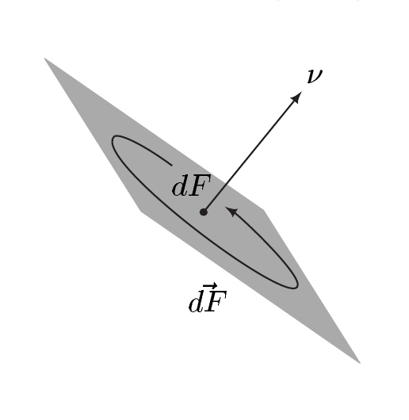

## 2 微分形式的积分

在 §VIII.4 中，我们引入了线积分这一重要概念，即 1-形式在定向曲线上的积分，因而也是在 1 维流形上的积分。本节我们引入高维的类似物，即 $ m $-形式在定向 $ m $ 维流形上的积分。

在引入基本内容之后，我们证明变换定理与富比尼定理对微分形式的推广。通过例子，我们说明这些想法如何用于具体情形。

最后，我们讨论流形上的通量，并证明重要的输运定理。后者不仅在连续介质力学中具有重要意义，而且给出向量场散度的几何解释。

本节中，设

- $ M $ 为 $ m $ 维、$ N $ 为 $ n $ 维的定向流形，其中 $ m, n \in \mathbb{N}^{\times} $。

##### m-形式的积分

设 $ g $ 是 $ M $ 上的伪黎曼度量，$ \omega_M $ 是体积元，$ \lambda_M $ 是相伴的黎曼–勒贝格体积测度。若 $ \omega $ 是 $ M $ 的 $ m $-形式，则由于对 $ p \in M $ 有 $ \dim(\bigwedge^m T_p^* M) = 1 $，恰有一个 $ f \in \mathbb{R}^M $ 使 $ \omega = f \omega_M $。于是称 $ (M, g) $ 上的 $ m $-形式 $ \omega $ 是**可积的**，如果 $ f $ 是 $ \lambda_M $-可积的，即 $ f $ 属于 $ \mathcal{L}_1(M, \lambda_M) $。此时，我们令

\[ \int_M \omega := \int_M f \, d\lambda_M \tag{2.1} \]

并称 $ \int_M \omega $ 为 $ m $-形式 $ \omega $ 在 $ M $ 上的**积分**。

2.1 注 (a)（局部表示）设 $ (\varphi, U) $ 是 $ M $ 的正坐标卡，使 $ \varphi = (x^1, \ldots, x^m) $。$ m $-形式 $ \omega := a\,dx^1 \wedge \cdots \wedge dx^m $ 在 $ U $ 上可积，当且仅当 $ \varphi_* a $ 属于 $ \mathcal{L}_1(\varphi(U)) $。若如此，则

\[ \int_U \omega = \int_U a\,dx^1 \wedge \cdots \wedge dx^m = \int_{\varphi(U)} \varphi_* a \, dx = \int_{\varphi(U)} \varphi_* \omega . \tag{2.2} \]

证明 由 $ \omega_U = \sqrt{|G|}\, dx^1 \wedge \cdots \wedge dx^m $ 可得 $ \omega = (a/\sqrt{|G|})\omega_U $。因此 $ \omega $ 可积当且仅当 $ a/\sqrt{|G|} $ 属于 $ \mathcal{L}_1(U, \lambda_M) $。由定理 1.10，这当且仅当

\[ \varphi_* a = \varphi_*(a/\sqrt{|G|}) \varphi_* \sqrt{|G|} \in \mathcal{L}_1(\varphi(U)) \]

时成立。现在由 (1.5) 与 (2.1) 即得结论。■

(b)（化归为局部表示）设 $ \omega $ 是 $ M $ 上的 $ m $-形式，并设 $ \{(\varphi_j, U_j, \pi_j) \ ; \ j \in \mathbb{N}\} $ 是 $ M $ 的局部系统，其坐标卡全为正，即正局部系统。对 $ j \in \mathbb{N} $，设 $ a_j dx_j^1 \wedge \cdots \wedge dx_j^m $ 是 $ \omega|U_j $ 关于坐标卡 $ (\varphi_j, U_j) $ 的局部表示，并令 $ \omega_j := \pi_j \omega|U_j $。则 $ \omega $ 在 $ M $ 上可积当且仅当

\[ \sum_{j=0}^{\infty} \int_{U_j} \pi_j |a_j|\, dx_j^1 \wedge \cdots \wedge dx_j^m = \sum_{j=0}^{\infty} \int_{\varphi_j(U_j)} \varphi_{j*}(\pi_j |a_j|)\, dx < \infty . \tag{2.3} \]

若 (2.3) 成立，则

\[ \int_M \omega = \sum_{j=0}^{\infty} \int_{U_j} \omega_j . \tag{2.4} \]

证明 这由 (a) 与命题 1.11（的证明）推出。■

(c) $ M $ 上每个具有紧支集的连续 $ m $-形式都在 $ M $ 上可积。

证明 设 $ \omega $ 是具有紧支集的连续 $ m $-形式。则存在正局部系统 $ \{(\varphi_j, U_j, \pi_j) \ ; \ j \in \mathbb{N}\} $ 与 $ k \in \mathbb{N} $ 使

\[ \operatorname{supp}(\pi_j) \cap \operatorname{supp}(\omega) = \varnothing \quad \text{对 } j > k . \]

因此 (2.3) 中的级数化为有限和，且 $ \pi_j |a_j| \in C_c(U_j) $，$ j \in \mathbb{N} $。命题 1.9(b) 给出这些函数的可积性。■

(d) 由 (a) 与 (b) 可见，$ M $ 上 $ m $-形式的积分与所取的特定伪黎曼度量无关。因此我们总取标准度量而不失一般性。事实上，微分形式的积分不需要任何度量。也就是说，我们可以用公式 (2.2)–(2.4) 来定义 $ \int_M \omega $，从而只用到 $ \mathbb{R}^m $ 中的勒贝格积分。由上述讨论（其中可取某个黎曼度量，例如标准度量）可知，这些定义有意义，即与所选局部系统无关。特别地，具有紧支集的连续 $ m $-形式的积分可在任意\footnote{当考虑抽象流形时，这一事实很重要。可以证明这类流形上总存在黎曼度量。}定向 $ m $ 维流形上定义。

(e)（线性）设 $ \Omega_c^m(M) $ 是 $ M $ 上所有具有紧支集的光滑 $ m $-形式的集合。特别地，$ \mathcal{E}_c(M) := \Omega_c^0(M) $。则 $ \Omega_c^m(M) $ 是 $ \Omega^m(M) $ 的 $ \mathcal{E}(M) $-子模，且

\[ \int_M : \Omega_c^m(M) \to \mathbb{R} , \quad \omega \mapsto \int_M \omega \]

是良定义的，且为 $ \mathbb{R} $-线性的。

证明 第一个结论显然。由 (c)，所给映射良定义，其线性由积分关于 $ \lambda_M $ 的线性推出。■

(f)（可定向性）$ m $-形式的积分是**定向的**，即若 $ M $ 的定向反转，则符号改变：

\[ \int_{(M, -Or)} \omega = - \int_M \omega . \]

证明 这由 $ \omega_{(M, -Or)} = -\omega_M $ 推出。■

(g) $ M $ 上的 $ m $-形式 $ \omega $ 可积，当且仅当对每个 $ A \in \mathcal{L}_M $，$ \chi_A \omega $ 可积。此时，我们令

\[ \int_A \omega := \int_M \chi_A \omega \quad \text{对 } A \in \mathcal{L}_M . \]

证明 这容易由 (a) 与 (b) 推出。■

(h)（正则性）只需假设 $ M $ 是 $ C^1 $ 流形。■

设 $ (M, g) $ 是伪黎曼流形。则 $ A \in \mathcal{L}_M $ 满足 $ \lambda_M(A) < \infty $。于是 $ \chi_A \omega_M $ 是 $ M $ 上可积的 $ m $-形式，且

\[ \lambda_M(A) = \int_A \omega_M . \tag{2.5} \]

若 $ \lambda_M(A) = \infty $，我们令 $ \int_A \omega_M := \infty $。此定义使 (2.5) 对每个 $ A \in \mathcal{L}_M $ 成立。

##### 到子流形的限制

设 $ M $ 或是 $ N $ 的子流形，或是 $ N $ 的边界 $ \partial N $；用 $ i : M \hookrightarrow N $ 记自然嵌入。又设 $ \omega $ 是 $ N $ 上的 $ m $-形式，且 $ \omega|M = i^* \omega $ 在 $ M $ 上可积。则我们令

\[ \int_M \omega := \int_M i^* \omega . \tag{2.6} \]

2.2 注 设 $ (\varphi, U) $ 是 $ M $ 的正坐标卡，$ \varphi = (x^1, \ldots, x^m) $，并令 $ h := i \circ \varphi^{-1} $。

(a) $ N $ 上的 $ m $-形式 $ \omega $ 满足

\[ \int_U \omega = \int_{\varphi(U)} h^* \omega \]

若 $ \omega|U $ 可积。

证明 由 (2.6) 与注 2.1(a) 可得

\[ \int_U \omega = \int_U i^* \omega = \int_{\varphi(U)} \varphi_* i^* \omega = \int_{\varphi(U)} (\varphi^{-1})^* i^* \omega = \int_{\varphi(U)} (i \circ \varphi^{-1})^* \omega = \int_{\varphi(U)} h^* \omega . \]

由此即得结论。■

(b)（线积分）设 $ X := N $ 是 $ \mathbb{R}^n $ 中的开集，并设 $ \omega := \sum_{j=1}^n a_j dx^j \in \Omega^1(X) $。又设 $ m = 1 $。则

\[ \int_M \omega = \int_M a_1 dx^1 + \cdots + a_n dx^n \]

是线积分。

证明 这由 §VIII.4（将其关于非紧曲线的结果作显然的推广）与定理 XI.1.18 推出。■

(c)（向量线元）设 $ X $ 是 $ \mathbb{R}^n $ 中的开集，且 $ m = 1 $。在物理学中，$ \omega := \sum_{j=1}^n a_j dx^j \in \Omega^1(X) $ 常写成向量场 $ \vec a := (a_1, \ldots, a_n) $ 与**向量线元**\footnote{见注 VIII.4.10(b)。} $ d\vec s := (dx^1, \ldots, dx^n) $ 的形式内积 $ \vec a \cdot d\vec s $。则

\[ \int_M \omega = \int_M \vec a \cdot d\vec s . \]

令 $ J := \varphi(U) $。则 $ J $ 是 $ \mathbb{R} $ 中的开区间。由于 $ M $ 是一维且定向的，对 $ p \in M $ 恰有一个 $ M $ 在 $ p $ 处的**正单位切向量** $ \mathbf{t}(p) $，即恰有一个 $ \mathbf{t}(p) = \sum_j t^j e_j \in T_p M $ 使 $ |\mathbf{t}(p)| = 1 $ 且 $ \omega_M(p)(\mathbf{t}(p)) = 1 $。于是 $ t := \varphi(p) \in J $ 满足 $ (\varphi_* t^j)(t) = \dot{h}^j(t)/|\dot{h}(t)| $。因此由 (a)、例 1.13(a) 与定理 1.10 可得

\[ \begin{aligned} \int_U \omega &= \int_{\varphi(U)} h^* \omega = \int_J \sum_{j=1}^n (a_j \circ \varphi^{-1}) \dot{h}^j \, dt = \int_{\varphi(U)} \sum_{j=1}^n \varphi_* a_j \, \varphi_* t^j \, |\dot{h}| \, dt \\ &= \int_{\varphi(U)} \varphi_*(\Theta^{-1} \omega|\mathbf{t}) \varphi_* \sqrt{G} \, dt = \int_U (\Theta^{-1} \omega|\mathbf{t}) \, ds . \end{aligned} \]

因此

\[ \int_M \vec a \cdot d\vec s = \int_M (\vec a|\mathbf{t}) \, ds , \]

这也可表示为 $ d\vec s = \mathbf{t}\, ds $。

(d)（空间中的曲面）设 $ m = 2 $，$ N $ 是 $ \mathbb{R}^3 $ 中的开集。又设 $ (x, y, z) $ 是 $ \mathbb{R}^3 $ 的欧几里得坐标，并令

\[ \omega := a\,dy \wedge dz + b\,dz \wedge dx + c\,dx \wedge dy . \]

用 $ (u, v) $ 记 $ U $ 的局部坐标，我们有

\[ \begin{aligned} \int_U \omega &= \int_U a\,dy \wedge dz + b\,dz \wedge dx + c\,dx \wedge dy \\ &= \int_{\varphi(U)} \left[ h^* a \frac{\partial(y, z)}{\partial(u, v)} + h^* b \frac{\partial(z, x)}{\partial(u, v)} + h^* c \frac{\partial(x, y)}{\partial(u, v)} \right] d(u, v) \\ &= \int_{\varphi(U)} (h^* \vec a) \cdot (\vec X_u \times \vec X_v) \, d(u, v) \end{aligned} \]

其中 $ \vec a := (a, b, c) $，$ \vec X := h $。

证明 这是例 XI.3.4(d) 与注 XI.6.25(c) 的推论。■

(e)（向量面积元）我们使用 (d) 的假设与记号。我们要求对每个 $ p \in M $ 及 $ T_p M $ 的每个正标准正交基 $ (v_1, v_2) $，$ (\nu(p), v_1, v_2) $ 都是 $ T_p \mathbb{R}^3 $ 的正标准正交基，以此定义 $ M $ 的**正（单位）法向量** $ \nu := \nu_M $。若 $ (u, v) $ 是 $ U $ 上的正坐标，则

\[ \nu|U = \left( \frac{\partial}{\partial u} \times \frac{\partial}{\partial v} \right) \Big/ \left| \frac{\partial}{\partial u} \times \frac{\partial}{\partial v} \right| . \tag{2.7} \]

在物理学中，三元组 $ (dy \wedge dz, dz \wedge dx, dx \wedge dy) $ 常称为**定向向量面积元**。它写作 $ d\vec F $，并被理解为一个“无穷小面积元”连同其定向，定向由法向量 $ \nu $ 指定。

我们还令

\[ \int_M \vec a \cdot d\vec F := \int_M a\,dy \wedge dz + b\,dz \wedge dx + c\,dx \wedge dy . \]

于是，利用**标量面积元** $ dF := \sqrt{G}\, dx \wedge dy \wedge dz $，我们得到

\[ \int_M \vec a \cdot d\vec F = \int_M \vec a \cdot \nu \, dF , \tag{2.8} \]

这也可表示为 $ d\vec F = \nu \, dF $。

证明 如同例 XI.5.3(g) 的证明，可见 $ \nu $ 良定义。我们令 $ w_1 := \partial/\partial u $，$ w_2 := \partial/\partial v $。则 $ (w_1(p), w_2(p)) $ 是 $ T_p M \subset T_p \mathbb{R}^3 $ 的正基。因此 $ w_1(p) \times w_2(p) \neq 0 $。我们定义 $ \tilde{\nu}|U $ 为 (2.7) 的右端。则 $ \tilde{\nu}|U $ 属于 $ C^{\infty}(U, \mathbb{R}^3) $。注 XI.6.25(b) 给出

\[ \omega_{\mathbb{R}^3}(\tilde{\nu}, w_1, w_2) = \omega_{\mathbb{R}^3}(w_1, w_2, \tilde{\nu}) = (\tilde{\nu}|w_1 \times w_2) = |w_1 \times w_2| . \tag{2.9} \]

因此 $ (w_1(p), w_2(p), \tilde{\nu}(p)) $ 是 $ T_p \mathbb{R}^3 $ 的正基，且 $ \tilde{\nu}(p) $ 与 $ w_1(p) $、$ w_2(p) $ 正交。这意味着 $ U $ 上的正法向量由 (2.7) 给出。
