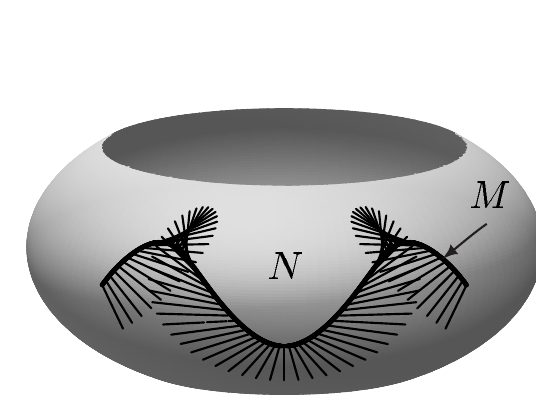
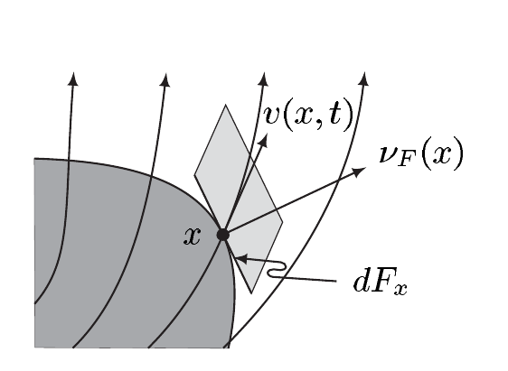

注 XI.6.25(b) 与例 XI.5.3(f) 蕴涵

\[ |w_1 \times w_2| = \sqrt{|w_1|^2 |w_2|^2 - (w_1 \mid w_2)^2} = \sqrt{EG - F^2} . \]

因此 $ w_1 \times w_2 = \nu \sqrt{EG - F^2} $ 在 $ U $ 上成立，这又由例 XI.5.3(f) 得出。现在 (2.8) 是 (d) 与 $ \lambda_M $ 的定义的推论。■

(f) 设或者 $ M $ 是 $ N $ 的子流形，或者 $ M := \partial N $。所谓 **$ N $ 沿 $ M $ 的向量场**，我们指的是一个映射

\[ v: M \to TN \qquad \text{其中 } v(p) \in T_p N \text{ 且 } p \in M . \]

注意 $ v(p) $ 未必是 $ M $ 的切向量，也就是说，$ v $ 一般不是 $ M $ 上的向量场。若 $ k \in \mathbb{N} \cup \{\infty\} $，则称 $ v $ 是 $ N $ 沿 $ M $ 的 $ C^k $ 向量场（当 $ k = \infty $ 时为**光滑**向量场），如果每个 $ p \in M $ 都有 $ N $ 关于 $ M $ 的子流形坐标卡 $ (\varphi, U) $，使得 $ \varphi_* v \in C^k(\varphi(U \cap M), \mathbb{R}^n) $。容易验证这个定义与坐标卡无关。\footnote{见注 XI.4.2(a)。}

现在设 $ (\cdot \mid \cdot) $ 是 $ N $ 上的黎曼度量，$ M $ 是 $ N $ 中的定向超曲面，即 $ m = n - 1 $。则恰有一个 $ N $ 沿 $ M $ 的光滑向量场 $ \nu := \nu_M $，具有以下性质

(i) 对 $ p \in M $，$ \nu(p) \perp T_p M $；

(ii) 对 $ p \in M $，$ |\nu(p)| = 1 $；以及

(iii) 若 $ (v_1, \dots, v_m) $ 是 $ T_p M $ 的正基，则 $ (\nu(p), v_1, \dots, v_m) $ 是 $ T_p N $ 的正基。

我们称 $ \nu $ 为沿 $ M $ 的**正单位法向量场**，或简称 $ M $ 的**正法向量**。

证明 该断言由例 XI.5.3(g) 的证明作显然的修改即得。■

(g) 设 $ (N, (\cdot \mid \cdot)) $ 是黎曼流形，且或者 $ M $ 是 $ N $ 中的定向超曲面，或者 $ M := \partial N $。则 $ N $ 沿 $ M $ 的每个向量场 $ v $ 都满足

\[ v \lrcorner \omega_N = (v \mid \nu)\omega_M . \]

证明 设 $ p \in M $，$ (v_1, \dots, v_m) $ 是 $ T_p M $ 的正标准正交基。则向量组 $ (\nu(p), v_1, \dots, v_m) $ 是 $ T_p N $ 的正标准正交基。因此 $ v(p) \in T_p N $ 有基表示

\[ v(p) = (v(p) \mid \nu(p))\nu(p) + \sum_{j=1}^{m} (v(p) \mid v_j)v_j . \]

于是由 $ \omega_N $ 的交错性得到

\[ \begin{aligned} v(p) \lrcorner \omega_N(p)(v_1, \dots, v_m) &= \omega_N(p)(v(p), v_1, \dots, v_m) \\ &= (v(p) \mid \nu(p))\omega_N(p)(\nu(p), v_1, \dots, v_m) \\ &= (v(p) \mid \nu(p))(\nu(p) \lrcorner \omega_N(p)(v_1, \dots, v_m)) . \end{aligned} \]

现在

\[ \nu(p) \lrcorner \omega_N(p)(v_1, \dots, v_m) = \omega_N(p)(\nu(p), v_1, \dots, v_m) = 1 \]

而 $ \nu \lrcorner \omega_N \in \Omega^m(M) $ 蕴涵 $ \nu \lrcorner \omega_N = \omega_M $，于是证毕。■

(h) 设 $ (N, (\cdot \mid \cdot)) $ 是黎曼流形，且或者 $ M $ 是 $ N $ 中的定向超曲面，或者 $ M := \partial N $。又设 $ v $ 是 $ N $ 沿 $ M $ 的向量场，且 $ (v \mid \nu) \in \mathcal{L}(M, d\lambda_M) $。则由 (g) 可得

\[ \int_M v \lrcorner \omega_N = \int_M (v \mid \nu) \, d\lambda_M . \]

这个积分称为**向量场 $ v $ 穿过 $ M $ 的通量**（沿正法向的方向）。在 (e) 的情形中，

\[ \int_M \vec{a} \cdot d\vec{F} \]

就是向量场 $ \vec{a} $ 穿过 $ M $ 的通量。

为了说明这个想法，我们考虑 (e) 中 $ N = X $ 的情形，并假设 $ X $ 中充满一种（虚构的）流动流体（或者更一般地，一种连续可形变的介质）。我们考虑一个（无穷小的）流体元，它在时刻 $ t = 0 $ 时“经过点 $ x $”。用 $ \chi^t(x) := \chi(x,t) $ 表示它在时刻 $ t $ 的位置。因此 $ t \mapsto \chi^t(x) $ 就是在 $ t = 0 $ 时位于 $ x $ 的那个流体元的轨迹。

现在设 $ v(y,t) $ 是在时刻 $ t $ 位于 $ y $ 的流体元的速度向量。则

\[ \frac{d\chi^t(x)}{dt} = v(\chi^t(x), t) , \]

其中 $ d\chi^t(x)/dt $ 是 $ s \mapsto \chi^s(x) $ 在 $ s = t $ 处的导数。

我们假设该流动在每一时刻都有确定（光滑）的质量（或电荷）密度 $ \rho(x,t) > 0 $。这意味着，在时刻 $ t $，包含在 $ X $ 的（可测）子集 $ A $ 中的流体的总质量（或电荷）由下式给出

\[ \rho(A,t) := \int_A \rho(x,t) \, dx . \]

现在我们考虑附着在点 $ x $ 上的向量面积元 $ d\vec{F}_x $。则向外（从而沿正法向）流过 $ dF_x $ 的流体，在时间区间 $ [t, t + \Delta t] $ 内，近似填满一个底面积为 $ dF_x $、高为 $ \Delta t(v(x,t) \mid \nu_F(x)) $ 的斜圆柱。

因此

\[ \Delta t \rho(x,t)(v(x,t) \mid \nu(x)) \, dF_x \]

近似等于在区间 $ [t, t + \Delta t] $ 内向外流过 $ d\vec{F}_x $ 的流体质量（或电荷）。（见习题 X.6.1。）这些考虑表明，向量场 $ (\rho v)(\cdot, t) $ 穿过 $ M $ 的通量，即

\[ \int_M ((\rho v)(\cdot, t) \mid \nu) \, d\lambda_M \]

给出了时刻 $ t $ 总质量（或电荷）流出 $ M $ 的速率。

(i) 设 $ (N, g) $ 是伪黎曼流形，且或者 $ M $ 是 $ N $ 中的超曲面，或者 $ M := \partial N $。又设 $ v $ 是 $ N $ 沿 $ M $ 的向量场。则我们称

\[ \int_M v \lrcorner \omega_N \]

为 $ v $ 穿过 $ M $ 的**通量**，如果 $ v \lrcorner \omega_M $ 在 $ M $ 上可积。我们有

\[ \int_M v \lrcorner \omega_N = \int_M \ast\Theta v . \]

证明 这由习题 XI.6.4 得出。■

##### 变换定理

关于勒贝格积分的变换定理是具体计算与理论探讨中最重要的辅助工具之一，它有一个整体化的版本：

2.3 定理（变换定理） 设 $ f \in \operatorname{Diff}(M,N) $ 保定向。则 $ n $-形式 $ \omega $ 在 $ N $ 上可积当且仅当 $ f^*\omega $ 在 $ M $ 上可积。\footnote{注意 $ M \cong N $ 也蕴涵 $ m = n $。} 此时 $ \int_N \omega = \int_M f^*\omega $。

证明 (i) 设 $ \omega $ 在 $ M $ 上可积，$ (\varphi, U) $ 是 $ M $ 的正坐标卡。则 $ (\psi, V) := (\varphi \circ f^{-1}, f(U)) $ 是 $ N $ 的正坐标卡，且 $ f $ 是从 $ U $ 到 $ V $ 的保定向微分同胚。又 $ \psi(V) = \varphi(U) $，且 $ \psi_* = (\varphi \circ f^{-1})_* = \varphi_* f^* $。对于可积微分形式 $ \omega \in \Omega^m(V) $，由注 2.1(a) 可得

\[ \int_V \omega = \int_{\psi(V)} \psi_*\omega = \int_{\varphi(U)} \varphi_*(f^*\omega) = \int_U f^*\omega . \]

因此 $ m $-形式 $ f^*\omega $ 在 $ U $ 上可积。

(ii) 设 $ \{ (\varphi_j, U_j, \pi_j) ;\ j \in \mathbb{N} \} $ 是 $ M $ 的正局部系统。则 $ \{ (\psi_j, V_j, \rho_j) ;\ j \in \mathbb{N} \} $，其中

\[ (\psi_j, V_j, \rho_j) := (\varphi_j \circ f^{-1}, f(U_j), \pi_j \circ f^{-1}) \]

是 $ N $ 的正局部系统。若 $ \omega $ 是 $ N $ 的可积 $ m $-形式且 $ j \in \mathbb{N} $，则 $ \rho_j \omega \mid V_j $ 是 $ V_j $ 上的可积 $ m $-形式。由 (i) 得到

\[ \int_{V_j} \rho_j \omega = \int_{U_j} f^*(\rho_j \omega) = \int_{U_j} (f^*\rho_j) f^*\omega = \int_{U_j} \pi_j f^*\omega \qquad \text{对 } j \in \mathbb{N} . \]

于是由注 2.1(b) 得到

\[ \int_N \omega = \sum_{j=0}^{\infty} \int_{V_j} \rho_j \omega = \sum_{j=0}^{\infty} \int_{U_j} \pi_j f^*\omega = \int_M f^*\omega . \]

特别地，$ f^*\omega $ 在 $ M $ 上可积。

(iii) 现在将 (ii) 应用于 $ f^{-1} $ 即得结论。■

##### 富比尼定理

下面我们对积流形的情形证明富比尼定理的一个整体版本。更确切地说，我们现在假设 $ M $ 或 $ N $ 无边界，并令 $ L := M \times N $，$ \ell := m + n $。此外，我们给 $ L $ 配备积定向（见例 XI.4.17(b) 与习题 XI.4.3）。

对每个 $ (p,q) \in M \times N $，积流形 $ \{p\} \times N $ 与 $ M \times \{q\} $ 分别是 $ L $ 的 $ n $ 维与 $ m $ 维的定向子流形。显然，自然的微分同胚

\[ \{p\} \times N \to N , \quad (p,q) \mapsto q \qquad \text{与} \qquad M \times \{q\} \to M , \quad (p,q) \mapsto p \tag{2.10} \]

保持定向。

由于

\[ T_{(p,q)}L = T_{(p,q)}(M \times \{q\}) \oplus T_{(p,q)}(\{p\} \times N) \]

（见习题 XI.5.1），微分同胚 (2.10) 诱导出自然的向量空间同构

\[ T_{(p,q)}L \to T_p M \times T_q N \qquad \text{对 } (p,q) \in M \times N . \]

以下我们借助 (2.10) 把 $ \{p\} \times N $ 与 $ N $ 等同、把 $ M \times \{q\} $ 与 $ M $ 等同；于是 $ T_{(p,q)}L $ 与 $ T_p M \times T_q N $ 等同，从而可以写

\[ T_{(p,q)}L = T_p M \oplus T_q N \qquad \text{对 } (p,q) \in M \times N , \tag{2.11} \]

只要意义从上下文看是清楚的。

设 $ \omega $ 是 $ L $ 上的 $ \ell $-形式，且 $ (p,q) \in M \times N $。对 $ a_1, \dots, a_m \in T_p M $，

\[ (b_1, \dots, b_n) \mapsto \omega(p,q)(a_1, \dots, a_m, b_1, \dots, b_n) \]

属于 $ \bigwedge^n T_q^* N $。因此

\[ \widehat{\omega}(p,\cdot)(a_1, \dots, a_m) := \omega(p,\cdot)(a_1, \dots, a_m, \cdot, \dots, \cdot) \]

是 $ N $ 上的 $ n $-形式。映射

\[ \widehat{\omega}(p,\cdot) := \left( (a_1, \dots, a_m) \mapsto \widehat{\omega}(p,\cdot)(a_1, \dots, a_m) \right) \]

在 $ (T_p M)^m $ 上 $ m $ 重线性、交错，且取值于 $ N $ 上 $ n $-形式构成的向量空间。因此它是 $ M $ 上的一个**取值于 $ n $-形式的 $ m $-形式**。此外，我们说 $ \widehat{\omega}(p,\cdot) $ 在 $ N $ 上**可积**，如果对每个 $ m $ 元组 $ (a_1, \dots, a_m) \in (T_p M)^m $，$ n $-形式 $ \widehat{\omega}(p,\cdot)(a_1, \dots, a_m) $ 都在 $ N $ 上可积。于是显然

\[ \int_N \widehat{\omega}(p,\cdot) := \left( (a_1, \dots, a_m) \mapsto \int_N \widehat{\omega}(p,\cdot)(a_1, \dots, a_m) \right) \]

属于 $ \bigwedge^m T_p^* M $。

类似地，

\[ \widehat{\omega}(\cdot,q)(b_1, \dots, b_n) := \omega(\cdot,q)(\cdot, \dots, \cdot, b_1, \dots, b_n) \qquad \text{对 } b_1, \dots, b_n \in T_q N \]

定义了 $ N $ 上一个取值于 $ m $-形式的 $ n $-形式 $ \widehat{\omega}(\cdot,q) $，并且若对 $ T_q N $ 中的每个 $ n $ 元组 $ (b_1, \dots, b_n) $，$ m $-形式 $ \widehat{\omega}(\cdot,q)(b_1, \dots, b_n) $ 在 $ M $ 上可积，则 $ \widehat{\omega}(\cdot,q) $ 在 $ M $ 上可积。此时，

\[ \int_M \widehat{\omega}(\cdot,q) := \left( (b_1, \dots, b_n) \mapsto \int_M \widehat{\omega}(\cdot,q)(b_1, \dots, b_n) \right) \]

属于 $ \bigwedge^n T_q^* N $。

现在我们可以证明微分形式的富比尼定理的一个有用的类似结论。

2.4 定理（富比尼） 设 $ \omega $ 是 $ L $ 上的可积 $ \ell $-形式。则以下三条成立：

(i) 对 $ \lambda_M $-几乎每个 $ p \in M $，$ \widehat{\omega}(p,\cdot) $ 在 $ N $ 上可积；对 $ \lambda_N $-几乎每个 $ q \in N $，$ \widehat{\omega}(\cdot,q) $ 在 $ M $ 上可积。

(ii) $ m $-形式

\[ \int_N \omega := \left( p \mapsto \int_N \widehat{\omega}(p,\cdot) \right) , \]

它在 $ \lambda_M $-几乎处处有定义，且在 $ M $ 上可积；而 $ n $-形式

\[ \int_M \omega := \left( q \mapsto \int_M \widehat{\omega}(\cdot,q) \right) , \]

它在 $ \lambda_N $-几乎处处有定义，且在 $ N $ 上可积。

(iii)

\[ \int_L \omega = \int_M \left( \int_N \omega \right) = \int_N \left( \int_M \omega \right) . \]

证明 (a) 设 $ (\varphi, U) $ 是 $ M $ 的正坐标卡，$ \varphi = (x^1, \dots, x^m) $。设 $ (\psi, V) $ 是 $ N $ 的正坐标卡，$ \psi = (y^1, \dots, y^n) $。则 $ (\chi, W) := (\varphi \times \psi, U \times V) $ 是 $ L $ 的正积坐标卡。最后，设

\[ \omega := a \, dx^1 \wedge \cdots \wedge dx^m \wedge dy^1 \wedge \cdots \wedge dy^n \]

在 $ W $ 上可积。则 $ \chi_* a $ 属于 $ \mathcal{L}_1(\varphi(U) \times \psi(V), \lambda_{m+n}) $。因此由定理 X.6.9 可得

\[ \chi_* a(x, \cdot) \in \mathcal{L}_1(\psi(V), \lambda_n) \qquad \text{对 } \lambda_m\text{-几乎每个 } x \in \varphi(U) , \tag{2.12} \]

以及

\[ \int_{\psi(V)} \chi_* a(\cdot, y) \, dy \in \mathcal{L}_1(\varphi(U), \lambda_m) \tag{2.13} \]

（其中这个函数只在 $ \lambda_m $-几乎处处有定义），并且

\[ \int_{\chi(W)} \chi_* a \, d\lambda_{m+n} = \int_{\varphi(U)} \left( \int_{\psi(V)} \chi_* a(x,y) \, dy \right) dx . \tag{2.14} \]

对 $ (p,q) \in U \times V $ 与 $ v_1, \dots, v_m \in T_p U $，可得

\[ \begin{aligned} \widehat{\omega}(p,\cdot)(v_1, \dots, v_m) &= a(p,\cdot) \, dx^1 \wedge \cdots \wedge dx^m \wedge dy^1 \wedge \cdots \wedge dy^n (v_1, \dots, v_m, \cdot, \dots, \cdot) \\ &= \alpha(p) a(p,\cdot) \, dy^1 \wedge \cdots \wedge dy^n \end{aligned} \]

其中

\[ \alpha(p) := dx^1 \wedge \cdots \wedge dx^m(p)(v_1, \dots, v_m) , \]

因为由 (2.11)，这可以从 (XI.2.3) 读出。因此得到

\[ \psi_* \widehat{\omega}(p,\cdot)(v_1, \dots, v_m) = \alpha(p)\psi_*(a(p,\cdot)) \, dy^1 \wedge \cdots \wedge dy^n . \]

现在注意关系式

\[ \psi_*(a(p,\cdot))(y) = a(p, \psi^{-1}(y)) = a(\varphi^{-1}(x), \psi^{-1}(y)) = \chi_* a(x,y) \]

其中 $ x = \varphi(p) $，$ y \in \psi(V) $。利用这一点并借助注 2.1(a)，由 (2.12) 得到

\[ \int_V \widehat{\omega}(p,\cdot) = \int_{\psi(V)} a(p, \psi^{-1}(y)) \, dy \, dx^1 \wedge \cdots \wedge dx^m (p) \in \bigwedge^m T_p^* U \]

它对 $ \lambda_M $-几乎每个 $ p \in U $ 都有定义。又由 (2.13) 得到

\[ \begin{aligned} \varphi_* \int_V \widehat{\omega}(p,\cdot)(x) &= \int_{\psi(V)} a(\varphi^{-1}(x), \psi^{-1}(y)) \, dy \, dx^1 \wedge \cdots \wedge dx^m \\ &= \int_{\psi(V)} \chi_* a(x,y) \, dy \, dx^1 \wedge \cdots \wedge dx^m \end{aligned} \]
