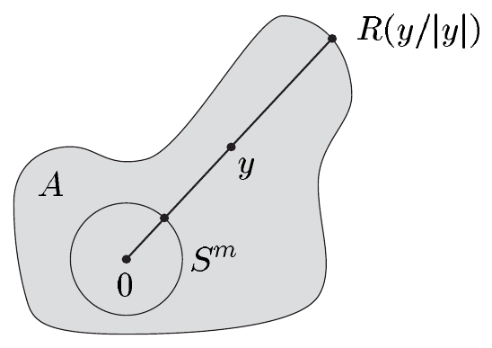
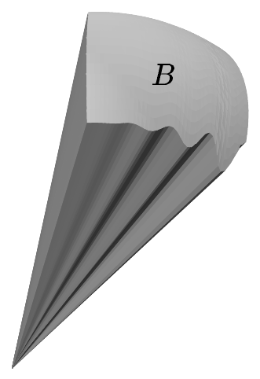

对 $ \lambda_M $-几乎处处的 $ p \in U $（其中 $ x = \varphi(p) $），由 (2.14) 与注 2.1(a) 可得

\[ \int_U \int_V \omega = \int_U \int_V \widehat{\omega}(p,\cdot) = \int_{\varphi(U)} \int_{\psi(V)} \chi_*a(x,y)\,dy\,dx = \int_{\chi(W)} \chi_*a\,d\lambda_{m+n} = \int_W \omega. \]

交换 $ U $ 与 $ V $ 的角色，即得本情形下其余的断言，

(b) 设 $ \{ (\varphi_j,U_j,\pi_j) ;\ j \in \mathbb{N} \} $ 与 $ \{ (\psi_j,V_j,\rho_j) ;\ j \in \mathbb{N} \} $ 分别为 $ M $ 与 $ N $ 的正局部系统。于是，对 $ (p,q) \in M \times N $ 令 $ \pi_j \otimes \rho_k(p,q) := \pi_j(p)\rho_k(q) $，则

\[ \{ (\varphi_j \times \psi_k, U_j \times V_k, \pi_j \otimes \rho_k) ;\ (j,k) \in \mathbb{N}^2 \} \]

为 $ L $ 的正局部系统。由 (a) 可得

\[ \int_{U_j \times V_k} \pi_j \otimes \rho_k \omega = \int_{U_j} \pi_j \int_{V_k} \rho_k \omega \quad \text{对 } (j,k) \in \mathbb{N}^2 . \]

现在断言由注 2.1(b) 推出。■

2.5 推论 设 $ L := M \times N $，并设 $ \pi_1: L \to M $ 与 $ \pi_2: L \to N $ 为典范投影。若 $ \alpha $ 是 $ M $ 上的可积 $ m $-形式，$ \beta $ 是 $ N $ 上的可积 $ n $-形式，则 $ \gamma := \pi_1^*\alpha \wedge \pi_2^*\beta $ 在 $ L $ 上可积，且 $ \int_L \gamma = \int_M \alpha \int_N \beta $。

2.6 注（正则性） 只需 $ M $ 与 $ N $ 是 $ C^1 $ 流形，且定理 2.3 中的 $ f $ 是 $ C^1 $ 微分同胚。■

##### 若干积分的计算

公式 (2.5) 与本节的各个定理为计算体积奠定了基础。我们用一些例子来说明这一点，这些例子中我们始终使用标准度量。

2.7 例 (a) $ (A,B) \in \mathcal{L}_M \times \mathcal{L}_N $ 满足 $ \lambda_{M \times N}(A \times B) = \lambda_M(A)\lambda_N(B) $。特别地，由此可得

\[ \operatorname{vol}(M \times N) = \operatorname{vol}(M)\operatorname{vol}(N) . \]

证明 我们考虑乘积流形 $ L := M \times N $ 上的 $ (m+n) $-形式 $ \omega := \chi_{A \times B}\omega_L = \chi_A\omega_M \wedge \chi_B\omega_N $（见习题 XI.5.1）。于是由推论 2.5 即得该断言（这里考虑到约定 $ 0 \cdot \infty := \infty \cdot 0 := 0 $）。■

(b)（球面） 对 $ m \ge 1 $，$ \mathbb{R}^{m+1} $ 中具有典范定向的 $ m $-球面 $ S^m $ 满足

\[ \int_{S^m} \sum_{j=1}^{m+1} (-1)^{j-1} x^j\,dx^1 \wedge \cdots \wedge \widehat{dx^j} \wedge \cdots \wedge dx^{m+1} = \operatorname{vol}(S^m) . \]

特别地，\footnote{我们已在例 VIII.4.2(a) 中计算过线积分 (2.15)。现在我们理解了这个公式。}

\[ \int_{S^1} x\,dy - y\,dx = 2\pi \tag{2.15} \]

以及

\[ \int_{S^2} x\,dy \wedge dz + y\,dz \wedge dx + z\,dx \wedge dy = 4\pi . \]

证明 这由例 XI.5.3(c) 与 1.13(c) 推出。■

(c)（星形区域） 设 $ m \ge 1 $，并定义 $ f $ 为“极坐标微分同胚”

\[ (0,\infty) \times S^m \to \mathbb{R}^{m+1}\setminus\{0\} , \quad (r,\sigma) \mapsto r\sigma := ri(\sigma) \]

其中 $ i: S^m \hookrightarrow \mathbb{R}^{m+1} $ 是典范嵌入。则

\[ f^*(dy^1 \wedge \cdots \wedge dy^{m+1}) = r^m\,dr \wedge \omega_{S^m} . \tag{2.16} \]

还设 $ R \in \mathcal{L}_1(S^m, \mathbb{R}^+) $，并令

\[ A := \{ y \in \mathbb{R}^{m+1}\setminus\{0\} ;\ |y| \le R(y/|y|) \} . \]

因此 $ A $ 是（关于 $ 0 $ 的）星形区域，其“外边界”在 $ m $-球面上参数化。它满足

\[ \lambda_{m+1}(A) = \frac{1}{m+1} \int_{S^m} R^{m+1}\,d\lambda_{S^m} . \tag{2.17} \]

证明 设 $ (\varphi,U) $ 是 $ S^m $ 的正坐标卡，且 $ h := i \circ \varphi^{-1}: \varphi(U) \to \mathbb{R}^{m+1} $ 为相伴的参数化。则 $ f $ 有局部表示

\[ f_\psi: (0,\infty) \times \varphi(U) \to \mathbb{R}^{m+1} , \quad (r,x) \mapsto rh(x) \]

其中 $ M := (0,\infty) \times S^m $ 的正坐标卡为

\[ (\psi,V) := (\operatorname{id} \times \varphi, (0,\infty) \times U) \]

而 $ \mathbb{R}^{m+1}\setminus\{0\} $ 取平凡坐标卡。因此

\[ df_\psi^j(r,x) = h^j(x)\,dr + r\,dh^j(x) \quad \text{对 } 1 \le j \le m+1 . \]

由容易的归纳法可得

\[ f_\psi^*(dy^1 \wedge \cdots \wedge dy^{m+1}) = df_\psi^1 \wedge \cdots \wedge df_\psi^{m+1} = r^m \sum_{j=1}^{m+1} (-1)^{j-1} h^j\,dr \wedge dh^1 \wedge \cdots \wedge \widehat{dh^j} \wedge \cdots \wedge dh^{m+1} + r^{m+1} dh^1 \wedge \cdots \wedge dh^{m+1} . \]

由 $ |h|^2 = 1 $ 可得 $ \sum_{j=1}^{m+1} h^j\,dh^j = 0 $，也就是说，对每个 $ x \in \varphi(U) $，余向量 $ dh^1(x),\ldots,dh^{m+1}(x) $ 线性无关。因此 $ dh^1 \wedge \cdots \wedge dh^{m+1} = 0 $。由例 XI.5.3(c) 可得

\[ f_\psi^*(dy^1 \wedge \cdots \wedge dy^{m+1}) = r^m\,dr \wedge \sum_{j=1}^{m+1} (-1)^{j-1} h^j\,dh^1 \wedge \cdots \wedge \widehat{dh^j} \wedge \cdots \wedge dh^{m+1} = r^m\,dr \wedge h^*\omega_{S^m} = \psi_*(r^m\,dr \wedge \omega_{S^m}) . \]

因为这对 $ S^m $ 的每个正坐标卡都成立，所以得到 (2.16)。这也说明 $ f $ 是从 $ M $ 到 $ N := \mathbb{R}^{m+1}\setminus\{0\} $ 的保定向微分同胚。

我们令 $ \omega := \chi_A\omega_N = \chi_A\,dy^1 \wedge \cdots \wedge dy^{m+1} $。则变换定理给出

\[ \lambda_{m+1}(A) = \lambda_N(A) = \int_N \omega = \int_M f^*\omega = \int_M f^*\chi_A r^m\,dr \wedge \omega_{S^m} = \int_{f^{-1}(A)} r^m\,dr \wedge \omega_{S^m} . \]

因为 $ f^{-1}(A) = \{ (r,\sigma) \in (0,\infty) \times S^m ;\ 0 < r \le R(\sigma) \} $，所以由富比尼定理可得

\[ \int_{f^{-1}(A)} r^m\,dr \wedge \omega_{S^m} = \int_{S^m} \left( \int_0^{R(\sigma)} r^m\,dr \right)\omega_{S^m}(\sigma) = \frac{1}{m+1} \int_{S^m} R^{m+1}\omega_{S^m} = \frac{1}{m+1} \int_{S^m} R^{m+1}\,d\lambda_{S^m} . \qquad \blacksquare \]

(d)（球面的锥形切片） 设 $ B $ 是 $ S^m $（$ m \ge 1 $）的可测子集。则

\[ K(rB) := \{ t\sigma ;\ 0 \le t \le 1,\ \sigma \in rB \} \]

这是以原点为顶点、以球面 $ rS^m $ 的子集 $ rB $ 为底面的锥。

我们有\footnote{该公式是习题 X.6.1 关于具有“平坦底面”的锥的陈述的类比。}

\[ (m+1)\operatorname{vol}(K(rB)) = r\operatorname{vol}(rB) . \]

对 $ B := S^m $，我们再次得到例 1.13(c) 的公式 $ r\operatorname{vol}(rS^m) = (m+1)\operatorname{vol}(r\mathbb{B}^{m+1}) $。

证明 取 $ R := r\chi_B $，由 (1.10) 可知这可由 (c) 推出。■

(e)（用极坐标做积分） 设 $ g \in \mathcal{L}_0(\mathbb{R}^n) $。则 $ g $ 可积当且仅当

\[ (r \mapsto g(r\sigma)r^{n-1}) \in \mathcal{L}_1((0,\infty)) \quad \text{对几乎每个 } \sigma \in S^{n-1} \]
