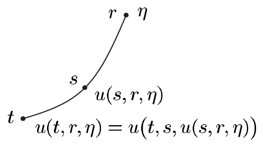

以及

\[ \left(\sigma \mapsto \int_0^\infty g(r\sigma)r^{n-1}\,dr\right) \in \mathcal{L}_1(S^{n-1}) . \]

于是我们有公式\footnote{见命题 X.8.9。}

\[ \int_{\mathbb{R}^n} g\,dx = \int_{S^{n-1}}\int_0^\infty g(r\sigma)r^{n-1}\,dr\,d\lambda_{S^{n-1}} . \tag{2.18} \]

若 $ g $ 是旋转对称的，且对 $ x \in \mathbb{R}^n $ 有 $ g(x) = \dot{g}(|x|) $，则 $ g $ 可积当且仅当 $ \dot{g}(r)r^{n-1} $ 在 $ (0,\infty) $ 上可积。此时 (2.18) 化为

\[ \int_{\mathbb{R}^n} g\,dx = \operatorname{vol}(S^{n-1})\int_0^\infty \dot{g}(r)r^{n-1}\,dr , \]

正如我们已经从定理 X.8.11 知道的那样。

证明 我们考虑 $ N := \mathbb{R}^n\setminus\{0\} $ 上的 $ n $-形式 $ \omega := g\,dy^1\wedge\cdots\wedge dy^n $。则 $ \omega $ 在 $ N $ 上可积当且仅当 $ g $ 属于 $ \mathcal{L}_1(\mathbb{R}^n) $。利用 (c) 中的极坐标微分同胚，由 (2.16) 得到

\[ f^*\omega = (f^*g)r^{n-1}\,dr\wedge\omega_{S^{n-1}} . \]

于是论断由定理 2.3 与推论 2.5 推出。■

##### 向量场的流

所谓 $ M $ 上的（整体）**流**，是指一个光滑映射

\[ \chi : M\times\mathbb{R}\to M , \quad (p,t)\mapsto \chi^t(p) := \chi(p,t) \]

使得

\[ \chi^0 = \operatorname{id}_M \quad \text{且 } \chi^{s+t} = \chi^s\circ\chi^t \quad \text{对 } s,t \in \mathbb{R} . \tag{2.19} \]

由 (2.19) 可得

\[ \chi^t \in \operatorname{Diff}(M,M) \quad \text{且 } (\chi^t)^{-1} = \chi^{-t} \quad \text{对 } t \in \mathbb{R} . \]

由于对 $ p \in M $ 有 $ \chi(p,\cdot) \in C^\infty(\mathbb{R},M) $，向量 $ v(p) := T_0\chi(p,\cdot)(0,1) \in T_pM $ 定义良好，且 $ v $ 是 $ M $ 上的光滑向量场。由 (2.19) 还可得

\[ \frac{d\chi^t(p)}{dt} = v(\chi^t(p)) \quad \text{对 } p \in M \text{ 和 } t \in \mathbb{R} . \tag{2.20} \]

这意味着对每个 $ p \in M $，**轨道** $ \chi(p,\cdot) $ 都是初值问题（在 $ \mathbb{R}^m $ 中）

\[ \dot{y} = v(y) \quad \text{和 } y(0) = p \tag{2.21} \]

的全局解。

以下我们用 $ \mathcal{V}_c^k(M) $ 表示 $ \mathcal{V}^k(M) $ 中由**具有紧支集的 $ C^k $ 向量场**构成的 $ C^k(M) $-子模。我们记 $ \mathcal{V}_c(M) := \mathcal{V}_c^\infty(M) $。

反之，设 $ v \in \mathcal{V}_c(M) $ 且 $ M $ 无边界。那么常微分方程理论\footnote{例如 [Ama95]，若 $ M $ 是 $ \mathbb{R}^m $ 中的开集。借助局部坐标卡（见 [Con93]、[Lan95]），这可推广到一般情形。}表明，恰有一个 $ M $ 上的流 $ \chi $，即**由 $ v $ 生成的流**，满足 (2.20)。把 $ \chi(p,\cdot) $ 看作在时刻 $ t = 0 $ 位于点 $ p $ 的“流体元”的轨道，我们看到 $ v(p) $ 就是这个元经过 $ p $ 时的速度\footnote{注意，与注 2.2(h) 相反，这里考虑的是“定常的”，即与时间无关的向量场。}。在这个解释下，$ \chi^t $ 是整个流场在时刻 $ t $ 的一幅快照。

现在我们来建立向量场的散度与它所生成的流之间的联系。为此，我们先证明一个关于线性非自治微分方程的结果。

2.8 命题（刘维尔） 设 $ A \in C(\mathbb{R},\mathcal{L}(\mathbb{R}^m)) $，且 $ X \in C^1(\mathbb{R},\mathcal{L}(\mathbb{R}^m)) $ 是齐次线性微分方程

\[ \dot{Y} = A(t)Y \quad \text{对 } t \in \mathbb{R} \]

在 $ \mathcal{L}(\mathbb{R}^m) $ 中的解。则 $ W := \det(X) $ 是标量方程

\[ \dot{y} = \operatorname{tr}\big(A(t)\big)y \quad \text{对 } t \in \mathbb{R} . \tag{2.22} \]

的解。因此

\[ W(t) = W(t_0)e^{\int_{t_0}^{t}\operatorname{tr}(A(s))\,ds} \quad \text{对 } t,t_0 \in \mathbb{R} . \]

证明 设 $ r \in \mathbb{R} $。对 $ \eta \in \mathbb{R}^m $，我们考虑初值问题

\[ \dot{y} = A(t)y \quad \text{对 } t \in \mathbb{R} , \quad y(r) = \eta . \tag{2.23;r,\eta} \]

由皮卡–林德勒夫定理（定理 VII.8.14）容易推出，该问题有唯一的全局解 $ u(\cdot,r,\eta) \in C^1(\mathbb{R},\mathbb{R}^m) $。\footnote{见习题 VII.8.13。}于是

\[ u\big(\cdot,s,u(s,r,\eta)\big) \quad \text{对 } r,s \in \mathbb{R} \]

是 $ (2.23)_{s,u(s,r,\eta)} $ 的唯一解。换言之，我们沿 $ (2.23)_{r,\eta} $ 的解 $ u(\cdot,r,\eta) $ 走到时刻 $ s $。然后我们“重新开始”，即重新求解微分方程 $ \dot{y} = A(t)y $，这次把值 $ u(s,r,\eta) $ 取作时刻 $ s $ 的起始值。然而，我们也可以沿解 $ u(\cdot,r,\eta) $ 走到时刻 $ t $。于是 $ (2.23)_{r,\eta} $ 对每个 $ (r,\eta) \in \mathbb{R}\times\mathbb{R}^m $ 都有唯一解，这一点蕴含

\[ u(t,r,\eta) = u\big(t,s,u(s,r,\eta)\big) \quad \text{对 } r,s,t \in \mathbb{R} \text{ 和 } \eta \in \mathbb{R}^m . \tag{2.24} \]

微分方程 $ \dot{y} = A(t)y $ 的线性性以及它有唯一解，容易推出：对任意一对 $ (t,r) \in \mathbb{R}^2 $，$ \eta \mapsto u(t,r,\eta) $ 都是线性函数。因此

\[ u(t,r,\eta) = U(t,r)\eta \quad \text{对 } t,r \in \mathbb{R} \text{ 和 } \eta \in \mathbb{R}^m , \tag{2.25} \]

其中 $ U(t,r) \in \mathcal{L}(\mathbb{R}^m) = \mathbb{R}^{m\times m} $。于是由 (2.24) 读出

\[ U(t,r) = U(t,s)U(s,r) , \quad U(t,t) = 1_m \quad \text{对 } r,s,t \in \mathbb{R} . \tag{2.26} \]

最后，由 (2.25)，并且因为 $ u(\cdot,r,\eta) $ 对每个 $ \eta \in \mathbb{R}^m $ 都是 $ (2.23)_{r,\eta} $ 的解，可知

\[ \partial_1U(t,r) = A(t)U(t,r) \quad \text{对 } t \in \mathbb{R} , \quad U(r,r) = 1_m . \tag{2.27} \]

这表明 $ U(\cdot,r) $ 是 $ E := \mathcal{L}(\mathbb{R}^m) $ 中由

\[ \dot{Y} = A(t)Y \quad \text{对 } t \in \mathbb{R} , \quad Y(r) = 1_m . \]

给出的初值问题\footnote{另一方面，见习题 VII.8.13。}的唯一全局解。

现在设 $ B = [b_1,\ldots,b_m] \in \mathbb{R}^{m\times m} $。则上述讨论表明

\[ U(\cdot,r)B = \big[U(\cdot,r)b_1,\ldots,U(\cdot,r)b_m\big] \]

是

\[ \dot{Y} = A(t)Y \quad \text{对 } t \in \mathbb{R} , \quad Y(r) = B \]

在 $ E $ 中的唯一全局解。若 $ X $ 是 $ \dot{Y} = A(t)Y $ 的某个解，则取 $ B := X(r) $ 可得

\[ X(t) = U(t,r)X(r) \quad \text{对 } r,t \in \mathbb{R} . \tag{2.28} \]

我们固定 $ r $，并令 $ \alpha(t) := \det\big(U(t,r)\big) $。则例 VII.4.8(a) 连同 (2.27) 以及关系式 $ U(t,r) = [u_1(t),\ldots,u_m(t)] $ 给出

\[ \begin{aligned} \dot{\alpha}(t) &= \sum_{j=1}^{m}\det\big[u_1(t),\ldots,u_{j-1}(t),\dot{u}_j(t),u_{j+1}(t),\ldots,u_m(t)\big] \\ &= \sum_{j=1}^{m}\det\big[u_1(t),\ldots,u_{j-1}(t),A(t)u_j(t),u_{j+1}(t),\ldots,u_m(t)\big] . \end{aligned} \tag{2.29} \]

对 $ t = r $，由 $ U(r,r) = 1_m $ 读出：对 $ 1 \le j \le m $ 有 $ u_j(r) = e_j $，其中 $ (e_1,\ldots,e_m) $ 表示 $ \mathbb{R}^m $ 的标准基。于是 (2.29) 给出

\[ \begin{aligned} \dot{\alpha}(r) &= \sum_{j=1}^{m}\det\big[e_1,\ldots,e_{j-1},a_j(r),e_{j+1},\ldots,e_m\big] \\ &= \sum_{j=1}^{m}a_j^j(r) = \operatorname{tr}\big(A(r)\big) \end{aligned} \tag{2.30} \]

其中 $ A(r) = [a_1(r),\ldots,a_m(r)] $。最后，由 (2.28) 得到 $ \dot{X}(t) = \partial_1U(t,r)X(r) $，因此

\[ \dot{W}(t) = \dot{\alpha}(t)W(r) \quad \text{对 } t \in \mathbb{R} . \]

由此及 (2.30) 得到

\[ \dot{W}(r) = \operatorname{tr}\big(A(r)\big)W(r) \quad \text{对 } r \in \mathbb{R} , \]

这表明 $ W $ 满足方程 (2.22)。至此，论断是例 VII.8.11(e) 的推论。■

2.9 注 (a) 命题 2.8 的证明已经为初值问题 $ (2.23)_{r,\eta} $ 产生了一批结果，它们推广了第 VII.1 节中关于常矩阵 $ A \in \mathcal{L}(\mathbb{R}^n) $ 的线性微分方程 $ \dot{x} = Ax $ 的相应结果。特别地，这种情形有

\[ e^{(t-s)A} = U(t,s) \quad \text{对 } s,t \in \mathbb{R} . \]

在与时间无关的情形，定理 VII.1.11(ii) 说 $ t \mapsto e^{tA} $ 是群同态；在非自治情形，即在“时变系数”的情形，这一结论被 (2.26) 取代。

(b) 若 $ X $ 是 $ \mathcal{L}(\mathbb{R}^m) $ 中解微分方程 $ \dot{Y} = A(t)Y $ 的矩阵，则 $ W := \det(X) $ 称为**朗斯基行列式**（Wronskian 或 Wronski determinant）。由命题 2.8 中给出的 $ W $ 的显式形式可知，$ W(t) $ 对每个 $ t \in \mathbb{R} $ 都不为零，当且仅当对某个 $ t_0 \in \mathbb{R} $ 有 $ W(t_0) \ne 0 $。此时，$ X $ 的各列 $ x_1,\ldots,x_m $ 构成微分方程 $ \dot{y} = A(t)y $ 在 $ \mathbb{R}^m $ 中的一个**基本解组**，因为我们容易验证该方程的每个解都能写成 $ x_1,\ldots,x_m $ 的线性组合。■

现在我们可以建立前面提到的向量场的流与其散度之间的联系。

2.10 命题 设 $ M $ 无边界且是伪黎曼的。又设 $ v \in \mathcal{V}_c(M) $，且 $ \chi $ 是由 $ v $ 生成的 $ M $ 上的流。则

\[ \operatorname{div}(v)\omega_M = (\chi^t)_*\frac{d}{ds}\big[(\chi^s)^*\omega_M\big]\Big|_{s=t} \quad \text{对 } t \in \mathbb{R} , \]
