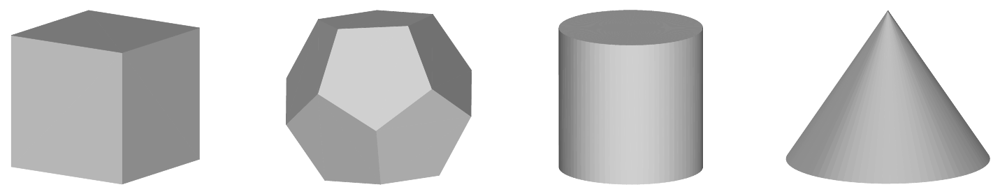
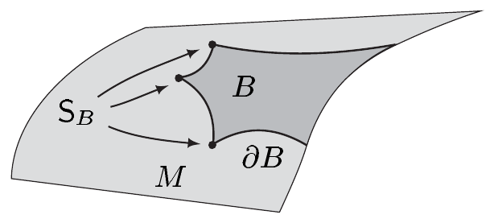
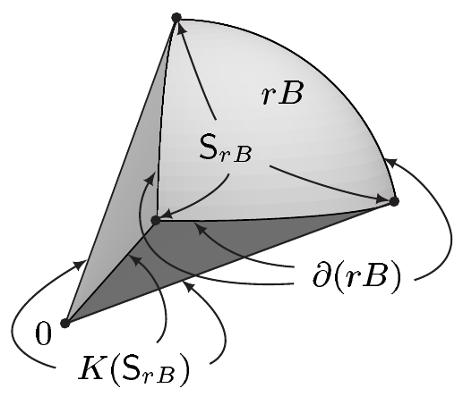
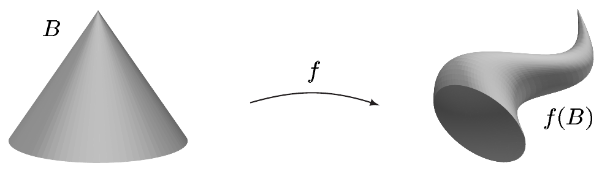

## 3 斯托克斯定理

在本节中，我们把流形上的微分学与积分学结合起来，并证明一般的斯托克斯定理。它是微积分基本定理的高维推广，在数学与理论物理中有大量应用。特别地，它构成了拓扑学与几何学中理论探索的基础，不过我们不在这里深入这些主题。

我们说明斯托克斯定理如何用于计算体积，以及它如何为算子 $ \operatorname{div} $ 与 $ \operatorname{curl} $ 提供物理解释。作为一个拓扑应用，我们证明布劳威尔不动点定理。

本节最后，我们建立外积与余微分之间的联系，不过我们把这一联系的全部意义留待后续的整体分析课程。

本节中始终假设

- $ m \ge 2 $；
- $ M $ 是 $ m $ 维定向流形。

若 $ M $ 带边界，则 $ \partial M $ 将由外法向定向（相对于周围空间 $ \mathbb{R}^m $ 诱导的度量）。

##### 光滑流形上的斯托克斯定理

我们用 $ i: \partial M \hookrightarrow M $ 表示自然嵌入，并回忆定义

\[ \int_{\partial M} \omega := \int_{\partial M} i^*\omega = \int_{\partial M} \omega|\partial M \qquad \text{对 } \omega \in \Omega^{m-1}(M), \]

只要 $ \omega|\partial M $ 可积，它就是有意义的。此外，我们约定 $ \int_\varnothing \omega := 0 $。

3.1 定理（斯托克斯） 任意 $ \omega \in \Omega_c^{m-1}(M) $ 都满足 $ \int_M d\omega = \int_{\partial M} \omega $。

证明 (i) 首先考虑 $ M = \mathbb{R}^m $ 的情形。此时 $ \partial M = \varnothing $，且 $ \omega $ 有表示

\[ \omega = \sum_{j=1}^{m} (-1)^{j-1} a_j \, dx^1 \wedge \cdots \wedge \widehat{dx^j} \wedge \cdots \wedge dx^m \tag{3.1} \]

其中 $ a_j \in \mathcal{D}(\mathbb{R}^m) $，如我们从例 XI.3.2(b) 所知。例 XI.3.7(b) 蕴含

\[ d\omega = \left( \sum_{j=1}^{m} \partial_j a_j \right) dx^1 \wedge \cdots \wedge dx^m. \tag{3.2} \]

因此由注 2.1(a) 推出

\[ \int_M d\omega = \int_{\mathbb{R}^m} \sum_{j=1}^{m} \partial_j a_j \, dx = \sum_{j=1}^{m} \int_{\mathbb{R}^m} \partial_j a_j \, dx = 0, \]

其中，由于 $ \partial_j a_j = \mathbf{1}\partial_j a_j $，最后一个等式由分部积分推出，依据是命题 X.7.22。因此在这一情形下结论成立，因为 $ \int_{\partial M} \omega = \int_\varnothing \omega = 0 $。

(ii) 设 $ M = \overline{\mathbb{H}}^m $。此时 (3.1) 与 (3.2) 同样成立，只是现在 $ a_j $ 属于 $ C_c^\infty(\overline{\mathbb{H}}^m) $。由富比尼定理与命题 X.7.22，取 $ x' = (x^1, \ldots, x^{m-1}) $，我们得到

\[ \int_{\overline{\mathbb{H}}^m} \partial_j a_j \, dx = \int_0^\infty \left( \int_{\mathbb{R}^{m-1}} \partial_j a_j \, dx' \right) dx^m = 0 \qquad \text{对 } 1 \le j \le m-1. \tag{3.3} \]

富比尼定理与微积分基本定理蕴含

\[ \int_{\overline{\mathbb{H}}^m} \partial_m a_m \, dx = \int_{\mathbb{R}^{m-1}} \left( \int_0^\infty \partial_m a_m \, dx^m \right) dx' = - \int_{\mathbb{R}^{m-1}} a_m(x', 0) \, dx'. \tag{3.4} \]

因为 $ i(x') = (x', 0) $，由例 XI.3.4(j) 推出

\[ i^*\omega = (-1)^{m-1} i^* a_m \, dx^1 \wedge \cdots \wedge dx^{m-1}. \tag{3.5} \]

由于 $ \partial\overline{\mathbb{H}}^m $ 的标准定向（见例 XI.5.3(h)）以及 (3.2)、(3.3) 与 (3.5)，我们可以把 (3.4) 写成如下形式

\[ \begin{aligned} \int_M d\omega &= \int_{\overline{\mathbb{H}}^m} \partial_m a_m \, dx = - \int_{\mathbb{R}^{m-1}} i^* a_m \, dx' \\ &= (-1)^{m-1} \int_{\partial\overline{\mathbb{H}}^m} (i^* a_m) \, dx^1 \wedge \cdots \wedge dx^{m-1} = \int_{\partial M} i^*\omega = \int_{\partial M} \omega. \end{aligned} \]

于是这一情形下结论也成立。

(iii) 现在设 $ \partial M = \varnothing $，且 $ M $ 由单个（正）坐标卡 $ (\varphi, M) $ 描述。由于 $ \omega $ 具有紧支集，$ \varphi_*\omega $ 属于 $ \Omega_c^{m-1}(\mathbb{R}^m) $。由 $ \varphi_* = (\varphi^{-1})^* $ 与定理 XI.4.10 推出 $ \varphi_* \circ d = d \circ \varphi_* $。因此 (i) 给出

\[ \int_M d\omega = \int_{\varphi(M)} \varphi_* d\omega = \int_{\varphi(M)} d(\varphi_*\omega) = \int_{\mathbb{R}^m} d(\varphi_*\omega) = 0 = \int_\varnothing \omega = \int_{\partial M} \omega. \]

(iv) 设 $ \partial M \neq \varnothing $，且 $ M $ 由单个（正）坐标卡 $ (\varphi, M) $ 描述。则 $ \{(\varphi_\partial, \partial M)\} $，其中 $ \varphi_\partial := \varphi|\partial M $，是 $ \partial M $ 的一个正图册。此外 $ \varphi_*\omega $ 在 $ \overline{\mathbb{H}}^m $ 中具有紧支集，且 $ i \circ \varphi_\partial^{-1} = \varphi^{-1} \circ i_{\partial\overline{\mathbb{H}}^m} $。因此

\[ (\varphi_\partial)_* i^* = (i_{\partial\overline{\mathbb{H}}^m})^* \varphi_*. \]

因此由 (ii)，类似于步骤 (iii)，推出

\[ \begin{aligned} \int_M d\omega &= \int_{\varphi(M)} \varphi_* d\omega = \int_{\varphi(M)} d(\varphi_*\omega) = \int_{\overline{\mathbb{H}}^m} d(\varphi_*\omega) \\ &= \int_{\partial\overline{\mathbb{H}}^m} i^*_{\partial\overline{\mathbb{H}}^m} \varphi_*\omega = \int_{\partial\overline{\mathbb{H}}^m} (\varphi_\partial)_* i^*\omega = \int_{\partial M} i^*\omega = \int_{\partial M} \omega. \end{aligned} \]

这证明了这一情形下的结论。

(v) 最后，设 $ \{(\varphi_j, U_j, \pi_j) ; j \in \mathbb{N}\} $ 是 $ M $ 的一个局部系统。因为 $ K := \operatorname{supp}(\omega) $ 是紧致的，我们可以这样选取它，使得存在 $ k \in \mathbb{N} $，满足当 $ j > k $ 时 $ \operatorname{supp}(\pi_j) \cap K = \varnothing $。令 $ \omega_j := \pi_j\omega|U_j \in \Omega_c^{m-1}(U_j) $，则推出 $ \omega = \sum_{j=0}^{k} \omega_j $。因此由 (iii) 与 (iv)，我们得到

\[ \int_M d\omega = \sum_{j=0}^{k} \int_M d\omega_j = \sum_{j=0}^{k} \int_{U_j} d\omega_j = \sum_{j=0}^{k} \int_{\partial U_j} \omega_j = \sum_{j=0}^{k} \int_{\partial M} \omega_j = \int_{\partial M} \omega. \]

这里我们用到了 $ \{(\varphi_{j,\partial}, \partial U_j, i^*\pi_j) ; j \in \mathbb{N}\} $ 是 $ \partial M $ 的一个局部系统，且当 $ j > k $ 时 $ \operatorname{supp}(i^*\pi_j) \cap K = \varnothing $。■

##### 带奇点的流形

对许多应用来说，$ M $ 是流形这一假设过于严格。人们还希望把斯托克斯定理应用于诸如柱体或锥体这样的“分段光滑流形”。

若没有“奇点”，也就是棱、角、尖点等，上述集合本会是带边界的流形。事实上，这些例外由相对于边界来说“薄”的集合组成。因此可以预料，就积分而言，奇点无关紧要。

我们现在引入一类“带薄奇异集的流形”，它包含上述例子，并且我们证明斯托克斯定理对这些对象也成立。

设 $ B $ 是 $ M $ 的闭子集且内部非空。我们把所有满足以下条件的 $ p \in B $ 组成的集合记为 $ \mathrm{M}_B $：存在 $ p $ 在 $ M $ 中的开邻域 $ V_p $，使得 $ B \cap V_p $ 是 $ V_p $ 的 $ m $ 维子流形。于是 $ \mathrm{M}_B $ 是 $ M $ 的 $ m $ 维子流形，即 $ B $ 的**支撑流形**。集合 $ \mathrm{S}_B := B \setminus \mathrm{M}_B $ 称为 $ B $ 的**奇异集**，而 $ B $ 称为 $ M $ 的 $ m $ 维**带奇点的子流形**。显然 $ \mathrm{S}_B $ 在 $ M $ 中是闭的。

所谓 $ B $ 的边界，我们指的是 $ \mathrm{M}_B $ 的边界；即 $ \partial B := \partial\mathrm{M}_B $。不要把 $ \partial B $ 与 $ B $ 在 $ M $ 中的拓扑边界 $ \operatorname{Rd}(B) $ 混淆。最后，我们给 $ \mathrm{M}_B $ 赋予由 $ M $ 典范诱导的定向。

设 $ \mathcal{H}^s $ 是 $ M $ 上的 $ s $ 维豪斯多夫测度（其中 $ M $ 带有由 $ \mathbb{R}^m $ 诱导的度量）。于是，当它是 $ \mathcal{H}^{m-1} $-零集时，我们称 $ B $ 的奇异集 $ \mathrm{S}_B $ 是**薄的**。在这一情形下，$ B $ 是**带薄奇异集的流形**。

如果我们只要求集合 $ \mathrm{M}_B $ 是某个 $ k \in \mathbb{N}^\times $ 的 $ C^k $ 类子流形，那么我们自然称 $ B $ 为 $ M $ 的带奇点的 $ C^k $ 子流形。这里只要求 $ M $ 是 $ C^k $ 流形。

3.2 例

（a）$ M $ 的每个在 $ M $ 中拓扑闭的 $ m $ 维子流形——特别地 $ M $ 本身——都具有薄的（实际上是空的）奇异集。

（b）若豪斯多夫维数满足 $ \dim_H(\mathrm{S}_B) < m-1 $，则 $ \mathrm{S}_B $ 是薄的。

证明 这由习题 IX.3.5 中 $ \dim_H $ 的定义推出。■

（c）设 $ (J_k) $ 是 $ \mathbb{R}^{m-2} $ 中的一列区间，且 $ f_k \in C^{1-}(J_k, M) $ 满足 $ \bigcup_{k=0}^{\infty} f_k(J_k) = \mathrm{S}_B $。则 $ \mathrm{S}_B $ 是薄的。

证明 由习题 IX.3.6(a) 与 (f) 推出 $ \dim_H(f_k(J_k)) \le m-2 $。因此对每个 $ k \in \mathbb{N} $，$ f_k(J_k) $ 都是 $ \mathcal{H}^{m-1} $-零集，而豪斯多夫测度的 $ \sigma $-次可加性完成证明。■

（d）（分段光滑区域） 设 $ \Omega $ 是 $ M $ 中的非空**区域**，即 $ M $ 的非空开连通子集。于是 $ \mathrm{S}_{\overline{\Omega}} $ 与 $ \mathrm{M}_{\overline{\Omega}} $，从而 $ \partial\overline{\Omega} = \partial\mathrm{M}_{\overline{\Omega}} $ 也有定义。设 $ \mathbb{B}_\infty^{m-1} = (-1,1)^{m-1} $ 是 $ (\mathbb{R}^{m-1}, |\cdot|_\infty) $ 中的开单位球。我们称 $ \Omega $ 是 $ M $ 中的**分段光滑区域**，如果存在有限多个函数\footnote{如果 $ \overline{\Omega} $ 只是 $ M $ 的带奇点的 $ C^k $ 子流形，我们称 $ \Omega $ 为 $ M $ 中的**分段 $ C^k $ 区域**。}

\[ h_j \in C^1(\overline{\mathbb{B}}_\infty^{m-1}, M) \cap C^\infty(\mathbb{B}_\infty^{m-1}, M) \qquad \text{对 } 0 \le j \le n \]

使得

（i）$ h_j|\mathbb{B}_\infty^{m-1} $ 是 $ \partial\overline{\Omega} $ 的某个子集的参数化，$ 0 \le j \le n $；

（ii）$ \partial\overline{\Omega} = \bigcup_{j=0}^{n} h_j(\mathbb{B}_\infty^{m-1}) $；

（iii）$ \operatorname{Rd}(\Omega) = \bigcup_{j=0}^{n} h_j(\overline{\mathbb{B}}_\infty^{m-1}) $。

则 $ \overline{\Omega} $ 是 $ M $ 的带薄奇异集的 $ m $ 维子流形，并且我们约定 $ \partial\Omega := \partial\overline{\Omega} $。更确切地说，我们有

\[ \mathrm{S}_{\overline{\Omega}} = \bigcup_{j=0}^{n} h_j(\operatorname{Rd}(\mathbb{B}_\infty^{m-1})) \qquad \text{且} \qquad \mathrm{M}_{\overline{\Omega}} = \Omega \cup \bigcup_{j=0}^{n} h_j(\mathbb{B}_\infty^{m-1}), \]

并且 $ \overline{\Omega} $ 具有紧边界 $ \operatorname{Rd}(\Omega) $。此外，$ \partial\Omega = \operatorname{Rd}(\Omega) $ 当且仅当 $ \overline{\Omega} $ 的奇异集为空。

证明 中值定理与 $ M \hookrightarrow \mathbb{R}^m $ 蕴含 $ h_j \in C^{1-}(\overline{\mathbb{B}}_\infty^{m-1}, M) $（见注 VII.3.11(b)）。因此 $ h_j|\operatorname{Rd}(\mathbb{B}_\infty^{m-1}) $ 也局部利普希茨连续，而结论由 (c) 推出。■

（e）$ \mathbb{R}^m $ 中每个内部非空的开多面体都是 $ \mathbb{R}^m $ 中的分段光滑区域。其边界由“开的”$ (m-1) $ 维“面”组成。换言之，奇异集由所有位于维数 $ \le m-2 $ 的“棱”中的点组成。因此，例如 $ \mathbb{R}^3 $ 中立方体的奇异集由 12 条棱与 8 个顶点组成。

证明 这由 (d) 推出。■

（f）设 $ M $ 与 $ N $ 分别是 $ \mathbb{R}^m $ 与 $ \mathbb{R}^n $ 的 $ m $ 维与 $ n $ 维拓扑闭子流形。则 $ B := M \times N $ 是 $ \mathbb{R}^{m+n} $ 的带薄奇异集的子流形。更确切地说，

\[ \mathrm{S}_B = \partial M \times \partial N, \qquad \partial B = (\mathring{M} \times \partial N) \cup (\partial M \times \mathring{N}), \qquad \mathrm{M}_B = (\mathring{M} \times \mathring{N}) \cup \partial B. \]

证明 容易看出 $ \mathrm{S}_B $、$ \mathrm{M}_B $ 与 $ \partial B $ 就是所给的集合。由习题 XI.1.8，我们知道 $ \dim_H(\partial M) \le m-1 $ 且 $ \dim_H(\partial N) \le n-1 $。因此习题 IX.3.8 表明 $ \dim_H(\partial M \times \partial N) \le m+n-2 $。于是 $ \mathrm{S}_B $ 是薄的。■

（g）设 $ B $ 是 $ S^m $ 的带薄奇异集的 $ m $ 维子流形，且 $ r > 0 $。则例 2.7(d) 的锥 $ K(rB) $ 是 $ \mathbb{R}^{m+1} $ 的带薄奇异集的 $ (m+1) $ 维子流形。更确切地说（约定 $ K(\varnothing, r) := \varnothing $），我们有

\[ \mathrm{S}_{K(rB)} = \{0\} \cup K(\mathrm{S}_{rB}) \cup \partial(rB) \]

以及

\[ \partial K(rB) = \operatorname{int}(rB) \cup \{ t\,i(\sigma) ; 0 < t < 1,\ \sigma \in \partial(rB) \} \]

其中 $ i: rB \hookrightarrow \mathbb{R}^{m+1} $。

证明 我们留给你去验证所给出的奇异集与 $ K(rB) $ 的边界的表示。由 $ \dim_H(\partial B) \le m-1 $ 与习题 IX.1.4(b)，$ r\partial B = \partial(rB) $ 是 $ \mathcal{H}^m $-零集。

作为紧致集 $ S^m $ 的闭子集，集合 $ \mathrm{S}_B $ 在 $ \mathbb{R}^{m+1} $ 中是紧致的。设 $ \varepsilon \in (0,1] $ 且 $ \rho > 0 $。因为 $ \mathrm{S}_B $ 是 $ \mathcal{H}^{m-1} $-零集，存在 $ \mathbb{R}^{m+1} $ 中的开集 $ O_0, \ldots, O_J $，使得 $ \operatorname{diam} O_j < \varepsilon $ 且

\[ \sum_{j=0}^{J} [\operatorname{diam} O_j]^{m-1} < \rho. \]

设 $ K \in \mathbb{N}^\times $ 满足 $ K\varepsilon < r \le (K+1)\varepsilon $。则区间

\[ J_k := [k\varepsilon, (k+1)\varepsilon] \qquad \text{对 } 0 \le k \le K \]

覆盖区间 $ [0,r] $，且满足 $ \operatorname{diam}(J_k) = \varepsilon $。因此

\[ \{ Q_j \times J_k ; 0 \le j \le J,\ 0 \le k \le K \} \]

是 $ \mathrm{S}_B \times [0,r] $ 在 $ \mathbb{R}^{m+1} \times \mathbb{R} $ 中由 $ \mathbb{R}^{m+1} $ 的子集构成的覆盖，且满足

\[ \operatorname{diam}(Q_j \times J_k) \le \sqrt{2}\varepsilon\operatorname{diam}(Q_j) \le \sqrt{2}\operatorname{diam}(Q_j) \le \sqrt{2}\varepsilon. \]

由此我们得到

\[ \begin{aligned} \sum_{j=0}^{J}\sum_{k=0}^{K} [\operatorname{diam}(Q_j \times J_k)]^m &\le (K+1)2^{m/2}\sum_{j=0}^{J}[\operatorname{diam} Q_j]^m \\ &\le (r+1)2^{m/2}\sum_{j=0}^{J}\varepsilon^{-1}[\operatorname{diam} Q_j]^m \\ &\le (r+1)2^{m/2}\sum_{j=0}^{J}[\operatorname{diam} Q_j]^{m-1} < (r+1)2^{m/2}\rho. \end{aligned} \]

由于这对每个 $ \varepsilon \in (0,1] $ 与每个 $ \rho > 0 $ 都成立，我们从习题 IX.3.4(a) 看出 $ \mathrm{S}_B \times [0,r] $ 是 $ \mathbb{R}^{m+1} \times \mathbb{R} $ 中的 $ \mathcal{H}^m $-零集。显然 $ K(\mathrm{S}_{rB}) $ 是 $ \mathrm{S}_B \times [0,r] $ 在如下利普希茨连续映射下的像：

\[ \mathbb{R}^{m+1} \times \mathbb{R} \to \mathbb{R}^{m+1}, \qquad (x,t) \mapsto tx \]

因此习题 IX.3.4(b) 蕴含 $ K(\mathrm{S}_{rB}) $ 也是 $ \mathcal{H}^m $-零集。由此推出 $ \mathrm{S}_{K(rB)} $ 是薄奇异集。■

（h）设 $ N $ 是 $ m $ 维流形，且 $ f \in \operatorname{Diff}(M,N) $。若 $ B $ 是 $ M $ 的带薄奇异集的子流形，则 $ f(B) $ 是 $ N $ 的带薄奇异集的子流形。

证明 这容易由注 XI.1.1(g) 与习题 IX.3.4(b) 推出。■

