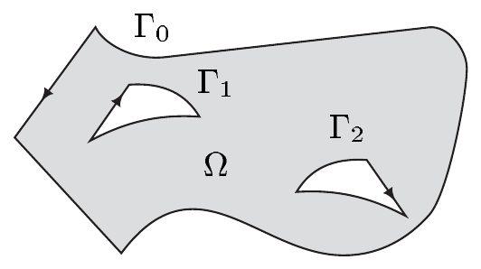
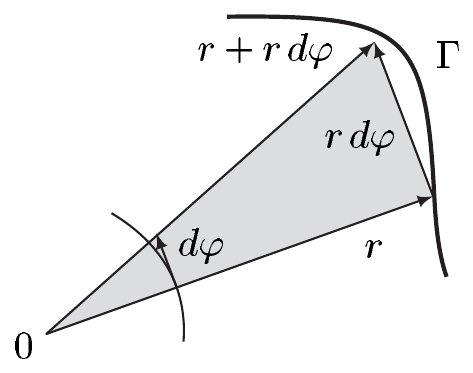
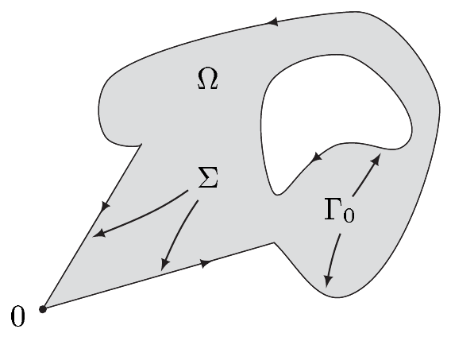

##### 带奇点的斯托克斯定理

我们现在把定理 3.1 推广到带薄奇异集的 $ C^2 $ 流形的情形。\footnote{我们的证明遵循 [Lan95] 中给出的想法。另一种途径见 [HR72] 与 [AMR83]。} 我们首先需要一个引理。这里我们用 $ \mathbb{B}^m(A,r) $ 表示 $ A \subset \mathbb{R}^m $ 的半径为 $ r > 0 $ 的开邻域，即

\[ \mathbb{B}^m(A,r) := \bigcup_{x\in A}\mathbb{B}^m(x,r) = \{ x\in\mathbb{R}^m ;\ \operatorname{dist}(x,A) < r \} \]

若 $ A \neq \varnothing $。

3.3 引理 设 $ K $ 是 $ \mathbb{R}^m $ 中的非空紧 $ \mathcal{H}^{m-1} $-零集。则对每一对 $ \varepsilon, r > 0 $，存在开集 $ U $ 与 $ V $ 以及 $ \chi \in \mathcal{E}(\mathbb{R}^m) $，使得

\[ K \subset\subset U \subset\subset V \subset\subset \mathbb{B}^m(K,r) \tag{3.6} \]

且

\[ \chi|U = 0 , \quad \chi|V^c = \mathbf{1} , \quad 0 \le \chi \le \mathbf{1} , \quad \int_{\mathbb{R}^m} |\nabla\chi| \, dx \le \varepsilon . \tag{3.7} \]

证明 我们固定一个 $ \psi \in \mathcal{E}(\mathbb{R}) $，其中 $ 0 \le \psi \le \mathbf{1} $，令 $ \psi|[0,1] = 0 $ 且 $ \psi|[2,\infty) = \mathbf{1} $，并置 $ \kappa := 2^m\operatorname{vol}(\mathbb{B}^m)\|\psi'\|_\infty $。因为 $ \mathcal{H}^{m-1}(K) = 0 $，故对每个 $ \delta > 0 $ 都有 $ \mathcal{H}^{m-1}_\delta(K) = 0 $。由于 $ K $ 紧，存在开集 $ W_j $（$ 0 \le j \le n $）使得 $ K \subset \bigcup_{j=0}^{n} W_j $，$ K \cap W_j \neq \varnothing $，且 $ \rho_j := \operatorname{diam}(W_j) < r/3 $，并且

\[ \sum_{j=0}^{n}\rho_j^{m-1} \le \varepsilon/\kappa . \tag{3.8} \]

我们选取 $ x_j \in W_j \cap K $，并置 $ U_j := \mathbb{B}^m(x_j,\rho_j) $ 与 $ V_j := \mathbb{B}^m(x_j,2\rho_j) $（$ 0 \le j \le n $）。则 $ U := \bigcup_{j=0}^{n}U_j $ 与 $ V := \bigcup_{j=0}^{n}V_j $ 是开集，并且满足 (3.6)，因为对 $ 0 \le j \le n $ 有 $ U_j \supset W_j $。

现在我们置

\[ \chi(x) := \prod_{j=0}^{n}\psi\left(\frac{|x-x_j|}{\rho_j}\right) \quad \text{对 } x \in \mathbb{R}^m . \]

则 $ \chi $ 属于 $ \mathcal{E}(\mathbb{R}^m) $，并且满足 $ \chi|U = 0 $ 与 $ \chi|V^c = \mathbf{1} $。我们还有

\[ \nabla\chi(x) = \sum_{j=0}^{n}\psi'\left(\frac{|x-x_j|}{\rho_j}\right)\frac{x-x_j}{|x-x_j|}\frac{1}{\rho_j}\prod_{k=0,\,k\neq j}^{n}\psi\left(\frac{|x-x_k|}{\rho_k}\right) \]

对 $ x \in \mathbb{R}^m $，因此

\[ |\nabla\chi| \le \|\psi'\|_\infty \sum_{j=0}^{n}\rho_j^{-1}\chi_{[\rho_j \le |x-x_j| \le 2\rho_j]} . \]

然后这与勒贝格测度的平移不变性给出

\[ \begin{aligned} \int_{\mathbb{R}^m}|\nabla\chi|\,dx &\le \|\psi'\|_\infty \sum_{j=0}^{n}\rho_j^{-1}\operatorname{vol}(2\rho_j\mathbb{B}^m) \\ &= 2^m\operatorname{vol}(\mathbb{B}^m)\|\psi'\|_\infty \sum_{j=0}^{n}\rho_j^{m-1} = \kappa \sum_{j=0}^{n}\rho_j^{m-1} . \end{aligned} \]

由 (3.8)，这蕴含 (3.7) 的最后一个断言。■

我们现在可以证明前面预告的斯托克斯定理的推广。

3.4 定理（带奇点的斯托克斯定理） 设 $ B $ 是 $ M $ 的具有薄奇异集的 $ m $ 维子流形，并设 $ \omega \in \Omega_c^{m-1}(M) $。若 $ \omega|\partial B $ 可积，则 $ \int_B d\omega = \int_{\partial B}\omega $。

证明 (i) 设 $ M $ 是 $ \overline{\mathbb{H}}^m $ 中的开集，且 $ K := S_B \cap \operatorname{supp}(\omega) $。由于 $ \operatorname{supp}(\omega) $ 紧且 $ S_B $ 在 $ M $ 中闭，我们知道 $ K $ 是 $ \mathbb{R}^m $ 中的紧 $ \mathcal{H}^{m-1} $-零集。因此由引理 3.3，对每个 $ \varepsilon > 0 $ 与 $ k \in \mathbb{N}^\times $，存在常数 $ \kappa > 0 $ 与开集 $ U_k $、$ V_k $，使得

\[ K \subset\subset U_k \subset\subset V_k \subset\subset \mathbb{B}^m(K,1/k) . \]

还存在 $ \chi_k \in \mathcal{E}(\mathbb{R}^m) $ 使得

\[ \chi_k|U_k = 0 , \quad \chi_k|V_k^c = \mathbf{1} , \quad 0 \le \chi_k \le \mathbf{1} , \quad \int_{\mathbb{R}^m}|\nabla\chi_k|\,dx \le \varepsilon . \]

特别地，

\[ \bigcap_{k=1}^{\infty}(\overline{V_k}\cap\partial B) = \varnothing . \tag{3.9} \]

我们置 $ \omega_k := \chi_k\omega $。则 $ \omega_k $ 属于 $ \Omega_c^{m-1}(M_B) $。于是因为 $ B\setminus M_B = S_B $ 是 $ \lambda_m $-零集，定理 3.1 给出

\[ \int_B d\omega_k = \int_{M_B}d\omega_k = \int_{\partial M_B}\omega_k = \int_{\partial B}\omega_k \quad \text{对 } k \in \mathbb{N}^\times . \tag{3.10} \]

令 $ \psi_k := 1-\chi_k $，可得

\[ \int_{\partial B}\omega - \int_{\partial B}\omega_k = \int_{\partial B}(1-\chi_k)\omega = \int_{\partial B}\psi_k\omega . \]

因为 $ \omega|\partial B $ 可积且 $ \operatorname{supp}(\psi_k) \subset \overline{V}_k $，(3.9) 与勒贝格定理（见习题 2.1）蕴含 $ (\int_{\partial B}\psi_k\omega) $ 是零序列。因此

\[ \lim_{k\to\infty}\int_{\partial B}\omega_k = \int_{\partial B}\omega . \tag{3.11} \]

此外，定理 XI.4.10(ii) 给出等式

\[ \int_B d\omega_k = \int_B d\chi_k\wedge\omega + \int_B \chi_k d\omega . \tag{3.12} \]

由于 $ B\setminus M_B $ 是 $ \lambda_m $-零集，我们有

\[ \int_B \chi_k d\omega = \int_{M_B}\chi_k d\omega \quad \text{对 } k \in \mathbb{N}^\times . \]

因为 $ d\omega \in \Omega^m(M) $ 具有紧支集，$ d\omega $ 在 $ M_B $ 上可积。又 $ \chi_k(x) \to 1 $ 对 $ x \in M_B $。再次利用勒贝格定理，我们得到

\[ \lim_{k\to\infty}\int_B \chi_k d\omega = \int_B d\omega . \tag{3.13} \]

现在 $ \omega $ 有表示 $ \omega = \sum_{j=1}^{m}(-1)^{j-1}a_j dx^1\wedge\cdots\wedge\widehat{dx^j}\wedge\cdots\wedge dx^m $，其中 $ a_j \in \mathcal{D}(M) $。由此读出 $ d\chi_k\wedge\omega = b_k\omega_{\mathbb{R}^n} $，其中

\[ b_k := \sum_{j=1}^{m}a_j\partial_j\chi_k \quad \text{对 } k \in \mathbb{N}^\times . \]

因此我们得到

\[ \left|\int_B d\chi_k\wedge\omega\right| = \left|\int_M b_k\,dx\right| \le c\int_{\mathbb{R}^m}|\nabla\chi_k|\,dx \le c\varepsilon \quad \text{对 } k \in \mathbb{N}^\times , \]

其中 $ c $ 是与 $ k $ 无关的常数。当 $ k\to\infty $ 时，结果 (3.10)–(3.13) 蕴含

\[ \left|\int_B d\omega - \int_{\partial B}\omega\right| \le c\varepsilon . \]

因为这对每个 $ \varepsilon > 0 $ 都成立，故本情形下断言得证。

(ii) 现在设 $ M $ 由单个坐标卡 $ (\varphi,U) $ 描述。则断言可由 (i) 通过“向下移动”到 $ \varphi(U) \subset \overline{\mathbb{H}}^m $ 得到。

(iii) 最后设 $ M $ 任意，而 $ \{(\varphi_j,U_j,\pi_j) ;\ j\in\mathbb{N}\} $ 是 $ M $ 的局部系统。则如同定理 3.1 的证明第 (v) 步那样，只需对 $ \omega_j := \pi_j\omega $ 与 $ B_j := B\cap U_j $（$ j \in \mathbb{N} $）证明断言。它们在本情形下的有效性由 (ii) 推出。证毕。■

3.5 推论

(i) 若 $ \omega $ 是闭的，则 $ \int_{\partial B}\omega = 0 $。

(ii) 若 $ M $ 没有边界，则 $ \int_M d\omega = 0 $。

我们再次指出，定理 3.4 包含定理 3.1 的“正则情形”，即 $ B = M $ 的情形。

3.6 注 (a)（一维情形） 我们考虑连通的紧一维定向流形 $ \Gamma $。根据定理 XI.1.18，$ \Gamma $ 或者是嵌入 $ \mathbb{R}^m $ 中的 1-球面，或者微分同胚于 $ I := [0,1] $。因此 $ \Gamma $ 是一条定向光滑曲线，它要么是闭的，要么具有起点 $ A $ 与终点 $ E $。因为 $ \Omega^0(\Gamma) = \mathcal{E}(\Gamma) $ 且 $ m := \dim(\Gamma) = 1 $，我们知道 $ \omega \in \Omega^0(\Gamma) $ 是 $ \Gamma $ 上的函数。于是由注 2.2(b) 与例 VIII.4.2(b)（当考虑到该证明只用到 $ f $ 与 $ \Gamma $ 的值时）可得

\[ \int_{\Gamma} d\omega = \omega(E) - \omega(A) , \tag{3.14} \]

其中在 $ \Gamma $ 是嵌入 1-球面的情形我们置 $ E = A $。通过规定 0 维流形的体积测度是 0 维豪斯多夫测度（计数测度），并给边界 $ \partial\Gamma $（若非空）赋予在 $ E $ 处为 $ +1 $、在 $ A $ 处为 $ -1 $ 的定向，我们可以把 (3.14) 写成 $ \int_{\Gamma} d\omega = \int_{\partial\Gamma}\omega $ 的形式。在 $ \Gamma $ 是区间 $ [a,b] $ 的特殊情形，方程 (3.14) 不是别的，正是微积分基本定理。这表明斯托克斯定理是定理 VI.4.13 的高维推广——而且确实以它为基础。。

(b) 推论 3.5(i) 蕴含线积分基本定理“一半”的高维推广，即定理 VIII.4.4 的陈述 $ (i)\Rightarrow(ii) $。在一般情形下“另一半”同样成立（例如 [Lan95] 中的定理 XIII.1.1）。

(c)（正则性） 对证明的分析表明，斯托克斯定理（带奇点）仍然成立，如果只假设 $ \omega $ 属于 $ \Omega^{m-1}_{(1)}(M_B) $ 且在 $ M $ 中具有紧支集，并且 $ \omega|\partial B $ 与 $ \omega|M_B $ 可积。此外，只需假设 $ B $ 是 $ M $ 的具有薄奇点的 $ C^2 $ 子流形，且 $ M $ 本身仅是 $ C^2 $ 流形。■

##### 平面区域

设 $ \Omega $ 是 $ \mathbb{R}^2 $ 中的分段光滑区域。则存在有限多条两两不交、无自交点的闭分段光滑曲线 $ \Gamma_0,\Gamma_1,\dots,\Gamma_n $，使得 $ \operatorname{Rd}(\Omega) = \Gamma := \Gamma_0+\cdots+\Gamma_n $。这里每条曲线 $ \Gamma_j $ 由 $ \partial\overline{\Omega}\cap\Gamma_j $ 的外法向定向。这意味着每条 $ \Gamma_j $ 的定向使得：沿 $ \Gamma_j $ 行进时，$ \Omega $ 中与 $ \Gamma_j $ 相邻的部分位于左侧。简言之，我们说 $ \Gamma $ 是 $ \Omega $ 的**定向边界曲线**。

3.7 命题（格林–黎曼） 设 $ \Omega $ 是 $ \mathbb{R}^2 $ 中有界的、边界曲线为 $ \Gamma $ 的分段光滑区域。又设 $ X $ 是 $ \overline{\Omega} $ 在 $ \mathbb{R}^2 $ 中的开邻域，且 $ a,b \in C^1(X) $。则（参见 VIII.1 中的习题 6 和 7 以及例 VIII.4.2(a)。）

\[ \int_{\Gamma} a\,dx + b\,dy = \int_{\Omega}\left(\frac{\partial b}{\partial x} - \frac{\partial a}{\partial y}\right)d(x,y) . \]

证明 设 $ \overline{\Omega} \subset\subset U \subset\subset X $，并设 $ \chi $ 是 $ U $ 的截断函数。再定义 $ \alpha := a\,dx + b\,dy $。则 $ \alpha $ 属于 $ \Omega^1_{(1)}(X) $，且 $ d\alpha = (\partial_1 b - \partial_2 a)\,dx\wedge dy $。因此 $ \omega := \chi\alpha $ 属于 $ \Omega^1_{(1)}(X) $，在 $ X $ 中具有紧支集，并且在 $ U $ 上与 $ \alpha $ 一致。因为线积分 $ \int_{\Gamma}\alpha $ 存在，$ \alpha $ 在 $ \partial\Omega $ 上可积，且

\[ \int_{\Gamma} a\,dx + b\,dy = \int_{\partial\Omega}\alpha = \int_{\partial\Omega}\omega . \]

因为 $ \lambda_2(\operatorname{Rd}(\Omega)) = 0 $，我们有

\[ \int_{\overline{\Omega}} d\omega = \int_{\overline{\Omega}} d\alpha = \int_{\Omega} d\alpha = \int_{\Omega}(\partial_2 b - \partial_1 a)\,d(x,y) . \]

现在断言由定理 3.4 与注 3.6(c) 推出。■

3.8 推论 在命题 3.7 的假设下，我们有**莱布尼茨面积公式**\footnote{$ A(\cdot) $ 表示面积。}

\[ A(\Omega) := \lambda_2(\Omega) = \int_{\Gamma} x\,dy = -\int_{\Gamma} y\,dx = \frac{1}{2}\int_{\Gamma} x\,dy - y\,dx . \]

证明 按要求，置 $ (a,b) := (0,X) $、$ (a,b) := (-Y,0) $ 或 $ (a,b) := (-Y,X) $。■

3.9 例 (a) 设 $ \Omega $ 是 $ \mathbb{R}^2 $ 中有界的、边界曲线 $ \Gamma $ 为定向的分段光滑区域。在极坐标 $ (r,\varphi) $ 下，我们有

\[ A(\Omega) = \frac{1}{2}\int_{\Gamma} r^2\,d\varphi . \]

这个公式有简单的几何解释：由例 XI.4.6(b)，我们知道 $ d\varphi $ 是单位圆 $ S^1 $ 的体积元。于是我们可以把 $ r\,d\varphi $ 解释为与 $ rS^1 $ 相切的一个\footnote{参见注 VI.5.2(c)。}无穷小正向线段的长度。而 $ r^2 d\varphi/2 $ 可以解释为其顶点位于原点以及位置向量 $ r $ 与 $ r+r\,d\varphi $ 的端点的三角形的面积。这些“无穷小”定向面积之和，即积分，就给出总面积。

证明 利用平面极坐标映射 $ f_2 $（见第 X.8 节），可以验证 $ f_2^*(x\,dy - y\,dx) = r^2 d\varphi $。因此断言由推论 3.8 推出。■

(b)（莱布尼茨扇形公式） 设 $ \Omega $ 是 $ \mathbb{R}^2 $ 中的分段光滑区域，其边界曲线 $ \Gamma $ 是定向的，且满足 $ \Gamma = \Sigma+\Gamma_0 $，其中 $ \Sigma $ 由端点位于 $ 0 $ 的线段组成。则

\[ A(\Omega) = \frac{1}{2}\int_{\Gamma_0} x\,dy - y\,dx . \]

证明 由 (a) 立即可得 $ \Sigma $ 上的积分为零。■

(c)（柯西积分定理） 我们把 $ \mathbb{C} $ 与 $ \mathbb{R}^2 $ 等同，并考虑 $ \mathbb{C} $ 中边界曲线 $ \Gamma $ 为定向的分段光滑区域 $ \Omega $。设 $ X $ 是 $ \overline{\Omega} $ 在 $ \mathbb{C} $ 中的开邻域，并设 $ f: X\to\mathbb{C} $ 是全纯的。则柯西积分定理成立\footnote{比较定理 VIII.5.5 与 VIII.6.20，并注意此时 $ \Gamma $ 可以有多条连通分支。}，即 $ \int_{\Gamma} f\,dz = 0 $。

证明 我们把 $ z = x+iy $ 与 $ f = u+iv $ 分解为实部与虚部。这给出 $ f\,dz = \alpha + i\beta $，其中 $ \alpha := u\,dx - v\,dy $，$ \beta := u\,dy + v\,dx $。则柯西–黎曼方程蕴含

\[ d\alpha = -(u_y + v_x)\,dx\wedge dy = 0 \quad \text{且} \quad d\beta = (u_x - v_y)\,dx\wedge dy = 0 \]

（见注 VIII.5.4(c)）。现在断言由命题 3.7（或者，借助截断函数，直接由定理 3.4）推出。■

(d) 设\footnote{参见 [SW96] 第四卷中的例 II.B.10。} $ B := \{ (x,y)\in\mathbb{R}^2 ;\ 0 \le x \le 1,\ 0 \le y \le f(x) \} $，其中

\[ f(x) := \begin{cases} 1 & \text{若 } x = 0 , \\ 1 + x\sin(\pi/x^2) & \text{若 } x \neq 0 . \end{cases} \]

则 $ S_B = \{ (0,0),(0,1),(1,0),(1,1) \} $，并且取 $ \omega = (x\,dy - y\,dx)/2 $ 可得 $ \lambda_2(B) = \int_B dx\wedge dy = \int_B d\omega < \infty $。沿曲线 $ \operatorname{graph}(f) $，我们有

\[ 2\omega = x\,dy - y\,dx = \left(xf'(x) - f(x)\right)dx = \left(-1 - \frac{2\pi}{x}\cos\frac{\pi}{x^2}\right)dx . \]
