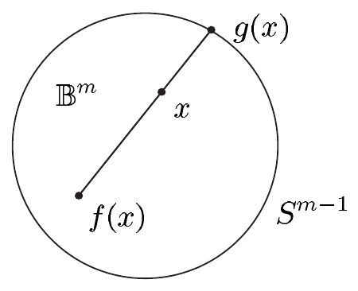

（ii）设 $ f \in C^\infty(\overline{\mathbb{B}}^m,\overline{\mathbb{B}}^m) $，并假设 $ f $ 没有不动点。则对 $ x \in \overline{\mathbb{B}}^m $，可以定义一条从 $ f(x) $ 出发且经过 $ x $ 的半射线。我们用 $ g(x) $ 表示它与 $ S^{m-1} $ 的交点。于是对 $ x \in \overline{\mathbb{B}}^m $ 有 $ g(x) = f(x) + t(x)(x - f(x)) $，其中 $ t(x) $ 表示二次方程

\[ |x - f(x)|^2 t^2 + 2t(x - f(x) \mid f(x)) + |f(x)|^2 = 1 \]

的正解。

由此可知，$ g $ 属于 $ C^\infty(\overline{\mathbb{B}}^m,\overline{\mathbb{B}}^m) $，并且满足 $ g|S^{m-1} = \operatorname{id}_{S^{m-1}} $。

现在考虑光滑映射

\[ h : I \times S^{m-1} \to S^{m-1}, \quad (t,x) \mapsto g(tx) \]

则 $ h_0 := h(0,\cdot) = g(0) $，$ h_1 := h(1,\cdot) = \operatorname{id}_{S^{m-1}} $。换言之，$ S^{m-1} $ 上的恒等映射在 $ S^{m-1} $ 中同伦于常值映射 $ h_0 $，也就是说，$ \operatorname{id}_{S^{m-1}} $ 在 $ S^{m-1} $ 中是零同伦的。因为对 $ \omega \in \Omega^{m-1}(S^{m-1}) $ 有 $ h_0^*\omega = 0 $，所以由定理 3.12 得到如下错误结论：对 $ \omega \in \Omega^{m-1}(S^{m-1}) $ 有 $ \int_{S^{m-1}} \omega = \int_{S^{m-1}} h_0^*\omega = 0 $。这表明每个 $ f \in C^\infty(\overline{\mathbb{B}}^m,\overline{\mathbb{B}}^m) $ 都至少有一个不动点。■

##### 高斯定律

除另有说明外，后文将使用以下假设与约定：

- $ (\cdot \mid \cdot) := (\cdot \mid \cdot)_M $ 是 $ M $ 上的黎曼度量；
- $ B $ 是 $ M $ 的带薄奇异集的 $ m $ 维子流形；
- $ \nu := \nu_B $ 是 $ \partial B $ 的**外法向**；
- $ \mu := \lambda_M $，$ \sigma := \lambda_{\partial B} $。

斯托克斯定理（带奇点）直接蕴涵散度定理。由于散度定理通常不以微分形式表述，它也许是斯托克斯定理最著名的推论。

3.15 定理（高斯定律，散度定理） 对满足 $ (v \mid \nu) \in \mathcal{L}_1(\partial B,\sigma) $ 的 $ v \in \mathcal{V}_c(M) $，有

\[ \int_B \operatorname{div} v\, d\mu = \int_{\partial B} (v \mid \nu)\, d\sigma. \]

证明 注 2.2(g) 给出 $ v \lrcorner \omega_M = (v \mid \nu)\omega_{\partial B} $。因此由定理 3.4，并因为 $ d(v \lrcorner \omega_M) = \operatorname{div}(v)\omega_M $，得到

\[ \begin{aligned} \int_B \operatorname{div} v\, d\mu &= \int_B \operatorname{div}(v)\omega_M = \int_B d(v \lrcorner \omega_M) \\ &= \int_{\partial B} v \lrcorner \omega_M = \int_{\partial B} (v \mid \nu)\omega_{\partial B} = \int_{\partial B} (v \mid \nu)\, d\sigma, \end{aligned} \]

这就完成了证明。■

3.16 注 （a）对 $ v \in \mathcal{V}_c(M) $，当下列情形之一成立时，$ (v \mid \nu) \in \mathcal{L}_1(\partial B,\sigma) $ 的假设自动满足：

（i）$ B = M $；

或

（ii）$ \Omega $ 是 $ M $ 中的分段光滑区域，且 $ B = \overline{\Omega} $。

证明 （i）是显然的，（ii）留给你。■

（b）（**散度的物理解释**）设 $ v \in \mathcal{V}(M) $ 且 $ p \in M $。则有关系

\[ \operatorname{div} v(p) = \lim_{\Omega \to p} \frac{\int_{\partial\Omega} (v \mid \nu)\, d\sigma}{\operatorname{vol}(\Omega)}. \tag{3.17} \]

更确切地说，这意味着：对每个 $ \varepsilon > 0 $，存在 $ p $ 在 $ M $ 中的邻域 $ U $，使得对 $ M $ 中每个满足 $ p \in \Omega \subset U $ 的相对紧分段光滑区域 $ \Omega $，都有

\[ \left| \operatorname{div} v(p) - \frac{\int_{\partial\Omega} (v \mid \nu)\, d\sigma}{\operatorname{vol}(\Omega)} \right| < \varepsilon. \tag{3.18} \]

由注 2.2(h) 可知，商

\[ \frac{\int_{\partial\Omega} (v \mid \nu)\, d\sigma}{\operatorname{vol}(\Omega)} \tag{3.19} \]

是向量场 $ v $ 通过 $ \partial\Omega $ 的单位体积通量。在特殊情形 $ v := \rho w $ 下，其中 $ \rho $ 是密度、$ w $ 是 $ M $ 中流体的速度，(3.19) 表示单位时间、单位体积内向外流过 $ \partial\Omega $ 的质量。因此在这种情形下 (3.17) 度量的是点 $ p $ 处单位时间内产生或消灭多少质量（取决于 $ \operatorname{div} v(p) $ 的符号）。由于这个原因，$ \operatorname{div} v(p) $ 也称为向量场 $ v $ 在点 $ p $ 处的**源**。特别地，若 $ \operatorname{div} v = 0 $，则称 $ v $ 是**无源的**或**无散度的**。

证明 由 $ \operatorname{div} v $ 的连续性，对每个 $ \varepsilon > 0 $ 存在 $ p $ 在 $ M $ 中的邻域 $ U $，使得

\[ |\operatorname{div} v(q) - \operatorname{div} v(p)| \le \varepsilon \quad \text{对 } q \in U. \tag{3.20} \]

设 $ \Omega $ 是 $ M $ 中满足 $ p \in \Omega \subset U $ 的相对紧分段光滑区域。则由 (3.20) 得到估计

\[ \left| \int_\Omega \operatorname{div} v\, d\mu - \operatorname{div} v(p)\operatorname{vol}(\Omega) \right| \le \int_\Omega |\operatorname{div} v - \operatorname{div} v(p)|\, d\mu \le \varepsilon \operatorname{vol}(\Omega). \]

现在由高斯定律推出 (3.18)。■

（c）（**正则性**）当 $ M $ 是 $ C^2 $ 流形、$ B $ 是带薄奇异集的分片 $ C^2 $ 子流形、$ v $ 是 $ M $ 沿 $ B $ 的 $ C^2 $ 向量场，且 $ \operatorname{div} v \in \mathcal{L}_1(M_B,\mu) $、$ (v \mid \nu) \in \mathcal{L}_1(\partial B,\sigma) $ 时，高斯定律仍然成立。■

##### 格林公式

设 $ f \in C^1(M) $。我们用 $ \partial_\nu f $ 表示 $ f $ 沿 $ B $ 的外法向的导数，即

\[ \partial_\nu f(p) := (\operatorname{grad} f(p) \mid \nu(p)) \quad \text{对 } p \in \partial B. \]

我们称 $ \partial_\nu f $ 为 $ f $ 的**法向导数**。

3.17 定理 设 $ \Omega $ 是 $ M $ 中的分段光滑区域，且 $ \overline{\Omega} = B $，$ f, g \in \mathcal{E}(M) $。定义 $ M $ 的拉普拉斯–贝尔特拉米算子 $ \Delta := \Delta_M $，则

（i）（1. 格林公式）

\[ \int_\Omega f \Delta g\, d\mu + \int_\Omega (\operatorname{grad} f \mid \operatorname{grad} g)\, d\mu = \int_{\partial\Omega} f \partial_\nu g\, d\sigma \]

若 $ f $ 或 $ g $ 有紧支集；

（ii）（2. 格林公式）

\[ \int_\Omega (f \Delta g - g \Delta f)\, d\mu = \int_{\partial\Omega} (f \partial_\nu g - g \partial_\nu f)\, d\sigma \]

若 $ f $ 与 $ g $ 有紧支集。

证明 （i）取 $ v := \operatorname{grad} g $，由于 $ \Delta = \operatorname{div} \operatorname{grad} $，该结论容易由命题 XI.6.11(ii) 与定理 3.15 推出。（ii）类似地由命题 XI.6.11(iv) 推出。■

3.18 推论

\[ \int_\Omega \Delta u\, d\mu = \int_{\partial\Omega} \partial_\nu u\, d\sigma \quad \text{对 } u \in \mathcal{E}_c(M). \]

证明 取 $ f := \mathbf{1} $，$ g := u $。■

作为应用，我们推导诺伊曼边值问题可解性的一个必要条件。

设 $ \Omega $ 是 $ \mathbb{R}^m $ 中的有界**区域**，具有**光滑边界**，即 $ \overline{\Omega} $ 是 $ \mathbb{R}^m $ 的连通紧 $ m $ 维光滑子流形。又设 $ f \in \mathcal{E}(\overline{\Omega}) $，$ g \in \mathcal{E}(\Gamma) $，其中 $ \Gamma := \partial\Omega $。所谓 $ \Omega $ 中拉普拉斯算子的**诺伊曼边值问题**，是指求函数 $ u \in \mathcal{E}(\overline{\Omega}) $ 使之满足方程

\[ -\Delta u = f \quad \text{在 } \Omega \text{ 中}, \qquad \partial_\nu u = g \quad \text{在 } \Gamma \text{ 上}. \tag{3.21} \]

这里 $ \Delta := \Delta_m $ 是 $ m $ 维拉普拉斯算子，即我们使用标准度量。

3.19 命题

（i）为使边值问题 (3.21) 可解，要求**相容性条件**

\[ \int_\Omega f\, dx + \int_\Gamma g\, d\sigma = 0 \]

得到满足。

（ii）(3.21) 的两个解 $ u, v \in \mathcal{E}(\overline{\Omega}) $ 至多相差一个常数。

证明 （i）是推论 3.18 的结论。

（ii）由 $ \Delta $ 与 $ \partial_\nu $ 的线性性可知，$ w := u - v $ 满足齐次方程

\[ -\Delta w = 0 \quad \text{在 } \Omega \text{ 中}, \qquad \partial_\nu w = 0 \quad \text{在 } \Gamma \text{ 上}. \]

于是由取 $ f := g := w $ 的第一格林公式可得

\[ \int_\Omega |\operatorname{grad} w|^2\, dx = 0. \]

由此可知 $ \operatorname{grad} w = 0 $，从而 $ w = \operatorname{const} $，正如由注 VII.3.11(c) 所知。■

显然，每个常值函数都是**齐次**诺伊曼问题

\[ -\Delta u = 0 \quad \text{在 } \Omega \text{ 中}, \qquad \partial_\nu u = 0 \quad \text{在 } \Gamma \text{ 上}. \]

的解。这意味着诺伊曼边值问题 (3.21) 从不会有唯一解。也就是说，若 $ u $ 是 (3.21) 的解，则对每个 $ c \in \mathbb{R} $，$ u + c\mathbf{1} $ 也是 (3.21) 的解。

诺伊曼问题的边界条件可以修改，从而给出另一个重要的边值问题，即**狄利克雷问题**。这就是如下问题：
