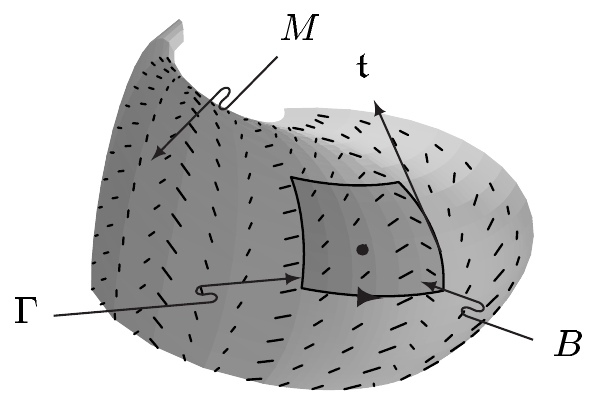
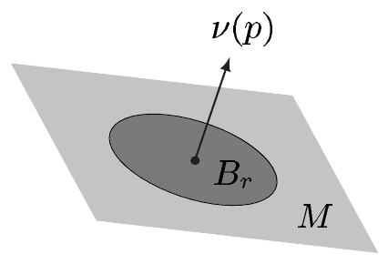

找出 $ u \in \mathcal{E}(\overline{\Omega}) $，使得

\[ -\Delta u = f \quad \text{in } \Omega, \qquad u = g \quad \text{on } \Gamma . \]

与诺伊曼问题相反，狄利克雷问题至多有一个解，如下一结果所示。

3.20 命题 齐次狄利克雷问题

\[ -\Delta u = 0 \quad \text{in } \Omega, \qquad u = 0 \quad \text{on } \Gamma \tag{3.22} \]

只有平凡解 $ u = 0 $。

证明 若 $ u \in \mathcal{E}(\overline{\Omega}) $ 解 (3.22)，则由取 $ f := g := u $ 的第一格林公式，以及 $ u $ 解此狄利克雷问题，可得 $ \int_\Omega |\operatorname{grad} u|^2 dx = 0 $，从而 $ u = \mathrm{const} $。由于 $ u|\Gamma = 0 $，这意味着 $ u = 0 $。■

偏微分方程理论证明，狄利克雷问题与诺伊曼问题都是可解的，不过后一种情形要求相容性条件得到满足。

##### 经典斯托克斯定理

照例，我们假定 $ \mathbb{R}^3 $ 带有标准度量。作为一般斯托克斯定理的特殊情形，我们现在证明它的经典版本。

3.21 定理（斯托克斯） 设 $ X $ 是 $ \mathbb{R}^3 $ 中的开集，$ M $ 是 $ X $ 中的定向曲面。又设 $ \mathbf{t} $ 是 $ \partial B $ 的正单位切向量，即 $ \partial M_B $ 的正单位切向量。则对 $ v \in \mathcal{V}_c(X) $ 且 $ (v|\mathbf{t}) \in \mathcal{L}_1(\partial M, \lambda_{\partial M}) $，有

\[ \int_B \operatorname{curl} v \cdot d\vec{F} = \int_{\partial B} v \cdot d\vec{s} \]

从而

\[ \int_B (\operatorname{curl} v|\nu)\, dF = \int_{\partial B} (v|\mathbf{t})\, ds . \]

证明 例 XI.4.13(b) 表明

\[ \operatorname{curl} v \lrcorner \omega_{\mathbb{R}^3} = (\operatorname{curl} v)^1 dy \wedge dz + (\operatorname{curl} v)^2 dz \wedge dx + (\operatorname{curl} v)^3 dx \wedge dy . \]

于是由注 2.2(e)、定义 (XI.6.24) 与定理 3.4 得到

\[ \int_B \operatorname{curl} v \cdot d\vec{F} = \int_B \operatorname{curl} v \lrcorner \omega_{\mathbb{R}^3} = \int_B d(\Theta v) = \int_{\partial B} \Theta v = \int_{\partial B} v \cdot d\vec{s} , \]

其中最后一个等式由注 2.2(c) 得出。结论的第二部分则是注 2.2(c) 与 (e) 的推论。■

3.22 注（旋度的物理解释） 积分

\[ \int_\Gamma (v|\mathbf{t})\, ds \]

称为向量场 $ v $ 沿 $ \Gamma := \partial B $ 的**环量**。在注 2.2(h) 的流体模型中，$ \int_\Gamma (\rho v|\mathbf{t})\, ds $ 是沿曲线 $ \Gamma $ 单位时间内输运的总质量的度量。

对 $ p \in M $，有

\[ \lim_{B \to p} \frac{\int_{\partial\Omega}(v|\mathbf{t})\, ds}{\operatorname{vol}(B)} = (\operatorname{curl} v|\nu)(p) , \tag{3.23} \]

其中极限按如下方式理解：对每个 $ \varepsilon > 0 $，存在 $ p $ 在 $ M $ 中的邻域 $ U $，使得

\[ \left| \frac{\int_{\partial\Omega}(v|\mathbf{t})\, ds}{\operatorname{vol}(B)} - (\operatorname{curl} v|\nu)(p) \right| < \varepsilon \]

对每个满足 $ p \in B \subset U $ 的 $ M $ 中的分段光滑区域 $ B $ 成立。(3.23) 左端的极限称为向量场 $ v $ 在点 $ p $ 处关于 $ \nu(p) $ 轴的**环量密度**（即指向 $ \nu(p) $ 方向的那个轴）。

现在为 $ M $ 选取过点 $ p $ 的定向平面，使得 $ \nu(p) $ 是 $ M $ 的正法向量。又设 $ B_r $ 是 $ M $ 中以 $ p $ 为圆心、半径为 $ r > 0 $ 的圆盘，$ \Gamma_r $ 是 $ B_r $ 的定向边界。则

\[ \lim_{r \to 0} \frac{1}{r^2\pi} \int_{\Gamma_r} (v|\mathbf{t})\, ds = (\operatorname{curl} v|\nu)(p) . \tag{3.24} \]

由于 $ \int_{\Gamma_r}(\rho v|\mathbf{t})\, ds $ 是沿定向圆周 $ \Gamma_r $ 单位时间内输运的流体量，(3.24) 表明 $ \operatorname{curl} v(p) $ 沿单位向量 $ \nu(p) $ 的分量等于关于 $ \nu(p) $ 轴的环量密度。对 $ \operatorname{curl} v(p) \neq 0 $，由柯西–施瓦茨不等式可得

\[ (\operatorname{curl} v|\nu)(p) \le |\operatorname{curl} v(p)| = \left(\operatorname{curl} v \middle| \frac{\operatorname{curl} v}{|\operatorname{curl} v|}\right)(p) . \]

因此，当关于 $ (p + \operatorname{curl} v(p)\mathbb{R}) $ 轴取环量密度时，它在点 $ p $ 处最大。\footnote{见注 XI.6.15(c)。} 基于这些理由，$ \operatorname{curl} v $ 也称为**涡量向量**。若 $ \operatorname{curl} v = 0 $，则称 $ v $ 是**无旋的**。

证明 由定理 3.21，(3.23) 可类比注 3.16(b) 的证明得到。■

##### 星算子与余微分

在本节余下的部分，设 $ g $ 是 $ M $ 上的伪黎曼度量，使得 $ \operatorname{sign}(g) $ 为常数。我们还置 $ (\cdot|\cdot)_M := g $。

下述定理是伪黎曼情形下散度定理的一般形式。

3.23 定理（散度定理） 对 $ v \in \mathcal{V}_c(M) $，

\[ \int_M \operatorname{div} v\, d\lambda_M = \int_{\partial M} \ast\Theta v . \]

证明 由定义 (XI.6.13)（它定义了散度）与注 2.2(i)，这是斯托克斯定理（定理 3.1）的直接推论。■

设 $ r \in \mathbb{N} $ 且 $ r \le m $。对 $ \alpha, \beta \in \Omega_c^r(M) $，我们置

\[ [\alpha|\beta]_M := \int_M \alpha \wedge \ast\beta . \]

3.24 注 $ [\cdot|\cdot]_M $ 是 $ \Omega_c^r(M) $ 上的非退化对称双线性型。若 $ g $ 是黎曼度量，则 $ [\cdot|\cdot]_M $ 是 $ M $ 上的标量积。

证明 由注 XI.5.11(a) 我们知道

\[ \alpha \wedge \ast\beta = \beta \wedge \ast\alpha = \operatorname{sign}(g)(\alpha|\beta)_{g,r}\omega_M . \]

结论由这一点以及 $ (\cdot|\cdot)_{g(p),r} $ 是 $ \bigwedge^r T_p^*M $ 上的内积这一事实得出。■

(b) 显然，当 $ \alpha \wedge \ast\beta $ 是 $ M $ 上可积的 m-形式时，$ [\alpha|\beta]_M $ 有定义。特别地，当 $ \alpha $ 与 $ \beta $ 属于 $ \Omega^r(M) $ 且它们支集之交为紧致集时就是这种情形。■

由斯托克斯定理，我们容易得到一般的格林积分公式：

3.25 命题 设 $ 1 \le r \le m $，$ \alpha \in \Omega_c^{r-1}(M) $，$ \beta \in \Omega_c^r(M) $。则

\[ [d\alpha|\beta]_M + [\alpha|\delta\beta]_M = [\alpha|\beta]_{\partial M} . \]

证明 由外微分的乘积法则可知

\[ d(\alpha \wedge \ast\beta) = d\alpha \wedge \ast\beta + (-1)^{r-1}\alpha \wedge d\ast\beta . \]

注 XI.5.9(d) 表明 $ d\ast\beta = (-1)^{r+1}\ast\delta\beta $。于是得到

\[ d(\alpha \wedge \ast\beta) = d\alpha \wedge \ast\beta + \alpha \wedge \ast\delta\beta . \]
